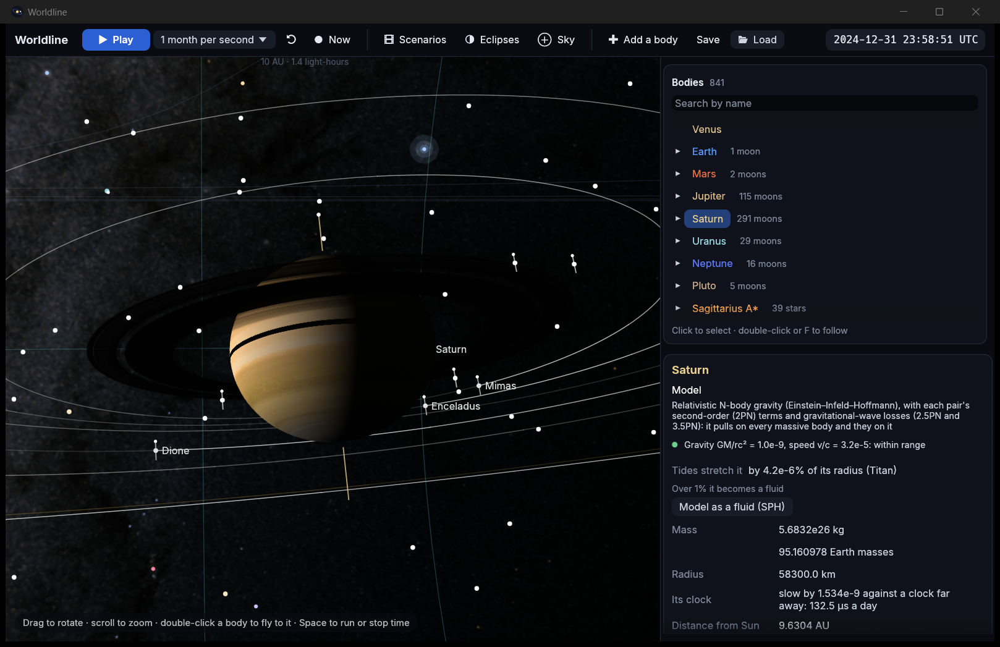
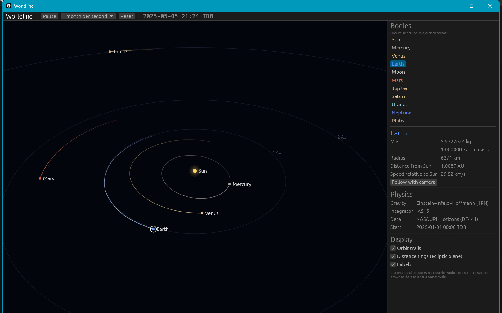
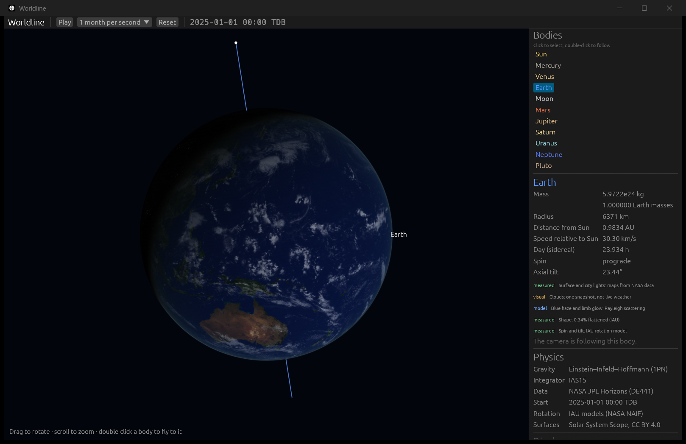
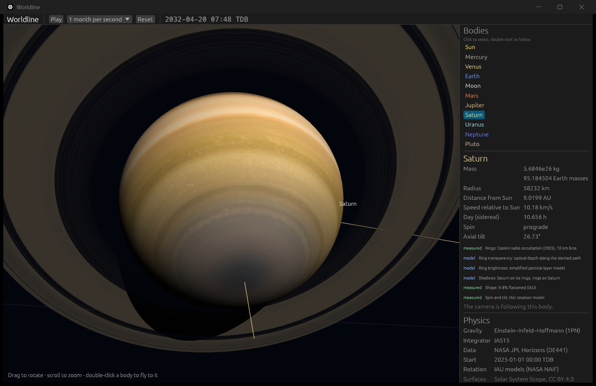
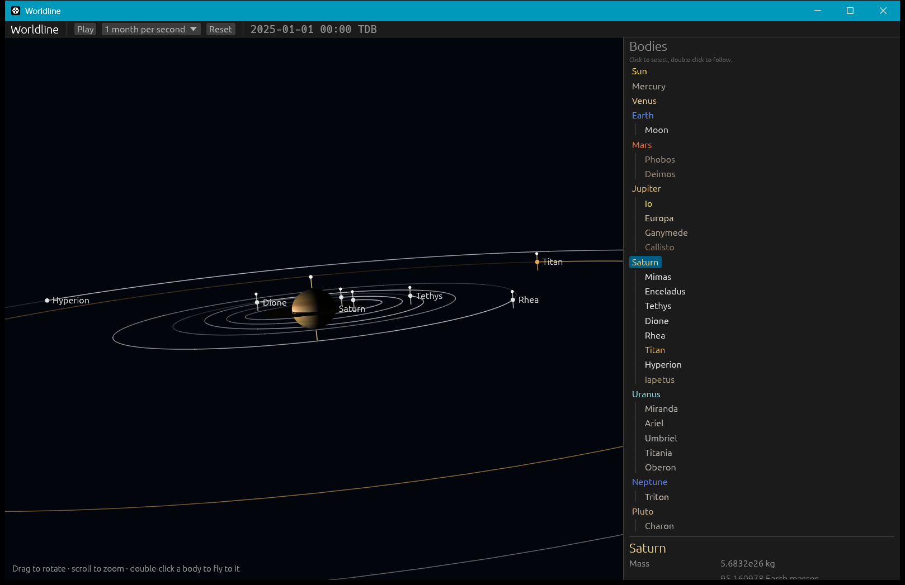
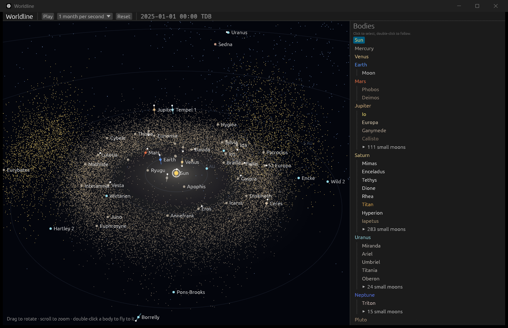
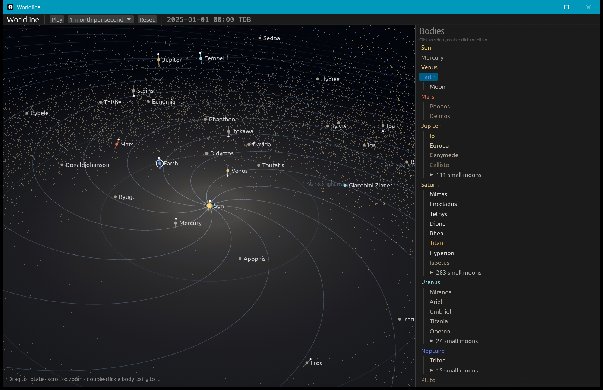
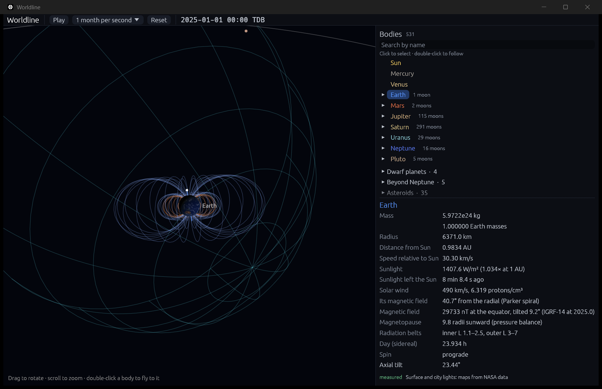
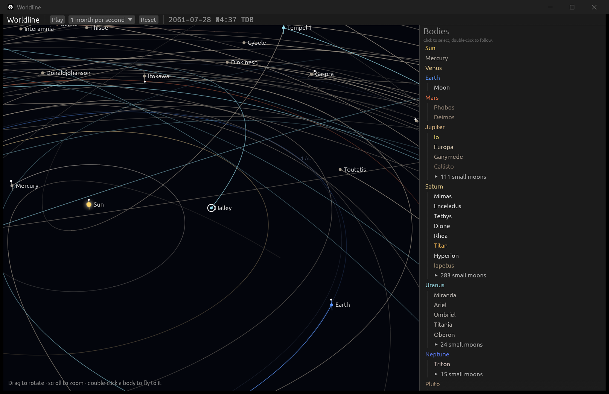

# Worldline

**A relativistic universe sandbox.** Drop black holes, neutron stars and planets into the real universe and watch general relativity play out. Every physics model is validated against theory and observation.

> **Status:** pre-alpha. The engine runs the real solar system in a 3D window, with relativistic gravity, all 459 of its known moons, 62 dwarf planets, asteroids and comets, 28,331 belt asteroids and Kuiper belt objects, the zodiacal dust, the Sun's reach (its wind, its heliosphere and its light), the planets' magnetospheres, and giant planets as self-gravitating fluids that tides stretch and tear apart. See the [roadmap](docs/ROADMAP.md).



















## What v1 will do

- Start from the real solar system (NASA JPL data) and a catalog of notable objects: Sagittarius A\*, TON 618, M87\* and the Hulse–Taylor binary pulsar.
- Add, drag and launch bodies, with time running anywhere from real time to millions of years per second.
- Simulate relativistic gravity: orbits precess, binaries spiral together by emitting gravitational waves, and black holes merge.
- Play the gravitational-wave chirp and show light bending around black holes.
- Show planets and stars torn apart by tides, and collisions in full: what they leave, debris, craters, giant impacts.
- Show the sky as it is right now, with eclipses, from space or from a place on Earth.
- Fill the Milky Way: famous stars and clusters at their real places, the rest as live dots that feel anything you add.
- Include quantum physics where it decides the outcome: white dwarf and neutron star mass limits, and Hawking evaporation.
- Always show which physics model is running, and warn when a scenario goes beyond known physics.

## Validated against reality

Each claim links the test that checks it and a plot of what that test measured, drawn automatically into [docs/validation](docs/validation/README.md). A test checks that every claim has both.

| Test | Expected | Status | Evidence |
|---|---|---|---|
| Kepler's third law (Mercury, Earth and Jupiter orbit periods) | T = 2π √(a³/GM) | ✅ passing, to 1 part in 100 million | [test](crates/worldline-core/tests/validation_kepler.rs) · [plot](docs/validation/kepler-periods.svg) |
| Energy conservation over 10,000 orbits (IAS15 integrator) | at the limit of double-precision rounding | ✅ passing, error 4 × 10⁻¹⁴ | [test](crates/worldline-core/tests/validation_ias15.rs) · [plot](docs/validation/ias15-energy.svg) |
| One year of the real solar system vs. NASA JPL | Earth within 1 part in 10,000 | ✅ passing, Earth within 0.41 km with relativity (61 km without) | [test](crates/worldline-data/tests/validation_solar_system.rs) · [plot](docs/validation/one-year-vs-jpl.svg) |
| Mercury's perihelion precession (relativistic part) | 42.9805″ per century | ✅ passing, 42.9807″ per century | [test](crates/worldline-core/tests/validation_mercury.rs) · [plot](docs/validation/mercury-perihelion.svg) |
| Planets' axial tilts (IAU rotation models plus simulated orbits) | NASA Planetary Fact Sheet | ✅ passing, all within 0.05° | [test](crates/worldline-data/tests/validation_rotation.rs) · [plot](docs/validation/axial-tilts.svg) |
| Mercury's 3:2 spin–orbit resonance | 3 spins per 2 orbits | ✅ passing, ratio 1.50000 | [test](crates/worldline-data/tests/validation_rotation.rs) · [plot](docs/validation/mercury-spin-orbit.svg) |
| The Moon keeps one face toward Earth (libration) | ±7.9° longitude, ±6.7° latitude at most | ✅ passing, −5.6° to +5.2°, −6.6° to +6.7° | [test](crates/worldline-data/tests/validation_rotation.rs) · [plot](docs/validation/moon-libration.svg) |
| Where the Sun is overhead on 1 Jan 2025, 00:00 TDB | about 23.0°S, 179°W | ✅ passing, 23.00°S, 178.76°W | [test](crates/worldline-data/tests/validation_rotation.rs) · [plot](docs/validation/sun-overhead.svg) |
| Saturn's rings edge-on to Earth | 23 March 2025 | ✅ passing, +0.73 days | [test](crates/worldline-data/tests/validation_rings.rs) · [plot](docs/validation/saturn-ring-crossings.svg) |
| Saturn's equinox (Sun crosses the ring plane) | 6 May 2025 | ✅ passing, +0.54 days | [test](crates/worldline-data/tests/validation_rings.rs) · [plot](docs/validation/saturn-ring-crossings.svg) |
| Cassini-measured ring structure vs. PDS boundaries | B ring edge 117,570 km; empty Encke Gap | ✅ passing, 117,630 km (edge oscillates ±70 km); τ = 0.000 | [test](crates/worldline-data/tests/validation_rings.rs) · [plot](docs/validation/ring-structure.svg) |
| 21 major moons after 30 days vs. NASA JPL | each within its own radius | ✅ passing, 18 within 1.6 km; worst Mimas 13 km (radius 198 km) | [test](crates/worldline-data/tests/validation_moons.rs) · [plot](docs/validation/major-moons-vs-jpl.svg) |
| Every moon in JPL's list loads | 459 | ✅ passing, 459 (1 Moon, 21 major, 437 small) | [test](crates/worldline-data/tests/validation_small_moons.rs) · [plot](docs/validation/every-moon-loads.svg) |
| Small moons after 30 days vs. NASA JPL, spot checks with measured sizes | each within its own radius | 🟨 41 of 48; 7 listed residuals (Epimetheus, four Saturn moonlets, Styx, Kerberos), 3–62 km | [test](crates/worldline-data/tests/validation_small_moons.rs) · [plot](docs/validation/small-moons-vs-jpl.svg) |
| Janus and Epimetheus trade orbits | January 2026 | ✅ passing, 30 January 2026 | [test](crates/worldline-data/tests/validation_small_moons.rs) · [plot](docs/validation/janus-epimetheus.svg) |
| Phobos and Deimos need Mars's lumpy (Tharsis) gravity | off by more than their size without it | ✅ passing, 108 and 175 km without, 0.10 and 0.28 km with | [test](crates/worldline-data/tests/validation_moons.rs) · [plot](docs/validation/mars-lumpy-gravity.svg) |
| Io–Europa–Ganymede Laplace resonance, after nudging Io | φ librates about 180° with a period of about 2071 days | ✅ passing, swings 148°–213°, period 2045 days | [test](crates/worldline-data/tests/validation_moons.rs) · [plot](docs/validation/laplace-resonance.svg) |
| The heaviest asteroids' pull brings Mars closer to JPL | smaller error with them | ✅ passing, Mars 0.19 → 0.11 km after a year (Earth 0.41 → 0.21 km) | [test](crates/worldline-data/tests/validation_small_bodies.rs) · [plot](docs/validation/asteroids-pull-on-mars.svg) |
| 62 dwarf planets, asteroids and comets after one year vs. NASA JPL | within 1 part in 10,000 | ✅ passing, 61 within 0.2 km; Bennu 2,420 km (1.5 × 10⁻⁵), a listed residual | [test](crates/worldline-data/tests/validation_small_bodies.rs) · [plot](docs/validation/small-bodies-vs-jpl.svg) |
| Halley's Comet returns | July 2061 (JPL: 28 July) | ✅ passing, 28 July 2061, 17 minutes from JPL's time | [test](crates/worldline-data/tests/validation_small_bodies.rs) · [plot](docs/validation/halley-2061.svg) |
| Kirkwood gaps in 19,971 real main-belt asteroids | gaps at Jupiter's 3:1, 5:2, 7:3 and 2:1 resonances, beyond 5σ | ✅ passing, −13.4σ, −11.8σ, −12.1σ, −17.3σ | [test](crates/worldline-data/tests/validation_belts.rs) · [plot](docs/validation/kirkwood-gaps.svg) |
| Jupiter's Trojans (4,509) | clustered 60° ahead of and behind Jupiter | ✅ passing, medians +62.0° and −61.9° | [test](crates/worldline-data/tests/validation_belts.rs) · [plot](docs/validation/trojans.svg) |
| Hildas and Plutinos crowd into 3:2 resonances (Jupiter's and Neptune's) | an excess beyond 5σ | ✅ passing, +138σ and +26σ | [test](crates/worldline-data/tests/validation_belts.rs) · [plot](docs/validation/hildas.svg) · [plot](docs/validation/plutinos.svg) |
| Zodiacal dust model (COBE) vs. Helios | brightens toward the Sun as R^−(2.3 ± 0.1) | ✅ passing, R^−2.30 to R^−2.38 | [test](crates/worldline-core/tests/validation_zodiacal.rs) · [plot](docs/validation/zodiacal-helios.svg) |
| Sunlight at 1 AU vs. NASA SORCE | 1360.8 ± 0.5 W/m² | ✅ passing, 1361.17 W/m² (2025 average at the simulated Earth: 1361.3) | [test](crates/worldline-data/tests/validation_sun_reach.rs) · [plot](docs/validation/sunlight.svg) |
| Light travel time, Sun to Earth | 8.3 minutes | ✅ passing, 8.318 min averaged over 2025, plus 53 µs of Shapiro delay | [test](crates/worldline-data/tests/validation_sun_reach.rs) · [plot](docs/validation/light-travel-time.svg) |
| Parker spiral vs. a year of solar wind measured at Earth (NASA OMNI) | agreement within 3 standard errors | ✅ passing, measured 44.3°, predicted 41.9°, daily difference +2.0° ± 1.2° | [test](crates/worldline-data/tests/validation_sun_reach.rs) · [plot](docs/validation/parker-spiral.svg) |
| Voyager heliosphere crossings, JPL positions vs. published distances | within 0.05 AU | ✅ passing, all four (94.0, 83.7, 121.6, 119.0 AU) | [test](crates/worldline-data/tests/validation_sun_reach.rs) · [plot](docs/validation/voyager-crossings.svg) |
| Earth's magnetopause from pressure balance | about 10 Earth radii sunward | ✅ passing, 9.84 Earth radii in 2025's average wind | [test](crates/worldline-data/tests/validation_magnetospheres.rs) · [plot](docs/validation/earth-magnetopause.svg) |
| Magnetopause, hour by hour through 2025, vs. Shue et al.'s fit to spacecraft crossings | within their 1.23 Earth radii scatter | ✅ passing, RMS difference 0.26 Earth radii | [test](crates/worldline-data/tests/validation_magnetospheres.rs) · [plot](docs/validation/magnetopause-2025.svg) |
| A Jupiter-mass planet dropped at 1.5 AU: energy and momentum over 10 years | conserved to the (v/c)² ≈ 4 × 10⁻⁸ of relativity | ✅ passing, 1.9 × 10⁻¹⁰ and 1.8 × 10⁻¹¹ | [test](crates/worldline-data/tests/validation_sandbox.rs) · [plot](docs/validation/jupiter-intruder.svg) |
| Save and load | lossless | ✅ passing, loads back bit for bit | [test](crates/worldline-app/src/simulation.rs) · [plot](docs/validation/save-and-load.svg) |
| Two bodies collide and merge (Newtonian gravity) | total momentum before = after | ✅ passing, to 1 × 10⁻¹⁶ (rounding) | [test](crates/worldline-core/tests/validation_collisions.rs) · [plot](docs/validation/two-planets-merge.svg) |
| A comet falling into the Sun from 1 AU at 50 km/s | caught at the surface: 618.3 km/s after 24.6177 days (energy conservation, radial Kepler orbit) | ✅ passing, 618.3 km/s after 24.6177 days | [test](crates/worldline-core/tests/validation_collisions.rs) · [plot](docs/validation/comet-into-the-sun.svg) |
| A Jupiter-mass body hits Mars (real solar system, relativistic gravity) | Mars absorbed, Phobos and Deimos freed, momentum kept | ✅ passing, moons freed by its tides first; momentum to 1.1 × 10⁻¹¹ | [test](crates/worldline-data/tests/validation_sandbox.rs) · [plot](docs/validation/intruder-hits-mars.svg) |
| Sagittarius A\*, TON 618, M87\* and PSR B1913+16 load with published masses | 4.297 × 10⁶, 10^10.82, 6.5 × 10⁹, 1.438 and 1.390 Suns | ✅ passing, exactly | [test](crates/worldline-data/tests/validation_notable_objects.rs) · [plot](docs/validation/notable-masses.svg) |
| Sirius B's gravitational redshift, from its mass and radius | 80.65 ± 0.77 km/s (Hubble) | ✅ passing, 80.70 ± 1.41 km/s | [test](crates/worldline-data/tests/validation_notable_objects.rs) · [plot](docs/validation/sirius-b-redshift.svg) |
| Sagittarius A\*'s size on the sky, from its mass and distance (stellar orbits) | 4.8 +1.4/−0.7 μas (Event Horizon Telescope image) | ✅ passing, 5.12 μas | [test](crates/worldline-data/tests/validation_notable_objects.rs) · [plot](docs/validation/black-hole-sizes.svg) |
| Hulse–Taylor pulsar's orbit turning, simulated | 4.226585°/yr measured | ✅ passing, 4.226561°/yr | [test](crates/worldline-data/tests/validation_notable_objects.rs) · [plot](docs/validation/hulse-taylor-turning.svg) |
| Hulse–Taylor pulsar's orbit shrinking from gravitational waves, simulated over 1000 orbits | −2.40 × 10⁻¹² s/s; general relativity's prediction −2.40263 × 10⁻¹² (Weisberg & Huang 2016), within mass rounding | ✅ passing, −2.40201 × 10⁻¹² (1.0σ from the measured −2.398 ± 0.004) | [test](crates/worldline-data/tests/validation_gravitational_waves.rs) · [plot](docs/validation/hulse-taylor-shrinking.svg) |
| A pair's energy loss vs. Einstein's quadrupole formula and its first correction | equal up to second post-Newtonian order | ✅ passing, 6.0 × 10⁻⁵ at GM/rc² = 0.003 (6.7 (GM/rc²)²) | [test](crates/worldline-core/src/gravity/post_newtonian.rs) · [plot](docs/validation/quadrupole-energy-loss.svg) |
| GW150914 replayed: its two black holes spiral in from 20 Hz and merge (numerical-relativity fits) | about 62 M☉, spin about 0.67; LIGO: 62 ± 4 M☉, spin 0.67 +0.05/−0.07, 3.0 ± 0.5 M☉ radiated | ✅ passing, 63.03 M☉, spin 0.683, 3.17 M☉ radiated; kick 43 km/s; rings down at 271 Hz | [test](crates/worldline-data/tests/validation_gw150914.rs) · [plot](docs/validation/gw150914.svg) |
| Two neutron stars' chirp, 20 to 40 Hz (3,927 wave cycles) | the sweep df/dt = (96/5) π^(8/3) (G𝓜/c³)^(5/3) f^(11/3), to its next order; with its first correction, to the one after | ✅ passing, 3.2 GM/rc² off the formula (2.8% at 20 Hz); 0.24% off with its correction (30 (GM/rc²)²) | [test](crates/worldline-core/tests/validation_chirp.rs) · [plot](docs/validation/chirp-sweep.svg) |
| Spacecraft maps of 12 moons, Pluto and Ceres are placed right: IAU Gazetteer landmarks | Sputnik Planitia, Cerealia Facula, Xanadu and Roncevaux Terra bright, Loki Patera dark, unlike a map turned halfway round | ✅ passing, e.g. Sputnik Planitia 158.8 against a 98.8 map average (114.0 turned) | [test](crates/worldline-app/tests/validation_maps.rs) · [plot](docs/validation/map-landmarks.svg) |
| Pluto and Charon face each other at longitude 0° (rotation models plus JPL positions) | within one map pixel, 0.176° | ✅ passing, 0.023° (NAIF's pck00011 values: 1.5°, so the New Horizons team's are used) | [test](crates/worldline-app/tests/validation_maps.rs) · [plot](docs/validation/pluto-charon.svg) |
| A black hole of 10 Suns falls into the Sun | survives as 11 Suns with a 32.5 km horizon, momentum kept | ✅ passing, to 4 × 10⁻¹⁷ | [test](crates/worldline-core/tests/validation_collisions.rs) · [plot](docs/validation/black-hole-into-the-sun.svg) |
| The belts as live particles vs. NASA JPL, after a year (24 sample bodies) | within 1 part in 10,000 | ✅ passing, median 2.3 × 10⁻⁶ (fixed ellipses: 1.6 × 10⁻⁴) | [test](crates/worldline-data/tests/validation_belts.rs) · [plot](docs/validation/live-belts-vs-jpl.svg) |
| A black hole of 10 Suns streaks past the asteroid belt at 0.1c | kicks match the impulse approximation 2GM/(bV), within 1.3 × 10⁻³ | ✅ passing, within 9.1 × 10⁻⁴ | [test](crates/worldline-core/tests/validation_swarm.rs) · [plot](docs/validation/black-hole-flyby.svg) |
| The star S2 around Sagittarius A\*: its orbit's relativistic turning | GRAVITY measured 0.997 ± 0.144 times general relativity's 12.2′ per orbit | ✅ passing, 12.26′ per orbit (1.005 times) | [test](crates/worldline-data/tests/validation_galactic_center.rs) · [plot](docs/validation/s2-turning.svg) |
| Sagittarius A\*'s direction in galactic coordinates | SIMBAD's l = 359.944236°, b = −0.046160°, within 0.0001° | ✅ passing, within 0.00002° | [test](crates/worldline-data/tests/validation_galactic_center.rs) · [plot](docs/validation/sagittarius-a-star-direction.svg) |
| The Milky Way's mass model (McMillan 2017), solved as his code solves it: the circular speed at 8.21 kpc, and the Sun's orbit in it | 233.1 km/s; McMillan's published orbit (8.120 to 9.185 kpc out, up to 104 pc from the plane) within his code's grid precision, 4 × 10⁻⁵ | ✅ passing, 233.109 km/s; the orbit within 1.2 × 10⁻⁵. The real solar system: once around every 238 million years | [test](crates/worldline-core/tests/validation_milky_way.rs) · [plot](docs/validation/milky-way-model.svg) · [plot](docs/validation/milky-way-rotation-curve.svg) |
| Light bending at the Sun's edge | 1.75″ | ✅ passing, 1.7512013″ (Einstein's 4GM/c²R plus the next order, exactly) | [test](crates/worldline-core/tests/validation_lensing.rs) · [plot](docs/validation/sun-light-bending.svg) |
| Innermost stable orbit of a black hole, from orbits in its exact (Kerr) spacetime | 6 GM/c² without spin; 2.32 and 8.72 GM/c² with and against a spin of 0.9 (Bardeen, Press & Teukolsky) | ✅ passing: nudged orbits 0.5% outside keep circling, 0.5% inside plunge, at all three | [test](crates/worldline-core/tests/validation_kerr.rs) · [plot](docs/validation/kerr-isco.svg) |
| Sagittarius A\* spirals into TON 618 (extreme mass ratio, 1 : 15,000) | shrinks at the adiabatic rate of circular orbits in TON 618's spacetime, then plunges at 6 GM/c² within about ν^(−1/5) orbits | ✅ passing, 3.8 × 10⁻⁵ from the rate (8.5 to 6.5 GM/c², 3,002 years); plunge in 4.4 orbits | [test](crates/worldline-data/tests/validation_emri.rs) · [plot](docs/validation/emri.svg) |
| Shadow of a non-spinning black hole, by tracing rays through its spacetime | √27 GM/c² from afar; Synge's angle from any distance; Darwin's exact bending | ✅ passing, to 4 × 10⁻¹⁴; bending to 6 × 10⁻¹³ rad; the GPU's table within 0.006 pixel | [test](crates/worldline-core/tests/validation_lensing.rs) · [plot](docs/validation/black-hole-shadow.svg) · [plot](docs/validation/light-bending.svg) · [plot](docs/validation/bending-table.svg) |
| A planet as a fluid (SPH), left alone, stays in equilibrium | Jupiter as an n = 1 polytrope of about 1,000 particles neither collapses nor flies apart over ten dynamical times, to SPH's resolution, with Lane–Emden's structure | ✅ passing: its half-mass radius moves 0.12 smoothing lengths at most; energy kept to 4 × 10⁻⁵; with 4,000 particles within 0.17% of Lane–Emden's | [test](crates/worldline-core/tests/validation_sph.rs) · [plot](docs/validation/sph-equilibrium.svg) · [plot](docs/validation/sph-convergence.svg) |
| The same fluid on the GPU, in single precision, and as many particles as it steps smoothly | densities and forces the CPU's to the GPU's Newton tolerance (3 × 10⁻⁵, 10⁻⁴); equilibrium as on the CPU; the app at 30 frames a second or more | ✅ passing: 6 × 10⁻⁷ and 9 × 10⁻⁶ off; moves 0.07 smoothing lengths; on an Intel Iris Xe, 8,144 particles at 32–55 frames a second | [test](crates/worldline-render/tests/validation_fluid_gpu.rs) · [plot](docs/validation/gpu-fluid-forces.svg) · [plot](docs/validation/gpu-fluid-equilibrium.svg) |
| Now: the computer's clock as the simulation's time, and today's planets | the clock read back in UTC within a second; the planets on 2026-10-28, run from the 2025 snapshot, as close to JPL as step 1.3's year; Earth turned by the IERS's UT1 | ✅ passing: 0.009 s; Earth under 0.1 km off and the Moon 1.2 km (since step 5.2 added Earth's bulge), every body within 4 × 10⁻⁷ of its distance; the overhead Sun 0.006° from JPL's | [test](crates/worldline-app/src/simulation.rs) · [plot](docs/validation/now.svg) · [plot](docs/validation/planets-today.svg)<br>[test](crates/worldline-data/tests/validation_time.rs) · [plot](docs/validation/sun-overhead-ut1.svg) |
| Eclipses: every solar and lunar eclipse of 2026–2030, found in the app's own simulation run from its 2025 snapshot | all 24 of NASA's Five Millennium Canon (Espenak & Meeus) found, of the same types, at its times of greatest eclipse to the minute | ✅ passing: 24 of 24, no others, the worst 5.0 s off; γ to the canon's 4th decimal | [test](crates/worldline-app/src/simulation.rs) · [plot](docs/validation/eclipses-2026-2030.svg) |
| The Moon's shadow on Earth: the path of the total solar eclipse of 12 August 2026, in the app's own simulation run from its 2025 snapshot | the central line within a few km of NASA's tabulated path (F. Espenak), turning Earth by NASA's ΔT | ✅ passing: 0.07–0.50 km across it from Siberia to Spain, 2.37 km at sunset; l₁, l₂ and tan f match NASA's Besselian elements to 2 × 10⁻⁶ | [test](crates/worldline-app/src/simulation.rs) · [plot](docs/validation/eclipse-path-2026.svg) |
| The sky from a place on Earth: rise and set of the Sun and Moon through 2026, in the app's own simulation run from its 2025 snapshot | every one of the U.S. Naval Observatory's tables for Washington and Sydney, to the minute; the planets' altitude and azimuth within 12.5″ of JPL's | ✅ passing: all 2,870, none extra, the worst 33 s from times rounded to the minute, 98% in the same minute; planets within 9.0″ | [test](crates/worldline-app/src/simulation.rs) · [plot](docs/validation/rise-and-set.svg) · [plot](docs/validation/sky-from-a-city.svg) |
| What a collision leaves: Leinhardt & Stewart's (2012) scaling laws | their worked example; their predicted remnants to the printed digits; the disruption threshold within a factor of 2 of their fits; the largest remnant of all 189 simulations within their "about 10%" | ✅ passing: 5.33 J/kg and 14.1 m/s (5.3 and 14); all 39 definable rows; 7 of 8 thresholds, the eighth 2.08 off; median error 6.5% (8 rows of the paper's follow no stated rule, and aren't reproduced) | [test](crates/worldline-data/tests/validation_collision_outcomes.rs) · [plot](docs/validation/leinhardt-stewart-example.svg) · [plot](docs/validation/leinhardt-stewart-table-1.svg) · [plot](docs/validation/disruption-threshold.svg) · [plot](docs/validation/largest-remnants.svg) |
| What a collision throws off: the mass flies off as fragments, and the energy lost heats what's left | mass and momentum before and after equal to rounding (130 ε, or 2.9 × 10⁻¹⁴); energy accounted for to rounding | ✅ passing, in all five regimes: mass off by at most 6.0 × 10⁻¹⁵, momentum by 7.5 × 10⁻¹⁶, kinetic energy by 3.8 × 10⁻¹⁷ | [test](crates/worldline-core/tests/validation_collisions.rs) · [plot](docs/validation/debris-accounts.svg) |
| The Moon-forming impact, as planets of rock and iron in SPH | the canonical impact leaves a disk of the mass Canup's (2004) simulations find: 1.33 to 1.62 lunar masses, widened by the counting noise of the disk's particles | ✅ passing at 7,936 particles: 1.38 lunar masses. At 4,000 particles it fails, with 1.08, and convergence isn't shown | [test](crates/worldline-core/tests/validation_giant_impact.rs) · [plot](docs/validation/giant-impact.svg) |
| Crater sizes from Holsapple's scaling laws, on the globe | Meteor Crater and Chicxulub from their estimated impactors, within the published scaling's spread (a factor of two in volume) | ✅ passing: 1,095 m against 1,186 m (−8%) and 143.6 km against 180 km (−20%). At the 200 km some give Chicxulub, it's 8% past the spread | [test](crates/worldline-core/tests/validation_craters.rs) · [plot](docs/validation/meteor-crater.svg) · [plot](docs/validation/chicxulub.svg) |
| The nearest and brightest stars as full bodies, at their measured places and motions | α Centauri A and B circle each other with their measured period; Barnard's Star crosses the sky at its measured rate | ✅ passing: 79.935 years against 79.929 ± 0.013 (limit 0.019, the period's uncertainty and the rounding of its fit's other digits); within 0.0001 mas a year of Gaia's 10,393.349 ± 0.036 | [test](crates/worldline-data/tests/validation_neighbors.rs) · [plot](docs/validation/alpha-centauri-period.svg) · [plot](docs/validation/barnards-star.svg) |
| The galaxy's stars as a swarm in its potential, kicked by anything added | left alone, the swarm keeps the model's density; a black hole passing through scatters it as the impulse approximation predicts | ✅ passing: χ² 145.2 as drawn and 130.3 a galactic year on, over 137 degrees of freedom (limit 193.9); 300 kicks up to 16.58 km/s, the worst at 0.88 of what's allowed; Gaia's 21,480 stars within 50 pc at their measured places, moving on average as the Sun's motion against them says (0.93 and 0.60 standard deviations) | [test](crates/worldline-data/tests/validation_galaxy_stars.rs) · [plot](docs/validation/galaxy-swarm-density.svg)<br>[test](crates/worldline-core/tests/validation_galaxy_stars.rs) · [plot](docs/validation/galaxy-swarm-flyby.svg)<br>[test](crates/worldline-data/tests/validation_gaia_nearby_stars.rs) · [plot](docs/validation/gaia-placed.svg) · [plot](docs/validation/gaia-motions.svg) |
| Clusters, nebulae and satellite galaxies as named objects at their measured places | each at its published distance and position | ✅ passing: all 251 placed in the galaxy and measured back as published, the worst at 0.001 of what rounding allows; their galactic coordinates as their catalogues print them, to the last digit printed (the worst at 0.98 of what's allowed) | [test](crates/worldline-data/tests/validation_clusters_and_galaxies.rs) · [plot](docs/validation/deep-sky-placed.svg) · [plot](docs/validation/deep-sky-galactic.svg) |
| The galaxy's swarm drawn on the GPU, from inside and outside | from above, the drawn disk thins out with the model's scale length | ✅ passing: 2.5945 kpc drawn against McMillan's 2.6156 over 4 to 12 kpc, 0.61 of a 30,000-star sample's standard deviation (limit 3) | [test](crates/worldline-render/tests/validation_glow_gpu.rs) · [plot](docs/validation/galaxy-glow.svg) |
| A scenario library: famous events, each set up in one click | each scenario loads and plays from a menu | ✅ passing: all 12 load and play, each as a film; played to their ends, Mercury's perihelion turns 42.9806″ a century against general relativity's 42.9807″, GW150914 and GW170817 merge when their recorded chirps end (8.7 s and 173 s), and the eclipse finder goes to 12 August 2026 | [test](crates/worldline-app/src/app/scenarios.rs) · [plot](docs/validation/scenarios-load.svg) · [plot](docs/validation/scenario-mercury.svg) · [plot](docs/validation/scenarios-play-out.svg) |
| The Hulse–Taylor pulsar as a film: shots, captions and cards beside the bodies, every number on them published or measured as it plays | the turning the film measures is the 4.226585° a year Weisberg & Huang timed; every figure in its captions follows from the data | ✅ passing: 4.22552° a year measured over the film's two years, 2.5 × 10⁻⁴ under the timed rate (limit 7.2 × 10⁻⁴: the catalog's masses rounded to 0.001 Suns, and its orbit sized by Kepler's law, which relativity makes 1.5 × 10⁻⁴ slower); the measured shrinking 0.998 ± 0.002 of general relativity's | [test](crates/worldline-app/src/app/scripts.rs) · [plot](docs/validation/film-hulse-taylor.svg) |
| The double pulsar, PSR J0737−3039A/B, from its published timing | its orbit turns and shrinks as Kramer et al. (2021) measured: 16.899323° a year, −1.247782 × 10⁻¹² s/s | ✅ passing: simulated with its measured period, it turns 16.899719° a year, 2.3 × 10⁻⁵ over (limit 2.8 × 10⁻⁵: the post-Newtonian order left out, which Kramer et al. measured, and the masses' rounding); Peters & Mathews's formula for the catalog's masses gives their prediction to 3 × 10⁻⁷, and their measurement is 0.35σ from it | [test](crates/worldline-data/tests/validation_notable_objects.rs) · [test](crates/worldline-data/tests/validation_gravitational_waves.rs) · [plot](docs/validation/double-pulsar-turning.svg) · [plot](docs/validation/double-pulsar-shrinking.svg) |
| Stars drawn the color of a blackbody at their published temperatures | the CIE's own standard lamp, illuminant A (a blackbody at 2848 K), comes out with the chromaticity CIE 015 publishes, 0.44757, 0.40745 | ✅ passing: 0.447574, 0.407439 from the CIE's colour-matching functions (limits 7.9 × 10⁻⁶ and 1.3 × 10⁻⁵: the published rounding and how far the sums CIE 015 allows spread) | [test](crates/worldline-data/tests/validation_star_colors.rs) · [plot](docs/validation/star-colors.svg) |
| A neutron star up close, drawn as its own gravity bends its light | the ray grazing its surface is half of a ray Darwin's exact formula bends: 2ψ − π, from just outside the photon sphere out | ✅ passing: within 10⁻¹⁴ rad at every radius from 3.2 to 100 GM/c² (limit 10⁻¹², rounding); the Hulse–Taylor pulsar looks 1.247 times its size, 76.8% of its surface in view | [test](crates/worldline-core/tests/validation_lensing.rs) · [plot](docs/validation/neutron-star-light.svg) |
| Tidal disruption begins near r_t ≈ R(M/m)^(1/3), and the debris falls back at a rate ∝ t^(−5/3) | a Jupiter-like planet passing a star loses what Faber, Rasio & Willems's simulations found (0.58, 0.24, 0.027 and 0 at 1.2, 1.5, 1.8 and 2.2 r_t); torn right through, its debris comes back as t^(−5/3) | ✅ passing: 0.581, 0.233, 0.024, 0; t^(−1.688 ± 0.022) | [test](crates/worldline-render/tests/validation_fluid_gpu.rs) · [plot](docs/validation/faber-rasio-willems.svg) · [plot](docs/validation/fallback-rate.svg) |
| A planet stays a point until it nears its tidal radius, then becomes a fluid | a point until tides would stretch it by 1% (5.34 tidal radii for n = 1, never passed); as a fluid it stretches by the n = 1 polytrope's Love number, 15/π² − 1 = 0.520 | ✅ passing: Jupiter falling toward a black hole stops at 1.006 of that distance; the GPU fluid's Love number 0.527 with 8,000 particles; a Jupiter passing the Sun is a fluid at its closest and a point again after | [test](crates/worldline-app/src/simulation.rs) · [plot](docs/validation/point-to-fluid.svg)<br>[test](crates/worldline-render/tests/validation_fluid_gpu.rs) · [plot](docs/validation/love-number.svg) |
| A clock near a black hole runs slow by the predicted factor (proper time) | on a circular orbit at 10 GM/c², √(1 − 3GM/rc²) = 0.836660; Earth's clock against the barycenter's, the IAU's L_C = 1.48082686741 × 10⁻⁸ | ✅ passing: 0.836660026534, carried round by the engine; Earth over 10 years 4 × 10⁻¹⁴ off L_C; GPS clocks gain 38.54 µs a day | [test](crates/worldline-core/tests/validation_proper_time.rs) · [plot](docs/validation/proper-time-orbit.svg) · [plot](docs/validation/gps-clocks.svg)<br>[test](crates/worldline-app/src/simulation.rs) · [plot](docs/validation/earths-clock.svg) |
| The overlays' numbers: clock rates, tides, the shape of space, gravitational waves | GPS clocks gain 45.7 µs a day from gravity; the Moon's tide 1.10 × 10⁻⁶ m/s², 2.18 times the Sun's; a ruler from a horizon to 2 r_s reads 2.2956 r_s; GW150914 face on from 410 Mpc at 100 Hz, h = 1.62 × 10⁻²¹ | ✅ passing, each to its hand calculation; each overlay draws only when switched on | [test](crates/worldline-core/tests/validation_overlays.rs) · [plot](docs/validation/overlay-clocks.svg) · [plot](docs/validation/overlay-tides.svg) · [plot](docs/validation/overlay-space.svg) · [plot](docs/validation/overlay-waves.svg) |
| Shadow of a spinning (Kerr) black hole, and a disk around it | lopsided as Bardeen worked out: its edge made of rays spiraling toward his photon orbits; the disk brighter on the side coming toward you | ✅ passing: edge rays on his orbits to 8 × 10⁻¹¹ (at spin 0.99, edge on, from −2.25 to 6.98 GM/c² across the axis); light shifted by g = 1.27 coming toward you and 0.61 going away, 19 times brighter; the GPU's rays within a hundredth of a pixel | [test](crates/worldline-core/tests/validation_kerr_light.rs) · [plot](docs/validation/kerr-shadow.svg) · [plot](docs/validation/kerr-disk-doppler.svg) |
| Chandrasekhar limit (ideal carbon-oxygen white dwarf), from the degenerate-electron equation of state | 1.46 M☉ | ✅ passing, 1.4563 M☉; ever denser white dwarfs approach it from below, short by 1/x² | [test](crates/worldline-data/tests/validation_white_dwarfs.rs) · [plot](docs/validation/chandrasekhar-limit.svg) |
| Black holes evaporate (Hawking radiation, textbook model) | lifetimes t = 5120πG²M³/(ħc⁴); a 10⁸ kg hole in the simulation vanishes within a step of its 2.7 years | ✅ passing, to 10⁻¹²; 0.03 days late with 1-day steps | [test](crates/worldline-core/tests/validation_hawking.rs) · [plot](docs/validation/hawking-lifetimes.svg) · [plot](docs/validation/hawking-evaporation.svg) |
| Maximum mass of a neutron star, SLy equation of state (general relativity's static stars) | about 2.05 M☉ | ✅ passing, 2.048 M☉; a 1.4 M☉ star is 11.71 km (both 0.05% from Read et al.) | [test](crates/worldline-data/tests/validation_neutron_stars.rs) · [plot](docs/validation/neutron-star-maximum.svg) · [plot](docs/validation/neutron-star-mass-radius.svg) |
| Neutron stars that merge collapse at once above Bauswein et al.'s threshold | their fit within their 0.025 for all 12 of their equations of state; GW170817 (2.73 M☉) didn't, as its kilonova showed | ✅ passing, within 0.024; SLy's threshold 2.94 M☉ | [test](crates/worldline-data/tests/validation_neutron_stars.rs) · [plot](docs/validation/prompt-collapse.svg) |
| Sirius B's radius from its measured mass (ideal cold carbon-oxygen white dwarf) | 0.00803 ± 0.00011 R☉ (Joyce et al. 2018) | ✅ passing, 0.00803 R☉: 5,583 km against 5,586 (0.03σ) | [test](crates/worldline-data/tests/validation_white_dwarfs.rs) · [plot](docs/validation/sirius-b-radius.svg) |

## Run it

You need [Rust](https://rustup.rs). From the repository root:

```bash
cargo run --release
```

The first build takes a few minutes. Then:
- drag to rotate,
- scroll to zoom,
- click a body to inspect it,
- double-click a body to fly to it.

Keyboard: **Space** runs or stops time, **+** and **−** change its speed, **F** follows the selected body, **Esc** closes windows, **Ctrl+S** saves, **F3** shows frames a second, and in a film **←** and **→** skip a shot. See [docs/app.md](docs/app.md#the-interface).

On a weaker computer, start with `--quality low` (or pick **Display → Quality**): the physics is the same, less is drawn. See [docs/app.md](docs/app.md#quality-presets-step-84b).

To play one of the scenario library's famous events (Mercury's perihelion, the Hulse–Taylor pulsar, the double pulsar, GW150914, GW170817, a planet meeting a black hole, TON 618 swallowing Sagittarius A*, a white dwarf past its limit, an evaporating black hole, the next total solar eclipse, the Moon-forming impact, a black hole through the Sun's neighborhood), open **Scenarios** in the top bar, or:

```bash
cargo run --release -- --scenario gw150914
```

See [docs/scenarios.md](docs/scenarios.md) for the keys.

Every scenario plays as a film: the camera moves shot by shot, captions tell the story, and cards beside the bodies give the published measurements and what the simulation measures as it plays. The Hulse–Taylor pulsar's runs from its discovery in 1974 to the turning and shrinking of its orbit that won the 1993 Nobel Prize; the double pulsar's, to the most precise test of gravitational waves (Kramer et al. 2021):

```bash
cargo run --release -- --scenario hulse-taylor
cargo run --release -- --scenario double-pulsar
```

Stars are drawn the color of a blackbody at their published temperatures (the Sun, Sirius A and B, α Centauri A and B, Proxima), and a neutron star up close as its own gravity bends its light: bigger than it is, more than half its surface in view. The inspector lists each visual choice and whether it's measured or an illustration:

```bash
cargo run --release -- --add "PSR B1913+16 pair:30" --focus "PSR B1913+16" --zoom 6 --paused
```

To start already flown in to a body with time stopped:

```bash
cargo run --release -- --focus Earth --paused
```

To see Jupiter with its moons (`--zoom` puts the camera that many of the planet's radii away):

```bash
cargo run --release -- --focus Jupiter --zoom 40
```

To drop a Jupiter-mass planet between Earth and Mars and watch the orbits get disturbed (or use **Add a body** in the top bar, and drag to launch):

```bash
cargo run --release -- --add jupiter:1.5
```

To throw a second Earth at Earth at 30 km/s, a little off center, and watch what it leaves (`--aim` takes the speed on arrival and the impact parameter, from 0 for head-on to 1 for grazing):

```bash
cargo run --release -- --add earth:0.0003@Earth --aim 30,0.3 --focus Earth --zoom 330 --speed hour
```

To fly to α Centauri, 4.4 light-years away, and watch A and B move:

```bash
cargo run --release -- --focus "Alpha Centauri A" --zoom 4000 --pitch 85 --speed decade
```

To watch the Moon-forming impact as a fluid of rock and iron, in a window of its own (about 20 minutes for its 27 hours; a smaller number is faster and coarser):

```bash
cargo run --release -- --moon-impact 8000 --paused
```

To send Chicxulub's estimated impactor at Earth and see the crater it digs, 25 hours later in the noon Sun:

```bash
cargo run --release -- --add "Chicxulub impactor:0.002@Earth" --aim 12,0.5 --advance 0.00289 --focus Earth --zoom 1.12 --yaw -75 --pitch 39 --speed real
```

To see Saturn's rings tilted toward the Sun in 2032 (`--advance` simulates that many years before starting):

```bash
cargo run --release -- --focus Saturn --advance 7.3
```

To see and hear the gravitational-wave chirp of GW170817's neutron stars, dropped 30 AU from the Sun (`--waves` opens the waves window; press **Play**):

```bash
cargo run --release -- --add "GW170817 pair:30" --focus "GW170817 heavier star" --paused --waves
```

To watch Sagittarius A\* spiral into TON 618, 15,000 times heavier, from ten times TON 618's GM/c² away (in TON 618's exact spacetime):

```bash
cargo run --release -- --add "TON 618:6600@Sagittarius A*" --focus "Sagittarius A*" --paused --waves
```

To see the total solar eclipse of 12 August 2026 at its greatest, with its path of totality across the globe (`--eclipse 7` goes to the 7th eclipse the finder finds, after a minute or two of searching; or press **Eclipses** in the top bar and **Go to** any of the next 5 years'):

```bash
cargo run --release -- --eclipse 7
```

To stand in Reykjavík at totality on 12 August 2026 (or press **Sky** in the top bar to stand anywhere, and see when the Sun and Moon rise and set):

```bash
cargo run --release -- --stand 64.1466,-21.9426 --advance 1.611890 --paused --fov 4
```

To replay GW150914, the first black-hole merger heard (press **Play** in the top bar; after 15 to 50 seconds of computing its last orbits, the two holes merge into one):

```bash
cargo run --release -- --add "GW150914 pair:30" --focus "GW150914 heavier hole" --paused --waves
```

## Built with

Rust · wgpu · egui · data from NASA JPL and NAIF · planet textures from Solar System Scope (CC BY 4.0) · moon, Pluto and Ceres maps from USGS and NASA PDS spacecraft mosaics. See [CREDITS.md](CREDITS.md).

## Docs

- [Scope](docs/SCOPE.md): what v1 includes and excludes, and why
- [Validation plots](docs/validation/README.md): a plot for every claim above, drawn from what its test measured
- [Roadmap](docs/ROADMAP.md): milestones and steps
- [Architecture](docs/ARCHITECTURE.md): how the engine picks physics models
- [The desktop app](docs/app.md): the interface and its keyboard shortcuts, frame loop, double-precision 3D view, camera, trails and the sandbox tools
- [Scenarios](docs/scenarios.md): the library of famous events, each set up in one click, and what each checks
- [What a collision leaves](docs/physics/collision-outcomes.md): merging, partial accretion, hit-and-run and disruption, from Leinhardt & Stewart's scaling laws
- [What a collision throws off](docs/physics/debris.md): the fragments, and where every joule goes
- [Craters](docs/physics/craters.md): what a small body digs, against Meteor Crater and Chicxulub
- [Giant impacts](docs/physics/giant-impacts.md): planets of rock and iron as fluids, and the impact that left Earth a disk
- [Collisions and the model indicator](docs/physics/collisions.md): merging with momentum kept, catching fast impacts, and which physics applies where
- [Black holes, neutron stars and white dwarfs](docs/physics/compact-objects.md): the notable-objects catalog, event horizons, and what happens when they meet the solar system
- [Compact binaries and gravitational waves](docs/physics/post-newtonian.md): second-order relativity and radiation reaction for close pairs; the Hulse–Taylor orbit shrinking as measured; the chirp, seen and heard
- [Black-hole mergers](docs/physics/mergers.md): what two black holes leave when they merge, from numerical relativity; GW150914 replayed
- [Hawking evaporation](docs/physics/hawking.md): small black holes glow and evaporate (theoretical), and a mini black hole to watch do it
- [Neutron stars](docs/physics/neutron-stars.md): nuclear matter's equation of state, the heaviest a neutron star can be, and when merging ones collapse
- [White dwarfs](docs/physics/white-dwarfs.md): stars held up by quantum mechanics, the Chandrasekhar limit, and what happens past it
- [Near a black hole](docs/physics/kerr.md): motion in a black hole's exact (Kerr) spacetime, the innermost stable orbit, and Sagittarius A\* spiraling into TON 618
- [The swarm](docs/physics/swarm.md): the belts and freed small moons as live particles that feel every massive body
- [The galaxy's stars](docs/physics/galaxy-stars.md): 30,000 stars drawn in equilibrium with the galaxy's mass, and Gaia's 21,480 within 50 pc, moving in its gravity
- [Star clusters, the Orion Nebula and satellite galaxies](docs/physics/clusters-and-galaxies.md): 251 objects at their published places and motions
- [The nearest and brightest stars](docs/physics/neighbors.md): nineteen stars at their measured places and motions, α Centauri and Sirius on their orbits
- [The galactic center](docs/physics/galactic-center.md): Sagittarius A\* at its real place, and the stars that orbit it
- [Fluids (SPH)](docs/physics/sph.md): planets and stars as self-gravitating fluids of particles, and Jupiter as a polytrope that holds itself up; on the GPU, as many particles as it steps smoothly
- [Tides](docs/physics/tides.md): when a planet stops being a point and becomes a fluid, and the tides it feels as one
- [Time](docs/physics/time.md): the computer's clock turned into the simulation's time, leap seconds, and Earth turning as it really does, from the IERS
- [The sky from a place on Earth](docs/physics/sky-from-earth.md): altitude and azimuth, refraction, the horizon, and every rise and set of 2026 checked against the U.S. Naval Observatory
- [Eclipses](docs/physics/eclipses.md): the shadows of the Moon and Earth, an eclipse finder checked against NASA's canon to the second, the path of totality checked against NASA's path, and Earth's bulge pulling on the Moon
- [Tidal disruption](docs/physics/disruption.md): a planet torn apart by a black hole, how much it loses, and its debris falling back as t^(−5/3)
- [Proper time](docs/physics/proper-time.md): every body's own clock, slow near a black hole by exactly what general relativity predicts, and Earth's against the solar system's barycenter
- [Overlays](docs/physics/overlays.md): the model check across the view, how fast clocks run, tides, the shape of space around a body, and gravitational waves' crests
- [Light bent by black holes](docs/physics/lensing.md): the shadow and the starfield ray-traced around a black hole, spinning or not, with a glowing disk; the Sun's 1.75″; and the sky from Gaia and the Bright Star Catalogue
- [The Milky Way](docs/physics/milky-way.md): the galaxy's mass as a smooth model, and the solar system's 238-million-year orbit around Sagittarius A\*
- [Rendering globes](docs/rendering.md): GPU globes, precision across 12 orders of magnitude, lighting, atmospheres, and fluids drawn as their particles
- [Saturn's rings](docs/physics/saturn-rings.md): Cassini's measured profile, transparency, shadows
- [Moons](docs/physics/moons.md): hierarchical integration, planets' gravity fields, and how each residual against JPL was tracked down
- [Small moons](docs/physics/small-moons.md): every known moon, computed in detail where you look
- [Small bodies](docs/physics/small-bodies.md): dwarf planets, asteroids and comets, outgassing comets, and Halley's 2061 return
- [Integrators](docs/physics/integrators.md): IAS15, and how a 2029 asteroid flyby changed how it picks its steps
- [The belts](docs/physics/belts.md): 28,331 real orbits, and the gaps and clusters that resonances carve into them
- [Zodiacal dust](docs/physics/zodiacal-dust.md): the COBE dust model, checked against the Helios probes
- [Magnetospheres](docs/physics/magnetospheres.md): planets' measured magnetic fields, magnetopauses from pressure balance, Earth's radiation belts
- [The Sun's reach](docs/physics/sun-reach.md): sunlight, light travel time, the Parker spiral checked against a year of solar wind, and the Voyager-measured heliosphere

## License

[MIT](LICENSE)
