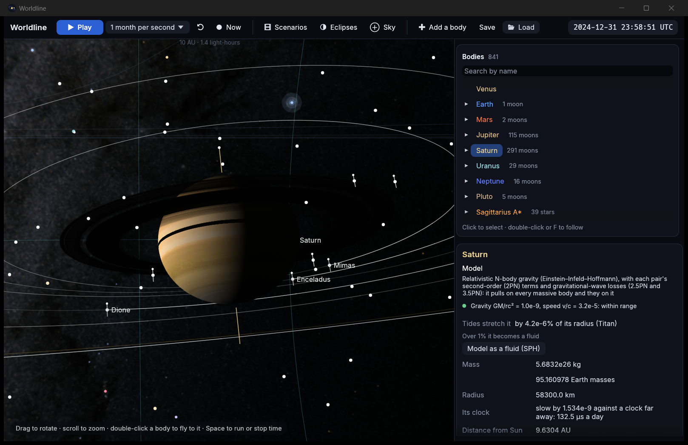
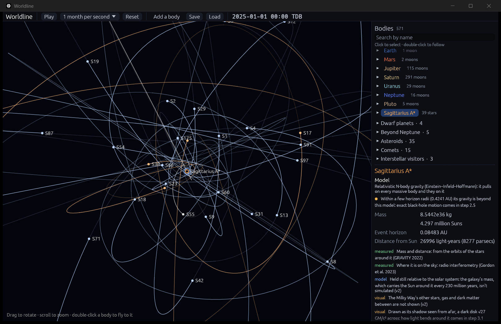
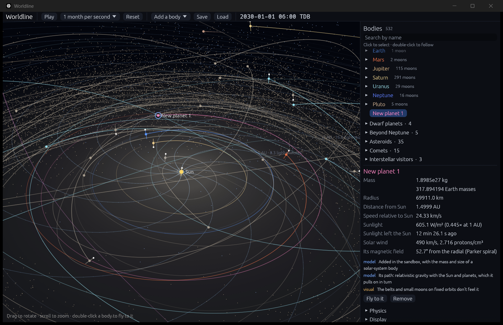
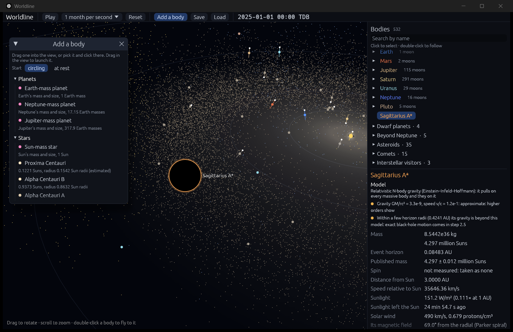

# The desktop app

**Code:** `crates/worldline-app/` · **Run:** `cargo run --release` (options: `-- --focus Jupiter --zoom 40 --pitch 20 --paused --advance 7`; `--zoom` sets how many of the focused body's radii away the camera starts, `--pitch` how many degrees above the ecliptic plane it looks from (default 34), `--overlays tides,clocks` starts with those overlays on (any of models, clocks, tides, embedding, waves and time), `--speed hour` how fast time runs (hour, day, week, month, year, decade or century per second), and `--advance` runs the physics that many years past the 2025 snapshot before the window opens)

The app is a window around the physics engine. It never does physics itself. It asks `worldline-core` to advance the simulation, then draws the result.

## Each frame

1. **Measure real time.** It measures how much real time has passed since the last frame, capped at 0.1 s so a stall (like dragging the window) doesn't cause a jump.
2. **Advance the physics.** It advances by *speed × real time*. Each step runs the whole hierarchy: relativistic gravity for the Sun and planets, then each planet's moon system in its own frame (see [physics/moons.md](physics/moons.md)). These are the same models the validation tests check. After each step the app copies positions into one flat list of bodies: the Sun and planets in the snapshot's order, then the moons. A planet with moons stands in for its system's barycenter.
3. **Respect a time budget.** Physics starts no new step once 12 ms of the frame have passed. If the chosen speed needs more, the simulation runs slower than requested and the top bar shows an amber chip with the percentage achieved. **Worldline never takes bigger, less accurate steps to keep up.** Accuracy wins over speed, and the app says so when that happens. The budget is checked between steps, though, and a single step of the whole solar system can take longer: in the default view, on an Intel Iris Xe, a step takes 12 to 17 ms (see "Where a frame's time goes", below).
4. **Point the camera.** The camera moves to the body it is following.
5. **Draw.** It draws the panels and the 3D view: rings and trails at the back, textured globes from the GPU in the middle, dots and labels in front. See [rendering.md](rendering.md).

## The interface

Step 8.3 gave the app its current look and feel.

**The look** (`theme.rs`):
- **Type.** Text is set in [Inter](https://github.com/rsms/inter), a typeface made for screens: Regular for text, SemiBold for titles and the primary button. egui's own fonts follow it for anything Inter lacks (arrows, symbols, the icons). A test reads every string the app's code writes and fails if any character would show as an empty box.
- **Color.** A deep blue-black, so the sky stays the brightest thing on screen; three steps of surface (panels, cards and windows, buttons); one blue accent for what's selected or open. A model's verdict keeps its green, amber and red.
- **Shape.** The inspector groups things in rounded cards. Floating windows cast soft shadows. The window has its own icon, drawn in code: an orbit around a star.

**The top bar**, left to right:
- **Time:** run or stop it (the blue button), how fast, ⟲ back to 1 January 2025, ● Now (the present, with the computer's clock).
- **Exploring:** 🎞 Scenarios, ◑ Eclipses, ⊕ Sky. A tool whose window is open is highlighted.
- **Building:** ✚ Add a body, Save, Load.
- **On the right:** the clock in UTC (hover for TDB and Earth's rotation), and chips for what's happening: "● live", a note when time can't run as asked ("⚠ 13% of the speed", the full reason on hovering). Since step 8.4c, the ☰ menu beside the exploring tools lists every window, and the last event shows as a notice over the view (both below).

In a window narrower than 1,200 points the exploring tools show their icons alone, their names on hovering.

**Every window, in one menu.** ☰ in the top bar lists every window: Scenarios, Eclipses, Sky from a place, Add a body, Gravitational waves and the Moon-forming impact, each with what it's for on hovering. One that needs something first is greyed out and says what on hovering: the waves window, a pair of neutron stars or black holes selected (since step 8.4c). Some open from elsewhere too (the waves window from a pair's panel, the impact from Earth's), but here they can all be found, with the keys below.

**What happened, said at the top of the view.** The last thing that happened shows for six seconds as a notice at the top of the view, wrapped to fit: a scenario started and what it opened ("Playing: GW150914: two black holes merge; it opened the gravitational-waves window"), a body added, the sandbox saved, a planet becoming a fluid. It used to be a chip at the end of the top bar, where a narrow window cut it to "…".

**The manual** (since step 8.6). **?** in the top bar, F1, or **Manual** in the ☰ menu opens it; `--manual` opens it at the start. Its seven chapters lead a newcomer from the first launch to every feature:
1. getting started;
2. the controls;
3. the view;
4. every window and tool;
5. the scenarios;
6. each physics model with its limits;
7. where the numbers come from.

Its **▶** buttons do what they say: fly to Saturn, open the scenarios, play a film. On a first launch with nothing else asked for, the notice at the top of the view says where it is.

It's written as plain text, `crates/worldline-app/assets/manual.md`, in a little Markdown (`manual.rs` reads and draws it). Its tests keep it complete as the app grows:
- every physics model's page in `docs/physics` is named, with its limits, in its physics chapter;
- every key is in it;
- every scenario has a button, and every window the ☰ menu lists is named;
- every button does something that exists;
- every character it shows has a glyph;
- every chapter draws, off-screen.

**How a star is drawn** (since step 8.5b). The inspector lists, for a star, white dwarf or neutron star, each visual choice and whether it's measured or an illustration: its color (a blackbody's at its published temperature, see [star-colors.md](physics/star-colors.md)), and for a neutron star its size up close and how much of its surface shows (its gravity bends its light, see [lensing.md](physics/lensing.md#a-neutron-stars-own-light-step-85b)), the grid drawn on it, and a pulsar's radio beams.

**Films** (since step 8.5a). A scenario with a film plays as one: shots, captions, cards beside the bodies, and a bar at the bottom to pause, skip and leave it. See [scenarios.md](scenarios.md#films-step-85a).

**Keyboard shortcuts** (`feel.rs`), ignored while typing in a field:

| Key | Does |
|---|---|
| Space | Run or stop time |
| + or ] | The next speed up |
| − or [ | The next speed down |
| F | Fly to the selected body and follow it |
| Esc | Close the open windows (while adding bodies: stop adding) |
| Ctrl+S | Save the sandbox |
| F3 | Show or hide the frame's timings |
| F1 | Open or close the manual |
| → | A film's next shot |
| ← | Back to a film's shot's start, or the one before within its first two seconds |

**The camera glides.** Let go of a drag and the view carries on turning, slowing by e every 0.16 s, so a flick spins it and a drag held still stops dead. A flick at 600 points a second glides as far as the pointer moves in 0.16 s at that speed, 96 points, however fast frames come. Clicking stops it.

**The frame's timings.** F3, **Display → Frame timings** or `--timings` shows, over the view's top right, as running means over about a quarter second:
- frames a second, and how long a frame takes;
- the physics's and the interface's share of it, and of the interface, drawing the view;
- the physics in parts: the solar system's steps a frame and their time (with the longest step lately), catching the galactic center up, and carrying the belts to now for drawing.

### Where a frame's time goes (step 8.4)

Measured with those timings, the default view (the solar system, a month a second) was held up by physics, not the interface:
- **The planets' step:** 7 to 10 ms. Their gravity worked out every pair's second-order and radiation terms, 1,056 of them for 33 bodies, though nearly all are far below the last digit of what they're added to. Each is now bounded first and left out if double precision couldn't hold it, so no acceleration changes by more than its last digit (see [physics/post-newtonian.md](physics/post-newtonian.md)): 4 ms.
- **The moon systems and the small bodies:** one after another on one core. They don't depend on each other, so they now run side by side on threads of their own, with the same results (see [physics/moons.md](physics/moons.md)).
- **The belts' swarm:** every 64 simulated days its 28,331 particles took their step in one go, holding up that frame for 70 to 180 ms: a stutter every two seconds. The step now runs on a thread of its own while the planets carry on, and is taken in once done, with the same result (see [physics/swarm.md](physics/swarm.md)).

Before and after, alternating runs on an Intel Iris Xe (12 threads):

| The default view | Frames a second | A frame | Physics | Interface | The longest frame |
|---|---|---|---|---|---|
| Before (step 8.3) | 15 to 18 | 54 to 65 ms | 35 to 44 ms | 14 to 16 ms | 128 to 180 ms |
| After | 23 | 43 to 44 ms | 22 to 24 ms | 14 to 16 ms | about 45 ms |

The longest frames are from a headless run of the physics alone (`cargo test --release -p worldline-app --bin worldline -- --ignored --nocapture where_the_default_views_physics_time_goes`), which prints each frame over 40 ms and what it spent the time on. Its companion, `how_long_the_top_levels_gravity_takes`, times the top level's gravity with every pair term and without those left out.

### Quality presets (step 8.4b)

**Display → Quality** picks how much is drawn, for weaker computers: Auto, Low, Medium or High. The physics is the same at every preset; only the drawing changes. Or start with `--quality low` (or `medium`, `high`).

| | Low | Medium | High |
|---|---|---|---|
| The sky and the globes, as a fraction of the screen's resolution | 1/2 | 3/4 | 1 |
| Rays traced near a black hole | 1/4 | 0.35 | 1/2 |
| The galaxy's glow, at most | 1/5 | 1/4 | 1/3 |
| The belts' asteroids drawn, and carried to now for drawing | 1 in 4 | 1 in 2 | all |
| The planets' surface maps on the GPU | 1K | 2K | 2K |

**Auto** picks from the GPU and the processor:
- **High:** a discrete GPU, or a newer integrated one with 8 or more processor threads (an Intel Iris Xe laptop like the owner's).
- **Medium:** other integrated GPUs, Intel's HD and UHD Graphics among them.
- **Low:** software rendering, a virtual GPU, or 4 processor threads or fewer with anything but a discrete GPU.

The fluid needs no preset: it already finds this GPU's particle budget by trial (step 4.2).

**Measured** on the Intel Iris Xe, 1,600 × 1,000 pixels, frames uncapped (`--no-vsync`), each run measuring itself (`--measure 21`: the last two thirds of 21 seconds, then it prints and closes):

| The default view, a day a second | Frames a second | A frame | Physics | Interface (the view) |
|---|---|---|---|---|
| High (three runs) | 65 to 71 | 14.1 to 15.5 ms | 6.6 to 7.0 ms | 5.1 to 6.3 ms (3.7 to 4.5) |
| Medium (two) | 77 to 81 | 12.3 to 13.0 ms | 5.6 to 5.9 ms | 4.6 to 4.8 ms (2.9 to 3.0) |
| Low (three) | 92 to 96 | 10.4 to 10.9 ms | 4.9 to 5.0 ms | 3.8 to 4.1 ms (2.2 to 2.3) |

On this computer the gain is the belts: fewer asteroids carried to now (the physics's share) and drawn (the view's). Drawing the sky and the globes is cheap on it: with time stopped, a frame takes 8 to 9 ms at every preset, 2 to 3 ms of it the GPU's, so their resolution barely shows. They're for weaker GPUs, where that share grows with the number of pixels: Low draws a quarter as many. That hasn't been measured on a weaker computer yet.

**Memory:** 430 to 470 MB at every preset, much of it the simulation's own (28,331 belt bodies, 30,000 of the galaxy's stars and Gaia's 21,480, the catalogues) and the GPU driver's. A surface map takes 8 MB on the GPU at 2K and 2 MB at 1K, so Low saves 6 MB for each body seen up close.

**Starting:** the first frame comes 1.6 to 1.9 s after the program starts.

## The 3D view

- **Projected in double precision.** Every position is taken relative to the camera in double precision, and only the final screen coordinates become single precision. GPUs work in single precision (about 7 digits), which can't place Neptune (4.5 × 10¹² m out) to better than about a kilometer. Projecting relative to the camera keeps positions precise at any zoom; a unit test nudges a body 30 AU out by 1 km and checks that it moves on screen by exactly the right amount.
- **Drawing.** egui's painter draws the shapes, rendering through wgpu: rings, trails, bodies and labels. The GPU draws the globes and the sky, which is ray-traced around a black hole (see [rendering.md](rendering.md)).
- **To scale.** Distances and positions are true. Bodies are drawn at their true size when that's visible; otherwise as dots at least 3 points wide, and the app says so in the Display panel.
- **Camera.** It orbits a target, with "up" pointing to ecliptic north, so prograde orbits run counterclockwise seen from above. Drag rotates and scroll zooms, down to 1.1 radii from a body's center. Double-clicking a body (or pressing *Fly to it*) flies the camera there in 1.2 s, ending 4 radii out so the globe fills most of the view. The fly-in eases in and out, and zooms evenly in scale, so going from 4 AU to 25,000 km looks smooth.
- **Trails.** Each trail keeps about one orbit of path, measured as one circle's length at the body's distance from the barycenter, so Mercury and Neptune both show one loop. Trails are drawn in the barycentric frame, and they fade from old to new.
- **A pair's trail** (since step 8.5b). A body bound to another whose orbit around their center of mass is far smaller than its distance from the barycenter (more than 10 times smaller, let go under 5) keeps its trail around that center of mass instead, and keeps its whole ellipse: Ramanujan's length for it, a twentieth more so it closes. Without this, a pair 30 AU out added a point only every 0.26 AU, ten times its whole orbit, and recorded nothing of it; so did α Centauri A and B, and the planets of a Sun a black hole has flung across space. The Sun's own planets are unaffected: their orbits are about as big as their distances. A trail that switches to another center starts afresh. A physics step can carry a body farther than the trail's point spacing (about half a degree of arc as seen from the barycenter), especially in the outer solar system. Then the points in between are filled in by cubic Hermite interpolation from the positions and velocities at both ends of the step. This only smooths the drawing; the physics never uses trails.
- **Moons.** A moon can circle its planet several times between physics steps (Phobos takes 7.7 hours), too fast for a recorded trail. So each moon shows its *osculating orbit* instead: the ellipse it would follow if only its planet pulled on it, computed from its current position and velocity. It fades toward the moon like a trail. Moons appear only around the planet in focus: the planet the camera follows, the planet of the moon it follows, or the planet whose Hill sphere around the Sun holds the body it follows (a body dropped among Saturn's moons brings them into view, and into detail). A selected moon shows too. Every other planet stays a single clean dot, so hundreds of moons' labels and orbits don't bury the view. Jupiter alone has 115 moons, spread over 0.2 AU. Even around the focused planet, a moon and its orbit appear only once the view resolves them: when its distance from its planet, on screen, clears the planet's dot or globe.
- **Names.** Zoomed out, hundreds of names would bury the view, so only these bodies are named:
  - the body the camera follows and the selected one;
  - the one under the pointer, which also gets a faint ring, and the cursor turns into a hand;
  - any body close enough to be drawn as a globe;
  - the major moons of the planet in focus, which appear only once the view resolves their orbits.

  A name is skipped if it would overlap one already placed. The Voyager crossing markers are named when the pointer is on them.
- **Spin axes.** Each body gets a line along its spin axis, from the IAU rotation models. A white dot marks the end the spin points toward (right-hand rule), so Venus's dot points down. The inspector shows each body's sidereal day, spin direction and axial tilt. See [physics/rotation.md](physics/rotation.md).
- **Details and their kind.** The inspector lists what's shown up close for the selected body, each tagged **measured** (observed data), **model** (a physics model) or **visual** (a visual aid or simplification). See [rendering.md](rendering.md).
- **Small moons and focus.** All 459 known moons are in the list. Flying to a planet, or to any of its moons, switches that planet's small moons to detailed simulation. Every other small moon rides an approximate orbit, and the inspector says which it is. A small moon shows its orbit only while selected, since hundreds of ellipses would hide everything else. A moon whose size hasn't been measured is drawn as a dot, and the camera flies to 1,000 km from it. See [physics/small-moons.md](physics/small-moons.md).
- **The side panel** has two parts, so its controls never scroll out of reach:
  - **The body list,** at the top, in its own scrolling frame (at most about 40% of the panel's height), with a search box above it. It is a tree:
    - each planet folds open to its moons, with the count beside its name;
    - the small moons fold once more;
    - collapsible groups hold the dwarf planets, the bodies beyond Neptune, the asteroids, the comets and the interstellar visitors.

    Typing in the search box shows a flat list of matching names. Picking a body in the 3D view opens its branch and scrolls the list to it.
  - **Below the list,** always in view: the selected body's details, then collapsible Physics and Display sections. The Display options explain themselves in tooltips.
- **The look.** A quiet dark theme (`theme.rs`), so the sky stays the brightest thing on screen. One soft blue accent marks the selection; labels in the inspector are muted so the values stand out.
- **The sky.** Behind everything is the Milky Way as ESA's Gaia mapped it, with the 9,096 stars of the Yale Bright Star Catalogue at their places, as seen from the solar system. Near a black hole it is bent as light really bends there (see [physics/lensing.md](physics/lensing.md)). It can be switched off in the Display panel (Starfield).
- **The accretion disk.** Within 10,000 GM/c² of the black hole bending the view, a thin glowing disk is drawn around it, visual only: its light bent and shifted as general relativity predicts, brightest on the side coming toward you. The Display panel's *Accretion disk* option turns it off; with the starfield off, the hole and its disk are drawn on black.
- **Belts and dust.** The asteroid belt, Jupiter's Trojans and the Kuiper belt (28,331 real orbits) are drawn as tiny squares: tan, gold and ice blue. Their positions come from fixed ellipses, refreshed once per frame on all cores (about 3.4 ms of work in total). The zodiacal dust is a faint warm glow in its tilted plane, with brightness from the COBE model on a log scale. Both show only when the camera is more than 0.05 AU from what it looks at, so zoomed in on a planet they don't sprinkle false stars across the sky. Both can be switched off in the Display panel. See [physics/belts.md](physics/belts.md) and [physics/zodiacal-dust.md](physics/zodiacal-dust.md).
- **The Sun's reach.** With the Sun in focus, the solar wind's magnetic field is drawn as 12 Parker spiral lines that turn with the Sun. From outside the termination shock, the heliosphere's two boundaries appear as faint wireframes, with the four Voyager crossings marked. The distance rings are labeled in light-time as well as AU. For any selected body, the inspector shows its sunlight (W/m²), how long ago that light left the Sun's surface (including gravity's Shapiro delay), and the solar wind there: speed, density and field angle, or whether the body lies beyond the wind. See [physics/sun-reach.md](physics/sun-reach.md).
- **Magnetospheres.** With a magnetized planet in focus, its magnetopause appears as a wireframe. Its nose sits where the planet's dipole balances 2025's average solar wind, and it points into the wind as the moving planet meets it. Earth also shows its two radiation belts, traced along dipole field lines around its tilted magnetic axis. The inspector gives the planet's field, its tilt and source model, the magnetopause distance and, for Earth, the belts' extent; for Venus and Mars, it explains they have none. See [physics/magnetospheres.md](physics/magnetospheres.md).
- **Small bodies** are drawn as dots in a color for their kind: comets pale blue, interstellar visitors magenta, and the rest in shades of tan and gray-brown. The inspector says whether a body pulls on the planets or only follows them, and whether it feels outgassing or the Yarkovsky push. See [physics/small-bodies.md](physics/small-bodies.md). For a moon, the inspector gives its distance and speed relative to its planet, and its axial tilt relative to its orbit around the planet. The Physics panel names both gravity models: the one between the planets and the one inside moon systems.
- **Dates.** The top bar shows the simulation's time as a date and time in UTC, to the second, the time people's clocks keep. Hovering shows TDB, the time scale JPL and the simulation use, with ΔT, UT1 − UTC and the leap seconds (see [physics/time.md](physics/time.md)). The calendar is Meeus's Julian Date algorithm.
- **Now.** **Now** in the top bar (or `--now`) shows the solar system as it is at this moment. It starts again from the 2025 snapshot and catches up to the computer's clock, about 7 seconds of computing, with the top bar showing the date reached. Then it runs in real time with the clock, marked **live**. Pausing, another speed, Reset or Load leave it. **Real time**, one second a second, is also among the speeds (`--speed real`).
- **The sky from a place.** **Sky** in the top bar (or `--sky`) opens a window with a place on Earth, the altitude and azimuth of the Sun, Moon and planets there, and the next sunrise, sunset, moonrise and moonset, found by a copy of the simulation run 8 days ahead on its own thread. **Stand here** (or `--stand LAT,LON`) puts the camera on the ground: drag to look around and scroll to zoom. The sky stays the GPU's starfield, and the camera's own zenith becomes up. The Sun, Moon with its phase, planets, ground and compass are drawn over it. No globes are drawn from there. See [physics/sky-from-earth.md](physics/sky-from-earth.md).
- **Collisions.** Where Leinhardt & Stewart's scaling laws cover a collision, it leaves what they say: a merger, a remnant and fragments, or two bodies flying on. Anything else merges. The message at the end of the top bar says what happened, and the inspector shows it for the body that took it: regime, what's left, what was thrown off, the heat and the speeds that matter. Fragments are orange dots that go on orbiting, and a body takes back the mass of any that fall on it. A body too small for those laws digs a crater, drawn to scale on the globe, with a ring around it when it's too small to see, and the inspector gives its size and the law's spread. See [physics/collision-outcomes.md](physics/collision-outcomes.md), [physics/debris.md](physics/debris.md) and [physics/craters.md](physics/craters.md).
- **Messages.** They come last in the top bar and shorten to the room that's left, the rest on hovering, so a long one can't push the clock away.
- **Eclipses.** **Eclipses** in the top bar (or `--eclipses`) opens the eclipse finder. It runs a copy of the simulation 5 years ahead on its own thread, from the moment it opens, so the app keeps running smoothly. Eclipses are listed as they are found, about a year of search every 15 to 20 seconds: the time of greatest eclipse in UTC (TDB on hovering), the type, γ and the magnitude. **Go to** jumps to an eclipse at its greatest, paused and set to an hour a second, with the camera looking down on the shadow for a solar eclipse or on the Moon for a lunar one. The window closes out of the way and keeps its list. The finder keeps a save of each moment, so the jump is quick. `--eclipse 7` goes to the 7th eclipse found, once found. **Search again from now** starts over, for a simulation that has changed. With Earth or the Moon in focus, the view draws both bodies' shadows: the umbra in red and the penumbra in amber, each ringed where it passes the other body (Display: *Shadows of the Moon and Earth*). On Earth's globe the same option draws where the Moon's shadow falls now, and, once the finder has reached that eclipse, its path of totality. See [physics/eclipses.md](physics/eclipses.md).

## The galactic center

Sagittarius A\*, the Milky Way's central black hole, is in the body list with its 39 stars, at its real place: 8,277 pc away, in its true direction on the sky. Double-click it to fly there; the camera climbs out from the solar system and comes back in, framing the stars. The camera can zoom out to about 300 kpc, far enough to see both at once.
- **Its stars** are colored by type: young, hot ones blue-white, cool giants orange. They show, with their orbits, around Sagittarius A\* in focus, like a planet's moons.
- **The inspector** gives its distance in light-years and parsecs, and labels what's measured and what isn't simulated.
- **The galaxy between** is a smooth mass model (McMillan 2017). It carries the solar system around the center every 238 million years, so the region drifts past the solar system at about 252 km/s.
  - **The Sun's inspector** gives that orbit: how far out it goes and how far from the galactic plane.
  - **Zoomed out past 10,000 AU,** the view draws the solar system's path for the next galactic year, a loop around Sagittarius A\*. `cargo run --release -- --focus Sun --zoom 2.2e12 --paused` frames it.
  - See [physics/milky-way.md](physics/milky-way.md).
- **Dropped bodies:** anything dropped near it, from the catalogue, joins its region and feels it.

## Clusters, nebulae and satellite galaxies

The galaxy's famous objects are bodies in the list, each where its catalogue measured it and moving in the galaxy's gravity with its swarm of stars: 28 open clusters (the Pleiades, the Hyades and the Messier ones), the Orion Nebula, 166 globular clusters and 56 satellite galaxies, the Magellanic Clouds among them. Each is a soft disk the size of its half-light radius with a dot at its center, colored by kind. Selecting one shows its mass and size where its catalogue gives them, how far it is, and its published distance and motion. See [physics/clusters-and-galaxies.md](physics/clusters-and-galaxies.md).

## The galaxy's stars

From 100 parsecs out, the galaxy's stars are drawn: 30,000 dots, each standing for 1.82 million Suns of McMillan's (2017) model, bluish white in the thin disk, pale yellow in the thick disk and orange in the bulge. They move in the galaxy's gravity and feel anything heavy dropped among them, so a black hole passing through scatters them. From a parsec out, Gaia's 21,480 measured stars within 50 pc of the Sun are drawn too, in white. Out among the galaxy's stars, more than 100 pc from the solar system and the galactic center, the swarm is drawn as light instead of dots, and by 1 kpc out it takes the place of the starfield, which is the sky as seen from the solar system ("The galaxy's glow" under Display). See [physics/galaxy-stars.md](physics/galaxy-stars.md) and [rendering.md](rendering.md#the-galaxys-glow).

## The nearest and brightest stars

Nineteen stars are bodies, listed under **Nearby stars**: the nearest, like Proxima Centauri, α Centauri A and B and Barnard's Star, and the brightest, like Sirius, Vega and Betelgeuse. They move as Gaia or Hipparcos measured them and pull on each other, and anything dropped near one joins them. The inspector shows each one's distance, what measured it, its parallax, how fast it crosses the sky and comes toward us, and where its mass and radius were published. See [physics/neighbors.md](physics/neighbors.md).

See [physics/galactic-center.md](physics/galactic-center.md).

## Scenarios

**Scenarios** in the top bar opens the library: eleven famous events and experiments, from Mercury's perihelion to GW150914 and a black hole through the Sun's neighborhood. **Play** sets one up afresh from the 2025 solar system, replacing what's running: its bodies, its view, its speed and any window it needs. `--scenario KEY` plays one from the command line. See [scenarios.md](scenarios.md).

## Sandbox tools

**Select and inspect.** Click a body to select it; the inspector shows what is known about it. Double-click it to fly to it.

**The catalogue.** **Add a body** in the top bar opens the catalogue: 30 entries in seven groups, each with its mass and size. Hover over one to see where the real one is and where its values were published. The entries are:
- **Planets:** copies of Earth, Neptune and Jupiter.
- **Stars:** a Sun-mass copy, Proxima Centauri, Alpha Centauri A and B, and Sirius A.
- **White dwarfs:** Sirius B. The inspector shows Chandrasekhar's limit and the radius an ideal white dwarf of its mass has; one that grows in a merger shrinks to that radius, and one pushed past the limit explodes (see [physics/white-dwarfs.md](physics/white-dwarfs.md)).
- **Neutron stars:** the Hulse–Taylor pulsar and its companion, two NICER pulsars, and GW170817's pair. The inspector shows the heaviest a neutron star can be and the radius for its mass (SLy); one that grows takes that radius, and one pushed past the maximum collapses into a black hole (see [physics/neutron-stars.md](physics/neutron-stars.md)).
- **Black holes:** from Gaia BH1 (9.6 Suns) up to Sagittarius A\*, M87\* and TON 618 (66 billion Suns), and a hypothetical mini black hole of 10⁸ kg that evaporates by Hawking radiation in 2.7 years (see [physics/hawking.md](physics/hawking.md)).
- **Binaries:** the Hulse–Taylor pair, together on its measured 7.75-hour orbit; GW170817's neutron stars and GW150914's black holes, on the circular orbits whose waves are at 20 Hz, about 3 minutes and under a second before they merge.
- **Impactors:** what published estimates say dug Meteor Crater and Chicxulub (see [physics/craters.md](physics/craters.md)).

See [physics/compact-objects.md](physics/compact-objects.md).

**Add and drag-launch.** Drag an entry from the catalogue into the view, or pick it and then click or drag in the view. **Start: circling / at rest**, at the top of the catalogue, chooses whether it starts on a circular orbit around what dominates gravity where it goes, or still relative to it, so that they fall together.
- **Where it goes.** Press in the view where it should go, on the plane through the body in focus, parallel to the ecliptic.
- **What it circles:** whatever dominates gravity there, not the body the camera follows. That's the body whose Hill sphere, r (m/3(M + m))^(1/3) toward what holds it, holds the point, the smallest such; or the Sun (Sagittarius A\* if nearer).
- **Click without dragging** to put it on a circular orbit around that body. The speed is √(G(M + m)/r) relative to that body, prograde in the ecliptic; for two bodies that orbit is exactly circular.
- **Drag** to launch it faster or slower. One circular speed is added for every quarter of the camera's distance dragged.
- **The preview.** While dragging, the app draws the orbit it would follow around that body if nothing else pulled, its speed, and whether it would escape.
- **What it joins.** New bodies join the Sun and planets at the top of the hierarchy, with relativistic gravity: they pull on everything and everything pulls on them. A close pair, like the Hulse–Taylor neutron stars, also loses energy to gravitational waves; the inspector shows how fast its period shrinks and when the two will merge, and **See and hear its gravitational waves** opens a window with the waveform an observer on Earth would record, played as sound (see [physics/post-newtonian.md](physics/post-newtonian.md)). Two black holes that spiral in merge into one, as numerical relativity says: the top bar reports what the merger radiated, and the inspector shows the final hole's spin, kick and ringdown tone (see [physics/mergers.md](physics/mergers.md)). The moon systems feel their tides, and the asteroids and comets that follow the top level feel their pull. The belts, the small moons on fixed orbits, the solar wind and the heliosphere don't respond to them; the inspector says so.
- **When you're done,** press **Done** or Esc.
- **From the command line:** `--add jupiter:1.5` drops a Jupiter-mass planet on a circular orbit 1.5 AU from the Sun before the window opens (also `earth:`, `sun:`, or any catalogue name, like `"Gaia BH1:3"`). `--catalogue` opens the catalogue at startup, and `--waves` opens the gravitational-wave window for the focused body's pair.
- **Near a black hole:** a body it holds circles at the hole's exact circular speed (see [physics/kerr.md](physics/kerr.md)); inside the innermost stable orbit (6 G(M + m)/c² without spin), where no circular orbit lasts, it starts at rest. Launches are capped at half the speed of light.
- **Heavier than what it circles:** the two circle their common center of mass, rather than the new body dragging the other away. The lighter one takes its system along (since step 8.4c): every body lighter than it, bound to it and pulled on hardest by it gets the same change of velocity, so the Sun goes on with its planets, moons, comets and belts around it. Before, only the Sun moved: with a copy of Sagittarius A* added, it went off at hundreds or thousands of km/s and left its planets behind, which looked, with the camera following the Sun, as if the hole pulled on everything but it. Near so heavy a body the Sun still loses what lies beyond its Hill sphere, r (m/3M)^(1/3): 0.43 AU with the hole 100 AU away, 8.5 AU with it 2,000 AU away. The inspector shows it as **Holds on within**.
- **Around another body, from the command line:** `--add "TON 618:6600@Sagittarius A*"` puts it 6,600 AU from Sagittarius A\* instead of the Sun. `--add` can be given more than once, each around a body added before it, and `--launch` starts the last one added at a share of the circular speed.
- **Into another body, from the command line:** `--aim 30,0.3` sends the last one added straight at what it circles, to arrive at 30 km/s with impact parameter 0.3, where 0 is head-on and 1 is grazing. `--yaw 180` turns the camera to look from that direction around the ecliptic, to see the side that was hit.
- **The Moon-forming impact:** `--moon-impact 8000`, or **The Moon-forming impact** in Earth's inspector, runs Canup's (2004) impact as a fluid of rock and iron in a window of its own, with the disk it leaves measured beside her figures. See [physics/giant-impacts.md](physics/giant-impacts.md).

**Remove.** **Remove** in the inspector, or the Delete key, takes the selected body out.
- **A planet with moons** goes with them (the button says how many).
- **The Sun can't be removed:** everything is measured from it.
- **Moons can't be removed on their own yet.**

The camera keeps following its body; if that body was removed, it goes back to the Sun.

**Black holes** are drawn as their shadow, a dark disk √27 GM/c² across, with a thin ring so they show against the sky. The one that bends the view most is ray-traced instead: its true shadow, lopsided if it spins, the starfield bent around it, and close up a disk (see [physics/lensing.md](physics/lensing.md)). The inspector shows a catalogue object's published mass with its uncertainty, its radius or horizon and spin, how much gravity reddens light from its surface, where the real one is, and its source.

**What feels an added body.** Everything:
- **The big bodies:** the Sun, planets, dwarf planets, the heaviest asteroids, and the comets and asteroids followed one by one.
- **The major moons,** through its tides.
- **The belts' 28,331 bodies,** live particles since step 2.1b (see [physics/swarm.md](physics/swarm.md)).
- **Small moons,** once it could tear them away: freed small moons keep their names and appear in the body list.

A distant body pulls the whole solar system almost equally, so it falls together; only tides pull it apart. The top bar reports what is swallowed and what is torn away ("Gaia BH3 swallowed 412 belt bodies"). If something absorbs the Sun, sunlight, the solar wind and the heliosphere go with it, but the belts stay.

**Collisions.** Bodies that touch merge: momentum is kept and volumes add. The top bar reports it ("New planet 1 hit Earth at 11.2 km/s and merged"). If the body you were following or had selected was absorbed, the camera and inspector move to the survivor. A planet that is absorbed leaves its major moons orbiting the Sun. See [physics/collisions.md](physics/collisions.md).

**The model indicator.** At the top of the inspector, under the body's name, a **Model** section says which model computes it. It also gives how strong gravity is there (ε = GM/rc²) and how fast it moves (v/c), relative to what pulls on it hardest (or, for a body farther from that than it is from its own partner, from the pair's center of mass). A colored dot grades whether the model covers that: green within range, amber approximate, red beyond it. Amber notes flag approximate positions, and massive bodies inside a moon system. The **Models** overlay shows the same verdict for every body on screen.

**Overlays.** The Overlays panel (below Display) switches on data drawn over the view, each saying what it shows in the view's top-left corner (see [physics/overlays.md](physics/overlays.md)):
- **Models:** a ring around each body on screen, green, amber or red by its model's verdict, with the amber and red ones named.
- **Clock rates:** a heatmap of how much more slowly a clock at rest runs than one far away, on the plane through what the camera looks at, square to the view; the value under the pointer.
- **Tides:** arrows around the body in focus showing how everything else stretches and squeezes it; around a black hole, the stretch a small body near it would feel.
- **Embedding diagram:** the body in focus's equatorial plane as a surface with true distances, Flamm's paraboloid, depth exaggerated by a stated power of ten when too small to see.
- **Gravitational waves:** for a pair that radiates, its waves' crests spiralling out at the speed of light in the orbit's plane, and the strain at the camera.
- **Proper time:** a dial beside the selected body, its own clock's hand against a far-away clock's, both turning once in the same time; near a black hole its hand visibly falls behind.

**A body as a fluid.** A body can become a self-gravitating fluid: an n = 1 polytrope of its mass and radius, as many particles as this GPU steps smoothly, stepped and drawn on the GPU (see [physics/sph.md](physics/sph.md) and [rendering.md](rendering.md#fluids)).
- **When tides matter, by itself.** A giant planet becomes a fluid where something's tides would stretch it by 1%, and turns back into a point once they stretch it by under 0.5%, if nothing was torn away (see [physics/tides.md](physics/tides.md)). The simulation stops right at that line, never passing it, and slows as a planet nears it ("Slowed down: Jupiter nearing Gaia BH1's tides").
- **By hand.** Any body with a measured mass and radius, except a black hole: **Model as a fluid (SPH)** in the inspector, under its Model section. **Back to a point body** turns it back.
- **One at a time.**
- **The first time,** time waits about 10 seconds while the fluid is readied. The app tries the body at 4,096 particles, then 8,192, 16,384 and so on, each for 2 seconds and drawn, until frames come slower than 47 a second; then it settles the largest that kept up. The 47 leave the physics its 12 ms of a 30th of a second, as time waits during the trials. After that, a body becomes a fluid at once.
- **Time runs at the fluid's pace** while a body is one, a step a frame (for Jupiter about 30 seconds a step, 20 minutes a second, whatever speed is chosen), and the top bar says so. It stops while time is paused.
- **The inspector** shows how much tides stretch a giant planet, and by whom. For a fluid it also gives:
  - its particle count, and the bodies whose tides it feels;
  - its dynamical time √(R³/GM), and how long it has been a fluid;
  - each step's length, and the frame rate.

  It labels the polytrope, the tides and the shared time as models, and the drawing as visual.
- **Torn apart,** it shows its debris: how much is bound to what tore it, when the first comes back, and a plot of the rate it comes back at, against t^(−5/3) (see [physics/disruption.md](physics/disruption.md)). It stays a fluid; removing it lets time run as asked again.
- **From the command line:**
  - `--fluid Jupiter` makes Jupiter a fluid by hand once the app has started.
  - `--launch 0.1676` with `--add` starts the added body at that share of the circular speed, so it falls in on an ellipse. `--add jupiter:1 --launch 0.1676` sends a Jupiter-mass planet past the Sun at 3 of its tidal radii.

**Each body's own clock.** The inspector shows how much more slowly the selected body's clock runs than one far away ("Its clock"), and how far it has fallen behind since it started ("Fallen behind"): exactly, in a black hole's spacetime, for a body the hole holds; to first order in weak fields otherwise (see [physics/proper-time.md](physics/proper-time.md)).

**Saves** include every belt body and freed moon (about 4 MB). Saves from before step 2.1b load with the belts carried along fixed ellipses from the start.

**Save and load.** **Save** writes the whole state to `%APPDATA%\Worldline\saves`, named after the simulation's date. **Load** lists the saves, newest first.
- **What a save holds:** the moment, and every body's position and velocity: the Sun and planets, each moon system and the followers. It also records which bodies were removed or added.
- **What it doesn't need to hold:** gravity fields, rotation and the data behind each body come from the bundled data when it loads.
- **It's exact.** Numbers are written in their shortest exact form, so a save loads back bit for bit.
- **One limit:** small moons being computed in detail restart from their mean orbits.

**The physics check** (`cargo test --release -p worldline-data --test validation_sandbox -- --nocapture`). A Jupiter-mass planet is dropped on a circular orbit 1.5 AU from the Sun, between Earth and Mars. The solar system is then run for ten years, with and without it:
- **Energy and momentum are conserved:** 1.9 × 10⁻¹⁰ and 1.8 × 10⁻¹¹ relative change. Relativistic gravity only lets the Newtonian quantities wobble by about (v/c)² ≈ 4 × 10⁻⁸.
- **The disturbance has the expected size.** After a year, Earth is 6.4 million km from where it would be (relative to the Sun). That is 2.3 times the simplest estimate, ½ (Gm/AU²) t².
- **Mars's orbit shrinks** from 1.524 to 1.470 AU in ten years. **Venus's eccentricity rises** from 0.0067 to 0.0086.
- **The circular launch is circular:** the new planet stays between 1.49994 and 1.50016 AU through its first orbit.

## Tests

`cargo test -p worldline-app` covers:
- **The look:** every character the app's code writes has a glyph in Inter or its fallbacks; the window's icon is a disk on a clear background with a warm star at its center.
- **A black hole beside the Sun:** a copy of Sagittarius A* added circling the Sun 2,000 AU out sends the Sun round it at 1,381 km/s, and Earth's velocity changes by the Sun's, to rounding; 30 days on, Earth (0.985 AU) and Jupiter (5.09 AU) are still bound to the Sun, inside its Hill sphere of 8.5 AU. With only the Sun moved, as before, the test fails.
- **The quality presets:** Auto picks High for an Iris Xe with 12 threads and a discrete GPU, Medium for Intel UHD Graphics with 8, Low for it with 4 and for software rendering; each preset draws less than the one above; a 2K map is halved to 1K, each pixel the mean of four.
- **The feel:** a flick glides 96 points at 30, 60 and 144 frames a second, and stops within a second; a drag held still before letting go doesn't glide; the shortcuts need no modifier but Ctrl+S, and Ctrl with another key does nothing; the timings average over the last frames.
- **Durations:** light travel times read as seconds, minutes and seconds, or hours and minutes.
- **Calendar:** known dates, including J2000, Sputnik 1 and the first Gregorian day, and rounding at midnight.
- **Camera:** projection geometry, hiding points behind the camera, size falling off with distance, double-precision stability 30 AU out, and the zoom limits.
- **Simulation loop:** one real second advances by exactly the chosen speed; pausing stops time; running out of budget is reported; trails reach back about one orbit and stay smooth across long steps; planets stand in for their systems' barycenters, with their moons listed under them; moons show only around the planet in focus; small moons are computed in detail only around the focus; every belt body lies between its orbit's perihelion and aphelion, and moves with time.
- **Picking:** clicking selects the nearest body within reach.
- **Sandbox:** added bodies join the simulation and run. Removing Jupiter takes its 115 moons with it while Saturn's keep their planet. The Sun and moons can't be removed. A save loads back to the same text, and two loads of one save run identically.
- **Picking a point:** a point picked on a plane projects back to the same pixel.
- **Names:** only the bodies attended to are named (followed, selected, pointed at, near enough to be a globe, or a major moon of the planet in focus).
- **Gravitational waves:** two neutron stars recorded from 190 Hz chirp to the end of their post-Newtonian inspiral, their strain growing as f^(2/3); the sound plays in real time with the wave's zero crossings, a slow pair is sped up into hearing, the chirp is flagged rough above 290 Hz for neutron stars (below 20 Hz for GW150914), and the WAV file is well formed. The catalogue's GW170817 pair starts with its wave at 20 Hz, to rounding. A black-hole pair's recording ends with the final hole's ringdown, at its tone.
- **Mergers:** GW150914's holes, started past where their radiation reaction converges, merge at once into a 63.03-Sun hole, and a save keeps how it formed.
