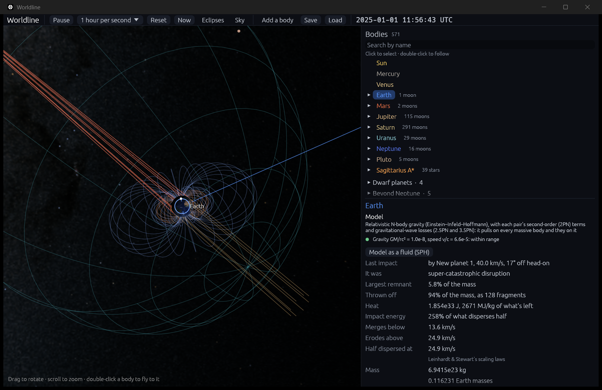

# What a collision leaves

**Code:**
- `crates/worldline-core/src/impact.rs`: the scaling laws: `Impact`, `Material`, `Outcome`, `Regime`;
- `crates/worldline-core/src/collision.rs`: `contact` (now the angle too) and `predicted_outcome`;
- `crates/worldline-core/src/hierarchy.rs`: each `Collision` carries its outcome;
- `crates/worldline-app/src/app.rs`: the message and the inspector's rows (`impact_rows`).

**Data:** `crates/worldline-data/data/impact-simulations-selected.csv` and `impact-simulations-all.csv`, from `tools/fetch_impacts.py`.

**Tests:**
- unit tests in `impact.rs` and `crates/worldline-data/src/impacts.rs`;
- `crates/worldline-data/tests/validation_collision_outcomes.rs`;
- `an_impact_is_measured_where_the_bodies_touch` in `crates/worldline-core/tests/validation_collisions.rs`.

**Source:** Leinhardt & Stewart (2012), *ApJ* 745, 79 (arXiv:1106.6084), "Collisions between Gravity-dominated Bodies. I. Outcome Regimes and Scaling Laws". Every equation, the order of the calculation (its Appendix) and the fitted constants come from there. Equation numbers below are the paper's. The arXiv text was read through its ar5iv rendering, so a later journal correction wouldn't show.

## Why it matters

Two bodies that touched used to simply merge ([collisions.md](collisions.md)). Real collisions do much more. A slow, head-on one merges. A faster one throws some of the mass off. A glancing one can leave both bodies flying on, nearly intact. A fast one can tear the target apart. Which of these happens decides how planets grow, and it is what the rest of milestone 6 builds on.

## From a prediction to what happens

This step works out what a collision leaves. Step 6.1 only reported it, as acting on it needs somewhere for the lost mass to go. Since step 6.2 the simulation carries it out: see [debris.md](debris.md).

## The scaling laws

Everything turns on one comparison: the collision's energy against the energy that disperses half the mass.

**The collision's energy** per unit of total mass, Q_R = ½ μ V² / M_tot, with μ the reduced mass (eq. 1).

**The disruption energy,** Q′*_RD, is built in steps:
1. **Two equal bodies.** Q*_RD,γ=1 = c* (4/5) π ρ₁ G R_C1² (eq. 28). R_C1 is the radius of the whole mass at ρ₁ = 1000 kg/m³. c* says how many times the gravitational binding energy it takes, and it is a measured constant.
2. **Unequal masses** take more: a small projectile puts its energy into a small part of the target. Q*_RD = Q*_RD,γ=1 (¼ (γ+1)²/γ)^(2/(3μ̄) − 1) (eq. 23), with γ the mass ratio. μ̄ is close to 1/3, so collisions scale nearly with momentum, not energy, which was the paper's main surprise.
3. **Oblique impacts** take more again, as part of the projectile misses. Only the share α that overlaps the target counts (eq. 11): Q′*_RD = (μ/μ_α)^(2 − 3μ̄/2) Q*_RD (eq. 15).

**The largest remnant** then follows the "universal law" (eq. 5):

  M_lr / M_tot = 1 − ½ Q_R / Q′*_RD.

Past Q_R / Q′*_RD = 1.8, with a tenth of the mass left, a power law takes over, with exponent about −1.5 (eq. 44). The second-largest remnant comes from the fragments' size distribution (eq. 37).

**The regimes,** in the order the paper's Appendix tests them:

| Regime | When | The largest remnant |
|---|---|---|
| **Merging** | slower than the mutual escape speed V′_esc (eq. 53) | everything |
| **Super-catastrophic** | energy past 1.8 Q′*_RD | power law |
| **Erosion** | fast enough that the universal law leaves less than the target | universal law |
| **Hit-and-run** | otherwise, if grazing: b above b_crit = R/(R+r), the projectile's center missing the target (eq. 6) | the target's mass; the projectile's fate from a reverse impact (eqs. 46–52) |
| **Partial accretion** | otherwise | universal law |

Here b is the sine of the angle between the line of centers and the velocity at contact. 0 is head-on.

**Constants:**

| | c* | μ̄ | Fitted to |
|---|---|---|---|
| Small bodies | 5 ± 2 | 0.37 ± 0.01 | bodies of every make-up, 1 to about 100 km |
| Planets | 1.9 ± 0.3 | 0.36 ± 0.01 | hydrodynamic planets, Mercury-sized to 10 Earth masses |
| Rubble piles | 4.3 | 0.35 | the paper's own 10-km simulations, used for the checks below |

**A choice of Worldline's:** the paper's small bodies stop near R_C1 = 125 km and its planets start near 5,600 km, and it sets no boundary. Worldline changes from one to the other at R_C1 = 1,000 km, about the middle of that gap on a log scale. This is a choice, not a result.

**At contact.** The contact check now also gives b, from the two bodies' relative position and velocity at the moment they touch, so gravity's bending of the path is included. The check below compares it with Newton's value.

## Validation

**The roadmap's check:** their catastrophic-disruption threshold and largest remnants, reproduced for their published cases (`cargo test -p worldline-data --test validation_collision_outcomes -- --nocapture`).

**1. The paper's worked example** (its §VI), for two equal small bodies:

| | Paper | Worldline |
|---|---|---|
| Q*_RD | 5.3 J/kg | 5.33 J/kg |
| V* | 6.5 m/s | 6.53 m/s |
| At 45°, Q′*_RD rises by | "almost a factor of 5" | 4.69 |
| At 45°, V′* | 14 m/s | 14.1 m/s |

The paper's text gives the size as R_C1 ~ 2 km, from radii of 1 km at rock's density. Those figures don't give its numbers: they need R_C1 = 2.52 km, which is two 2-km bodies at 1000 kg/m³, so the test uses that. This looks like a slip in the paper's wording. Worldline's numbers match the paper's printed results, not that sentence.

**2. Table 1's derived columns,** for the 48 selected simulations:

| Column | Limit | Result |
|---|---|---|
| Interacting share α (eq. 11) | the printed digits | all, within 0.005 |
| Q_R (eq. 1) | 2-digit rounding, 4.5% at most | within 4.0% |
| The paper's predicted largest remnant, from its fitted Q′*_RD (eq. 5) | its rounding, plus Q′*_RD's 2-digit rounding carried through | all 39 such rows, within 0.0064 |
| The paper's predicted second remnant (eq. 37) | likewise | all 39, within 0.0052 |

The table prints second remnants rounded twice: 0.0047 appears as 0.01, by way of 0.005. The test allows for exactly that.

**Eight rows could not be reproduced:** the equal-mass oblique impacts, marked † in the paper. Their footnote gives the number of remnants (N_lr = 2, N_slr = 4) but not how the masses were predicted. The printed values fit ½ − Q_R/(12 Q′*_RD), but the paper states no such rule, so Worldline doesn't use it. It follows the Appendix there instead, which applies the universal law only for M_lr below the target's mass.

**3. The catastrophic-disruption threshold, from the recipe alone,** against the value fitted to each simulated series. The paper fits only α > 0.5, and says its correction "usually" lands within a factor of 2. Equal masses at b = 0.35 are left out of the count, as the paper sets them apart: the collision's own spin lowers their threshold.

| γ | b | α | Q′*_RD, Worldline | Simulated | Ratio |
|---|---|---|---|---|---|
| 1 | 0 | 1.00 | 114 J/kg | 110 | 1.04 |
| 0.25 | 0 | 1.00 | 125 | 130 | 0.96 |
| 0.25 | 0.35 | 0.93 | 136 | 190 | 0.72 |
| 0.1 | 0 | 1.00 | 209 | 160 | 1.31 |
| 0.1 | 0.35 | 1.00 | 209 | 270 | 0.77 |
| 0.025 | 0 | 1.00 | 616 | 640 | 0.96 |
| 0.025 | 0.35 | 1.00 | 616 | 720 | 0.86 |
| 0.025 | 0.7 | 0.74 | 959 | 2,000 | 0.48 |

**Result:** 7 of 8 within a factor of 2. The eighth is 2.08 off. The series outside the paper's fit are printed too: they run from 0.31 to 2.76 times the simulated value, which is why the paper leaves them out.

**4. All 189 simulations, from the recipe alone.** The paper says its law holds to "about 10%" for near-normal impacts, and is worse for highly oblique ones.

| Check | Limit | Result |
|---|---|---|
| Median error in the largest remnant, b ≤ 0.35 (82 runs), as a share of the total mass | 10% | **6.5%** |
| The same for oblique impacts (107 runs) | shown | 2.4% |
| Regime matches what the simulation did | shown | 170 of 189 |
| Hit-and-run calls | shown | 53 of 61 right |
| Second remnant in hit-and-runs, median error | shown; the paper calls this first-order | 1.1% |

The medians hide a long tail: a tenth of the runs are off by 24% of the total mass or more, and the worst by 53%. So a single prediction can be well off even where the median is good.

**5. Measured at contact.** A Mars sent at an Earth, aimed 8,000 km off center, bends inward under gravity. Energy and angular momentum give what it should arrive with, and the limits are what the paper's tables resolve:

| | Newton | Measured | Limit |
|---|---|---|---|
| Speed at contact | 8.776 km/s | 8.776 km/s | 0.5% |
| b | 0.18679 | 0.18678 | ±0.005 |

**Every regime, for a Mars into an Earth, with the planets' constants:** the test prints speeds from 8 to 80 km/s. At b = 0.3 the regimes run merging, partial accretion, erosion and super-catastrophic. At b = 0.8 they run merging, hit-and-run and erosion. Super-catastrophic disruption would take 200 km/s there, outside the range.

## In the app

- **The message** at the end of the top bar says what happened: "New planet 1 and Earth shattered at 40.0 km/s". Hovering shows the whole of it.
- **The inspector,** for the body that took the impact, shows at the top: the impact's speed and angle, the regime, what it left, the heat, the energy against the threshold, and the speeds at which it would merge, erode and disperse half.
- **The Physics panel** says the same.

Collisions the laws don't cover merge and show none of this: black holes, bodies past 10 Earth masses, and so on.

A body falling onto another arrives at about their escape speed, so it merges. To see the other regimes, `--aim` sends a body in faster, or **Add a body** and a drag to launch:

```bash
cargo run --release -- --add earth:0.0015@Earth --aim 40,0.3 --focus Earth --zoom 40 --speed hour
```



## Where it's valid

- **Range.** The target's radius from 1 km, its mass to 10 Earth masses, mass ratios to 1 : 45,000, and speeds to 80 km/s. That is where the paper's data reach. Outside it, the bodies merge as before.
- **Gravity-dominated bodies.** Smaller bodies are held together by strength, a different regime. So are craters on a large body from a small impactor, which are step 6.3.
- **Bulk density.** Bodies are taken as one uniform density. Composition isn't tracked, so a mantle stripped from a core isn't followed.
- **No spin.** The paper ran bodies without spin before impact, and says collision spin lowers the threshold for equal masses. Worldline doesn't correct for it.
- **Graze-and-merge** is a part of the hit-and-run regime that the paper doesn't define. Worldline doesn't call it out either, but a slow hit-and-run can end in a merger on a second encounter, as [debris.md](debris.md) shows.
- **The reverse impact is an estimate.** The paper calls the mass involved "of order". Its eq. 48 gives it as a volume, so Worldline takes it at the target's density.
- **Small-body and planet constants** switch abruptly at R_C1 = 1,000 km, Worldline's choice.
- **Spreads.** c* is known to ±40% for small bodies. Predictions near a boundary between regimes could fall either side.
