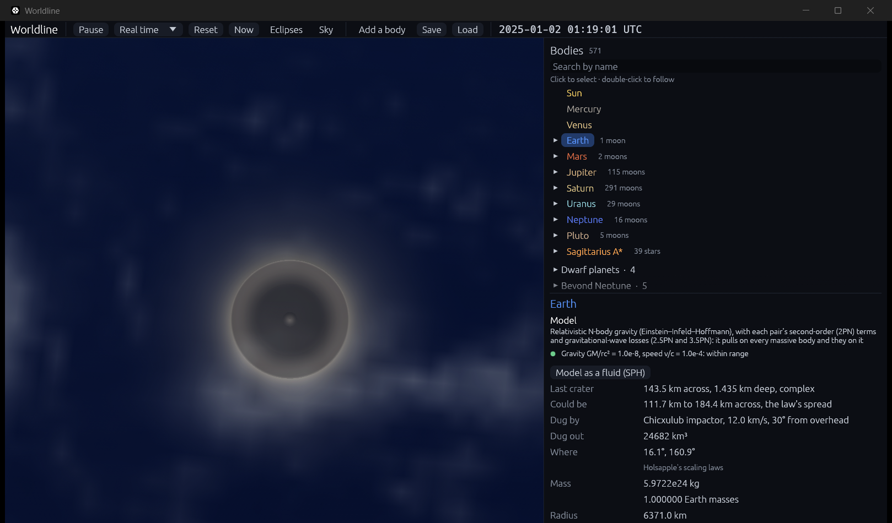
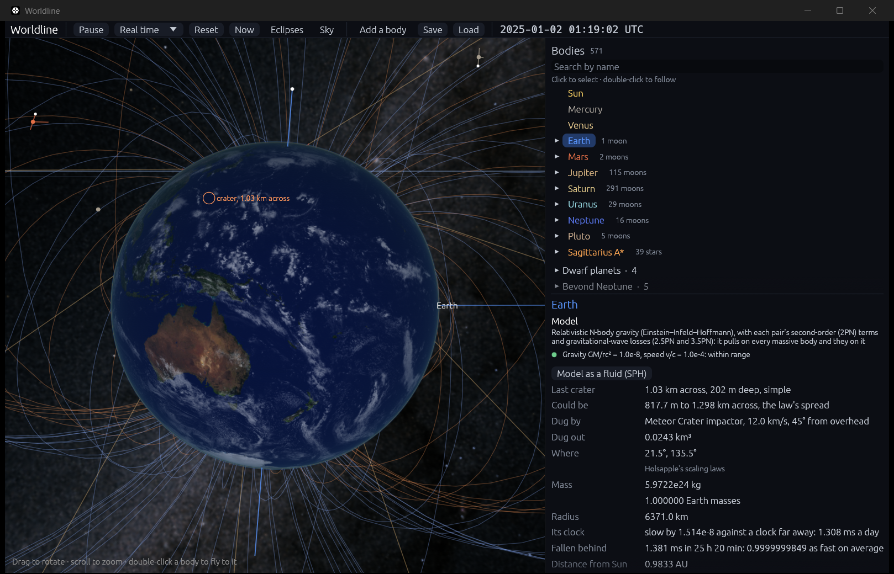

# Craters

**Code:**
- `crates/worldline-core/src/crater.rs`: `dig`, which turns a strike into a crater, and `Ground`, the surfaces;
- `crates/worldline-core/src/collision.rs`: `crater_left`, which decides whether a collision leaves one;
- `crates/worldline-core/src/hierarchy.rs`: `surface_center`, so that an impact is found at the planet and not at its barycenter;
- `crates/worldline-app/src/simulation.rs`: `scar`, which keeps a crater in its body's own frame;
- `crates/worldline-render/src/bodies.wgsl`: `scars_at`, which draws it;
- `crates/worldline-app/src/view.rs`: `draw_small_craters`.

**Tests:**
- unit tests in `crater.rs`;
- `crates/worldline-core/tests/validation_craters.rs`: the paper's Table 1 and lunar example, Meteor Crater, Chicxulub, and an impact on a planet with a moon;
- `a_small_body_digs_a_crater_that_turns_with_its_planet` in `crates/worldline-app/src/simulation.rs`.

**Sources:**
- Holsapple (1993), *Annu. Rev. Earth Planet. Sci.* 21, 333: the scaling laws, the rim, the collapse into a complex crater, and the spread.
- Collins, Melosh & Marcus (2005), *Meteorit. Planet. Sci.* 40, 817, eq. 21, after Schmidt & Housen (1987), *Int. J. Impact Eng.* 5, 543, which wasn't read: the crater's radius in rock, and the widest crater.
- Holsapple (2022), arXiv:2203.07476: only the vertical component of the speed counts, the slowest speed the laws hold at, and ice.
- Melosh & Collins (2005), *Nature* 434, 157: Meteor Crater's impactor. Only its abstract and the press release that gives the mass were read.
- Collins et al. (2020), *Nat. Commun.* 11, 1480: Chicxulub's impactor.
- Morgan et al. (2016), *Science* 354, 878: Chicxulub's size, from its abstract.

## Why it matters

Leinhardt & Stewart's laws ([collision-outcomes.md](collision-outcomes.md)) cover bodies that disrupt each other. A rock hitting a planet is a different problem: the planet hardly notices, and what's left is a hole. Holsapple's laws say how big.

## The idea

A hypervelocity impactor is tiny against the crater it digs. Seen from far enough away, it is a point: a burst at the surface. Then the crater can't depend on its size and speed separately, only on one combination of them. That turns into power laws, whose exponents come from experiments, and they hold from laboratory shots to basins.

Two things stop a crater growing. In small ones it's the **strength** of the ground. In large ones it's **gravity**: the crater stops when it would have to lift more rock than the impact can. For hard rock, at Earth's gravity and 10 km/s, the change comes with impactors around 30 m across.

## The law

In the paper's symbols, with m, U and a the impactor's mass, speed and radius, δ its density, and ρ, g and Ȳ the ground's density, gravity and strength:

π_V = ρV/m = K₁ [ π₂ (δ/ρ)^(1/3) + (Ȳ/ρU²)^((2+μ)/2) ]^(−3μ/(2+μ))  (eq. 19)

The first term in the bracket is gravity and the second strength. Table 1's π₂ is 3.22 ga/U², as Schmidt & Housen define it. Since a depends on δ as δ^(−1/3), π₂ (δ/ρ)^(1/3) is g (3m/4πρ)^(1/3)/U². So only the impactor's mass matters, not its density.

The radius at the original ground, R_e, follows the same bracket to the power −μ/(2+μ) (eq. 20). The rim is 1.3 times that (eq. 22b), and a simple crater is 2.55 times as wide in radius as it is deep from the rim.

**Past a transition,** the crater collapses under its own gravity into a much shallower, wider complex crater. The transition is at a rim radius of 8.5 km on the Moon and goes as 1/g, so about 1.4 km on Earth. The paper's fits are:
- R/R_e = 1.32 (R/R*)^0.079 (eq. 28)
- d/R* = 0.313 (R/R*)^0.301 (eq. 29)

**A slanted impact** counts only its speed straight down (Holsapple 2022).

| Ground | K₁ | μ | Ȳ | ρ | Radius constant | Used for |
|---|---|---|---|---|---|---|
| Soft rock | 0.20 | 0.55 | 7.6 MPa | 2650 | 0.8 | Meteor Crater's check |
| Hard rock | 0.20 | 0.55 | 18 MPa | 2650 | 0.8 | bodies of mean density over 3000 kg/m³ |
| Dry soil | 0.24 | 0.41 | 0.18 MPa | 1700 | 0.842 | the paper's lunar example |
| Ice | 0.20 | 0.55 | 18 MPa | 930 | 0.8 | bodies of mean density under 3000 kg/m³ |

## Choosing the radius

Holsapple's paper gives crater **volumes** for rock, in its Table 1, but no radius. The radius needs one more number, and the choice matters.

- **The paper's own dry soil** has a radius of 1.36 times the cube root of its volume (K₁ of 0.69 against 0.132).
- **Collins et al.'s eq. 21,** which they base on Schmidt & Housen (1987) and earlier work, gives the same 1.37 with Table 1's rock volume. Their constant 1.161 for a sphere is D = 1.6 (m/ρ)^(1/3) π₂^(−0.22). Schmidt & Housen is also where Holsapple's paper points for materials beyond dry soil.
- **Holsapple's later program** (2022) uses 1.1 for rock.

Worldline uses the 1.37, which is a radius constant of 0.8 in the table above. With 1.1, craters come out 19% smaller, and Chicxulub falls outside the spread: its impactor would dig 113 km. That was seen before the choice was made, so the choice isn't independent of the check. It rests on the two agreeing sources above, but it should be read with that in mind.

## When a collision leaves a crater

A collision leaves a crater when:
- Leinhardt & Stewart's laws don't cover it, which for a small body means a mass ratio under 1 : 45,000;
- the target has a surface: it isn't a black hole, and it's under 10 Earth masses, as far as the solid bodies in those laws' data go;
- the speed straight down is at least 1 km/s;
- the excavation is under 0.235 of the target's radius. On Earth that's Collins et al.'s 1,500 km, past which the crater collapses to an almost featureless surface. Scaling it with the radius is Worldline's choice.

Otherwise the bodies merge as before ([collisions.md](collisions.md)). Either way the impactor's mass and momentum go to the target.

## Finding the planet

The top level of the hierarchy follows a planet's system, whose barycenter isn't the planet: it lies 4,671 km from Earth's center, three quarters of the way to its surface. Contact used to be measured from there, so an impact could be found thousands of kilometers from Earth's real surface, and at the wrong angle.

Contact is now measured from the planet's own center, at both ends of a step, and the laws use the planet's own mass. A rock falling along the line through Earth and the Moon touches at Earth's surface at 13.6 km/s, as energy says, and not at 15.4 km/s, 4,671 km further in.

This changed one result of step 6.2: a grazing impact aimed at b = 0.8 now really strikes there, and leaves 11.79 MJ/kg of heat rather than 10.81.

**What didn't change:** a body in flight still feels a planet and its moons as one mass at the barycenter. So something falling at Earth is pulled toward a point off Earth's center. Tried from 20,000 km out at 12 km/s, a rock aimed straight at Earth's center from the side struck at b = 0.12 instead of 0, 315 km off.

## Validation

**The roadmap's check:** Meteor Crater and Chicxulub from their estimated impactors, within the published scaling's spread (`cargo test -p worldline-core --test validation_craters -- --nocapture`).

**The spread** is Holsapple's own: crater volumes are "unknown to within a factor of perhaps two". That is a factor of 1.26 either way on a simple crater's diameter, and 1.285 on a complex one's, which goes as 1.086 powers of its excavation.

| Crater | Impactor | Worldline | With the spread | Measured | Off by |
|---|---|---|---|---|---|
| Meteor Crater | 3 × 10⁸ kg at 12 km/s and 45°, into soft rock | 1,095 m | 869 to 1,379 m | 1,186 m | −8% |
| Chicxulub | 17 km across, 2630 kg/m³, at 12 km/s and 60°, into hard rock | 143.6 km | 111.8 to 184.6 km | 180 km | −20% |

**Meteor Crater's impactor.** Melosh & Collins give 300,000 tons of iron, reaching the ground at about 12 km/s. Its angle isn't known, so it is 45°, the likeliest of all. About half of it broke up on the way down. If only the half that stayed whole counted, the crater would be 905 m, past the spread by 4%.

**Chicxulub's impactor.** Collins et al. chose it to make a Chicxulub-sized crater in their simulations at that angle and speed. So this asks whether the scaling law agrees with a hydrocode, not whether it predicts the crater blind. Chicxulub's size is itself uncertain:

- at 180 km, the usual figure, it is inside the spread, near the edge;
- at about 200 km (Morgan et al. 2016) it is **8% past** the spread.

**Other checks:**

| The paper's lunar example: 25 km radius, 25 km/s, dry soil | Paper | Worldline |
|---|---|---|
| Excavation radius | 141 km | 143.5 km |
| Transient rim radius | 184 km | 186.5 km |
| Depth below that rim | 72 km | 73.1 km |
| Final rim radius | 244 km | 247.2 km |
| Final depth | 7.3 km | 7.34 km |

The limit is the rounding of the paper's own numbers: its 0.69 and the 7.8 it becomes, the Moon's gravity if it took 1/6 of Earth's, and each printed result. That's under 2% for the radii.

| The paper's Table 1, for hard rock | Paper | Worldline |
|---|---|---|
| Gravity regime, 10¹⁵ kg at 10 km/s | 0.48 m^0.783 G^−0.65 U^1.3 | 1.4% under |
| 10¹⁷ kg | | 0.6% under |
| 10¹⁹ kg | | within 0.1% |
| Strength regime, soft rock | 0.009 m U^1.65 | 0.0094 |
| Strength regime, hard rock | 0.005 m U^1.65 | 0.0046 |

The gravity limit is 2.1% to 3.0%: the table's exponents take α as 0.65, where μ = 0.55 makes 0.647, and its 0.48 is rounded.

- **Earth's complex-crater transition** comes out 2.8 km across from the Moon's, and the paper says about 3 km.
- **Collins et al.'s full law** gives 1,313 m and 147 km, against 1,095 m and 144 km. Theirs has a rim 1.25 times the excavation against Holsapple's 1.3, and keeps a small dependence on the impactor's density, which is why iron differs more. Their constant's stated range, 0.8 to 1.5, reaches 197 km.
- **The paper's Table 1 transition sizes,** 11 m and 32 m, come out about 10 m and 31 m by hand. It doesn't say how it worked them out, and they aren't tested.

## In the app

- **The Impactors group** in the catalogue has both estimated impactors.
- **The message** says what happened: "Chicxulub impactor hit Earth at 12.0 km/s, digging a crater 143.5 km across".
- **The inspector,** for the body that was hit, shows the crater's size and depth, the spread, what dug it, the volume and where.
- **On the globe** it is drawn to scale, turning with its body. A crater too small to see has a ring around it, naming its size.
- **`--yaw`** is a new start flag, to turn the camera to the side that was hit.

```bash
cargo run --release -- --add "Chicxulub impactor:0.002@Earth" --aim 12,0.5 --advance 0.00289 --focus Earth --zoom 1.12 --yaw -75 --pitch 39 --speed real
```

`--advance` runs on 25 hours past the impact, which happens on the night side, until the crater reaches the noon Sun.



```bash
cargo run --release -- --add "Meteor Crater impactor:0.002@Earth" --aim 12,0.7071 --advance 0.00289 --focus Earth --zoom 4 --yaw -79 --pitch 12 --speed real
```



This gives 1.03 km, not the check's 1,095 m, as the app's ground is hard rock and Meteor Crater's is soft.

## Where it's valid

- **Point source.** The laws need an impactor much smaller than its target, at more than a few km/s, and don't apply to extremely shallow, glancing impacts, whose real craters aren't round. Here every crater is round.
- **A factor of about two in volume.** A number here is the middle of a range, and the inspector shows the range.
- **No atmosphere.** Nothing slows or breaks up what falls. A real atmosphere breaks up small bodies high above the ground, so they dig no crater, and Collins et al. give the entry physics a later step could use. Speeds here are at the surface.
- **No oceans.** Earth's ground is hard rock everywhere, even under the sea. A real ocean impact digs a different crater, or none.
- **Two grounds.** A body's mean density decides between rock and ice, and the line at 3000 kg/m³ is Worldline's. Mercury is rock, though the paper treats the Moon as soil.
- **Ice** is rock's law at ice's density. The paper has no ice, and Holsapple (2022) gives all nonporous ground the same outcome where gravity rules. Its strength is a stand-in.
- **The Moon can't be hit yet.** Collisions inside moon systems aren't detected, so a rock passes through it. Only top-level bodies take craters.
- **Comets and small asteroids** in the catalog of real bodies are massless here, so they leave no crater, and neither do fragments that fall back, though they could.
- **The drawing is a sketch.** The diameter, the depth and the rim's height come from the laws. The profile between them, the floor's width, the peak, the ejecta and all the colors are a visual approximation. Peak rings aren't drawn.
- **Giant impacts wipe craters.** A collision Leinhardt & Stewart's laws cover takes both bodies' craters away: Worldline's choice, as such an impact remakes a surface.
- **No erosion.** A crater stays as it was dug.
- **Heat isn't reported** for a crater, and the energy isn't accounted for as in [debris.md](debris.md). Momentum and mass are kept.
