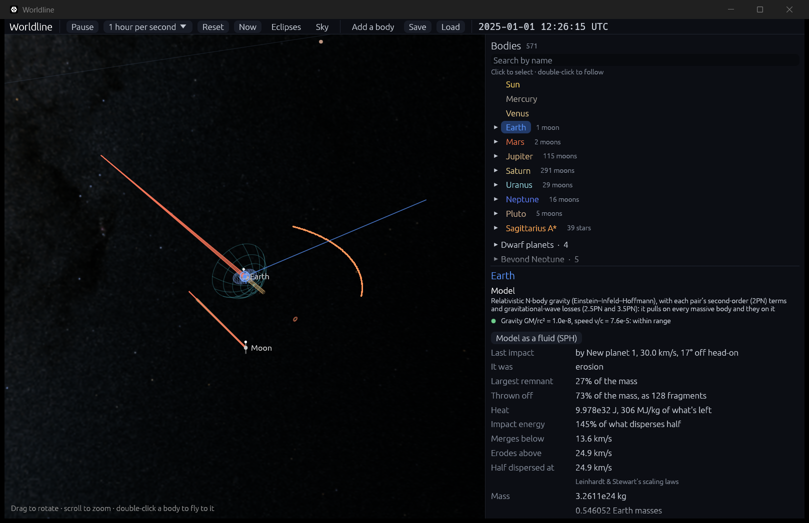
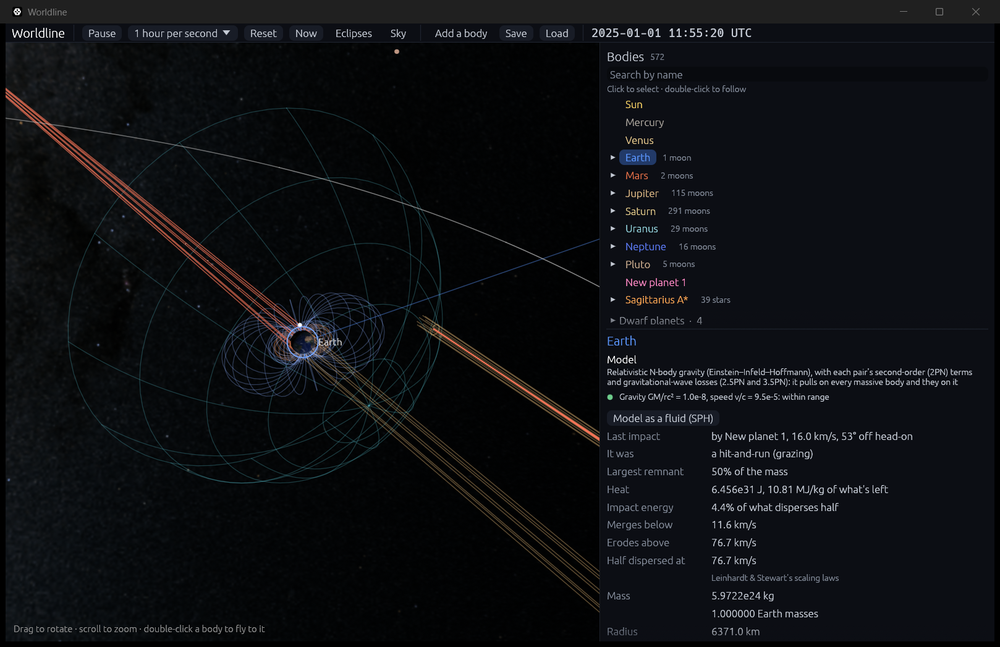

# What a collision throws off

**Code:**
- `crates/worldline-core/src/debris.rs`: `aftermath`, which turns an outcome into remnants, fragments and heat;
- `crates/worldline-core/src/hierarchy.rs`: `merge_top` carries it out, and `add_debris` and `take_back` keep the fragments' mass;
- `crates/worldline-app/src/simulation.rs`: `aim_at`, `debris_positions`;
- `crates/worldline-app/src/simulation/save.rs`: saves which swarm particles are fragments;
- `crates/worldline-app/src/app.rs`: the message and the inspector's rows (`impact_message`, `impact_rows`).

**Tests:**
- unit tests in `debris.rs`;
- in `crates/worldline-core/tests/validation_collisions.rs`: `a_collision_keeps_its_mass_momentum_and_energy`, `a_hit_and_run_leaves_both_going_their_ways`, `a_slow_hit_and_run_comes_back_and_merges`, `fragments_that_fall_back_give_back_their_mass`;
- `a_collision_throws_off_fragments_that_save_and_load` in `crates/worldline-app/src/simulation.rs`.

**Sources:**
- Leinhardt & Stewart (2012), *ApJ* 745, 79 (arXiv:1106.6084): the remnants' masses ([collision-outcomes.md](collision-outcomes.md)), the largest remnant's velocity (its Appendix), and how a hit-and-run slows the bodies.
- Chambers (2013), *Icarus* 224, 43, as Quintana et al. (2016), *ApJ* 821, 126 (arXiv:1511.03663), describe it in their §3.1: equal fragments, dispersed slightly above the escape velocity in uniform directions within a plane. Worldline follows that description. Chambers's paper itself wasn't read in full.

## Why it matters

Step 6.1 worked out what a collision would leave but still merged the bodies. Now the simulation does what the laws say. The largest remnant goes on with the mass they give it. What it lost flies off as fragments that keep orbiting, and can fall back. The energy that went missing is reported as heat. Nothing is created or lost along the way, which is the point of this step.

## What happens

**1. The largest remnant** takes its mass from the scaling laws. Its radius follows from keeping the two bodies' combined density: its volume is the same share of their total volume as its mass is of their total mass.

**2. Its velocity,** in the center of mass's frame, comes from the paper's Appendix: the center of mass's own after a head-on collision, the target's own past b = 0.7, and linear in b between. The paper also reports that it approaches the center of mass's as it takes in more of the projectile, but gives no formula, so that is linear too: full at no gain, zero once it has gained the projectile's mass. Without this, a remnant that takes in nearly everything would leave a trace of debris holding a huge momentum.

**3. The fragments carry the rest of the momentum.** That fixes their mean velocity: −V_lr M_lr / M_lost.

**4. The fragments' speeds.** There are 128, equal in mass, starting just off the remnant's surface, all at 1.05 times its escape speed. The remnant's mass from the laws already counts what stays, so none may fall straight back. They lie in the plane of the impact.

- **Head-on,** they have nothing to carry, and spread evenly over the whole circle, as in the source.
- **Otherwise** they must carry momentum. They spread over a narrower arc around the direction of the momentum, narrow enough that their mean velocity is right. This departs from the source's uniform directions, and it is **Worldline's choice**.
- **Past ±30°,** they stay at that arc and go faster. A spray that stays a spray is also Worldline's choice.

**Why an arc.** The first version kept the directions uniform around the mean velocity, and raised the speed until the slowest fragment escaped. That spent all the energy there was: a 30 km/s impact between two Earths came out with a heat of 10⁻¹³ MJ/kg, plainly wrong. An arc is the cheapest way to carry the momentum with every fragment escaping. The same impact now gives 306 MJ/kg.

**5. A hit-and-run** leaves two bodies. The target keeps its mass. The projectile comes out where the line it came in on leaves the target's reach, keeping what the laws give it, with what it lost spread around it in a full circle, 5% over its own escape speed. If it would survive as less than one fragment's mass, it doesn't go on, and all of it becomes fragments.

Both slow by 10% in the center of mass's frame, the same share each, which keeps the momentum. The paper says "the targets typically lose about 10% of their pre-impact velocity" at b = 0.9, and that slowing is stronger at b = 0.7, and that its data don't give the dependence. So 10% is the one figure there is, used for every hit-and-run, and labeled. Where b is under 0.63, the Appendix's line above already slows them more, and that stands. Without any slowing nothing would pay for what the projectile loses.

This also does what the paper says slowing does, "which increases the probability of merging in subsequent encounters". Two Earths meeting at 11.9 km/s, just fast enough to part, are left under their mutual escape speed of 11.2 km/s. They come back 54.8 hours later at 10.8 km/s and merge.

**6. Fragments that come back.** A fragment that reaches a surface is swallowed, and that body takes its mass and momentum.

## The energy

All in the center of mass's frame:

| Term | Before | After |
|---|---|---|
| Motion | the two bodies | the remnants and the fragments |
| Gravity | the two bodies on each other | the remnants on each other and on the fragments |
| Binding, −(3/5) G m²/R as a uniform sphere | both bodies | the remnants |

**Heat** is what's left over. A merger's heat can exceed the motion it came from, because the merged body is more tightly bound than the two were.

**When the motion would take more than there is,** everything slows by the same factor, which keeps the momentum, and the heat is exactly zero. Some fragments may then fall back. It is rare: 4 of the 810 collisions that threw mass off in the unit test's scan of speeds, angles and masses, all glancing blows, at b = 0.75 or 0.9.

## Validation

**The roadmap's check:** mass and momentum before and after equal to rounding, and energy accounted for to rounding (`cargo test -p worldline-core --test validation_collisions -- --nocapture`).

A Mars sent into an Earth, worked out afresh from what is really in the simulation before and after: the bodies, and the swarm's particles with the masses they carry.

| Speed, b | Regime | Fragments | Mass off by | Momentum off by | Heat | Motion before |
|---|---|---|---|---|---|---|
| 9 km/s, 0.3 | merging | 0 | 0 | 6.5 × 10⁻¹⁹ | 3.061 × 10³¹ J | 2.372 × 10³¹ J |
| 14 km/s, 0.3 | partial accretion | 128 | 5.7 × 10⁻¹⁵ | 2.3 × 10⁻¹⁶ | 4.464 × 10³¹ J | 5.704 × 10³¹ J |
| 40 km/s, 0.3 | erosion | 128 | 4.6 × 10⁻¹⁵ | 7.5 × 10⁻¹⁶ | 3.390 × 10³² J | 4.638 × 10³² J |
| 75 km/s, 0.3 | super-catastrophic | 128 | 1.0 × 10⁻¹⁵ | 1.7 × 10⁻¹⁶ | 1.402 × 10³³ J | 1.630 × 10³³ J |
| 16 km/s, 0.8 | hit-and-run | 128 | 6.0 × 10⁻¹⁵ | 3.7 × 10⁻¹⁶ | 1.473 × 10³¹ J | 7.433 × 10³¹ J |

**The limit** is 130 ε, or 2.9 × 10⁻¹⁴: 130 terms in the sums, two bodies and 128 fragments, each good to one part in 2⁵².

**Energy.** Heat is the remainder, so the accounts close by construction. The checks with teeth are that the heat never comes out negative, and that the kinetic energy of what's really flying matches the accounts. It does, to 3.8 × 10⁻¹⁷ of the energy's scale at worst, under the same limit.

**Across the regimes.** A unit test repeats the check on 1,260 collisions: three projectile masses, seven impact parameters and 60 speeds from 3 to 280 km/s.

**The working frame matters.** At Earth's distance from the Sun, positions round to tens of micrometers, so the energy would be off by 10⁻¹³ if worked out there. `aftermath` works in the center of mass's frame and moves to the Sun's only at the end.

**Other checks:**
- a fragment that falls back gives its body its mass, to the last digit;
- a hit-and-run leaves both bodies parting, with no second collision on the next step;
- a target keeps 90% of its velocity in a hit-and-run;
- a save keeps which particles are fragments, and a later collision's fragments get labels of their own.

## In the app

- **The message** says what happened: "New planet 1 hit Earth at 30.0 km/s, eroding it", or "New planet 1 grazed Earth at 16.0 km/s and flew on".
- **The inspector,** for the body that took the impact, shows the regime, the largest remnant, what was thrown off, the heat in J and in MJ/kg of what's left, and the speeds that matter. Hovering over the source line gives the simplifications.
- **Fragments** are orange dots, drawn at any distance. Tiny against what they left, they wouldn't otherwise be seen.
- **A notice** says when fragments fall onto a body.
- **`--aim SPEED,B`** after an `--add` sends that body straight at what it circles, to arrive at SPEED km/s with impact parameter B. Gravity's pull on the way in is allowed for, from energy and angular momentum.

```bash
cargo run --release -- --add earth:0.0003@Earth --aim 30,0.3 --focus Earth --zoom 330 --speed hour
```



```bash
cargo run --release -- --add earth:0.0015@Earth --aim 16,0.8 --focus Earth --zoom 60 --speed hour
```



## Where it's valid

Every range in [collision-outcomes.md](collision-outcomes.md) applies. Anything the laws don't cover, like stars and black holes, merges as before ([collisions.md](collisions.md)).

- **Fragments pull on nothing.** They feel the bodies, as the swarm's particles do, and carry mass in a ledger. So the bodies don't feel them back, and a cloud of debris doesn't gather under its own gravity. Momentum is kept at the collision, and fragments that fall back return theirs, but in between the bodies don't feel the fragments' pull.
- **128 equal fragments** is a simplification, from the source, and the number is Worldline's. Real debris runs from dust to a second planet. In every regime but hit-and-run the laws' second-largest remnant is not its own body: its mass goes to the fragments.
- **5% over the escape speed** is Worldline's reading of the source's "slightly above". A source for the exact figure wasn't found.
- **A plane.** Real debris leaves in three dimensions. The plane comes from the source.
- **An arc** is Worldline's, not from a source.
- **The paper's own fit for debris speeds** (eqs. 38–43) isn't used. Its bin width has no stated value, and it gives the lowest bin a share above 1 where the text says about 0.1 of the total mass.
- **10% in every hit-and-run** comes from the paper's b = 0.9 runs. It says b = 0.7 slows more, and a pass that barely touches must slow less.
- **Heat is a number.** Nothing melts, expands or glows yet. All of it is counted against what's left, though fragments would really take a share.
- **Uniform spheres.** Real planets are denser in the middle, and more tightly bound than the −(3/5) G m²/R used here.
- **No composition.** Iron and rock aren't told apart, so a mantle stripped from a core isn't followed. Step 6.4 brings that.
- **No spin.** The impact's angular momentum isn't added to the remnants' spin, nor to the fragments' accounts.
- **A hit-and-run projectile's moons** are set free.
