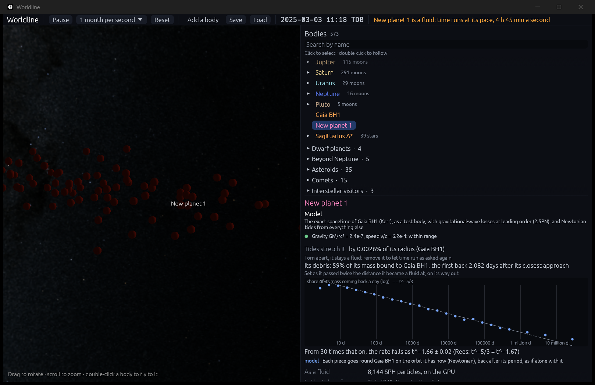

# Tidal disruption: a planet torn apart

**Code:**
- `crates/worldline-core/src/sph.rs`: `self_bound`, which particles are still bound to the body they made up;
- `crates/worldline-core/src/tides.rs`: `return_time`, when debris comes back, and `fallback_power`, the power of the rate it comes back at;
- `crates/worldline-app/src/fluid.rs`: `Debris`, a torn body's debris in the app;
- `crates/worldline-app/src/app.rs`: the inspector's debris rows and plot (`debris_rows`, `fallback_plot`).

**Tests:**
- unit tests in `sph.rs`, `tides.rs` and the app's `fluid.rs`;
- `crates/worldline-render/tests/validation_fluid_gpu.rs`: a planet passing a star, and one torn right through.

**Sources:**
- **The fallback rate ∝ t^(−5/3):** Rees (1988), *Nature* 333, 523; Phinney (1989), IAU Symposium 136, 543. Evans & Kochanek (1989), *ApJ* 346, L13, found it in the first simulations.
- **Partial disruptions fall off faster,** as t^(−9/4): Coughlin & Nixon (2019), *ApJ* 883, L17.
- **How much a Jupiter-like planet loses passing a star:** Faber, Rasio & Willems (2005), *Icarus* 175, 248, Table 1. They used SPH with an n = 1 polytrope, as Worldline does.
- **Estimating the power of a falling rate:** Hill (1975), *Annals of Statistics* 3, 1163.

## Why it matters

Step 4.3 made a giant planet a fluid where tides start to matter. This step follows what they do to it closer in:
- **stripped:** a passage near the tidal radius r_t = R (M/m)^(1/3) tears its outer layers away;
- **torn apart:** a deeper one tears it right through.

The debris spreads along the orbit. About half of it is bound to what tore it, and comes back to it over months, years and centuries. Around a black hole that returning debris is what makes a tidal disruption event shine. Worldline doesn't model the accretion or the light, only when the debris comes back.

## How much is torn away

How deep an encounter goes is measured by β = r_t/r_p, r_p being the closest approach.

**The measure.** Whatever of the body is no longer bound to the rest, by its own gravity and motion, has been torn away. "Bound" is worked out by iteration: start with all the particles, and keep those whose kinetic energy, relative to the kept ones' center of mass, plus their potential energy from the kept ones is negative. Repeat until nothing changes.

**The check.** Faber, Rasio & Willems (2005) sent a Jupiter-like planet, an n = 1 polytrope, past a star 1,000 times its mass on a parabola, so r_t = 10 of its radii. The GPU fluid runs the same encounters:
- it starts settled, at 5.34 r_t, where step 4.3 makes a planet a fluid;
- it ends twice that far out on the way back.

| Closest approach | Their mass lost (Table 1) | Worldline's, with 8,000 particles |
|---|---|---|
| 1.2 r_t (12 radii) | 0.58 | 0.574 |
| 1.5 r_t | 0.24 | 0.235 |
| 1.8 r_t | 0.027 | 0.024 |
| 2.2 r_t | 0 | 0 |

The limit is ±0.036: the mass in the planet's outermost smoothing length, (sin ξ − ξ cos ξ)/π short of 1 at ξ = π(1 − h/R). SPH resolves the surface the tides strip no finer. So disruption begins near r_t, at about 2 r_t for a planet like Jupiter, as the roadmap asks. In their runs the first particles came free at 2.1 r_t.

## When the debris comes back

**Each piece's orbit.** Once torn, each piece of debris goes round what tore it on an orbit of its own, of specific energy E = v²/2 − GM/r. The bound ones (E < 0) come back to where they were torn after one period:

  t = 2πGM/(−2E)^(3/2).

**Why the rate falls as t^(−5/3).** Inverting gives E = −½ (2πGM/t)^(2/3). So the rate the debris comes back at is

  dM/dt = (dM/dE)·|dE/dt| = (dM/dE)·⅓ (2πGM)^(2/3) t^(−5/3).

Debris coming back late is debris barely bound, E near 0. For a body torn right through, that is the middle of its spread of energies, where dM/dE is smooth and flat. There the rate falls as **t^(−5/3)**.

**Why not at once.** Earlier it can't: the most bound debris comes from where dM/dE falls away. Picture the energies frozen as the body passes its closest approach: dM/dE then follows the body's mass along the line to the hole, ∝ 1 + cos(πu) for n = 1, where u is the energy as a share of the most bound's. The rate's slope is then −5/3 + 2πu sin(πu)/(3(1 + cos πu)), with u = (t/t_first)^(−2/3). That is −1.53 at 11 times the first return, −1.63 at 30, and −5/3 only later still.

**Partial disruptions.** When a core survives, its pull takes back the barely bound debris and the rate falls faster, as t^(−9/4) (Coughlin & Nixon 2019). So the check is for a body torn right through.

**The check.** The same planet passing the star at 0.5 r_t (β = 2):
- **Set.** By twice the switch distance on the way out, each particle's orbit around the star is fixed.
- **Bound.** 52.7% of it is bound to the star.
- **First back:** 37 dynamical times after the closest approach.
- **The power.** From 30 times that on, 866 particles come back. The maximum likelihood estimate of α in t^(−α) is α − 1 = n/Σ ln(t/t₁), with standard error (α − 1)/√n. It comes out at **1.676 ± 0.023**, 0.4 standard errors from 5/3.
- **The limit:** within 3 standard errors.

## In the app

A body torn on its way past its closest approach shows its debris in the inspector, under its tides line:
- how much of its mass is bound to what tore it, and when the first comes back;
- a plot of the rate it comes back at, against time since the closest approach, both on log scales, with a dashed line ∝ t^(−5/3);
- the power from 30 times the first return on, with its standard error.

**When it is worked out.** Every 2 seconds, from the particles read back, until the body is twice as far as where it became a fluid. Then it is set. Later the first pieces come back round, and a period counted from the closest approach no longer says when.

**Its particles** are drawn no bigger than a quarter of its radius. Debris is sparse, and its smoothing lengths grow to many radii.

**Time.** A torn body stays a fluid, and time stays at its pace. Removing it lets time run as asked again.

**The scenario.** This drops a Jupiter copy 2 AU from Gaia BH1 (9.6 Suns), itself 1,000 AU from the Sun, at 0.071 of the circular speed. It falls past the hole at 0.50 tidal radii:

```
cargo run --release -- --add "Gaia BH1:1000" --add "jupiter:2@Gaia BH1" --launch 0.071 --focus "New planet 1" --zoom 25
```

In the app:
- Jupiter's tidal radius around the hole is 1.51 million km.
- It becomes a fluid 8.1 million km out, and is torn apart at its closest approach.
- 59% of it ends up bound to the hole, the first back 2.1 days later.
- The rate falls as t^(−1.66 ± 0.02).

## Where it's valid

- **Newtonian orbits for the debris,** each as if alone with what tore it. At 0.5 r_t from a black hole of 9.6 Suns, GM/rc² = 2 × 10⁻⁵.
- **When, not how bright.** What happens when the debris comes back is left out: its streams' collisions, the accretion disk and the light. The fallback rate is when it comes back.
- **Only planets.** The n = 1 polytrope is a planet's structure. Stars need their own (n = 1.5 or 3), so the stars torn apart by supermassive black holes in real tidal disruption events aren't modeled yet.
- **The fluid goes on after the debris is set.** It keeps stepping, its particles ever more spread out, and its steps slower.
- **Frames.** On the Iris Xe the scenario plays at 5 to 20 frames a second around the closest approach. The physics takes more than its 12 ms a frame: one planet skimming a black hole holds the whole solar system's top level to its short steps.

## Validation

| Check | Expected | Result |
|---|---|---|
| A particle at twice the escape speed is no longer bound (`cargo test -p worldline-core sph`) | it alone leaves | it alone leaves |
| Debris comes back after its period; the power of a rate known to fall as t^(−5/3) (`cargo test -p worldline-core tides`) | a year for Earth's orbit; 5/3 | to 10⁻¹⁵; within 2 × 10⁻³ |
| **Disruption begins near r_t:** mass lost passing a star at 1.2, 1.5, 1.8 and 2.2 r_t | Faber, Rasio & Willems's 0.58, 0.24, 0.027, 0, within the mass in the outermost smoothing length (0.036) | 0.574, 0.235, 0.024, 0 |
| **Debris falls back at a rate ∝ t^(−5/3):** a planet torn right through (β = 2) | within 3 standard errors of 5/3 | 1.676 ± 0.023 |
| In the app, from its own debris | the same law | t^(−1.66 ± 0.02), 59% bound |

The GPU checks need a GPU: `cargo test --release -p worldline-render --test validation_fluid_gpu -- --ignored --nocapture --test-threads=1`. Last digits vary from run to run, as the GPU adds its sums in a varying order (another run: 0.575, 0.234, 0.024, 0; t^(−1.671 ± 0.022)).


