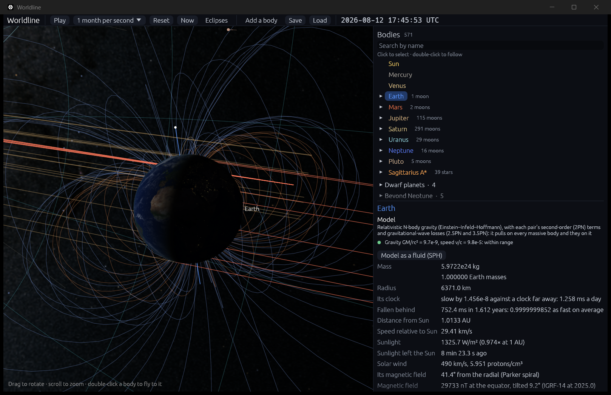
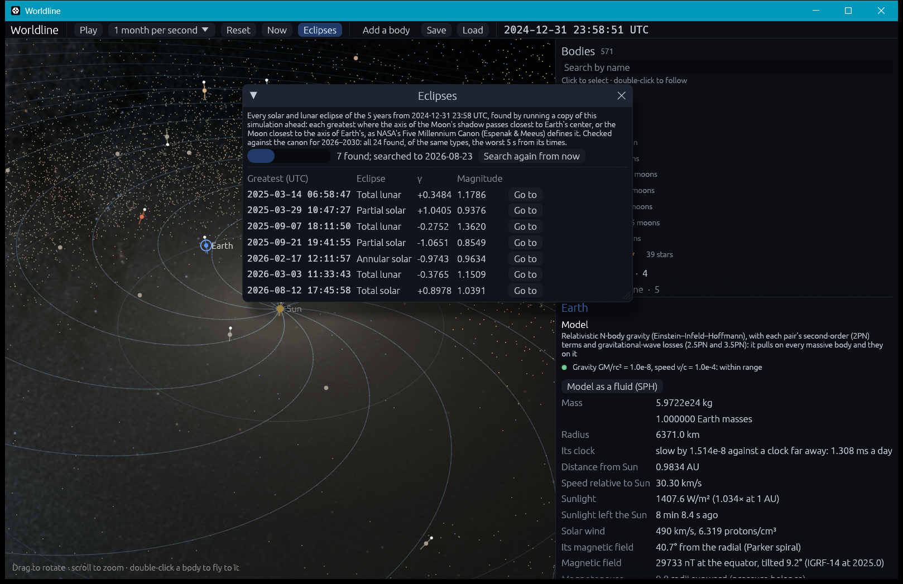

# Eclipses: the shadows of the Moon and Earth, and an eclipse finder

**Code:**
- `crates/worldline-core/src/eclipses.rs`:
  - `apparent`: the Sun and Moon as seen from Earth's center;
  - `MoonShadow` (solar) and `EarthShadow` (lunar): each shadow, measured as the canon measures it;
  - `shadow_cones`: the cones drawn in the 3D view;
  - `Ephemeris`: the Sun, Earth and Moon sampled and searched for eclipses.
- `crates/worldline-core/src/shadow_on_earth.rs`: the shadow on the ground (`GroundShadow`) and the path across it (`path`).
- `crates/worldline-core/src/gravity/bulges.rs`: Earth's bulge pulling on the Moon (see below).
- `crates/worldline-app/src/eclipse_finder.rs`: the finder in the app, a copy of the simulation run ahead on its own thread.
- `crates/worldline-app/src/view.rs` (`draw_shadows`, `draw_shadow_on_earth`) and `app.rs` (`eclipses_window`).

**Data:**
- `crates/worldline-data/data/solar-eclipses-2026-2030.csv` and `lunar-eclipses-2026-2030.csv`, from `tools/fetch_eclipses.py`;
- `crates/worldline-data/data/earth-zonal-harmonics.csv`, from `tools/fetch_earth_bulge.py`;
- `crates/worldline-data/data/eclipse-path-2026-08-12.csv`, from `tools/fetch_eclipse_path.py`.

**Tests:**
- unit tests in `eclipses.rs`, `shadow_on_earth.rs` and `bulges.rs`;
- three slow checks: `every_eclipse_of_2026_to_2030_at_nasas_time` and `the_august_2026_eclipse_path_is_nasas` in `crates/worldline-app/src/simulation.rs`, and `going_to_an_eclipse_lands_on_its_greatest` in `eclipse_finder.rs`.

**Sources:**
- **The reference, and its definitions:** Espenak & Meeus, *Five Millennium Canon of Solar Eclipses: −1999 to +3000* (NASA/TP-2006-214141) and *Five Millennium Canon of Lunar Eclipses* (NASA/TP-2009-214172), and their catalogs on NASA's eclipse web site. These give, for each eclipse, the time of greatest eclipse in Terrestrial Dynamical Time, its type, γ and magnitudes.
- **The path of 2026 August 12:** F. Espenak, NASA GSFC: the path table and Besselian elements on NASA's eclipse web site.
- **The shadow on the fundamental plane (Besselian elements):** Explanatory Supplement to the Astronomical Almanac (Seidelmann 1992), chapter 8; Meeus, *Elements of Solar Eclipses 1951–2200* (1989).
- **The Sun's radius:** 959.63″ at 1 AU (Auwers), 695,990 km, as the canons and NASA's Besselian elements take it. Eclipses happen at the Sun's visible edge, a little beyond the photosphere's radius that the IAU's nominal 695,700 km is. With the IAU's radius the umbra of 2026 August 12 comes out 1% bigger than NASA's (see the validation below).
- **The Moon's radius:** k = 0.2724880 for the penumbra and 0.272281 for the umbra and antumbra (the solar canon, §1.5). NASA's Besselian elements for 2026 August 12 use the same pair.
- **Earth's shadow, enlarged by its atmosphere:** Danjon's rule, as the lunar canon uses it (NASA, "Enlargement of Earth's Shadows").
- **Earth's bulge:** RE and J2E to J5E from the header of JPL's planetary ephemeris DE440 (Park et al. 2021, *AJ* 161, 105).

## Why it matters

Eclipses are the most precise everyday test of where the Moon is. It moves about 1 km a second along its orbit. So an eclipse timed to the minute pins the Moon to within about 60 km, after years of simulation, and one timed to a few seconds to within a few km. The roadmap's check: find every solar and lunar eclipse of 2026–2030 in the app's own simulation, at the canon's times of greatest eclipse, to the minute.

## The shadows

**Seen from Earth's center.** Light takes 1.3 s from the Moon and 8.3 minutes from the Sun. So eclipses are worked out from **apparent** positions:
- each body where it was when the light now arriving left it;
- turned by the aberration of Earth's motion, u' = u + v/c − u(u·v/c).

The Sun's aberration alone moves the Moon's shadow by about 40 km at Earth, which is 40 s of an eclipse's time.

**The Moon's shadow (solar eclipses).** Two cones are tangent to the Sun and the Moon:
- the **umbra**, which narrows to a point about 374,000 km behind the Moon, near Earth's distance;
- the **penumbra**, which widens from a point between them.

They are measured on the **fundamental plane**, through Earth's center and across the shadow's axis, in Earth's equatorial radii:
- (x, y): where the axis crosses the plane, east and north;
- l₁: the penumbra's radius;
- l₂: the umbra's, negative where the umbra itself reaches the plane;
- tan f₁, tan f₂: how fast each widens or narrows.

These are the Besselian elements. NASA publishes them for each eclipse: for the total eclipse of 2026 August 12, l₁ = 0.537954 and l₂ = −0.008142 at 18:00 TDT. The validation below compares them with the simulation's.

- **Greatest eclipse** is when the axis passes closest to Earth's center. **γ** is that least distance, positive north.
- **The type** depends on what reaches Earth's surface, taken as flattened (ρ = √(1 − e² cos² d)). There, the shadow's radii are l − ζ tan f, ζ being the surface's height above the plane:
  - umbra: **total**;
  - only the antumbra, beyond the umbra's point: **annular**;
  - umbra on the surface but not on the plane: **hybrid**;
  - only the penumbra: **partial**.
- **The magnitude** of a central eclipse is the Moon's apparent diameter over the Sun's on the axis, (L₁ − L₂)/(L₁ + L₂). For one that isn't central, it is the share of the Sun's diameter covered where the eclipse is greatest.

**Earth's shadow (lunar eclipses).** Seen from Earth's center, at the Moon's distance, the shadow's radii are:
- umbra: R_u = 1.01 π_moon − s_sun + π_sun;
- penumbra: R_p = 1.01 π_moon + s_sun + π_sun.

π is each body's horizontal parallax and s_sun the Sun's semidiameter. The factor 1.01 is Danjon's: Earth's atmosphere makes its shadow about 1% larger than its solid body.
- **Greatest eclipse** is when the Moon's center passes closest to the axis.
- **The magnitudes** are (R + s − σ)/(2s), for the penumbra and for the umbra. s is the Moon's semidiameter (IAU mean radius, k = 0.2725076), and σ is its center's distance from the axis.
- **The type:** total if the umbral magnitude is 1 or more; partial if it is above 0; penumbral if only the penumbral magnitude is above 0.

## Finding them

1. **Sampling.** The simulation runs ahead, recording the Sun, Earth and Moon every 6 hours.
2. **Interpolating.** Between samples, cubic Hermite interpolation (positions and velocities at both ends) puts the Moon within (6 h)⁴ ω⁴ r / 384 ≈ 11 m, ω being its monthly motion.
3. **Searching.** Near each new moon, the axis's distance from Earth's center has a minimum; near each full moon, the Moon's distance from the axis of Earth's shadow does. Each minimum is narrowed by golden-section search to 0.01 s.
4. **Keeping the eclipses.** A minimum is an eclipse if a shadow touches: the penumbra reaches Earth, or the Moon enters the penumbra.

## Earth's bulge on the Moon

The first run found every eclipse, but late: 20 s in early 2026, growing to over a minute by 2028.

**The cause.** The Moon lagged JPL's along its orbit by 18 km a year: 63 km after 3.5 years, against 0.6 km radially. Step 1.3 had seen this and named the missing physics: **Earth's equatorial bulge**. The planets' moons feel their planets' bulges in their moon systems (see [moons.md](moons.md)). The Moon is simulated at the top level, beside Earth, where everything was a point mass.

**The size of the effect.** The bulge pulls the Moon a little harder than a point mass would. That changes its mean motion by about (3/2) J₂ (R/a)² ≈ 4.5 × 10⁻⁷ (the exact factor depends on the orbit's tilt to Earth's equator). Over the 32 million km the Moon travels in a year, that is about 15 km.

**The fix.** The top level now adds Earth's zonal harmonics J₂ to J₅, the ones DE440 integrates:
- they pull on every other body there, and each pulls back on Earth (Newton's third law);
- the pole is Earth's IAU pole at the 2025 epoch, as for the other planets.

| The Moon against JPL Horizons, run from 2025-01-01 | Along its orbit | Across | Radially |
|---|---|---|---|
| after 3.5 years, before | 63.3 km behind | 17.4 km | 0.6 km |
| after 3.5 years, with Earth's bulge | 2.4 km behind | 0.1 km | 0.1 km |

What remains is about 0.7 km a year, under a second of an eclipse's time. It is likely the rest of what DE440 models and Worldline doesn't: the Moon's own figure, and the tides between Earth and the Moon.

## The shadow on the ground

Step 5.2 measured the shadow on the fundamental plane, through Earth's center. This step follows it down to the ground: Earth's surface, the WGS 84 ellipsoid, turned as it really turns (see [time.md](time.md)).

**The geometry.** Each shadow is a pair of cones, so each edge is a set of straight lines. Worldline traces them:
- **the central line** is where the axis first meets the ellipsoid;
- **the edge of the umbra** comes from lines running from the Moon's limb toward the umbra's vertex, and on past it into the antumbra;
- **the edge of the penumbra** comes from lines running away from its vertex through the limb.

A line meets an ellipsoid where a quadratic says, solved from the line's point nearest Earth's center, so a line starting 380,000 km away loses no digits. On the ellipsoid, latitude follows exactly from tan φ = z / ((1 − e²) ρ).

**The limits of the path.** At any moment the path's edge is where the umbra's edge is farthest from the central line, across the way the shadow is moving over the ground. That is where a shadow moving steadily touches the edge of the strip it sweeps.

**Which limit is which.** The shadow always moves east across the fundamental plane, so the limit on its left is the **northern** one, as the canon names them. This eclipse crosses the North Pole. So at 17:02 UT the northern limit is at 75°56′N and the southern at 85°19′N: the names follow the side, not the latitude.

**The finder** works out the path of each solar eclipse whose axis meets Earth, every 30 s, from the same ephemeris it finds the eclipse in.

## Validation

**The roadmap's check** (`cargo test --release -p worldline-app -- --ignored every_eclipse --nocapture`):
- the app's own simulation runs from its 2025-01-01 snapshot through 2030, sampled every 6 hours (7,305 samples, 79 s);
- every eclipse it finds is matched with the canon's, of the same family, within a day.

It must find all 24 and no others, each of the same type, at most a minute from the canon's time of greatest eclipse. The canon gives times in TD. TDB, the simulation's time, is within 2 ms of it.

| Eclipse | Canon (TD) | Worldline − canon | γ (canon) | Magnitude (canon) |
|---|---|---|---|---|
| Annular solar | 2026-02-17 12:13:06 | +0.6 s | −0.9743 (−0.9743) | 0.9630 (0.9630) |
| **Total solar** | **2026-08-12 17:47:06** | **+0.8 s** | **+0.8978 (+0.8977)** | **1.0387 (1.0386)** |
| Annular solar | 2027-02-06 16:00:48 | +1.2 s | −0.2952 (−0.2952) | 0.9281 (0.9281) |
| Total solar | 2027-08-02 10:07:50 | +1.9 s | +0.1421 (+0.1421) | 1.0790 (1.0790) |
| Annular solar | 2028-01-26 15:08:59 | +1.8 s | +0.3901 (+0.3901) | 0.9208 (0.9208) |
| Total solar | 2028-07-22 02:56:40 | +1.9 s | −0.6056 (−0.6056) | 1.0560 (1.0560) |
| Partial solar | 2029-01-14 17:13:48 | +2.2 s | +1.0553 (+1.0553) | 0.8711 (0.8714) |
| Partial solar | 2029-06-12 04:06:13 | +3.0 s | +1.2943 (+1.2943) | 0.4561 (0.4576) |
| Partial solar | 2029-07-11 15:37:19 | +2.9 s | −1.4191 (−1.4191) | 0.2282 (0.2303) |
| Partial solar | 2029-12-05 15:03:58 | +3.2 s | −1.0609 (−1.0609) | 0.8907 (0.8911) |
| Annular solar | 2030-06-01 06:29:13 | +3.5 s | +0.5627 (+0.5626) | 0.9443 (0.9443) |
| Total solar | 2030-11-25 06:51:37 | +3.8 s | −0.3867 (−0.3867) | 1.0469 (1.0468) |
| Total lunar | 2026-03-03 11:34:52 | +0.2 s | −0.3765 (−0.3765) | umbral 1.1506 (1.1507) |
| Partial lunar | 2026-08-28 04:14:04 | +2.6 s | +0.4964 (+0.4964) | umbral 0.9299 (0.9299) |
| Penumbral lunar | 2027-02-20 23:14:06 | −3.1 s | −1.0480 (−1.0480) | penumbral 0.9266 (0.9266) |
| Penumbral lunar | 2027-07-18 16:04:09 | +1.2 s | −1.5758 (−1.5758) | penumbral 0.0012 (0.0014) |
| Penumbral lunar | 2027-08-17 07:14:59 | +3.4 s | +1.2796 (+1.2797) | penumbral 0.5456 (0.5456) |
| Partial lunar | 2028-01-12 04:14:13 | +5.0 s | +0.9817 (+0.9817) | umbral 0.0661 (0.0662) |
| Partial lunar | 2028-07-06 18:20:57 | −0.4 s | −0.7904 (−0.7903) | umbral 0.3892 (0.3892) |
| Total lunar | 2028-12-31 16:53:15 | +3.4 s | +0.3258 (+0.3258) | umbral 1.2462 (1.2463) |
| Total lunar | 2029-06-26 03:23:22 | +3.5 s | +0.0124 (+0.0124) | umbral 1.8436 (1.8436) |
| Total lunar | 2029-12-20 22:43:12 | +3.7 s | −0.3811 (−0.3811) | umbral 1.1174 (1.1174) |
| Partial lunar | 2030-06-15 18:34:34 | +2.1 s | +0.7534 (+0.7534) | umbral 0.5025 (0.5025) |
| Penumbral lunar | 2030-12-09 22:28:51 | +3.5 s | −1.0731 (−1.0731) | penumbral 0.9415 (0.9416) |

**Result:** all 24 found, no others, every type right, **the worst 5.0 s** from the canon's time. γ agrees to the canon's last digit or one off. The magnitudes of central solar eclipses and of lunar eclipses agree to 0.0002; those of partial solar eclipses to 0.002, since Worldline measures how far the axis passes from Earth's flattened outline approximately (as a stretched circle). The faintest, the penumbral eclipse of 2027 July 18, grazes the penumbra by 0.0014 of the Moon's diameter, and is found.

The timing differences grow by about a second a year, in step with the Moon's remaining drift from JPL's.

**Step 5.3's check** (`cargo test --release -p worldline-app -- --ignored the_august_2026 --nocapture`): the app's own simulation, run from its 2025 snapshot to the total solar eclipse of 2026 August 12, against each of the 46 rows of NASA's path table (F. Espenak). The roadmap asks for the central line within a few km of NASA's. The test reads that as 3 km, across the line.

**Comparing like with like.** NASA computed this table with ΔT = 71.4 s. That is a prediction, and the IERS's ΔT that day is about 69.2 s. A row's UT is dynamical time less 71.4 s, and its longitudes turn Earth by that UT. So the test turns Earth the same way: UT1 = TD − 71.4 s at each row. Otherwise 2 s of Earth's turning, about 0.4 km at Iceland's latitude, would count as an error in the shadow.

| UT | NASA's central line | Worldline's | Off it, across | Along the path | Limits off theirs, N and S |
|---|---|---|---|---|---|
| 17:10 | 86°50.1′N 1°38.3′W | 86°51.3′N 1°23.5′W | 0.35 km | 1.7 s behind | 0.31 km, 0.29 km |
| 17:30 | 73°41.0′N 27°47.3′W | 73°42.1′N 27°48.2′W | 0.43 km | 1.8 s behind | 0.46 km, 0.43 km |
| **17:46** | 65°10.3′N 25°12.3′W | 65°11.2′N 25°13.3′W | 0.46 km | 1.9 s behind | 0.50 km, 0.42 km |
| 18:00 | 58°16.3′N 21°34.4′W | 58°17.2′N 21°35.5′W | 0.49 km | 2.0 s behind | 0.54 km, 0.45 km |
| 18:20 | 48°12.7′N 13°02.9′W | 48°13.7′N 13°04.4′W | 0.39 km | 2.1 s behind | 0.47 km, 0.34 km |
| 18:30 | 41°49.0′N 3°11.1′W | 41°50.6′N 3°14.6′W | 0.23 km | 1.5 s behind | 3.61 km, 0.65 km |
| 18:32 | 39°24.5′N 2°57.0′E | 39°28.6′N 2°44.5′E | 2.37 km | 4.0 s behind | not on Earth (NASA's), 25.63 km |

**Result:** the central line stays 0.07 to 0.50 km from NASA's, from sunrise in Siberia, over the pole and past Iceland, to Spain. It is 2.37 km off at the last row, 18:32, with the Sun 2° above the horizon. All 46 rows pass.

**Along the path,** the shadow runs 1.5 to 2.2 s behind NASA's, before the last row. That is timing rather than where the line lies. About 1 s of it is the Moon's remaining lag behind JPL's, 1.1 km in August 2026 (see above). NASA's table comes from the theories VSOP87 and ELP2000-85 rather than DE440, which is the likely source of the rest, though this hasn't been measured.

**The offset across, up to 0.5 km,** is about the size of the nutation Worldline leaves out of Earth's pole (see [time.md](time.md)). In August 2026 that is about 3″ and 8″ along its two axes, 9″ in all, or about 0.3 km on the ground. That is an estimate of the size, not a proof of the cause.

**The limits** are within 0.80 km of NASA's lines from 17:06 to 18:26. They aren't part of the roadmap's check, so the test prints them without a limit. They part at the path's two ends, along the sunrise and sunset terminators: up to 11.6 km at the start and 25.6 km at the end, and at 18:32 Worldline still has a northern limit where NASA's has left Earth (see "Where it's valid").

**The Besselian elements,** at 18:00 TDT, against NASA's:

| | l₁ | l₂ | tan f₁ | tan f₂ | The axis's distance from Earth's center |
|---|---|---|---|---|---|
| Worldline | 0.537956 | −0.008141 | 0.0046141 | 0.0045911 | 0.905987 |
| NASA | 0.537954 | −0.008142 | 0.0046141 | 0.0045911 | 0.906023 |

x and y aren't compared one by one: NASA's plane takes north from the true pole of date, and Worldline's from the pole of J2000.

**How the check found the Sun's radius.** With the IAU's 695,700 km, the path came out 1% wider than NASA's, both limits outside theirs by 1 to 2 km. The elements showed why: tan f₂ was 0.0045892 against NASA's 0.0045911, which is the difference a Sun of about 696,000 km makes.

**Other checks:**

| Check | Expected | Result |
|---|---|---|
| The drawn cones against the measured shadow (unit test) | where each cone crosses the fundamental plane, its radius is l₁ (penumbra) and −l₂ (umbra), the same geometry | to 10⁻¹²; the Moon's umbra 374,000 km long at 1 AU, d r/(R☉ − r) |
| Going to an eclipse (`... -- --ignored going_to_an_eclipse --nocapture`): the finder's first find from the 2025 snapshot, loaded as "Go to" loads it | the canon's total lunar eclipse of 2025 March 14 (06:59:56 TD, γ = 0.3484); the loaded simulation's own γ the finder's, within the interpolation's 11 m | 06:59:56 TDB, γ +0.3484363; 0.0 m apart |
| Earth's bulge (unit test) | adds exactly its zonal field to each body's pull; momentum still conserved | to rounding |
| The Moon a dead-ahead new moon, near and far (unit test) | total near, annular far, magnitude above 1 only for total | passes |
| A full Moon dead opposite the Sun (unit test) | umbral magnitude about 1.84 (the canon's most central eclipse of 2026–2030 has 1.8436); Danjon's umbra about 41.6′ | passes |

## In the app

- **Eclipses**, in the top bar, opens the finder. It runs a copy of the simulation 5 years ahead, from the moment it opens, on its own thread. The list fills as it searches, about a year every 15 to 20 seconds. For each eclipse it shows the time of greatest eclipse (UTC; TDB on hovering), its type, γ and magnitude.
- **Go to** jumps there: the simulation as it is at greatest eclipse, kept by the finder, paused. It runs at an hour a second once played. For a solar eclipse the camera looks straight down on where the shadow's axis meets the ground; for a lunar one it is on the Moon. The finder's window closes out of the way, and keeps its list. `--eclipse 7` goes to the 7th eclipse found, once found: from the 2025 snapshot, the total solar eclipse of 2026 August 12.
- **Shadows of the Moon and Earth**, in the view options, draws each one's umbra (red) and penumbra (amber), whenever Earth or the Moon is in focus. Each cone runs from the body casting it past the other. It is ringed where it passes the other's center: on the fundamental plane, or at the Moon's distance.
- **From the ground:** standing at a place (see [sky-from-earth.md](sky-from-earth.md)), **Go to** keeps you there, so you can watch the eclipse from your place.
- **On the globe,** with the same option, the Moon's shadow is drawn where it falls now, whenever Earth is a globe in the view: the umbra as a dark oval rimmed in red, and the penumbra's edge in amber. If the finder has reached this eclipse, its path shows from 3 hours before the umbra touches Earth to 3 hours after it leaves: the limits in red, and the central line pale. They turn with Earth.

**Times in UTC.** NASA's catalogs list UT times computed with ΔT predicted years ahead: 75.4 s for 2026. The IERS measures ΔT at about 69.2 s in 2026. So an eclipse happens about 6 s later in UT than NASA's table says. Worldline's UTC uses the IERS's ΔT, and so lands those 6 s later too.

## Where it's valid

- **2025 to about 2031,** and a few years beyond. The Moon drifts from JPL's by about 0.7 km a year. Further out, IERS predictions run out (see [time.md](time.md)): UTC times then rest on a ΔT held at its last value, though TDB times don't.
- **The central line** has been checked for one eclipse, the total of 2026 August 12. Annular and hybrid paths use the same code, unchecked.
- **The limits near the path's ends.** Taking the umbra's farthest points across its motion assumes a shadow moving steadily over the ground and whole on Earth. Near sunrise and sunset it is neither: it stretches along the terminator and is cut off by it. So the limits there are approximate, and they disagree with NASA's by up to tens of km.
- **The path needs the finder.** It is worked out from an ephemeris running across the whole eclipse, so it appears only once the finder has reached that eclipse. The shadow itself needs nothing: it is worked out from the present moment.
- **A smooth Earth and a smooth Moon.** Heights above the ellipsoid and the mountains on the Moon's limb are left out, as NASA's table leaves them out. NASA notes the limb alone moves the limits by 1 to 3 km and durations by 1 to 3 seconds. Local circumstances (when and for how long at a place) aren't computed.
- **UTC on the ground.** The app turns Earth by the IERS's ΔT, so its path is where the shadow is expected to fall, not NASA's table. The two differ by the difference in ΔT, about 2 s of Earth's turning.
- **The globes are lit as if nothing stood in the sunlight:** the Moon in Earth's umbra still looks lit. The shadows are drawn, not cast on the surfaces.
- **Danjon's 1% enlargement** of Earth's shadow is a rule fitted to observed eclipses, not physics from first principles: the atmosphere's real effect varies with weather and volcanic dust. The traditional rule, Chauvenet's, enlarges it by 1/50 instead, giving slightly larger lunar magnitudes. Worldline follows the canon, to compare with it.
