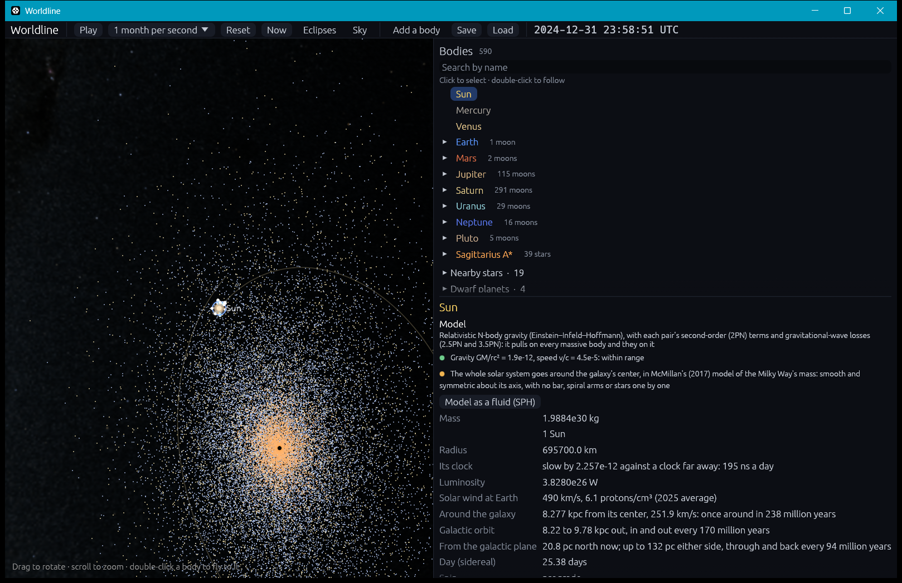

# The galaxy's stars as a swarm

**Code:**
- `crates/worldline-core/src/galaxy_stars.rs`: drawing stars in equilibrium, moving them, and checking a swarm against the model;
- `crates/worldline-data/examples/galaxy_stars.rs`: draws the swarm the app uses;
- `crates/worldline-app/src/simulation.rs`: `GalaxySwarm`, stepping it and what pulls on it;
- `crates/worldline-app/src/view.rs`: `draw_galaxy_stars`.

**Data:** `crates/worldline-data/data/galaxy-stars.csv`, written by `cargo run --release -p worldline-data --example galaxy_stars 30000 1` (about 3 minutes on all cores).

**Tests:**
- unit tests in `galaxy_stars.rs`;
- `crates/worldline-core/tests/validation_galaxy_stars.rs`: the method, afresh, and a black hole passing through;
- `crates/worldline-data/tests/validation_galaxy_stars.rs`: the swarm the app uses;
- `the_galaxy_swarm_steps_feels_a_black_hole_and_saves` in `crates/worldline-app/src/simulation.rs`.

**Sources:**
- **The galaxy:** McMillan (2017), *MNRAS* 465, 76, as in [milky-way.md](milky-way.md). Its bulge and thin and thick disks are the stars. Its gas disks and dark halo hold none.
- **Velocities:** the axisymmetric Jeans equations for a distribution of energy and angular momentum about the axis alone (Binney & Tremaine 2008, *Galactic Dynamics*, ch. 4), split into rotation and dispersion by Satoh's (1980, *PASJ* 32, 41) k = 1.
- **Equilibrium:** Schwarzschild's (1979, *ApJ* 232, 236) method of superposing orbits, the weights found by Richardson's (1972, *JOSA* 62, 55) and Lucy's (1974, *AJ* 79, 745) iteration.
- **The kick from a passing body:** the impulse approximation (Binney & Tremaine 2008, §8.2), as in step 2.1b ([swarm.md](swarm.md)).
- **Checking a sample:** Pearson's χ², its 99.9% point by Wilson & Hilferty (1931, *PNAS* 17, 684).
- **Random numbers:** SplitMix64 (Steele, Lea & Flood 2014, *OOPSLA*), seeded, so the same stars come every time.

## Why it matters

Step 2.9 gave the galaxy its mass as a smooth model, but its stars weren't there. Now 30,000 of them are, as dots that move through the galaxy's gravity and feel anything heavy dropped among them. A black hole passing through the disk scatters the stars it passes.

## The stars

Each stands for 1.82 million Suns of the model, not a star that exists:

| Component | Stars | Mass |
|---|---|---|
| Thin disk | 19,335 | 3.52 × 10¹⁰ Suns |
| Thick disk | 5,786 | 1.05 × 10¹⁰ Suns |
| Bulge | 4,879 | 8.87 × 10⁹ Suns |

**Places** are drawn from each component's density:
- a disk's radius from Σ(R) R, its height from its vertical profile;
- the bulge's spheroidal radius from its mass's distribution, then a direction, squashed by its axis ratio.

**Velocities** are what the model doesn't give: its mass says nothing about how its stars move. The Jeans equations say what the velocities' spreads must be for the stars to stay as they are, in the whole galaxy's potential:
- σ_R = σ_z = σ, with ρσ² = ∫_z^∞ ρ ∂Φ/∂z′ dz′;
- ⟨v_φ²⟩ = σ² + (R/ρ) ∂(ρσ²)/∂R + R ∂Φ/∂R.

They're solved on a grid 400 points in radius by 500 in height. At the Sun the thin disk's σ comes out 16.8 km/s, and √⟨v_φ²⟩ 230.3 km/s against a circular speed of 233.1: it turns a little slower than a circular orbit, as a warm disk does. σ_R = σ_z, and rotation taking all of ⟨v_φ²⟩ beyond σ², are Worldline's choices among the many that keep the density.

## Why drawing from the Jeans equations isn't enough

Gaussians with those spreads get the averages right, but not the shape of the distribution, so the stars drift. Drawn so, 20,000 stars start as the model (χ² 139.2 over 129 degrees of freedom, against a limit of 184.4). After a galactic year they've drifted (223.1), with 37% too many stars at 9 to 10 kpc and 0.3 to 0.6 kpc from the plane. The bulge's Gaussian tails throw stars past its cutoff, and the thick disk swells and shrinks.

## Equilibrium by orbits

Schwarzschild's method builds a system that stays as it is:
1. **Orbits:** three for every star wanted, drawn from the Jeans equations: near equilibrium, if not in it.
2. **Settle and watch:** each is let mix for 216 million years, a galactic year at the Sun, then watched for 864 million, where it is recorded every million.
3. **Weights:** each orbit is weighted so that, all together, the time they spend in each of 35 × 16 bins in radius and height is the component's mass there. Richardson–Lucy iteration, 200 rounds.
4. **Stars:** drawn from the orbits by weight, each at a random moment of its watch.

An orbit's weight depends on nothing that changes along it, and its star is equally likely to be at any moment of it, so the swarm stays as it is. It takes about 3 minutes for 30,000 stars, too long at every start. So the swarm is drawn once, by the command above, and saved as data.

## How they move

- **In the galaxy's potential:** each star by leapfrog steps of its own, a fiftieth of its dynamical time √(r/|a|), about 300 an orbit. A star's energy is kept to 1.5 × 10⁻⁵ of ½v_c² over 400 million years.
- **Pulled by heavy bodies:** every body of the simulation as heavy as a hundredth of a Sun, in any region: the Sun, the nearby stars, Sagittarius A\*, anything dropped. A star's steps shorten near one, to a fiftieth of the time to cross the distance, or of the body's dynamical time there. Planets are left out: Jupiter pulls on a star a parsec away at 1.3 × 10⁻¹⁶ m/s², and the swarm's nearest star is 235 pc from the Sun.
- **Swallowed:** a star reaching a body's surface or horizon is gone.
- **Massless:** they pull on nothing. Their mass is the smooth model's, which is what the solar system feels.

**In the app** the swarm is stepped every 1,000 years of simulated time, and carried in straight lines between steps for drawing. That's off by ½(1,000 years/dynamical time)² of a star's distance from the center: under 10⁻⁶, as no star's dynamical time is under 0.7 million years. Between steps a body's path is the cubic through where it was and is. Saves keep the swarm. The clusters, the Orion Nebula and the satellite galaxies of step 7.3 are stepped with it, by the same code ([clusters-and-galaxies.md](clusters-and-galaxies.md)).

## Validation

**The roadmap's checks:**

| Check | Expected | Result |
|---|---|---|
| The app's 30,000 stars, as drawn, against the model's density in 18 × 8 bins of radius and height | χ² under its 99.9% point: no further off than chance allows once in a thousand times | 145.2 over 137 degrees of freedom, limit 193.9 |
| The same, left alone for a galactic year (216 million years) | the same | **130.3**, limit 193.9 |
| A million-Sun black hole falling through the disk at 1,000 km/s, among 300 stars within 30 pc of the Sun's radius | each kick as the impulse approximation gives it, to twice what it leaves out: the kick over the relative speed (the star pulled off its straight path), and the galaxy's tide on the kick before it's measured, ½|T|τ² | kicks up to 16.58 km/s; the worst off by 0.88 of what's allowed |

**The density check** (`cargo test --release -p worldline-data --test validation_galaxy_stars -- --include-ignored --nocapture`) counts the swarm's stars in each bin against what the model's mass there says. Any sample is noisy, and χ² measures how noisy. Stars that drift, as the Jeans-drawn ones do, push it far past the limit.

**The flyby** (`cargo test --release -p worldline-core --test validation_galaxy_stars -- --include-ignored --nocapture`) aims the hole where the patch will be when it crosses the plane, as the disk turns. Each kick is measured five crossing times after closest approach, against an undisturbed copy of the same star. So the prediction keeps the part of the kick along the path that hasn't yet cancelled, (GM/bV)(b/√(Z₁² + b²) − b/√(Z₂² + b²)).

**Also checked:**

| Check | Expected | Result |
|---|---|---|
| The method afresh: 6,000 stars from 18,000 orbits, then a galactic year | χ² under its limit, both times | 84.2 and 82.3 over 100, limit 149.5 |
| Drawn from the Jeans equations alone | starts as the model, then drifts past the limit | 139.2, then 223.1 over 129, limit 184.4 |
| Each component's share of the stars | its mass's share, to a star | 19,335, 5,786, 4,879 against 19,334.8, 5,785.8, 4,879.3 |
| In the app: a hundred-million-Sun hole 10 pc from a star, moving with it, for 2,000 years | its pull GM/d² plus the galaxy's, to twice how much the hole's pull changes as the star falls, 2 × 2Δd/d = 3.6 × 10⁻³ | 8,823.36 m/s against 8,817.51: off by 6.6 × 10⁻⁴ |
| A save and load | every star to the last digit | passes |

## In the app

```bash
cargo run --release -- --focus Sun --zoom 1.5e12 --pitch 50 --paused
```

From 100 parsecs out the swarm is drawn: thin-disk stars bluish white, thick-disk ones pale yellow, the bulge's orange. The colors only tell the populations apart.



## Where it's valid

- **A picture, not a census.** Each star stands for 1.82 million Suns, so near the Sun there are none: the nearest is 235 pc away. Gaia's measured stars near the Sun aren't in the swarm yet.
- **How they move is Worldline's.** The model gives the mass; σ_R = σ_z and the split of rotation are choices among the many that keep it. Measured disk stars move more in radius than in height.
- **No bar or spiral arms:** the model has none.
- **Equilibrium to the check's resolution:** the weights fit the model in 35 × 16 bins, and the check uses 18 × 8. Finer structure is as the Jeans orbits left it.
- **Their own pull is left out.** A swarm that pulled on itself would need a galaxy-scale self-gravitating simulation, which is in v2.
- **Only heavy bodies pull on them:** a hundredth of a Sun or more.
- **Between the app's steps,** a body's path is the cubic through its two ends, which is wrong for one orbiting fast; it matters only for a star within a few times that orbit's size.
