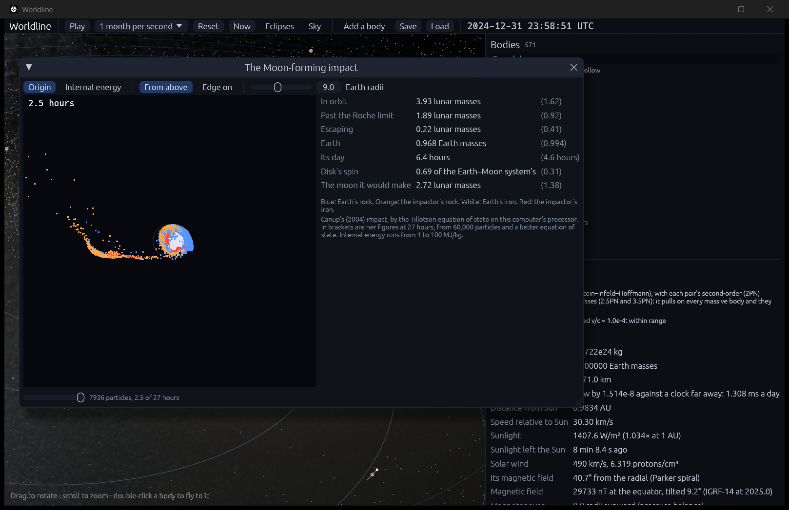

# Giant impacts as fluids

**Code:**
- `crates/worldline-core/src/tillotson.rs`: the equation of state of rock and iron;
- `crates/worldline-core/src/giant_impact.rs`: planets in equilibrium, the impact, and measuring the disk;
- `crates/worldline-core/src/sph.rs`: the fluid, now of mixed materials;
- `crates/worldline-app/src/impact_lab.rs`: the window.

**Tests:**
- unit tests in `tillotson.rs` and `giant_impact.rs`;
- `crates/worldline-core/tests/validation_giant_impact.rs`.

**Sources:**
- Canup (2004), *Icarus* 168, 433: the impact, the planets' make-up, how a disk is measured, and the results it's checked against.
- Tillotson (1962), General Atomic report GA-3216, which wasn't read: the equation of state, as Reinhardt & Stadel (2017), *MNRAS* 467, 4252, give it in their Appendix A, with their Table A1's constants for olivine (Marinova et al. 2011) and iron (Benz et al. 1987).
- Reinhardt & Stadel (2017): pressure held at zero when stretched, and the 50 m/s test of a settled planet.
- Darwin–Radau, for the flattening of a spinning planet: a standard result, and Worldline's way of doing what Canup's iteration needs. Her paper points to Canup et al. (2001) for the detail, which wasn't read.

## Why it matters

Steps 6.1 to 6.3 treat a collision with scaling laws: quick, and right on average, but they can't say where the rock goes. The Moon is the reason to do better. The leading explanation of its origin is that a body about the size of Mars struck the young Earth, and what was thrown into orbit became the Moon. Only a simulation of the two planets as fluids can show that, and Canup's (2004) simulations are the standard account of it.

## Rock and iron

An ideal gas won't do for a planet: rock barely compresses, then vaporizes. The Tillotson equation of state gives pressure from density and internal energy, in three regions:
- **Solid or compressed:** P = (a + b/w) uρ + Aμ + Bμ², with η = ρ/ρ₀, μ = η − 1 and w = u/(u₀η²) + 1. A is the bulk modulus, so this is a stiff solid.
- **Expanded and hot, past complete vaporization:** the same terms dying away exponentially with expansion, leaving an ideal gas, P = a uρ.
- **In between:** a straight mix of the two in u.

Cold, stretched rock would pull back. A fluid breaks into droplets instead, so the pressure stops at zero.

Canup used M-ANEOS, a better equation of state, which treats melt and vapor as real phases with a thermodynamic consistency Tillotson lacks. The roadmap's choice of Tillotson is the older and simpler one: it's what Canup & Asphaug (2001) used, and Canup (2004) compares the two. Her finding is that Tillotson gives somewhat more massive disks with less iron.

**The materials** are olivine, the closest in Reinhardt & Stadel's table to Canup's dunite, and iron. There's one set of constants each for every particle, with the digits as printed.

## A planet in equilibrium

The structure is integrated inward from the surface, at zero pressure and a chosen temperature, with:
- dm/dr = 4πr²ρ;
- dρ/dr = −ρGm/(r²c²), hydrostatic balance on an isentrope, c being the sound speed;
- du/dr = (P/ρ²) dρ/dr.

At the core the pressure and temperature carry over and the material changes. The radius is found by halving, until the mass runs out at the center.

The surface is at 2000 K, Canup's "warm start". The heat capacities that turn this into an energy are Reinhardt & Stadel's for granite, standing in for olivine, and iron. They matter little.

| An Earth of 30% iron | Worldline | Real Earth |
|---|---|---|
| Radius | 6,558 km | 6,371 km |
| Core radius | 3,273 km | 3,480 km |
| Pressure at the core's top | 135 GPa | about 136 GPa |
| Density across that boundary | 5,093 to 10,811 kg/m³ | about 5,500 to 9,900 kg/m³ |
| Pressure at the center | 384 GPa | about 364 GPa |

That's a two-material model with no adjustment made to fit Earth, so the agreement is a good sign and isn't a test of it. Earth's core also holds lighter elements, which this doesn't, and its radius comes out 3% large.

**As particles:** a cubic lattice in a sphere, each point moved along its radius until the mass inside it is the planet's. It's then settled for five dynamical times with its motion damped and its energies held.

**Stable?** An impactor of 2,008 particles, settled, then left alone for 10 hours: r.m.s. speed at most 32 m/s, under the 50 m/s Reinhardt & Stadel take for a relaxed planet, with energy kept to 1.1 × 10⁻⁶.

## The impact

Canup's §4.1, as in her Table 1:

| | |
|---|---|
| Total mass | 1.019 Earth masses |
| Impactor's share, γ | 0.13 |
| Speed at infinity | 0, so they meet at their mutual escape speed |
| Scaled impact parameter, b′ | 0.73: the impact's angular momentum over a grazing one's |
| Each body | 30% iron, in a core |
| Viscosity | α up to 1.5, β = 2α, as hers |

They start 1.5 times the sum of their radii apart, on a parabola, and run for 27 hours.

**b′ was held, not the angular momentum.** Canup's 0.73 goes with 1.25 times the Earth–Moon system's angular momentum and 9.3 km/s, for radii adding up to about 9,400 km. Worldline's planets are about 5% larger, adding up to 9,885 km. So at the same b′ the impact carries 1.286 of it, at 9.07 km/s. b′ is what describes the geometry, and Canup finds it's what the outcome turns on.

## Measuring the disk

Canup's §3.3, an iteration:
1. Guess the planet's mass, and from it its radius at Earth's density, 5.5 g/cm³.
2. From its spin, with Earth's moment of inertia constant 0.335, find its equatorial radius.
3. A particle outside it with positive energy is **escaping**.
4. Otherwise, its angular momentum along the spin axis gives the circular orbit it could settle on. If that's outside the equator it's **in orbit**, and otherwise **in the planet**.
5. That gives a better mass and spin. Repeat until nothing changes.

Her eq. 1 then estimates the moon such a disk would make, from its mass and angular momentum.

## Validation

**The roadmap's check:** the canonical impact leaves a disk of the mass Canup's simulations find (`cargo test --release -p worldline-core --test validation_giant_impact -- --ignored --nocapture`, about 21 minutes).

**The limit was set before any run.** Her Table 1 has 11 warm-start runs at γ = 0.13, v = v_esc and 0.723 ≤ b′ ≤ 0.740, spanning **1.33 to 1.62 lunar masses**. Worldline's disk must lie in that span, widened by the counting noise of its own disk's particles, 1/√n.

| Particles | Mass in orbit | Disk particles | Limit with its noise | Time | |
|---|---|---|---|---|---|
| 4,000 | 1.08 lunar masses | 54 | 1.15 to 1.84 | 6 minutes | **fails,** 6% under |
| 7,936 | 1.38 lunar masses | 135 | 1.22 to 1.76 | 21 minutes | passes, and is inside 1.33 to 1.62 without the noise |

**Convergence isn't shown.** This is one pass at one resolution, and the run below it fails. The disk gained 28% on doubling the particles, more than the 16% counting noise between them. A run of 16,000 particles was started to see where that goes, and was stopped at 3 of its 27 hours, as it needs about two hours. So whether the mass settles inside her span with more particles is still unknown.

Against her run at these settings, at 27 hours, with 7,936 particles:

| | Worldline | Canup, 60,000 particles |
|---|---|---|
| Mass in orbit | 1.38 lunar masses | 1.62 (span above 1.33 to 1.62) |
| With periapsis outside the planet | 1.21 lunar masses | within a few percent of the above, she says |
| Past the Roche limit | 0.82 | 0.92 |
| Escaping | 0.41 | 0.41 in her text. Her table prints 0.71 for the same run, but only 0.41 adds up to her total mass |
| Earth | 0.997 Earth masses | 0.994 |
| Earth's day | 4.35 hours | 4.6 hours |
| Disk's angular momentum | 0.28 of the Earth–Moon system's | 0.31 |
| Planet and disk's | 1.21 | 1.18 |
| Iron in the disk | 9.5% | 5% |
| From the impactor | 74% | 82% |
| The moon it would make | 1.33 lunar masses | 1.38 |

**Kept over the run:** energy to 6.1 × 10⁻⁴, against 10⁻³ in hers; angular momentum to 3.9 × 10⁻⁹, against 10⁻⁴; momentum to 9.3 × 10⁻¹⁰ of its scale.

**The story matches too.** The impactor shears into an arm by about 3 hours, part of it falls back and strikes again around 6 hours, and what's left settles into a disk, as in her Figure 2.

**Where it's weaker:**
- **The disk is still shrinking.** It holds 2.09 lunar masses at 12 hours and 1.38 at 27, so the answer depends on when it's read. 27 hours is her Figure 2's end, and her table's runs end at 22 to 30.
- **Iron** is about twice hers. She warns it's the most variable number of all, and 9.5% here is 13 particles of 135.

**Also checked:**
- the Tillotson pressure's slopes match finite differences, its regions join without a jump, and a thin vapor is an ideal gas with γ = 1 + a;
- the structure's pressure balances gravity at every depth;
- the disk measure finds nothing around a lone planet, and sorts one particle on a circle and one flung away correctly;
- the rewritten fluid still gives step 4.1's numbers exactly: Jupiter moved at most 0.0206 R, with kinetic energy at most 1.6 × 10⁻⁴ of the binding energy.

## In the app

```bash
cargo run --release -- --moon-impact 8000 --paused
```

Or select Earth, then **The Moon-forming impact** in the inspector. A window opens with the impact from above, or edge on, colored by where the material came from or by its internal energy, with the results beside it and Canup's in brackets. It takes about 20 minutes of this computer's time for the 27 hours, and every 5 simulated minutes is kept, so the slider replays it. A smaller number runs faster and less well: 2,000 takes 2 or 3 minutes, and at 4,000 the disk already comes out too light.



The window stands apart from the main view: the impact happened 4.5 billion years ago, so it doesn't touch today's solar system.

## Where it's valid

- **Resolution.** 8,000 particles against her 60,000 and up. A lunar mass of disk is about 100 particles here, so anything finer isn't resolved. Her paper notes the mass and angular momentum in orbit are the sturdy results, and early 3,000-particle runs gave similar ones.
- **Tillotson has no phases.** Melt and vapor mixtures are an interpolation, so the disk's vapor share isn't reported, and neither are temperatures: the equation of state has no temperature of its own.
- **No new physics of the disk.** It's a day old. How it becomes a moon is estimated by eq. 1, not simulated.
- **SPH's known limits.** It's known to clump spuriously, and to treat the boundary between rock and iron crudely, as a density smoothed across it. No correction is made for either, as in Canup's runs. Reinhardt & Stadel's surface correction isn't used.
- **The planets aren't spinning,** and the bodies are exactly the canonical pair. Other impacts can be set in code, but the app runs only this one.
- **The largest smoothing length is held at Earth's radius,** Worldline's choice: a lone particle beyond it flies under gravity alone.
- **The sound speed has a floor,** a tenth of the sound speed at rest, in stretched cold rock where it has no meaning: Worldline's choice, for the time steps and viscosity only.
- **On the processor, not the GPU.** The GPU has no double precision and its fluid is an ideal gas, so this runs in `worldline-core`, in double precision.
- **A collision in the main view still uses the scaling laws** of steps 6.1 and 6.2.
