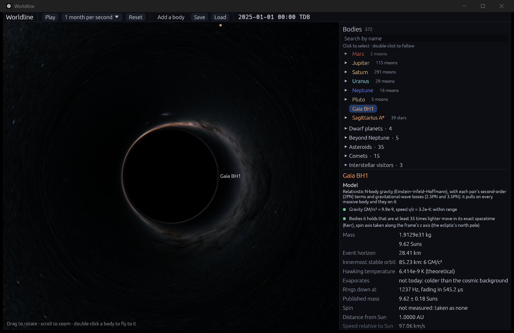
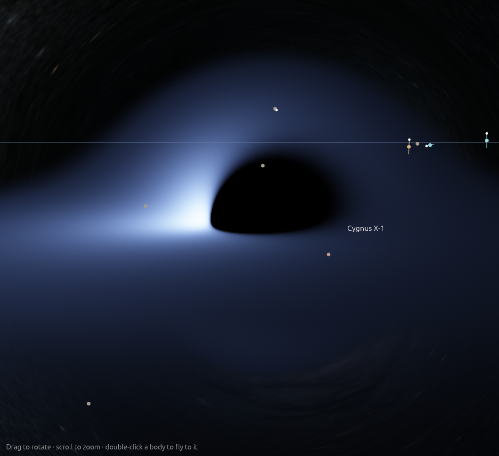

# Light bent by a black hole, and the sky behind everything

**Code:**
- `crates/worldline-core/src/lensing.rs`: rays through a non-spinning hole's spacetime, the shadow, and the table the GPU reads;
- `crates/worldline-core/src/kerr_light.rs`: rays through a spinning hole's spacetime, its shadow, and the thin disk around it (step 3.2);
- `crates/worldline-render/src/sky.rs` and `sky.wgsl`: the sky pass, which also traces rays past a spinning hole;
- `crates/worldline-app/src/sky.rs`: the sky map;
- `crates/worldline-data/src/stars.rs`: the bright stars.

**Data:** `crates/worldline-data/data/bright-stars.csv` and `crates/worldline-app/assets/textures/gaia_edr3_sky_2k.png`, both fetched by `tools/fetch_sky.py`.

**Tests:** `crates/worldline-core/tests/validation_lensing.rs` and `validation_kerr_light.rs`, `crates/worldline-render/tests/validation_kerr_gpu.rs` (needs a GPU), plus unit tests in each crate.

**Sources:**
- **Rays near a black hole:** Binet's equation for light in Schwarzschild spacetime, d²u/dφ² + u = 3GMu²/c² with u = 1/r (e.g. Misner, Thorne & Wheeler 1973, §25.6).
- **The exact bending:** Darwin (1959), *Proc. R. Soc. A* 249, 180, as an elliptic integral computed by Carlson's method (Carlson 1988, *Math. Comp.* 51, 267; 1995, *Numer. Algorithms* 10, 13).
- **The shadow's edge seen from any distance:** Synge (1966), *MNRAS* 131, 463.
- **The sky:**
  - **The Milky Way:** "The colour of the sky from Gaia's Early Data Release 3", ESA/Gaia/DPAC, CC BY-SA 3.0 IGO, acknowledgement A. Moitinho.
  - **The bright stars:** the Yale Bright Star Catalogue, 5th revised edition (Hoffleit & Warren 1991), CDS catalog V/50.
- **Star colors:** Ballesteros (2012), *EPL* 97, 34008, for temperature from B − V.
- **A spinning hole (step 3.2):**
  - **Its spacetime:** Kerr (1963), in Kerr–Schild coordinates (Kerr & Schild 1965; Visser 2007, arXiv:0706.0622), as the engine already uses for motion ([kerr.md](kerr.md)).
  - **Rays' constants:** Carter (1968), *Phys. Rev.* 174, 1559.
  - **The camera, orbits and photon orbits:** Bardeen, Press & Teukolsky (1972), *ApJ* 178, 347: the zero-angular-momentum observer, circular orbits' Ω, u^t and E, and the equatorial photon orbits.
  - **The shadow's edge:** Bardeen (1973), in *Black Holes* (Les Houches), eds. DeWitt & DeWitt, p. 215.
  - **The disk:** Novikov & Thorne (1973), in the same book, p. 343, and Page & Thorne (1974), *ApJ* 191, 499. The flux is used in the closed form Li (2002, arXiv:astro-ph/0202361, Appendix A, eqs. A1–A3) gives.
  - **Constants:** the proton mass, Thomson cross-section and Stefan–Boltzmann constant from CODATA 2018.

To see it: `cargo run --release -- --add "Gaia BH1:1" --focus "Gaia BH1" --zoom 20 --paused`.

To see it: `cargo run --release -- --add "Cygnus X-1:3" --focus "Cygnus X-1" --zoom 28 --pitch 9 --paused`.

## Why it matters

Light passing a black hole is bent, more the closer it passes.
- **The shadow:** light aimed closer than √27 GM/c² (2.6 times the horizon) falls in. So a black hole shows as a dark disk that big, its shadow, the thing the Event Horizon Telescope photographed in M87\* and Sagittarius A\*.
- **The ring:** light passing just outside the shadow is bent all the way around, so the sky behind is stretched into rings around it.
- **The Sun bends light too:** just 1.75″ at its edge. Measuring that in 1919 confirmed general relativity.
- **A spinning hole drags space around with it.** Light circling with the spin can pass closer before it is caught than light circling against it. So its shadow is lopsided, flattened on one side and shifted to the other. Gas circling it shines brighter where it comes toward you.

## Rays

A ray stays in one plane, where u = 1/r follows Binet's equation for light. Worldline traces each ray backward from the camera, which is taken at rest beside the hole.
- **The camera's angle sets the ray:** looking at angle ψ from the direction to the hole, the impact parameter is b = r sin ψ / √(1 − 2GM/c²r).
- **The shadow's edge** falls where Synge's formula puts it, sin ψ_c = √27 (GM/c²r) √(1 − 2GM/c²r). Rays inside it fall in.
- **Tracing:** fourth-order Runge–Kutta on Binet's equation, in steps of φ. The ray ends where u reaches 0, found on the cubic through the last step.
- **The result:** a ray that gets away has swept π − ψ + δ(ψ) around the hole from the camera, δ its bending. It then heads off in that direction, toward the sky.

**From the exact answer.** For a ray from and to far away, the bending is 2∫₀^u_t du/√(1/b² − u² + 2GMu³/c²) − π, u_t the turning point. That is an elliptic integral, done by Carlson's R_F, with the cubic's three roots found by trigonometry and polished by Newton's method far out. Far from the hole it is 4GM/(c²b) + (15π/4)(GM/c²b)² + ….

## What the GPU does, and doesn't

The GPU has no double precision, and in Worldline it knows nothing about physics. So the physics stays on the CPU:
- **The table:** for the camera's distance from the hole, `BendTable` traces 2,048 rays in double precision and tabulates δ(ψ). They are sampled evenly in x = ln((ψ − ψ_c)/(π − ψ_c)), since δ grows like −ln(ψ − ψ_c) toward the edge.
- **Cost and refresh:** building it takes a few milliseconds on all cores. It is built again whenever the camera has moved a thousandth of its distance.
- **The GPU's part,** for each pixel: its ray's angle ψ, δ looked up in the table, the direction the ray ends up in, and the sky map there. Black if ψ ≤ ψ_c.
- **Which hole:** the one whose Einstein ring, √(4GM/c²r) across, is widest from the camera, once that spans half a pixel. Any other is drawn as a dark disk the size of its shadow.

## A spinning hole (step 3.2)

Close to a hole, within 10,000 GM/c², the rays are traced one by one, through Kerr spacetime with the hole's spin. Farther out, the table above serves; there the spin moves the image by under 10⁻⁴ of the camera's distance in GM/c².

**Rays.** Worldline traces them in Kerr–Schild Cartesian coordinates, the ones the engine uses for motion near a hole. The metric is g = η + f l⊗l, with
- r from (x² + y²)/(r² + a²) + z²/r² = 1;
- f = 2r³/(r⁴ + a²z²);
- l = ((rx + ay)/(r² + a²), (ry − ax)/(r² + a²), z/r);

in units of GM/c², spin a along +z. Its inverse is η − f l l, so a ray of energy E has the Hamiltonian 2H = |p|² − E² − f (E + l·p)² = 0, and
- dx/dλ = p − f (E + l·p) l;
- dp/dλ = ½ (E + l·p)² ∇f + f (E + l·p) ∇(l·p).

Boyer–Lindquist coordinates, where the equations separate (Carter 1968), break down on the spin axis, and rays passing behind the hole cross it. These coordinates don't break down there. A ray keeps its energy, its angular momentum about the spin axis L = x p_y − y p_x, and Carter's constant Q. The tests check all three are kept.

**The camera** is a zero-angular-momentum observer: it turns with the hole's frame dragging and measures the ray's energy as 1. For a hole that doesn't spin, it is at rest, as in step 3.1. A ray it sees along a direction gets its Boyer–Lindquist momentum from the observer's frame. That is turned into Kerr–Schild components, whose time and φ run ahead of Boyer–Lindquist's by ∫ 2r dr/Δ and ∫ a dr/Δ. The result is linear in the look direction, a 4 × 4 matrix the GPU is handed.

**Where a ray ends:**
- **It falls in** when it moves inward inside the smaller equatorial photon orbit, 2(1 + cos(⅔ arccos(−a))): nothing there can turn back out. This stops it before the coordinates' trouble at the hole's past horizon.
- **It reaches the sky** when it moves outward past 100,000 times the camera's distance in core, 100 times on the GPU. Past R, a ray passing at b would bend by under GM b/(c²R²) more.

In double precision (core) the steps are Dormand–Prince 5(4), with each step's error held to a given tolerance.

**The shadow's edge** is made of rays that spiral toward Bardeen's spherical photon orbits. A ray on an orbit of radius r has ξ = L/E = (r²(3 − r) − a²(r + 1))/(a(r − 1)) and η = Q/E² = r³(4a² − r(r − 3)²)/(a²(r − 1)²). From far away at inclination i it appears at α = −ξ/sin i, β = ±√(η + a² cos²i − ξ² cot²i). Seen edge on at a = 0.99, the shadow spans α = −2.25 to 6.98 GM/c², against ±5.20 without spin.

**The disk** is visual only (SCOPE). It is a thin disk in the equatorial plane, as Novikov and Thorne describe one:
- **Extent:** from the innermost stable orbit out to 25 GM/c², fading to clear from 15 GM/c² so it has no hard edge (a choice).
- **Feeding:** at a tenth of the Eddington rate (a choice): Ṁc² = L_Edd/η, with L_Edd = 4πGMm_pc/σ_T, and η = 1 − E_ms the fraction of its rest energy the gas radiates on the way down.
- **Light:** each face radiates the flux Page and Thorne found, F = Ṁc²/(4π(GM/c²)²) × 3/(2x⁴(x³ − 3x + 2a)) [x − x₀ − (3a/2) ln(x/x₀) − Σᵢ 3(xᵢ − a)²/(xᵢ(xᵢ − xⱼ)(xᵢ − xₖ)) ln((x − xᵢ)/(x₀ − xᵢ))]. Here x = √r, x₀ is that at the innermost stable orbit, and x₁, x₂, x₃ are the roots of x³ − 3x + 2a = 0. It glows as a blackbody, σT⁴ = F.
  - **Example temperatures:** a 10-Sun hole's disk peaks near 4 × 10⁶ K, and Sagittarius A\*'s near 1.5 × 10⁵ K. (The real Sagittarius A\* is fed far more slowly and has no such disk.)
- **Shift:** the gas circles at Ω = 1/(r^(3/2) + a), with u^t = (r^(3/2) + a)/(r^(3/4) √(r^(3/2) − 3r^(1/2) + 2a)). Light from it reaches the camera shifted by g = 1/(u^t (E − ΩL)), and a shifted blackbody looks like one at gT. So the gas coming toward you looks hotter and much brighter, and the gas going away cooler and dimmer.
- **Drawn:** with the tint of a blackbody at gT, and a brightness that is the square root of its total light, (gT)², so the dim outer disk shows along with the bright inner one. Both the tint and the scale are visual choices.

The **Accretion disk** option turns it off. With the starfield off, the hole and its disk are still drawn, on black.

**On the GPU,** each pixel's ray is traced in single precision, by fourth-order Runge–Kutta:
- **Steps** are κr long. A ray moving at angle α to the line from the hole is bent at about 2 sin α/r² per unit length, and a step's error is about that bending times κ⁴. κ is chosen to keep that near 10⁻⁶ rad, between 3% of r near the hole and r far out.
- **The disk:** where a step crosses the equatorial plane inside it, the crossing is found by straight interpolation, and the light is looked up from tables the app works out in double precision: temperature, Ω and u^t at 256 radii, and colors at 512 temperatures.
- **Cost:** 40 to 50 ms for 800 × 500 rays on an Intel Iris Xe. So the view is traced at half the screen's resolution, where a pixel spans about what a texel of the sky map does. It is traced again only when the view changes.
- **Accuracy:** checked against core's double-precision rays, which the shader is a single-precision copy of (see the validation table).

## The sky

- **The Milky Way:** Gaia's map of its glow (2,000 × 1,000, equirectangular in galactic coordinates), enlarged to 4,096 × 2,048.
- **The stars:** the 9,096 stars of the Bright Star Catalogue with positions, drawn into the map as small spots at their exact places.
  - **Brightness:** their flux, 10^(−0.4V), shown as bright as fits up to magnitude 2.3, beyond which they saturate. That's visual.
  - **Color:** from B − V, by Ballesteros's temperature and Planck's law at a display's red, green and blue.
- **Orientation:** the simulation's axes are turned into galactic ones by the obliquity and the Hipparcos rotation. Sagittarius A\* lands in the middle of the map, within a texel.
- **Detail for each pixel:** its level of detail comes from how much sky the pixel covers. So the map's seam doesn't show, and the sky blurs properly where the hole squeezes it.
- **The Starfield option** turns the sky off.

## Where it's valid

- **Spin is shown within 10,000 GM/c² of the hole.** Farther out, the image is drawn as for a hole that doesn't spin. The spin's effect there is under 10⁻⁴ of the distance in GM/c², but zooming far in on a distant spinning hole shows its shadow round.
- **The spin axis** is the frame's z axis (the ecliptic's north pole), as for motion near a hole ([kerr.md](kerr.md)).
- **The camera at rest beside the hole,** or for a spinning hole, turning with its frame dragging. A camera moving fast would also see aberration.
- **The disk is visual:** its extent, its feeding rate and how its light is drawn are choices. The gas isn't simulated, and nothing in the simulation feels it. Its light is bent and shifted as general relativity predicts.
- **One hole bends the sky;** the rest are drawn as dark disks.
- **Only the sky is bent.** Bodies, orbits and labels in front of or behind the hole are drawn unbent, and something behind the hole shows through its shadow.
- **The sky is as seen from the solar system:** from the galactic center the real sky would differ.
- **Star brightness and color** are visual approximations.

## Validation (`cargo test`)

`cargo test --release -p worldline-core --test validation_lensing -- --nocapture`:

| Check | Expected | Result |
|---|---|---|
| The shadow's edge, found by tracing rays from 3.5, 6, 30, 1,000 and a million GM/c² | Synge's sin ψ_c = √27 (M/r)√(1 − 2M/r): the impact parameter there √27 = 5.196152423 GM/c² | 4.1 × 10⁻¹⁴ apart; from 6 GM/c², exactly 45° |
| The shadow's radius from far away | √27 GM/c² | to rounding |
| Rays traced from far away against Darwin's exact bending, for b = 5.25 to 10,000 GM/c² | equal, to the tracing's step⁴ (10⁻¹²) | 5.7 × 10⁻¹³ rad |
| Light grazing the Sun (b = 696,000 km) | the roadmap's 1.75″; and 4GM/c²R + (15π/4)(GM/c²R)², to the next order's 10⁻¹⁰″ | 1.7512013″ = 1.7511903″ + 0.0000110″ |
| The table the GPU reads, from 2.5 (inside the photon sphere), 8, 40 and 10,000 GM/c² | moves the sky on screen by under a tenth of a pixel (0.8 rad over 1,080 rows), the table's error divided by how much the hole magnifies there | at most 0.006 pixel |

Other checks:
- `cargo test -p worldline-data stars`: the stars' positions, carried back to 1950 by their proper motions and turned into galactic coordinates, match the catalogue's own galactic coordinates. The median star is 0.0037° off, within half their last digit.
  - Without carrying them back, the fast movers (61 Cygni, Groombridge 1830, α Centauri) are off by up to 0.09°: that is how the epoch was found.
  - 8 of 9,096 entries stay off, by up to 0.023° (HR 7705); those coordinates disagree with the catalogue's own positions.
- `cargo test -p worldline-render`: the sky shader compiles and validates, and its uniforms' layouts as naga computes them match the Rust side.
- `cargo test -p worldline-app sky`: Sagittarius A\* lands in the middle of the sky map, and star colors run from bluish to red as B − V grows.
- **In the app:** Gaia BH1 seen from 40 GM/c² (above) shows a shadow 146.0 px in radius across and down, centered on the view. Synge's 7.274° in a view 967 px tall puts it at 146 px.

### A spinning hole

`cargo test --release -p worldline-core --test validation_kerr_light -- --nocapture`:

| Check | Expected | Result |
|---|---|---|
| Without spin, 13 rays from 6, 40 and 10,000 GM/c², out of the plane, against step 3.1's | the same, to the steps taken × the tolerance (10⁻¹²) plus step 3.1's error: 4.8 × 10⁻¹⁰ rad | 5.5 × 10⁻¹³ rad |
| The shadow's edge, found by halving between rays that fall in and get away, along 12 directions, for (a, i) = (0.5, 30°), (0.9, 60°), (0.9, 90°), (0.99, 90°) | the edge rays' η = Q/E² is Bardeen's for the photon orbit their ξ names, to the tracer's error, steps × 10⁻¹²: 3.8 × 10⁻⁹ to 2.2 × 10⁻⁸ | 1.2 × 10⁻¹² to 7.9 × 10⁻¹¹. Lopsided as Bardeen has it: at a = 0.99, edge on, from −2.252 to 6.983 GM/c² across the spin axis, as his outline |
| Without spin, 45 rays crossing a disk, seen face on, from 60° and from 85° | where Binet's equation (step 3.1's) puts them when they have swept round to the equator, and shifted by g = √(1 − 3/r)/(E − ΩL), to steps × 10⁻¹²: 6.5 × 10⁻¹⁰ | radius 1.5 × 10⁻¹², shift 3.7 × 10⁻¹³ |
| **The roadmap's check:** a = 0.9, seen 80° from the axis, light from the disk near r = 9 on each side | brighter on the side coming toward you: g > 1 there, g < 1 on the other | g = 1.2706 coming toward you, 0.6058 going away; brightness, ∝ g⁴, 19.4 times greater |
| The disk's flux in Li's closed form, against the integral it solves, F = −Ω′(E − ΩL)⁻² ∫(E − ΩL)L′ dr / r, for a = 0, 0.5, 0.9, 0.998 out to 1,000 GM/c² | equal, to the integral's numerical error, 10⁻¹⁰ | 1.7 × 10⁻¹¹ |

Other checks:
- `cargo test -p worldline-core kerr_light`:
  - rays leave the camera as light, H = 0 to rounding;
  - the camera's matrix gives the same rays;
  - over 200 steps a ray keeps its energy, L and Q to 2 × 10⁻¹⁰ (measured: Q off by 4 × 10⁻¹⁵);
  - Bardeen, Press & Teukolsky's photon orbits are 3 without spin and 1 and 4 at the fastest spin.
- `cargo test --release -p worldline-render -- --ignored --nocapture` (needs a GPU): the shader's rays against core's, 8,000 for each of three cameras (a = 0.9 from 31 GM/c², 0.99 from 12, 0 from 548).
  - **The standard** is a pixel of the usual view, 7.4 × 10⁻⁴ rad.
  - **Most rays:** 99% land on the sky within a tenth of a pixel. Measured: 4.5 × 10⁻⁶, 6.1 × 10⁻⁶ and 1.8 × 10⁻⁵ rad; medians 2 to 5 × 10⁻⁷.
  - **Rays that circle the hole first** carry any error e^(2π) times further each turn. Where a ray's end on the sky moves A times as far as its start, its error in the picture is A times smaller, and that is held to a tenth of a pixel too. All 27 such rays pass.
  - **At the edge:** no ray disagrees about falling in except within a pixel of the shadow's edge.
  - **Timing:** it also reports the frame time, 40 to 50 ms on an Intel Iris Xe.
