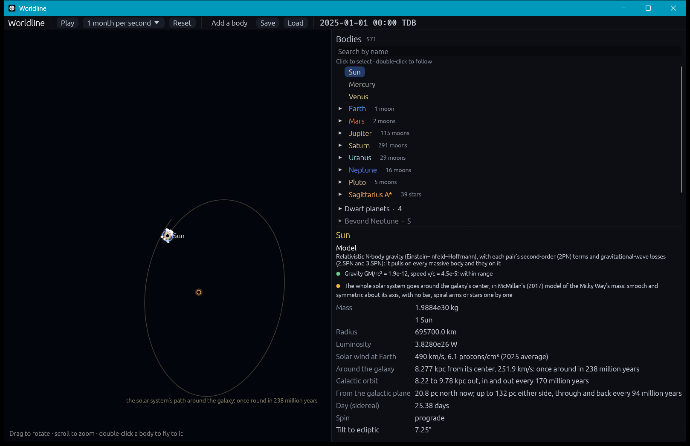

# The Milky Way: its mass, and the solar system's orbit around its center

**Code:** `crates/worldline-core/src/milky_way.rs` (the mass model, its potential, orbits in it), `crates/worldline-data/src/galactic_center.rs` (the solar system's measured place and motion), `crates/worldline-app/src/simulation.rs` (the galactic center region moving with it)
**Data:** `crates/worldline-data/data/sun-galactic-motion.csv`, written by `tools/write_galactic_center.py`
**Tests:** `crates/worldline-core/tests/validation_milky_way.rs`, the galactic center's in `crates/worldline-data/tests/validation_galactic_center.rs`, plus unit tests

**Sources:**
- **The mass model:** McMillan (2017), *MNRAS* 465, 76, and his best fit's full-precision parameters, the file `pot/PJM16_best.Tpot`, published with the paper's code (GalPot, github.com/PaulMcMillan-Astro/GalPot).
- **Solving it:** Dehnen & Binney (1998), *MNRAS* 294, 429, the method GalPot uses.
- **Where the solar system is:**
  - the distance to Sagittarius A\*: GRAVITY Collaboration (2022), as in [galactic-center.md](galactic-center.md);
  - the Sun's height above the galaxy's midplane, 20.8 ± 0.3 pc: Bennett & Bovy (2019), *MNRAS* 482, 1417.
- **How it moves:**
  - Sagittarius A\*'s motion across the sky, −6.411 ± 0.008 mas/yr along the galactic plane and −0.219 ± 0.007 toward its north pole: Reid & Brunthaler (2020), *ApJ* 892, 39;
  - the Sun's motion toward the center, 11.1 ± 0.74 km/s: Schönrich, Binney & Dehnen (2010), *MNRAS* 403, 1829.

To see it: `cargo run --release -- --focus Sun --zoom 2.2e12 --paused`. The inspector shows the Sun's orbit around the galaxy.

## Why it matters

The galactic center and the solar system were separate regions, held still relative to each other. In reality the solar system goes around the galaxy's center at about 250 km/s, once every 240 million years or so.
- **What holds it in orbit** isn't Sagittarius A\*: its 4.3 million Suns pull on the Sun under 10⁻¹⁴ m/s². It's the whole galaxy's mass inside the Sun's orbit, about 10¹¹ Suns of stars, gas and dark matter, which pulls 2 × 10⁻¹⁰ m/s².
- **That mass** is now in Worldline as a smooth mass model. The galaxy's stars aren't simulated or drawn one by one, which would cost far more computing. The solar system goes around inside it, and the galactic center region moves as it does.

## The model: McMillan (2017)

McMillan's best fit to the Milky Way's measured rotation, maser motions, star counts and local density is the standard model of its mass. It has six axisymmetric parts:

| Part | Density | Parameters (`PJM16_best.Tpot`) | Mass |
|---|---|---|---|
| Bulge | ρ₀(1 + r′/r₀)^(−1.8) exp(−(r′/r_cut)²), r′² = R² + (z/q)² | ρ₀ = 9.8351 × 10¹⁰ M☉/kpc³, r₀ = 0.075 kpc, r_cut = 2.1 kpc, q = 0.5 | 8.87 × 10⁹ M☉ |
| Thin star disk | Σ₀/(2z_d) exp(−\|z\|/z_d − R/R_d) | Σ₀ = 8.95679 × 10⁸ M☉/kpc², R_d = 2.49955 kpc, z_d = 0.3 kpc | 3.52 × 10¹⁰ M☉ |
| Thick star disk | the same | Σ₀ = 1.83444 × 10⁸, R_d = 3.02134, z_d = 0.9 | 1.05 × 10¹⁰ M☉ |
| Atomic gas (H I) disk | Σ₀/(4z_d) exp(−R_m/R − R/R_d) sech²(z/2z_d) | Σ₀ = 5.31319 × 10⁷, R_d = 7, R_m = 4, z_d = 0.085 | 1.07 × 10¹⁰ M☉ |
| Molecular gas (H₂) disk | the same | Σ₀ = 2.17995 × 10⁹, R_d = 1.5, R_m = 12, z_d = 0.045 | 1.23 × 10⁹ M☉ |
| Dark-matter halo (NFW) | ρ₀/(x(1 + x)²), x = r/r_h | ρ₀ = 8.53702 × 10⁶ M☉/kpc³, r_h = 19.5725 kpc | the galaxy in all: 1.37 × 10¹² M☉ within its virial radius (McMillan's Table 3) |

## Solving it

The potential has to be found from the density by Poisson's equation, ∇²Φ = 4πGρ. Worldline solves it the way McMillan's own code does, after Dehnen & Binney (1998).
- **The difficulty:** the disks are thin, 45 to 900 pc thick against kiloparsecs across. Expanding them in spherical harmonics would need hundreds of terms.
- **The disks' thin layers are written down directly.** For a disk ρ = Σ(R) h(z), the potential 4πG Σ(r) H(z), with r the spherical radius and H″ = h, has nearly the disk's density as its source. What it misses, ρ − ∇²[Σ(r)H(z)], is smooth.
- **Everything else goes into a multipole expansion:** the bulge, the halo and the disks' leftovers, to l = 80 (as GalPot).
  - **The radial integrals** are carried node to node on a grid in ln r from 1 pc to 1 Gpc, 100 nodes per factor of 10, each step by 4-point Gauss–Legendre.
  - **Between nodes** each multipole is a cubic through its values and exact slopes. So the potential is smooth, and the forces are its exact gradient: orbits keep their energy.
  - **Beyond the grid** only the halo's tail is left. It is carried on as a power law with its local slope, which misjudges the depth inside by (r_h/1 Gpc)² ≈ 10⁻⁹.
- **It solves in about 0.1 s** at startup, on all cores.

## The solar system's place and motion, as measured

**Its place.** Sagittarius A\* is 8,277 pc away in its radio direction (as in [galactic-center.md](galactic-center.md)), and the Sun 20.8 pc above the galaxy's midplane.

**Its motion.** Sagittarius A\*'s apparent motion across the sky is almost all the reflex of the Sun's own, since its own is under about 1 km/s (Reid & Brunthaler 2020). At 8,277 pc it gives:
- 251.55 km/s the way the galaxy turns;
- 8.56 km/s toward the galaxy's north;
- plus 11.1 km/s toward the center (Schönrich et al.).

**The axes** are those astropy calls Galactocentric: x toward Sagittarius A\* along the midplane, z toward the north galactic pole (the Hipparcos catalogue's), tilted so that the Sun is 20.8 pc above the plane.

In McMillan's model that's an orbit:
- **8.22 to 9.78 kpc from the center,** in and out every 170 million years;
- **up to 132 pc from the midplane,** through and back every 94 million years;
- **once around every 238 million years:** the galactic year.

## In the simulation

- **The solar system's barycenter** goes around the galaxy as a test body, integrated by IAS15 in the model's potential.
- **The galactic center region** is placed where the barycenter isn't: its origin, and everything in it, moves relative to the solar system at about 252 km/s. Its stars keep their own orbits around Sagittarius A\*.
- **Inside each region nothing changes:**
  - **The solar system falls freely,** so only the galaxy's tide acts across it: under 10⁻¹¹ of the Sun's pull at Neptune, left out.
  - **Inside the galactic center** the model puts a tenth of a Sun within S2's orbit, against Sagittarius A\*'s 4.3 million, so the region feels only its own bodies.
- **Trails** in the galactic center are kept relative to it, so they don't smear as it moves.
- **Saves** (version 5) record where the solar system is in its orbit. Older saves carry it from the start.

## In the app

- **The Sun's inspector** gives:
  - its distance from the galaxy's center and its speed;
  - the galactic year;
  - how far in and out the orbit goes;
  - how far from the midplane the Sun is now and gets.

  Its model note says the galaxy is a smooth model.
- **Sagittarius A\*'s note** says it sits at rest at the center of the model.
- **The path ahead** is drawn once the camera is farther out than 10,000 AU: one galactic year of it, from the Sun around Sagittarius A\*.
- **Watching it move:** at the app's fastest setting, 100 years per second, a galactic year would take 27 days, and the galactic center drifts about 90 pc an hour. The path shows the whole orbit.

## Where it's valid

- **Axisymmetric:** there is no bar and no spiral arms. McMillan notes the model can't represent the inner few kiloparsecs, where the bar is. Near the Sun the bar and arms nudge orbits, which the model leaves out.
- **Smooth:** stars passing near the solar system aren't in it, nor the halo's clumps, nor satellites like the Magellanic Clouds.
- **The model's uncertainty:** its circular speed at the Sun is 232.8 ± 3.0 km/s (statistical).
  - With GRAVITY's distance and Reid & Brunthaler's proper motion, the Sun moves 18.4 km/s faster than a circular orbit in the model. Local stars give 12.24 km/s (Schönrich et al.).
  - The 6 km/s difference is the size of the model's uncertainty plus the measurements' systematics. It makes the orbit's eccentricity and height somewhat larger than they would otherwise be.
- **Not in v1:** the galaxy's stars from Gaia one by one, a live halo, and galaxy-scale simulation (see [SCOPE.md](../SCOPE.md)).

## Validation (`cargo test`)

`cargo test --release -p worldline-core --test validation_milky_way -- --nocapture`:

| Check | Expected | Result |
|---|---|---|
| The solver: the halo alone against its closed form, Φ = −4πGρ₀r_h³ ln(1 + r/r_h)/r | within the grid's interpolation order, h⁴ = 2.8 × 10⁻⁷ | 1.8 × 10⁻⁷ (the force at 10 pc; the potential 4 × 10⁻¹⁰) |
| The solver: the thin disk alone against its Hankel transform (Binney & Tremaine §2.6), at five points from 3 to 15 kpc, in and above the plane | within GalPot's own grid precision, 4.2 × 10⁻⁵, so that comparing with GalPot tests GalPot | 7.5 × 10⁻⁶ |
| The solver: the flattened bulge alone against its shells (Binney & Tremaine eq. 2.140) | likewise | 9.0 × 10⁻⁸ |
| McMillan's Table 3: the circular speed at his R₀ = 8.21 kpc | 233.1 km/s (to its last digit) | 233.109 km/s |
| Table 3: the halo's density there | 0.0101 M☉/pc³ | 0.01010 |
| Table 1: the gas disks at 8.33 kpc, and their masses | 10 and 2 M☉/pc²; 1.1 × 10¹⁰ and 1.2 × 10⁹ M☉ | 10.000 and 2.000; 1.068 × 10¹⁰ and 1.231 × 10⁹ |
| The Sun's orbit in the model, McMillan's appendix example: from R = 8.2 kpc, z = 14 pc, (v_R, v_z, v_φ) = (11.1, 7.25, −245) km/s for 10 Gyr, as GalPot traced it | within GalPot's grid precision (201 points over seven decades of radius: h⁴ = 4.2 × 10⁻⁵) | guiding radius 8.621188 kpc (8.62121), 8.119867 to 9.184989 kpc (8.11988 to 9.18502), up to 0.104203 kpc (0.104202): all within 1.2 × 10⁻⁵ |
| Its energy, and GalPot's | GalPot's −153,122 (km/s)², made 65.14 deeper: past its grid's 1,000 kpc GalPot takes the halo's density as r⁻³, missing 4πGρ₀r_h⁴/(r_max + r_h)² of depth | −153,188.3 against −153,187.1: 7.7 × 10⁻⁶ |
| Energy kept over 10 Gyr | below the potential's own h⁴ | 5.4 × 10⁻⁹ |

`cargo test --release -p worldline-data --test validation_galactic_center -- --nocapture`:

| Check | Expected | Result |
|---|---|---|
| The solar system's place | 8,277 pc from Sagittarius A\*, 20.8 pc above the midplane | to 10⁻¹⁴ |
| Its motion, turned back into what was measured | Sagittarius A\* crossing the sky at −6.411 and −0.219 mas/yr, approaching at 11.1 km/s | to 10⁻¹² |
| Printed: its orbit | | 8.22 to 9.78 kpc, up to 132 pc; around every 238.1 million years, in and out every 170.0, through the plane and back every 94.4 |

In the app (`cargo test -p worldline-app galactic`): over 30 days Sagittarius A\* moves 6.53 × 10¹¹ m across the solar system's frame, at its drift of 251.94 km/s. It lands 13 km from drift × time, within the drift's change a t² plus the rounding of coordinates 8 kpc out (115 km).

**Not checked:** two of Table 3's derived numbers don't follow from its parameters with the density formulas the paper and GalPot use:
- **the bulge's mass,** 9.23 × 10⁹ M☉: we get 8.87 × 10⁹, and the paper's own §2.1 gives 8.9 × 10⁹ for a bulge 1% denser;
- **the vertical force 1.1 kpc above the Sun,** 73.9 × 2πG M☉/pc²: we get 74.18.
