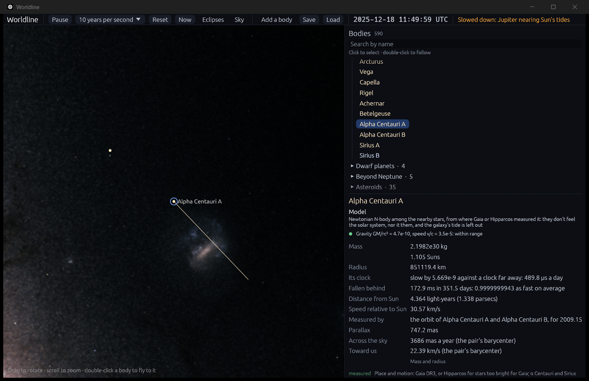

# The nearest and brightest stars

**Code:**
- `crates/worldline-data/src/neighbors.rs`: the stars, placed at any moment from where they were measured, and visual binaries' orbits;
- `crates/worldline-app/src/simulation.rs`: `Neighborhood`, the region they're simulated in.

**Data:** `crates/worldline-data/data/neighbors.csv` and `neighbor-binaries.csv`, written by `tools/fetch_neighbors.py`

**Tests:**
- unit tests in `neighbors.rs`;
- `crates/worldline-data/tests/validation_neighbors.rs`;
- `the_nearby_stars_move_as_measured_and_save` in `crates/worldline-app/src/simulation.rs`.

**Sources:**
- **Places and motions:** Gaia DR3 (Gaia Collaboration 2023), where its astrometry is good (a RUWE under 1.4, as Lindegren et al. 2021 advise), otherwise the new reduction of Hipparcos (van Leeuwen 2007, *A&A* 474, 653), both from ESA's Gaia archive.
- **Radial velocities:** Gaia DR3, or for stars Gaia doesn't measure, SIMBAD's adopted value, with the paper it cites written beside each in the data.
- **α Centauri A and B:** Kervella et al. (2016), *A&A* 594, A107: their orbit, parallax, barycenter's motion and place. That ω is B's is from Pourbaix & Boffin (2016), *A&A* 586, A90, whose fit theirs refines.
- **Sirius A and B:** Bond et al. (2017), *ApJ* 840, 70: their orbit, parallax and velocity. Sirius A's place and motion are from Hipparcos.
- **Masses and radii:** each star's own paper, named in the data and in the inspector.

## Why it matters

The galaxy's stars have so far been a fixed backdrop of points at infinity. This step makes the nearest and brightest of them bodies: real places in space, measured distances and velocities, and masses. They move, pull on each other, and anything dropped among them feels them.

## The stars

| Star | Measured by | Distance | Mass, radius (Suns) |
|---|---|---|---|
| Proxima Centauri | Gaia DR3 | 1.30 pc | 0.1221, 0.1542 |
| α Centauri A and B | their orbit (Kervella et al. 2016) | 1.34 pc | 1.1055, 1.2234; 0.9373, 0.8632 |
| Barnard's Star | Gaia DR3 | 1.83 pc | 0.162, 0.185 |
| Wolf 359 | Gaia DR3 | 2.41 pc | 0.110, 0.144 |
| Sirius A and B | their orbit (Bond et al. 2017) | 2.64 pc | 2.063, 1.711; 1.018, 0.00803 |
| Ross 128 | Gaia DR3 | 3.37 pc | 0.168, 0.209 |
| 61 Cygni A and B | Gaia DR3 | 3.50 pc | 0.690, 0.665; 0.605, 0.595 |
| Procyon | Hipparcos | 3.51 pc | 1.478, 2.048 |
| τ Ceti | Hipparcos | 3.65 pc | 0.783, 0.793 |
| Vega | Hipparcos | 7.68 pc | 2.15, 2.726 |
| Arcturus | Hipparcos | 11.3 pc | 1.08, 25.4 |
| Capella | Hipparcos | 13.1 pc | 5.061, 11.87 |
| Achernar | Hipparcos | 42.8 pc | 6.1, 9.16 (its equator) |
| Canopus | Hipparcos | 94.8 pc | 9.81, 73.2 |
| Betelgeuse | Hipparcos | 153 pc | 17.75, 764 |
| Rigel | Hipparcos | 265 pc | 23.0, 78.9 |

The brightest stars are too bright for Gaia, so Hipparcos measured them, and also τ Ceti and Procyon, whose Gaia astrometry is poor.

## From a catalogue to a place in space

A catalogue gives a star's direction, its parallax ϖ, how fast it crosses the sky (proper motion μ) and how fast it comes or goes (radial velocity v_r), all for one moment, its epoch: 2016.0 for Gaia DR3, 1991.25 for Hipparcos.
- **Distance:** 1/ϖ parsecs.
- **Velocity:** μ times the distance across the sky, plus v_r along it.
- **Then:** it's carried from its epoch to the simulation's start in a straight line. Over the 9 to 34 years between, the other stars' pull changes nothing measurable: the strongest on Barnard's Star is 3.9 × 10⁻¹⁴ m/s².

**A pair close enough to orbit** can't be placed that way: each star's measured motion includes its orbit. α Centauri and Sirius are placed by their published orbits instead.
- **Their barycenter** moves in a straight line. For α Centauri it's measured directly. For Sirius it's Sirius A's Hipparcos place and motion less A's own share of the orbit at 1991.25.
- **Each star** sits on the orbit around it, at its share of the mass.
- **Their speeds** follow from their masses and the orbit's size by Kepler's third law, so that how they move matches how they pull. The published period agrees with that to its last digits.
- **Which star is nearer** depends on the orbit's sign conventions. ω is B's (Pourbaix & Boffin 2016), measured from the node where B recedes, the convention of the radial-velocity fits these orbits come from.

## How they move

They're a region of their own, as the galactic center is (see [galactic-center.md](galactic-center.md)), in the solar system's barycentric frame:
- **Each pulls on each,** by Newton, and they collide and merge as other bodies do.
- **They don't feel the solar system, nor it them.** The strongest pull between the two is α Centauri's on the Sun, 1.6 × 10⁻¹³ m/s². Left out, it shifts the solar system against them by 80 m in a year and 800 km in a century, at a distance of 4 × 10¹³ km. Its tide across the planets' orbits, which would change how they move around the Sun, is 3 × 10⁻¹⁷ m/s².
- **The galaxy's tide is left out.** The solar system and the stars all go round the galaxy together, and the difference in the galaxy's pull across a few parsecs is a tide too small to matter over a human lifetime. Over millions of years it would.
- **Anything dropped near one of them** joins their region.
- **Their clocks** feel only each other, and Earth's feels none of them. Barycentric time (TCB) leaves out everything outside the solar system, and counting the stars would slow Earth's clock by about 1.6 × 10⁻¹³ more than the IAU's rate, which a test catches.

## Validation

**The roadmap's checks** (`cargo test --release -p worldline-data --test validation_neighbors -- --nocapture`):

| Check | Expected | Result |
|---|---|---|
| α Centauri A and B's period, three orbits simulated, from their closest approaches | 79.929 ± 0.013 years (Kervella et al. 2016). The period follows from their size, parallax and masses through Kepler's third law, fitted together with it, so the limit is its own uncertainty plus the rounding of their printed digits: 0.019 years | 79.935 years. The first periastron is at 2035.534, against 2035.533 from the orbit |
| Barnard's Star across the sky, over its first year from 2016.0, in tenths | Gaia's 10,393.349 ± 0.036 mas a year, speeding up 1.285 mas a year each year as it approaches (dμ/dt = −2μv_r/d) | within 0.0001 mas a year throughout |

**Barnard's Star's check** mostly checks the conversion from catalogue to space and back. Nothing pulls on it hard enough to change its course measurably, so it moves as Gaia's numbers say. That is the point: the simulation adds nothing a measurement would contradict.

**Also checked:**

| Check | Expected | Result |
|---|---|---|
| α Centauri B's place relative to A at 2014.5426, by ALMA (Kervella et al. 2016, Table 5) | 282.91° ± 0.15°, 4.208″ ± 0.01″ | 282.91°, 4.208″ |
| And at 2016.1893, by NACO | 305.19° ± 0.30°, 4.013″ ± 0.02″ | 304.90°, 4.016″ |
| Barnard's Star in the app, a month on | where its velocity takes it, to 10⁻⁹ | passes |
| A save and load | every star where it was, to the last digit | passes |

The limit on B's place is three of the measurement's standard deviations. This checks the orbit's elements are read with the published conventions: a different one for the node or the inclination would put B elsewhere.

## In the app

The stars are listed under **Nearby stars**. Selecting one shows how far it is, what measured it, its parallax, how fast it crosses the sky and comes toward us, and where its mass and radius were published.

The catalogue can still add a copy of one of these stars somewhere else. It gets a number, like "Sirius B 2", and the real one stays where it is.

```bash
cargo run --release -- --focus "Alpha Centauri A" --zoom 4000 --pitch 85 --speed decade
```



## Where it's valid

- **Nineteen stars.** The rest of the galaxy's stars are a swarm (step 7.2, [galaxy-stars.md](galaxy-stars.md)), with Gaia's 21,480 within 50 pc among them; the four of these that are bodies here aren't in it twice.
- **Pairs.** Only α Centauri and Sirius are placed by their orbits. 61 Cygni A and B are placed separately from Gaia, which includes their slow orbit of several centuries. Procyon's white dwarf and Capella's second star are folded into one body with the main star's radius.
- **Proxima Centauri** is placed by Gaia, independently of α Centauri. Whether it stays bound to them in the simulation isn't checked.
- **Sirius's barycenter** comes from Sirius A's Hipparcos motion, a mean over the mission's three years, less its orbit at one moment, 1991.25: an approximation. Which of Sirius A and B is nearer rests on Bond et al.'s ω being B's, which the paper doesn't state.
- **Masses and radii** are measured for some stars and modelled for others: Betelgeuse's radius is a model's prediction, Canopus's mass is from its surface gravity, and 61 Cygni's masses are from stellar models. The inspector names each source.
- **Uncertainties** come with every number. The stars are placed at the published values, with no spread.
- **The backdrop** still has the same stars as points at infinity, at their 2000 positions, so a star can be seen twice from far away.

## Data

`tools/fetch_neighbors.py` asks ESA's Gaia archive for Gaia DR3 and Hipparcos, and SIMBAD for radial velocities. The orbits and masses are copied from the papers into the script, digit for digit.
