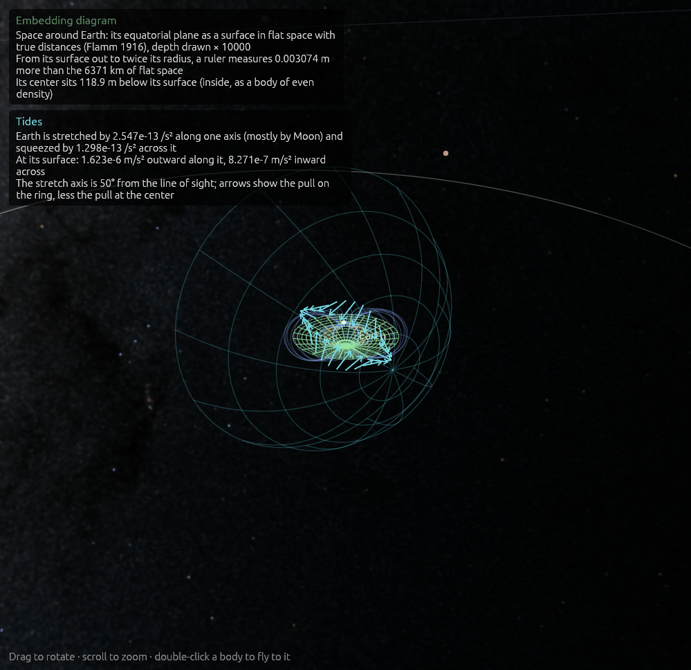

# Overlays: what gravity does, drawn over the view

**Code:**
- `crates/worldline-core/src/fields.rs`: clock rates, the tidal field, and the shape of space around a body;
- `crates/worldline-core/src/gravitational_waves.rs`: the chirp mass, time to merge, where a circular pair's orbit was a while ago, and its waves' strength;
- `crates/worldline-app/src/overlays.rs`: drawing them;
- `crates/worldline-app/src/simulation.rs` (`regime`, `validity`): the model check.

**Tests:** `crates/worldline-core/tests/validation_overlays.rs` (hand calculations), plus unit tests in `fields.rs` and `overlays.rs`.

**Sources:**
- **Clock rates:** Einstein (1911); the first post-Newtonian metric, g_tt = −(1 − 2U/c²); Schwarzschild's and Kerr's static observers (Kerr–Schild form, as in [kerr.md](kerr.md)).
- **Tides:** Newton's tidal field. For a black hole, the Riemann tensor in a static observer's frame (Misner, Thorne & Wheeler 1973, §31.2).
- **The embedding diagram:** Flamm (1916), outside a body. Inside one, Schwarzschild's (1916) interior solution for even density.
- **Gravitational waves:** leading order for circular orbits (Peters 1964; Maggiore 2008, *Gravitational Waves* vol. 1, §4.1).
- **Published values in the tests:**
  - **Earth's GM:** IERS Conventions 2010.
  - **Earth's radius:** IAU 2015 nominal.
  - **The Moon's GM:** JPL DE440.
  - **GPS's orbit:** its nominal semi-major axis, 26,559.7 km.

To see it: `cargo run --release -- --add "GW150914 pair:30" --focus "GW150914 heavier hole" --zoom 600 --pitch 60 --paused --overlays waves,clocks,models`.

To see it: `cargo run --release -- --focus Earth --zoom 90 --pitch 25 --paused --overlays tides,embedding`.

## Why it matters

General relativity is more than orbits. Clocks run slower deep in a gravity well, tides stretch and squeeze, space itself is curved, and moving masses send out ripples. These overlays make each of those visible, and give its size in numbers you can check by hand. They are off by default; the **Overlays** panel (or `--overlays models,clocks,tides,embedding,waves`) turns each on. Each says what it shows in the view's top-left corner.

## Models

Every body is computed by some model, and every model has limits ([collisions.md](collisions.md) describes the check, from step 1.7). The overlay puts a ring around each body on screen:
- **green** where its model covers its situation;
- **amber** where only approximately;
- **red** where not.

Amber and red rings are named, and the corner counts all of them by verdict and by model.

**The check** uses how strong gravity is, ε = GM/(rc²), and how fast the body moves, v/c. Both are measured from what pulls on it hardest.
- **A body farther from that than it is from its own partner** (a planet far from a close pair of black holes) is measured from the pair's center of mass, with both their masses.
- **Why:** otherwise the partners' own whirl, 0.26c for GW150914's holes at 20 Hz, counted as the far body's speed and flagged the whole outer solar system amber. The overlay showed that, and it is fixed.

## Clock rates

**The formula:** a clock at rest at a point runs at dτ/dt = √(1 − 2U/c²) of one far away, with U the sum of each body's potential:
- **outside a body,** GM/r;
- **inside, as a sphere of even density,** GM(3R² − r²)/(2R³);
- **near a black hole,** its exact Kerr–Schild f c²/2 = GMr/Σ, which handles spin.

**How exact:** for one body this is exact, Schwarzschild's (or Kerr's) static clocks. For several it adds their weak fields, which is right to first order in U/c². The slowdown, 1 − dτ/dt, is computed as 2U/(1 + √(1 − 2U)), so 10⁻¹⁰ keeps its digits.

**What's left out:** the Milky Way's own pull. It slows every clock in the solar system by about 10⁻⁶, the same everywhere.

**Where no clock can stay at rest** (inside a horizon, or a spinning hole's ergosphere), the overlay is black.

**The heatmap** covers the plane through what the camera looks at, square to the view, sampled every 12 points.
- **Colors** run blue → green → yellow → white across the range in view: on a log scale if that range spans more than a factor of ten, otherwise straight. The corner gives both ends.
- **Under the pointer** it gives the value, and the time lost per day.

## Tides

**The formula:** the tidal tensor, T = Σ GM/d³ (3n̂n̂ᵀ − I). The pull at point + δ, less the pull at the point, is T δ: a stretch of 2GM/d³ along the line to each body and a squeeze of GM/d³ across it.
- **Inside a body** of even density it adds −GM/R³ I.
- **Principal stretches** come from Jacobi's rotations.

**Around a body,** the tensor at its center, from everything else:
- **The arrows** are T δ on a ring around it, the pattern that raises ocean tides.
- **The corner** names the body that raises most of it, and gives the stretch and squeeze at its surface.

**Around a black hole,** the tensor at each point of the ring, the hole included:
- **The arrows** show the stretch a small body there would feel along the line to the hole.
- **The corner** gives it for a body 2 m long.
- **How exact:** for a hole that doesn't spin, this is exactly what a clock at rest measures.

## The embedding diagram

**What it shows:** the focused body's equatorial plane, drawn as a surface in flat space whose distances along it are true distances. Radial distances are longer than the difference in r, so the plane bends down into a funnel.
- **Outside a body,** Flamm's paraboloid, z = 2√(r_s(r − r_s)), with r_s = 2GM/c².
- **Inside a body of even density,** a cap of a sphere of radius √(R³/r_s).
- **Ruler distance:** a ruler laid straight out measures ∫ dr/√(1 − r_s/r) = [√(r(r − r_s)) + r_s ln(√r + √(r − r_s))]. The corner gives how much longer that is than flat space.

**Drawing:** it sinks below the ecliptic-parallel plane through the body.
- **Extent:** out to 6 radii, or from a black hole's horizon to 10 r_s.
- **Exaggeration:** for anything but a black hole the depth is far too small to see (Earth's center sits 119 m down). So it is exaggerated by the largest power of ten that keeps it under 40% of the width, and the corner says by how much.
- **Spin:** a spinning hole is drawn as one that doesn't spin.

## Gravitational waves

**When:** the body in focus is in a pair whose waves will merge it within the age of the universe (the same test as step 2.3's chirp).

**What's drawn:** the crests in the orbit's plane, two arms spiralling out at the speed of light, half a turn of the orbit apart.

**Where each crest is:** a crest leaves along the line through the pair, so the crest at angle φ and radius R left when the orbit pointed along φ, R/c ago.
- **The orbit's past phase,** for a circular orbit at leading order, is Φ(τ) = Φ_c − (τ/5T)^(5/8), with τ the time left and T = G𝓜/c³.
- **So the time back to a given phase is** L = τ((1 + Δ/x)^(8/5) − 1), with x = (τ/5T)^(5/8). It is written with ln_1p and exp_m1 so a slow pair keeps its digits.
- **The chirp:** the crests bunch up toward the pair as it chirps.

**The current frequency** is twice the orbit's, from its angular speed |r × v|/r².

**Strength:** the crests fade as 1/R, the waves' own falloff, down to a floor so the far ones still show. They aren't drawn within half a wavelength, where the waves aren't yet waves. The corner gives the strain at the camera, h₊ = (4/R)(G𝓜/c²)^(5/3)(πf/c)^(2/3)(1 + cos²ι)/2 and h× with cos ι, at the frequency sent R/c ago.

## Where it's valid

- **Clock rates:** first order in U/c² where several bodies overlap; exact for one alone. Clocks at rest, not moving ones (step 3.4).
- **Tides:** Newtonian, first order in the size of what is stretched; exact for one non-spinning hole. Not for bodies moving fast relative to the hole.
- **Embedding:**
  - Schwarzschild's geometry of the equatorial plane at an instant.
  - Spin, and other bodies, left out.
  - Inside a body, even density: a real planet, denser at its center, sinks a little deeper.
- **Waves:**
  - Leading order, as from a circular orbit at its current frequency (an eccentric orbit's waves have harmonics this leaves out).
  - Only in the orbit's plane.
  - Not within half a wavelength.

## Validation (`cargo test`)

`cargo test --release -p worldline-core --test validation_overlays -- --nocapture`:

| Check | By hand | Result |
|---|---|---|
| A GPS clock (26,559.7 km from Earth's center) gains on one at the equator, from gravity alone | GM/c²(1/R − 1/r): 45.65 µs a day, the figure GPS is built around; what that leaves out, (GM/Rc²)², is 5 × 10⁻¹⁹ | 45.65 µs a day, to 5 × 10⁻¹⁹ |
| A clock on Earth, with the Sun | GM☉/(rc²) + GM⊕/(Rc²) = 1.0566 × 10⁻⁸ | 1.0566 × 10⁻⁸ slow, 0.913 ms a day |
| Twice the Schwarzschild radius from a hole | √½ = 0.7071067812 | 0.7071067812 |
| Above a spin-0.9 hole's pole at 1.9 GM/c² | √(1 − 2r/(r² + a²)) = 0.3745283610 | 0.3745283610; and no clock at rest inside the horizon, or at 1.9 GM/c² on the equator, inside the ergosphere |
| The Moon's tide at Earth's surface | 2GM R/d³ = 1.1011 × 10⁻⁶ m/s² along the line to it, half that across | the same, to 10⁻¹³ |
| The Sun's | 5.0566 × 10⁻⁷ m/s²; the Moon's is 2.18 times it | the same |
| A 2 m body 1,000 km from a 10-Sun hole | 2GM·2 m/r³ = 5,308 m/s², 541 g | 5,308 m/s² |
| A ruler from a horizon to 2 r_s; the paraboloid's height there | r_s(√2 + ln(1 + √2)) = 2.2956 r_s; 2 r_s | 1.295587149393 r_s more than r_s; 2.000000000000 r_s |
| Earth: a ruler from its surface to twice its radius; its center's depth; the height at twice its radius | (r_s/2) ln 2 = 3.0741 mm longer; √(r_s R)/2 = 118.927 m; 2√(r_s R)(√2 − 1) = 197.044 m (first order; what it leaves out, r_s/R, is 1.4 × 10⁻⁹) | the same, to 10⁻⁸ |
| GW150914's holes (36 and 29 Suns) at 100 Hz: time to merge | Peters' for a circular orbit, 0.0116 s; waves 2,998 km long | equal, to 10⁻¹² |
| Their orbit half a turn back | about π/(πf) = 10 ms, longer since it was slower; the orbital frequency adds up over that time to π | 11.52 ms; 3.141592653590 rad |
| Their strain from 410 Mpc, face on | (4/R)(G𝓜/c²)^(5/3)(πf/c)^(2/3) = 1.622 × 10⁻²¹ | the same |
| The strain formula against the quadrupole formula with the bodies themselves, for a wide pair at 10⁻³ Hz, face on and edge on | equal, to the first order left out, GM/rc² = 10⁻⁴ times a number of order 1 (2 allowed) | 4.6 × 10⁻⁵ and 9.2 × 10⁻⁵ apart |

Other checks:
- `cargo test -p worldline-core fields`: Jacobi's rotations give a symmetric matrix's eigenvalues and unit eigenvectors, to 10⁻¹².
- `cargo test -p worldline-app overlays`:
  - **Each overlay draws only when on,** and says what it shows: the model check, the heatmap, the tide arrows, the embedding diagram, and GW150914's crests at 20 Hz. With the holes 30 AU above the Sun, nothing in Earth's view is flagged.
  - **The readouts carry the hand numbers:**
    - Earth's center 118.9 m below its surface;
    - a ruler 0.003074 m longer out to twice its radius;
    - a stretch at its surface between 1.5 and 1.7 × 10⁻⁶ m/s², the Moon's and the Sun's together, near the new moon of 30 December 2024.
