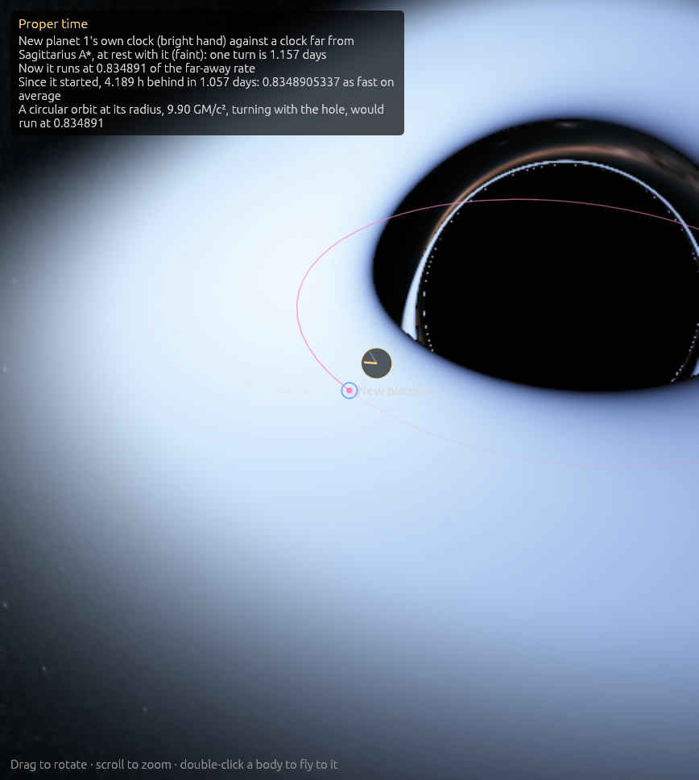

# Proper time: each body's own clock

**Code:**
- `crates/worldline-core/src/fields.rs`: `moving_clock_slowdown` (weak fields) and `kerr_clock_slowdown` (exact, near a black hole);
- `crates/worldline-app/src/clocks.rs`: each body's clock;
- `crates/worldline-app/src/simulation.rs`: reading them after every step;
- `crates/worldline-app/src/overlays.rs`: the dial.

**Tests:**
- `crates/worldline-core/tests/validation_proper_time.rs`;
- `crates/worldline-app/src/simulation.rs`: the roadmap's check, and Earth against the IAU's rate, ignored as slow;
- `crates/worldline-app/src/overlays.rs`.

**Sources:**
- **Moving clocks near a black hole:** dτ/dt = √(−g_μν Uᵘ Uᵛ) in Kerr's spacetime (Kerr 1963), in the Kerr–Schild coordinates the engine moves such bodies in ([kerr.md](kerr.md)). On a circular orbit it is 1/u^t (Bardeen, Press & Teukolsky 1972, *ApJ* 178, 347).
- **Clocks in the solar system:**
  - **Rate:** the first post-Newtonian metric, as IAU 2000 Resolution B1.5 relates geocentric and barycentric time: 1 − dTCG/dTCB = (U_ext + v²/2)/c².
  - **Measured average:** L_C = 1.48082686741 × 10⁻⁸ (IAU 2006 Resolution B3, from Irwin & Fukushima 1999).
  - **Periodic terms:** of TDB − TT, from Fairhead & Bretagnon (1990).
- **GPS's numbers:** its orbit's nominal semi-major axis, 26,559.7 km; Earth's GM from the IERS Conventions 2010.

To see it: `cargo run --release -- --add "earth:0.42@Sagittarius A*" --focus "New planet 1" --zoom 30000 --speed hour --overlays time` (Sagittarius A*'s 10 GM/c² is 0.42 AU).

## Why it matters

There is no single time. A clock deep in a gravity well, or moving fast, ticks more slowly than one far away at rest.
- **GPS:** its satellites' clocks gain 38 µs a day on clocks on the ground, and the system would drift by kilometers a day if that weren't corrected.
- **Near a black hole,** a clock circling at 6 GM/c² runs at only 71% of the rate of one far away.

Worldline gives every body its own clock, so you can watch that happen.

## The clocks

**Which bodies:** every body but small moons and swarm particles carries a clock. It starts when the simulation does, or when the body is added. Saves don't keep clocks, so loading one starts them afresh.

**How it is read:** after every step, its rate is taken from where it is and how it moves. The time it falls behind a far-away clock is added up by the trapezoid rule over the step. That lag is added up rather than the time itself, so its digits don't drown in the far-away time.

**Near the black hole that holds it** (one at least 35 times heavier, whose exact spacetime it moves in), the rate is exact, against a clock far from the hole and at rest with it:

dτ/dt = √(1 − v²/c² − f (1 + l·v/c)²),

- f and l are the Kerr–Schild metric's (g = η + f l⊗l);
- v is the clock's velocity relative to the hole.

On a circular orbit at r around a hole that doesn't spin, this is √(1 − 3GM/rc²): 0.7071 at 6 GM/c², 0.8367 at 10. At rest it is √(1 − 2GM/rc²), the clock-rate overlay's.

**Everywhere else,** in the weak fields of every other body in its region, against a clock far away at rest in the region's frame:

1 − dτ/dt = 2X/(1 + √(1 − 2X)),

with X = (U + v²/2)/c². This is right to first order, and written so tiny slowdowns keep their digits.
- **The body's own field is left out,** as geocentric time leaves out Earth's.
- **The other region's bodies are left out,** and the galaxy's own pull with them, as barycentric time does. (Leaving Sagittarius A* in, 8 kpc away, shifted Earth's clock by 2.5 × 10⁻¹¹; the check below found it.)
- **The solar system's frame** is its barycenter's. The galactic center's moves with it.

**The inspector** shows, for the selected body:
- **"Its clock":** how much more slowly it runs now;
- **"Fallen behind":** how far it has fallen behind since it started, and its average rate.

**The Proper time overlay** draws a dial beside it with two hands. The bright one is its own clock, the faint one a far-away clock's, both turning once in the same time. That time is the power of ten of seconds nearest ten real seconds' worth at the chosen speed. Near a black hole the bright hand visibly falls behind.
- **For a body a hole holds,** the corner also gives the rate a circular orbit at its radius would run at, for comparison.

## Where it's valid

- **Near a black hole:** exact, for a body moving in its spacetime, against a clock at rest with the hole. The hole's own motion and the rest of the universe are left out of that comparison.
- **Elsewhere:** first order in U/c² and v²/c², which is what the bodies there need: Earth's clock is slow by 1.5 × 10⁻⁸, and the next order is 10⁻¹⁶.
- **Moons** are read at the ends of each top-level step, which can be longer than their orbits. Their speed's monthly wobble is averaged coarsely, about 10⁻¹⁰ for the Moon.
- **The galactic center's bodies** are read once a frame, as the region catches up in its own steps.

## Validation (`cargo test`)

`cargo test --release -p worldline-core --test validation_proper_time -- --nocapture`:

| Check | Expected | Result |
|---|---|---|
| A clock on circular orbits at spin 0 (r = 6, 10), 0.9 (r = 4, 10) and 0.99 (r = 2), from the metric itself | Bardeen, Press & Teukolsky's 1/u^t, to rounding | 0.707106781187, 0.836660026534, 0.619507809083, 0.845936298536, 0.331294523453: each to 10⁻¹⁴ |
| **The roadmap's check:** a clock carried 20 times round the orbit at 10 GM/c² by the engine's own geodesic equation | √(1 − 3/10) = 0.836660026534; the orbit holds its radius to the integrator's precision (10⁻¹⁰ allowed) | 0.836660026534 |
| A GPS clock against one on the equator | gravity's GM/c²(1/R − 1/r), less the speeds' (v_s² − v_g²)/2c²: 38.54 µs a day (GPS corrects for 38.6, with Earth's oblateness, left out here) | 38.54 µs a day, to 5 × 10⁻¹⁹ |

In the app, `cargo test --release -p worldline-app clock -- --nocapture --include-ignored`:

| Check | Expected | Result |
|---|---|---|
| **The roadmap's check, in the app:** a probe set circling Gaia BH1 at 10 GM/c², read after every step for 20 turns | runs at √(1 − 3/10) = 0.836660026534 of a clock far from Gaia BH1, at rest with it (10⁻⁹ allowed) | 0.836660026534 |
| Earth's clock over 10 years against the solar system's barycenter (slow; ignored by default) | on average 1 − L_C, L_C = 1.48082686741 × 10⁻⁸ (IAU). Ten years average out the annual terms; Saturn's 13.8 µs (29.5 years) and Jupiter's 4.8 µs (11.9 years) can move the average by up to 1.2 × 10⁻¹³ | 1.480822825 × 10⁻⁸, 4.0 × 10⁻¹⁴ off: Earth's clock fell 4.67 s behind in the 10 years |

Also `cargo test -p worldline-app overlays`: the Proper time dial draws only when its overlay is on.
