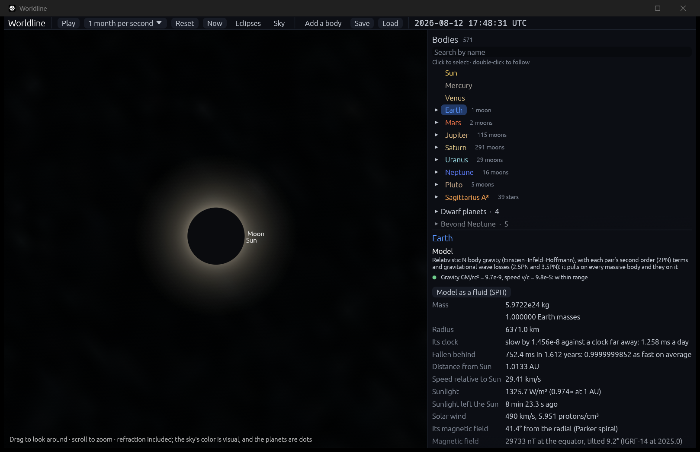
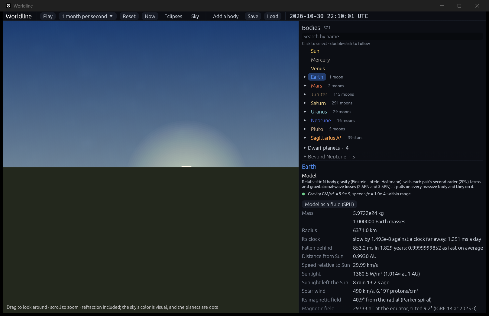
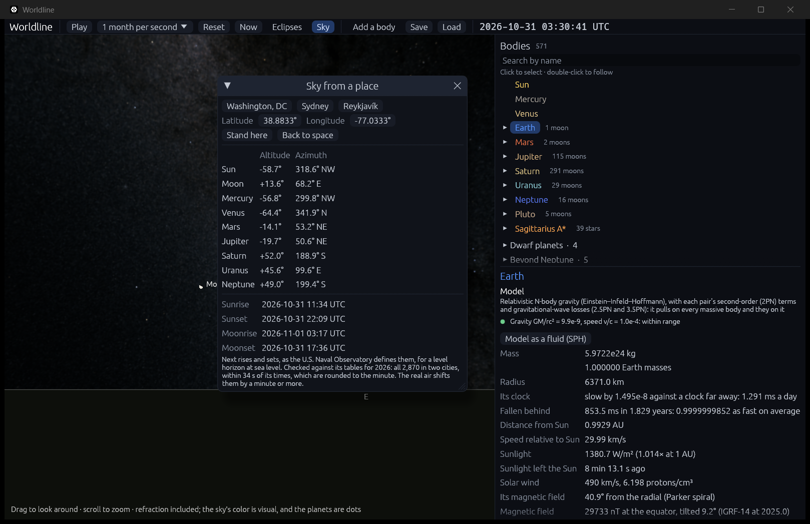

# The sky from a place on Earth

**Code:**
- `crates/worldline-core/src/horizon.rs`: `LocalFrame` (north, east and up at a place), `refraction`, and `rises_and_sets`;
- `crates/worldline-core/src/eclipses.rs`: `seen_from`, a body as seen from anywhere, and `share_of_sun_covered`;
- `crates/worldline-app/src/ground.rs`: the view, and the next rises and sets, from a copy run ahead;
- `crates/worldline-app/src/camera.rs`: `Standing`, a camera on the ground;
- `crates/worldline-app/src/app.rs`: the sky window (`sky_window`).

**Data:** `crates/worldline-data/data/rise-set-2026.csv` and `sky-from-earth-2026.csv`, from `tools/fetch_sky.py`.

**Tests:**
- unit tests in `horizon.rs`, `ground.rs` and `eclipses.rs`;
- two slow checks in `crates/worldline-app/src/simulation.rs`: `the_sun_and_moon_rise_when_the_naval_observatory_says` and `the_sky_from_a_city_is_jpls`.

**Sources:**
- **Rise and set, defined and tabulated:** U.S. Naval Observatory, Astronomical Applications Department: "Rise, Set, and Twilight Definitions", and the "Sun or Moon Rise/Set Table for One Year".
- **Refraction:** Sæmundsson (1986), in Meeus, *Astronomical Algorithms*, eq. 16.4.
- **Where the planets stand:** NASA JPL Horizons, observer tables (apparent azimuth and elevation, airless).
- **Earth's turning and the shadow:** see [time.md](time.md) and [eclipses.md](eclipses.md).

## Why it matters

Everything until now was seen from space. This step stands on the ground, at a latitude and longitude, and looks up. Most people meet astronomy this way: when the Sun sets, where the Moon is tonight. It needs every earlier part of milestone 5 to come together. The simulation has to know where the Sun and Moon are, how Earth is turned at that moment, and how the air bends light at the horizon.

## A place, and its directions

A place is a geodetic latitude and longitude on the WGS 84 ellipsoid, the convention of maps. "Up" is square to the ellipsoid there. So it doesn't point quite at Earth's center: at latitude 45° the two differ by 0.2°.

From up, north and east, any direction becomes:
- **altitude:** the angle above the horizon;
- **azimuth:** the angle from north, through east.

Earth's orientation comes from step 5.1, so these directions turn with Earth as it really turns.

## How a body looks from there

Each body is taken where it appears from the place, not from Earth's center:
- where it was when the light now arriving left it;
- shifted by the aberration of Earth's motion;
- seen from the place itself. For the Moon this matters most: it stands up to a degree away from where Earth's center sees it.

**Refraction.** The air bends light downward as it enters, so everything looks higher than it is. The bend is about 34′ at the horizon, a little more than the Sun's whole width, and it falls to 1′ at 45° up. The view uses Sæmundsson's formula:

  R = 1.02′ / tan(h + 10.3 / (h + 5.11)), with h the true altitude in degrees.

It is for 10 °C and 1010 hPa. Below −2° it is held fixed, since nothing can be seen there and the formula has a pole at −5.11°.

## Rise and set

Rise and set are the Naval Observatory's definitions, for an observer at sea level with a level horizon and average air. They use the zenith distance of the center of each body, seen from Earth's center:

| | Zenith distance at rise and set | Made of |
|---|---|---|
| The Sun | 90.8333° | 16′ for its apparent radius, 34′ for refraction |
| The Moon | 90.5666° + its apparent radius − its horizontal parallax | 34′ for refraction, then the radius and parallax of that moment |

The Moon's terms matter because it is so near. Its parallax of about 57′ is more than its radius and the refraction together. So at moonrise, seen from Earth's center, it is 5 to 10′ *above* the horizon, as the Observatory says.

**Finding them.** The Sun, Earth and Moon are sampled every 6 hours and interpolated (see [eclipses.md](eclipses.md)). Every 5 minutes, Worldline checks which side of its rise-and-set altitude the body is on. Where that changes, bisection narrows the crossing to 0.01 s. A body up or down for under 5 minutes would slip through, which takes a graze of the horizon at high latitudes.

## Validation

**The roadmap's check** (`cargo test --release -p worldline-app -- --ignored the_sun_and_moon_rise --nocapture`): every rise and set of the Sun and Moon in 2026, in the app's own simulation run from its 2025 snapshot, against the Observatory's tables. There are two cities, one in each hemisphere, so a wrong sign anywhere would show. The roadmap's limit is a minute, and every event must be found, with none extra.

| City | Body | Events | In the same minute as the Observatory's | Largest difference |
|---|---|---|---|---|
| Washington, DC | Sun | 730 | 715 | 32.6 s |
| Washington, DC | Moon | 705 | 697 | 31.6 s |
| Sydney | Sun | 730 | 715 | 33.2 s |
| Sydney | Moon | 705 | 690 | 32.1 s |

**Result:** all 2,870 found, none extra, **the worst 33.2 s** from the Observatory's time.

**What 33 s means.** The Observatory's times are rounded to the minute, so even a perfect calculation can be 30 s from them. The largest differences are about 3 s beyond that. So 2,817 of the 2,870, 98%, round to exactly the Observatory's minute. The other 53 fall within seconds of a half-minute and round the other way.

**The planets** (`... -- --ignored the_sky_from_a_city --nocapture`): the Sun, Moon and seven planets from both cities, at four moments of 2026, 72 positions in all, against JPL Horizons without refraction. They are computed as the view computes them.

| Check | Limit | Result |
|---|---|---|
| Altitude and azimuth, against JPL | 12.5″: nutation moves Earth's pole by at most √(6.8² + 9.2²) = 11.4″, and polar motion, diurnal aberration and the Moon's error add under 1″ | worst 9.0″, the Moon from Washington |

The result agrees with the expected size. In 2026 nutation puts the pole about 9″ from where Worldline has it (see [eclipses.md](eclipses.md)), and the 9″ here is what's left.

**Other checks:**

| Check | Expected | Result |
|---|---|---|
| The compass (unit test) | on the equator at Greenwich, up is +x, north +z, east +y; every place's frame is square | to 10⁻¹⁵ |
| A still Sun over a turning Earth (unit test) | sets 90.8333° of turning after noon, and rises as far before the next | to 0.02 s |
| The Moon's rise-and-set altitude (unit test) | 5 to 10′ above the geocentric horizon, at any distance | passes |
| Refraction (unit test) | 34′ at the horizon, about 1′ at 45°, nothing at the zenith | passes |
| The Moon covering the Sun (unit test) | the area two disks share: none apart, all when the Moon is bigger and centered, the ratio of areas when smaller, and 2/3 − √3/(2π) for equal disks a radius apart | to 10⁻¹² |
| The next rises and sets in the app, at Washington on 2026-10-31 | the Observatory's table: sunrise 11:34, sunset 22:09, moonset 17:36, and moonrise 03:17 on 1 November | exactly |

**Seen, not measured.** Two views show the parts working together, but no test checks them:
- **Sunset in Washington on 2026-10-30.** At the Observatory's 22:10 UT, the top of the Sun stands just above the horizon. It is about 3′ above, not exactly on it: at that altitude Sæmundsson's refraction is 37′, and the Observatory's constant is 34′.
- **Totality from Reykjavík on 2026-08-12.** A sliver of Sun is still showing at 17:47:59 UTC, and the Moon covers it at 17:48:31. Reykjavík lies just inside the northern limit of NASA's path.

## In the app

**Sky** in the top bar opens the window:
- **A place:** Washington, Sydney or Reykjavík, or any latitude and longitude.
- **What stands in its sky now:** the Sun, Moon and planets, with altitude and azimuth.
- **The next sunrise, sunset, moonrise and moonset:** in UTC, rounded to the minute as almanacs do. A copy of the simulation runs 8 days ahead on its own thread to find them. It runs again as time passes, while time goes at a day a second or slower.
- **Stand here** puts the camera on the ground, and **Back to space** returns it.

**The view:**
- **Looking around:** drag to look, and scroll to zoom, from 100° across down to 0.5°, where the Moon fills the screen.
- **The Sun, Moon and planets** are where the air lifts them, at their true sizes. Planets are dots. The Moon shows its phase, with a terminator worked out from how far it stands from the Sun.
- **The ground** hides what's below the horizon, with the compass points on it.
- **The sky** brightens from the end of nautical twilight, 12° below the horizon, to full by 6° above. It dims with the share of the Sun the Moon covers, and at totality the corona appears.

Eclipses **Go to** leaves you standing where you are, so you can watch an eclipse from your place. `--stand LAT,LON` starts on the ground, `--look AZ,ALT` picks the direction and `--fov DEG` the zoom. `--sky` opens the window.

## Where it's valid

- **Rise and set times are the calculation's, not a forecast.** As the Observatory says, the real air moves them by a minute or more, and much more at high latitudes, where the Sun and Moon meet the horizon at a shallow angle. Hills, buildings and height above sea level aren't included.
- **Near the poles,** a body that grazes the horizon for under 5 minutes can be missed. The check covers latitudes 34°S and 39°N only.
- **2025 to about 2027 in UTC.** Times rest on the IERS's table of Earth's rotation, predicted to late 2027 and held after that (see [time.md](time.md)). TDB times aren't affected.
- **The sky's color is a visual aid,** not a model of the sky's light: a simple brightness from the Sun's altitude and how much of it the Moon covers. So is the ground, which is flat and bare. The app says so.
- **Earth's pole leaves out nutation,** which is why positions are 9″ from JPL's. That is far below what the eye can see.
- **Refraction is one fixed formula.** It stands for average air, and it is held below −2°. It lifts a whole disk by one amount, so the Sun doesn't flatten at the horizon as it really does.
- **Planets are dots with no brightness model,** and stars aren't lifted by refraction, which matters only within a few degrees of the horizon.
- **Totality from a place is shown, not checked.** Local eclipse times haven't been compared with a published table.
