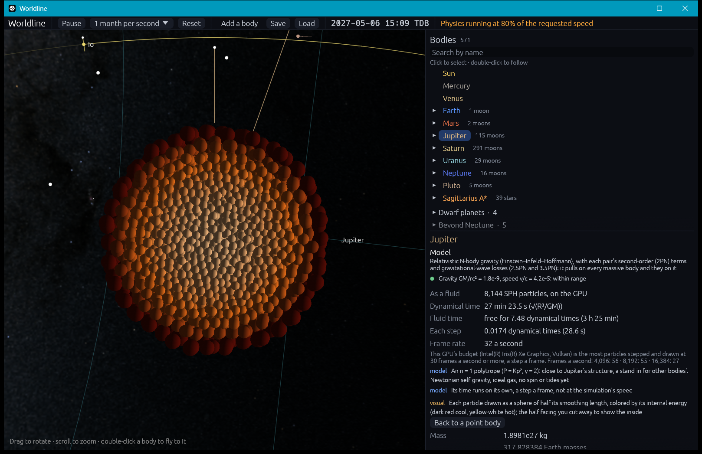

# Fluids: smoothed particle hydrodynamics (SPH)

**Code:**
- `crates/worldline-core/src/sph.rs`: the fluid on the CPU, in double precision (step 4.1);
- `crates/worldline-render/src/fluid.rs` and `fluid.wgsl`: the same fluid on the GPU, in single precision (step 4.2);
- `crates/worldline-app/src/fluid.rs`: a body modeled as a fluid in the app, and the GPU's particle budget.

**Tests:** `crates/worldline-core/tests/validation_sph.rs` and `crates/worldline-render/tests/validation_fluid_gpu.rs`, plus unit tests in `sph.rs`, `fluid.rs` (both) and the shader's naga check

**Sources:**
- **The method:** Price (2012), *J. Comput. Phys.* 231, 759, "Smoothed particle hydrodynamics and magnetohydrodynamics":
  - the M4 cubic spline kernel (eq. 6);
  - the smoothing length set by the density, with η = 1.2 (eq. 10, and his recommendation in §5);
  - the "grad-h" term Ω (eqs. 27–28);
  - the equation of motion (eq. 30);
  - the internal energy equation (eq. 35);
  - Monaghan's (1992) artificial viscosity as his eq. 98 gives it (α = 1, β = 2, ε = 0.01);
  - Morris & Monaghan's (1997) switch, his eq. 105 (σ = 0.1, α_min = 0.1).
- **The cap on the switch, α_max − α:** Rosswog et al. (2000), *A&A* 360, 171.
- **Gravity softened by the kernel:** Price & Monaghan (2007), *MNRAS* 374, 1347.
- **Time steps:** Monaghan (1992), *ARA&A* 30, 543, with Price et al.'s (2018, *PASA* 35, e031) coefficients 0.3 and 0.25.
- **The polytrope:** Lane–Emden for n = 1 (e.g. Chandrasekhar 1939, *An Introduction to the Study of Stellar Structure*, ch. IV).
- **Jupiter:** IAU 2015 nominal GM and radius.
- **On the GPU:**
  - **finding neighbours:** a grid of cells hashed into a table with Teschner et al.'s (2003, *Proc. Vision, Modeling, Visualization*, 47) hash, the particles sorted by cell with a counting sort;
  - **the sort's prefix sum:** Hillis & Steele's (1986, *Commun. ACM* 29, 1170) scan;
  - **gravity, pair by pair:** in tiles shared by a workgroup, as in Nyland, Harris & Prins (2007, *GPU Gems 3*, ch. 31).

## Why it matters

So far every body has been a point, or a rigid shape. But a planet that passes too close to a star or a black hole is stretched by tides until it deforms, sheds mass or is torn apart, and planets that collide splash. To show that, a body has to become a fluid. Step 4.1 built that fluid, on the CPU in double precision; step 4.2 moved it to the GPU, for as many particles as the GPU steps smoothly, and into the app. Later steps:
- **4.3** turns a point into a fluid when tides start to matter.
- **4.4** tears one apart.
- **6.4** collides planets as fluids.

## The method

SPH represents a fluid as particles. Each carries a mass, a velocity, an internal energy per unit mass and a **smoothing length**, h, the size of the region it represents.
- **Kernel:** a particle's mass is spread out by a bell-shaped kernel W over 2h, the M4 cubic spline.
- **Density:** a point's density is the sum of its neighbours' spread-out masses, ρ_a = Σ m_b W(r_ab, h_a).
- **Smoothing length:** each particle's h follows its density, h = 1.2 (m/ρ)^(1/3). That gives about 58 neighbours everywhere, so dense regions get fine resolution and sparse ones coarse. Since ρ depends on h and h on ρ, the two are solved together by Newton's method, to 10⁻⁶ of h.
- **Pressure:** the gas is ideal, P = (γ − 1)ρu.
- **Forces and heating:** the equations of motion and of internal energy are derived from a Lagrangian. So they keep momentum and angular momentum exactly, and energy to the time steps' error.
  - **Pressure:** dv_a/dt = −Σ_b m_b [P_a/(Ω_a ρ_a²) ∇W_ab(h_a) + P_b/(Ω_b ρ_b²) ∇W_ab(h_b)], where Ω corrects for h changing with density.
  - **Heating:** du_a/dt = P_a/(Ω_a ρ_a²) Σ_b m_b (v_a − v_b)·∇W_ab(h_a).
- **Shocks:** an artificial viscosity (Monaghan's) acts between particles closing in on each other, and heats them as much as it slows them.
  - **The switch:** its strength α is each particle's own (Morris & Monaghan). It decays to 0.1 over a few smoothing lengths' sound-crossing times, and grows toward 1 where the gas is compressed (−∇·v > 0).
  - **Why:** without it, the viscosity heats the particles' small jiggles in a calm fluid, and the test star slowly swelled: 2% in ten dynamical times.
- **Gravity:** every particle pulls on every other, its mass spread out as the kernel, so two never pull infinitely hard.
  - **Force:** particle b pulls on a with G m_b M(r/h)/r². M(q) is the share of the kernel's mass within q, averaged over the two particles' h so that momentum is kept.
  - **Potential:** −G m ψ(q)/h, with ψ(0) = 7/5.
  - **How it's computed:** directly, pair by pair, on all the computer's cores. That is right for thousands of particles; 4.2 moves to the GPU for more.
- **Time steps:** leapfrog (kick–drift–kick), all particles together. Each step is the smallest over the particles of:
  - **sound crossing:** 0.3 h/(c + 1.2α(c + 2μ));
  - **force:** 0.25 √(h/|a|).

## Building a star or planet

**The polytrope:** an n = 1 polytrope (P = Kρ², γ = 2) has an exact structure: ρ = ρ_c sin ξ/ξ, ξ = πr/R, ρ_c = πM/(4R³).
- **Radius:** every one with a given K has the same radius, R = π√(K/2πG), whatever its mass.
- **Why Jupiter:** this is why gas giants from a Saturn's mass to a few Jupiters' are about the same size, and Jupiter is close to one: its central density comes out at 4.4 g/cm³.

**Placing the particles:** they start on a cubic lattice in a sphere, each moved out along its radius until the mass inside matches the polytrope's. Each is given the polytrope's energy, u = Kρ.

**Settling:** that start isn't quite SPH's own equilibrium, so `settle` lets it relax for five dynamical times, √(R³/GM), at the polytrope's entropy.
- **During it,** motion is damped with a time constant of 0.3 of one, and each energy is reset to Kρ after every step.
- **Then** it is set at rest and left alone, its energy now evolving freely.

## Where it's valid

- **Resolution:** SPH resolves nothing finer than a smoothing length. With 1,000 particles that is about a sixth of the radius, with 4,000 a ninth. A structure's errors shrink as h², faster in practice here.
- **Noise:** its particles jiggle around their places by a fraction of a smoothing length. That is SPH's noise, about 10⁻⁴ of the binding energy in motion here.
- **Equations of state:** only an ideal gas so far. Rock and iron (the Tillotson equation of state) come with giant impacts in 6.4.
- **Gravity is Newtonian,** and computed directly, pair by pair, so its cost grows as N². Thousands of particles are fine on the CPU; on the GPU it is what limits the count (see [the budget](#the-particle-budget)).
- **Single precision on the GPU.** About 7 digits: the GPU's densities and forces agree with the CPU's to the GPU's Newton tolerance (see the validation below), and its energy is kept as well as the CPU's over ten dynamical times. Positions are in the fluid's own units, relative to its center, so the precision is spent on the body, not on where it is.
- **In the app by hand.** A body becomes a fluid when you ask (step 4.2), on its own when tides matter in step 4.3. Until then the fluid keeps its own time, a step a frame, and nothing outside it pulls on it: no spin, no tides.

## On the GPU (step 4.2)

The GPU steps the same equations as `sph.rs`, in single precision, for many more particles. The GPU has no double precision, so the fluid works in its own units: lengths in the body's radius R, masses in its mass M, times in its dynamical time √(R³/GM). In them G = 1 and every number is near 1, where single precision is densest. The app converts from SI going in and back coming out.

**A step** is a chain of compute passes, all submitted together; the CPU never waits for them.
1. **Kick and drift:** half a kick, then a drift, the leapfrog's first half.
2. **Sort by cell.** Space is cut into cubes, each twice the smallest smoothing length across (or half the largest, if that is more), and each cube is hashed into a table of 262,144 buckets. The particles are counted into the buckets, the counts summed into starting places (a prefix sum, in three passes), and each particle given its place. What a neighbour needs of each particle (position, smoothing length, density, velocity, pressure) is then copied out in that order, so neighbours sit together in memory.
3. **Density:** each particle's smoothing length and density together, by Newton's method as on the CPU, to 10⁻⁵ of h (single precision's rounding allows no tighter), searching the cells its own 2h reaches.
4. **Gravity, as from points:** every particle's pull on every other, the particles shared in tiles of 128, two particles to a thread.
5. **Forces:** pressure, viscosity with its switch, and heating, from every particle within 2 max(h_a, h_b). The cells searched reach twice the largest h, but a cell whose largest h can't reach is skipped. Between neighbours close enough for each other's kernels, the point pull from pass 4 is replaced by the kernel-softened one, as on the CPU.
6. **The second half kick,** then the clock, the next time step (the smallest over the particles, found with atomic minima) and the next grid.

**Settling** is the CPU's: five dynamical times with damping and the entropy set, then at rest and let go.

**The clock** (the fluid's time and next step) is copied back to the CPU without waiting for the GPU. The app reads it a frame or so late, enough to show it and to know when settling is over.

### The particle budget

"Smooth playback" is taken as 30 frames a second or more. What a frame costs depends on everything else the app draws and computes, not just the fluid, so the app finds its budget by trying. The first time a body is made a fluid, the app runs it at 4,096 particles, then 8,192, 16,384 and so on, stepped once a frame and drawn. Each count runs for 2 seconds: the first half second is let go by, and the frames of the rest are counted. The largest count that kept 30 frames a second is the budget. The trials wait until the app has run for 2 seconds and the camera's flight is over: before then, frames come several times slower.

On the Intel Iris Xe this was built on (Vulkan, 1618 × 1047 window, Jupiter in view, 1 month per second):

| Particles | Frames a second, with the fluid stepped and drawn | GPU time a step, alone (`validation_fluid_gpu`) |
|---|---|---|
| 2,008 | | 4.3 ms |
| 4,032 | 56 | 6.1 ms |
| 8,144 | 55 | 9.3 ms |
| 16,368 | 27 | 21.8 ms |
| 32,752 | | 54 ms |
| 65,752 | | 184 ms |

So this GPU's budget is 8,144 particles. A frame takes a whole number of the screen's refreshes (16.7 ms at 60 Hz): the app's own drawing and the 16k fluid's step together need just over two, so frames come every three, 20 to 27 a second. Gravity's N² sets the steep rise past 16,000. A discrete GPU, with ten or more times the Iris Xe's arithmetic, reaches tens of thousands.

## Validation (`cargo test`)

`cargo test --release -p worldline-core --test validation_sph -- --nocapture --include-ignored`:

| Check | Expected | Result |
|---|---|---|
| **The roadmap's check:** Jupiter as an n = 1 polytrope of 968 particles, settled, then left alone for ten dynamical times (about 4.6 hours) | It stays in equilibrium, to what SPH resolves (mean h = 0.176 R). Its half-mass radius stays within h/2 of where it started, and its kinetic energy under that of an oscillation that size, (h/2R)² = 7.8 × 10⁻³ of the binding energy. Without pressure it would fall in within one dynamical time | moved at most 0.0206 R (0.12 h); kinetic energy at most 1.6 × 10⁻⁴ of the binding energy |
| Its energy over those ten dynamical times | kept to the leapfrog steps' error, (Δt/t_dyn)² = 1.4 × 10⁻³ | 4.1 × 10⁻⁵ |
| Its structure | the polytrope's: its half-mass radius within a smoothing length of Lane–Emden's 0.6066 R | 0.6186 R |
| With 4,032 particles (slow; ignored by default) | closer to Lane–Emden by at least 0.4, as h² shrinks | 0.6076 R, 0.0010 R off against 0.0120 R: 12 times closer |

Also `cargo test -p worldline-core sph`: the kernel's mass adds up to 1, the softened potential's slope is the softened pull, ψ(0) = 7/5 and ψ = 1/q beyond 2h, and w′ is w's slope.

### On the GPU

`cargo test --release -p worldline-render --test validation_fluid_gpu -- --ignored --nocapture --test-threads=1` (needs a GPU; measured on an Intel Iris Xe):

| Check | Expected | Result |
|---|---|---|
| The GPU's densities and forces against the CPU's, the same 968 particles of Jupiter | densities within 3 × 10⁻⁵: the GPU's Newton's method stops at 10⁻⁵ of h, and ρ ∝ h⁻³. Accelerations within 10⁻⁴ of the largest: pressure ∝ ρ² doubles that, with room for rounding (6 × 10⁻⁸ a term) | densities 6.1 × 10⁻⁷ off at most, accelerations 8.8 × 10⁻⁶ |
| **The roadmap's check, on the GPU:** step 4.1's planet, settled on the GPU for five dynamical times, then left alone for ten | as on the CPU: its half-mass radius within h/2, its kinetic energy under (h/2R)² = 7.8 × 10⁻³ of the binding energy | moved at most 0.0126 R (0.07 h); kinetic energy at most 2.0 × 10⁻⁴ of the binding energy |
| Its energy over those ten dynamical times | the steps' (Δt/t_dyn)², plus single precision's rounding, 10⁻⁶ a step over the 280 steps: 1.6 × 10⁻³ | 4.1 × 10⁻⁵, as on the CPU |
| The clock copied back without waiting | exactly the clock read by waiting for the GPU | the same, to the last bit |
| How long a step takes, 2,008 to 65,752 particles | (not a pass/fail check) | the table above |

The GPU adds up its sums in an order that varies from run to run, so the last digit of these results can too.

Also, without a GPU (`cargo test`): naga validates `fluid.wgsl` and `particles.wgsl`, and their structs' layouts match the Rust ones byte for byte; in the app, a polytrope in its own units has G = 1 and K = 2/π, and the budget is the largest count that ran at 30 frames a second.
