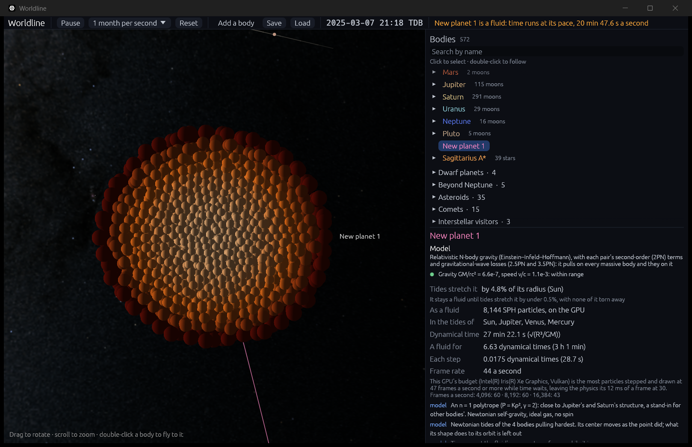

# Tides: when a point becomes a fluid

**Code:**
- `crates/worldline-core/src/tides.rs`: tidal radius, the stretch, Love numbers, where a body becomes a fluid and turns back;
- `crates/worldline-app/src/simulation.rs`: `Limits` and `Approach`, which stop the simulation where a planet becomes a fluid and hold it to the fluid's clock;
- `crates/worldline-app/src/fluid.rs`: the fluid every body is made from (`Lab`), and a body as a fluid in the simulation (`FluidBody`);
- `crates/worldline-app/src/app.rs`: which bodies switch, and when (`approaches`, `update_fluid`);
- `crates/worldline-render/src/fluid.wgsl`: the tides the GPU fluid feels.

**Tests:** unit tests in `tides.rs` (Radau's equation) and `simulation.rs` (the switch); `crates/worldline-render/tests/validation_fluid_gpu.rs` (the GPU's tides, and a fluid planet's Love number).

**Sources:**
- **Tidal radius:** r_t = R (M/m)^(1/3), as in Rees (1988), *Nature* 333, 523.
- **Love numbers:** Love (1911), *Some Problems of Geodynamics*. A fluid body's surface stays level, so its displacement number is h₂ = 1 + k₂ (Murray & Dermott 1999, *Solar System Dynamics*, ch. 4).
- **Radau's equation and the apsidal constant:** Sterne (1939), *MNRAS* 99, 451. For an n = 1 polytrope it gives k₂ = 15/π² − 1 = 0.5198, which the unit test checks by integrating the equation.
- **The quadrupole a tide raises:** Q = (2/3) k₂ R⁵ E/G, with the normalization of Hinderer (2008), *ApJ* 677, 1216.
- **Giant planets:**
  - above about 10 Earth masses a growing planet holds on to hydrogen and helium (Pollack et al. 1996, *Icarus* 124, 62);
  - below 13 Jupiter masses deuterium doesn't burn: the IAU Working Group on Extrasolar Planets' working definition of a planet (2003).
- **Hill radius:** D (m/3M)^(1/3).

## Why it matters

A point has no shape. Near something massive enough, a real planet is stretched along the line to it, and close enough it is torn apart. Step 4.2 built the fluid that can show that. This step decides when a planet stops being a point and becomes that fluid, and couples the two: the fluid feels the tides of the bodies around it, and the simulation's time follows the fluid's.

## When tides matter

A body of mass m and radius R at distance D from a mass M is stretched toward it. In equilibrium, to first order, its surface rises there by

  δR/R = h₂ (M/m)(R/D)³ = h₂ (r_t/D)³,  r_t = R (M/m)^(1/3).

- **h₂** measures how much the body gives. A fluid body's surface stays level with its own and the tide's gravity, so h₂ = 1 + k₂. For an n = 1 polytrope k₂ = 15/π² − 1, so h₂ = 15/π² = 1.52.
- **The 1% line.** A point leaves that stretch out. Worldline grades every model the same way (see `regime.rs`): within range while what it leaves out is below the integrator's tolerance, approximate up to 1%, beyond after. So a planet becomes a fluid where its tides would stretch it by 1%, at r_t (100 h₂)^(1/3) = **5.34 tidal radii** for n = 1.
- **Back to a point** once the stretch falls under 0.5% (6.72 tidal radii), and only if none of the fluid is beyond its Hill sphere around what pulls it hardest: nothing torn away. Half the line, so a body grazing it doesn't flicker between the two.
- **For example:** Jupiter's tidal radius is 710,000 km around the Sun (about the Sun's own radius), and 1.5 million km around a black hole of 9.6 Suns. It becomes a fluid 3.8 and 8.1 million km from them.

**Which bodies.** Only giant planets turn into fluids by themselves: from 10 Earth masses, where planets hold hydrogen and helium envelopes, to 13 Jupiter masses, where brown dwarfs begin. Their bulk is fluid, and an n = 1 polytrope models Jupiter and Saturn well (Uranus and Neptune less so).
- **Rocky bodies** need rock's equation of state (Tillotson, step 6.4). When tides stretch one by 1% or more, the inspector says a point can't show that.
- **Stars** have no fluid model of their own yet.
- **By hand,** any body with a measured mass and radius, except a black hole, can still be made a fluid (step 4.2's button).

## Stopping at the line

A simulation step can be days long, and a planet falling toward a black hole crosses the line in hours. So every update watches each giant planet against every body that could stretch it by 1% before the two touch, and never steps past where they could reach that distance.
- **The bound.** Two bodies falling together from distance D to any r ≥ stop at most speed up to √(v² + 2G(M + m)/r). That is under v + √(2G(M + m)/stop), so they can't close to `stop` in less than (D − stop)/(v + √(2G(M + m)/stop)).
- **Each step** goes no further than that, and the steps shrink as the two near the line. The update stops once they are within 1% beyond it.
- **Others' pulls** are left out of the bound: where tides matter, the body raising them dominates.
- **While it watches,** a step capped this way slows the simulation, and the top bar says why ("Slowed down: Jupiter nearing Gaia BH1's tides").

## The fluid, ready

Every n = 1 polytrope is the same in its own units (G = R = M = 1). So the app settles one once and makes every body's fluid from it, scaled by the body's radius, mass and dynamical time √(R³/GM).
- **When.** It is readied the first time a body needs a fluid, by tides or by hand, and time waits for it (about 10 seconds on the Iris Xe).
- **The budget's trials** (see [sph.md](sph.md#the-particle-budget)) run first, each drawn as the body that is waiting. They run while time waits, so without the physics. Once time runs, the physics may take its budget of 12 ms of each frame. A trial must therefore keep frames under 1/30 s − 12 ms = 21.3 ms: 47 frames a second.
- **Then** the budget's fluid settles for five dynamical times, as in step 4.1, and is read back.

## A body as a fluid

- **Its frame** falls with the point it was. Its center keeps moving as the point did, under the simulation's gravity model.
- **Its particles** feel their own gravity and pressure, and the tides of the 4 bodies pulling on it hardest: each one's pull on a particle less its pull on the center, exactly, not just its first-order (tidal tensor) part.
- **Those bodies** are given to the GPU as they are at the simulation's time, with their velocities and accelerations relative to the body. The GPU follows them along a parabola to its own time, a few of its steps ahead of the simulation.
- **Time runs at the fluid's pace.** The fluid takes a step a frame, of the time its Courant and force conditions allow (about 0.017 dynamical times with 8,000 particles, 30 seconds for Jupiter). The simulation advances to the fluid's time, as its clock comes back, and no further. For Jupiter that is about 20 minutes a second, whatever speed is chosen; the top bar says so.
- **One at a time:** while a body is a fluid, no other turns into one.

## Where it's valid

- **Newtonian tides.** Fine where tides matter for a planet: 8 million km from a black hole of 9.6 Suns, GM/rc² = 2 × 10⁻⁶.
- **The orbit doesn't feel the shape.** A stretched body pulls back on what stretches it a little differently from a point. That changes its orbit by order (R/D)² of the pull, and is left out. So is the orbital energy that goes into the body's tidal oscillations (tidal capture).
- **What it keeps when it turns back.** A body that turns back into a point keeps its mass, radius and motion. The tidal heating and oscillations it picked up as a fluid are lost.
- **Torn bodies stay fluids.** A body that loses mass stays a fluid, and time stays at its pace. Tidal disruption itself is step 4.4.
- **Spin.** It starts at rest, not spinning, so its rotational flattening is left out: 6.5% for Jupiter, more than the 1% that switches it.
- **Up to 4 bodies' tides.** Those of the rest are left out, as are those of bodies in another region.
- **Collisions.** A fluid whose point collides or is swallowed goes with it.

## Validation

| Check | Expected | Result |
|---|---|---|
| The n = 1 polytrope's Love number, from Radau's equation integrated numerically (`cargo test -p worldline-core tides`) | 15/π² − 1 = 0.519818; 3/2 for even density | within 10⁻⁹; 3/2 exactly |
| **The roadmap's check, the point's side:** Jupiter falling toward a black hole of 9.6 Suns, on an ellipse 3 tidal radii from it at its closest (`cargo test --release -p worldline-app a_giant_planet`) | a point until its tides would stretch it by 1%, 5.34 r_t (8,063,000 km). The update stops there, within 1% beyond, never closer before | stopped at 1.0057 of it, after 74 frames (29.5 hours); never closer |
| The tides the GPU fluid feels: a body of 1,000 times its mass, 10 radii away, moving and accelerating, followed 0.1 time units on | each particle's pull, less the center's, as Newton's, within 10⁻⁴ of the largest: the GPU's Newton tolerance, as in step 4.2's forces check | 2.1 × 10⁻⁶ |
| **A fluid planet stretches as a fluid planet should:** the GPU's Jupiter settled in a steady tide at 5.34 r_t, its quadrupole moment's growth giving its Love number | 0.5198, within the mean smoothing length over the radius, as SPH resolves its structure no finer (17.6% at 968 particles, 8.8% at 8,024) | 0.540 (3.9% off) and 0.517 (0.6% off) |
| **The roadmap's check, in the app:** a Jupiter-mass planet grazing the Sun at 3 tidal radii (2.1 million km from its center) | a point until its tides stretch it by 1%; a fluid through its closest approach; a point again once they ease, nothing torn away; smooth playback | becomes a fluid at 0.97–1%; stretched by up to h₂/3³ = 5.6% at its closest; a point again on the way out, and a fluid again on its next pass four months later; 8,144 particles at 36–44 frames a second |

The GPU checks need a GPU: `cargo test --release -p worldline-render --test validation_fluid_gpu -- --ignored --nocapture --test-threads=1`. Last digits vary from run to run, as the GPU adds its sums in a varying order.

