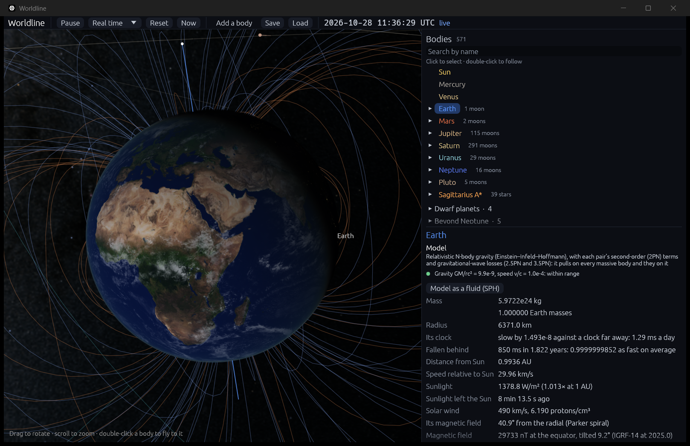

# Time: the computer's clock, the simulation's, and Earth's rotation

**Code:**
- `crates/worldline-core/src/timescales.rs`: the conversions, and `TimeScales`, the IERS's tables in use;
- `crates/worldline-core/src/rotation.rs`: `earth_prime_meridian`, Earth turned by UT1;
- `crates/worldline-data/src/time.rs` and `data/leap-seconds.csv`, `data/ut1-utc.csv`: the tables;
- `crates/worldline-app/src/simulation.rs` (`update_to`, `orientation`) and `app.rs` (the Now button, the clock).

**Tests:**
- unit tests in `timescales.rs`;
- `crates/worldline-data/tests/validation_time.rs`;
- two slow checks in `crates/worldline-app/src/simulation.rs`: today's planets, and the clock.

**Sources:**
- **The time scales:** Kaplan (2005), *USNO Circular 179*, chapter 2:
  - TAI = UTC + ΔAT (eq. 2.1) and TT = TAI + 32.184 s (eq. 2.4);
  - TDB − TT as a truncated series, good to about 10 µs from 1600 to 2200 (eq. 2.6, after Fairhead & Bretagnon 1990);
  - ΔT = TT − UT1 = 32.184 s + ΔAT − (UT1 − UTC) (eq. 2.9);
  - the Earth Rotation Angle θ = 0.7790572732640 + 0.00273781191135448 D_U + frac(JD(UT1)) turns (eq. 2.11).
- **Leap seconds:** IERS Bulletin C 72 (6 July 2026): UTC − TAI = −37 s from 2017 January 1, and no leap second at the end of 2026. The table is IANA's `leap-seconds.list`, which republishes the IERS's, valid until 2027-06-28.
- **UT1 − UTC, daily:** the IERS Rapid Service/Prediction Center's `finals2000A.data` (IERS Bulletin A), measured to 2026-10-22 and predicted to 2027-10-29.
- **Earth's pole:** the IAU model (Archinal et al. 2018), as in [rotation.md](rotation.md).
- **The check:** NASA JPL Horizons, for where the Sun is overhead and where the planets are on 2026-10-28.

## Why it matters

Until this step Worldline ran on its own time, TDB, the time JPL's ephemerides use, and started from a snapshot on 2025-01-01. To show the solar system as it is right now (milestone 5: eclipses, the sky from a place on Earth), it needs two more things:
- **to turn the computer's clock into its own time;**
- **to turn Earth as it really turns.** Earth's rotation isn't uniform: it is measured, and runs about 69 seconds behind the atomic clocks.

## The time scales

A computer keeps **UTC**, counting days of exactly 86,400 s; Unix time leaves the leap seconds out. From it:

| Scale | From UTC | Now |
|---|---|---|
| TAI, atomic time | + ΔAT, the leap seconds so far (IERS Bulletin C) | + 37 s |
| TT, terrestrial time | TAI + 32.184 s | + 69.184 s |
| TDB, the simulation's | TT + periodic terms under 2 ms, the clocks of Earth and the barycenter drifting apart and back each year | + 69.184 s ± 1.7 ms |
| UT1, Earth's rotation | + (UT1 − UTC), measured and predicted by the IERS | − 0.052 s on 2026-10-28 |

ΔT = TT − UT1 is how far Earth's rotation runs behind: 69.236 s on 2026-10-28.

**UT1 − UTC between days.** It is interpolated linearly between the IERS's days. The interpolation runs on UT1 − TAI, which runs on smoothly through a leap second, where UT1 − UTC jumps by a second.

**Going back.** UTC from TDB inverts the chain by iterating it, to a Julian Date's resolution in double precision, 47 µs.

## Earth's rotation

Earth's prime meridian is now turned by the **Earth Rotation Angle** θ(UT1), the IERS's measure of how far Earth has turned. Before, it was the IAU model's angle W, evaluated in TDB, with no UT1. The IAU's angle runs from the node of Earth's equator on the ICRF's (right ascension α₀ + 90°); θ runs from the Celestial Intermediate Origin, near 0h. So:

  W = θ(UT1) − 90° − α₀.

**The pole** stays the IAU model's: precession, but not nutation, which moves it by up to 17″.

**Against JPL.** Where the Sun is overhead lands 0.006° from Horizons' on 2025-01-01 and on 2026-10-28. With the IAU model in TDB it was 0.09° off. That matters for step 5.4: 0.09° is 22 seconds of sunrise.

## Now, in real time

**Now** in the top bar, or `--now`, shows the solar system as it is at this moment:
1. It starts again from the 2025-01-01 snapshot. The simulation can't run backward, and a fresh start loses nothing that was real.
2. It catches up to the computer's clock, the physics given 50 ms a frame instead of 12. From the 2025 snapshot to late 2026 is about 7 seconds of computing, and the top bar shows the date it has reached.
3. Then it runs in real time, each frame to the moment the computer's clock reads, converted to TDB. It never drifts from the clock. The top bar marks it **live**.

**Leaving.** Pausing, choosing another speed, Reset or Load leave real time.

**The clock** in the top bar now shows UTC, to the second, the time people's clocks keep. Hovering shows TDB, ΔT, UT1 − UTC and whether it was measured or predicted, and the leap seconds.

## Where it's valid

- **UT1 − UTC is the IERS's** from 2024-12-01, predicted from late October 2026 to 2027-10-29, with the IERS's own stated error growing to 0.025 s by then. Beyond, it is held at its last value. Earth's real rotation will drift from that by up to a second a year, which no one can predict.
- **Leap seconds** are known until 2027-06-28 (none until then). Later ones aren't, so a UTC far in the future may be off by them.
- **Earth's pole leaves out nutation** (up to 17″) and polar motion (under 1″). Where the Sun is overhead is also left without aberration (20.5″), which is why it lands 0.006° from JPL's.
- **Only Earth** turns by UT1; every other body by its IAU model, which is in TDB, as it should be.

## Validation

| Check | Expected | Result |
|---|---|---|
| TT − UTC since 2017 (`cargo test -p worldline-data --test validation_time`) | 69.184 s (Bulletin C 72), to a Julian Date's resolution, 47 µs | 69.184 s to 20 µs on 2017-01-01, 2025-01-01 and 2026-10-28 |
| ΔT on 2026-10-28 | 32.184 + 37 − (−0.0517246) = 69.2357246 s | exactly |
| Where the Sun is overhead, against JPL Horizons | within 0.015°: aberration, nutation and the CIO's offset left out add to 0.013° | 0.006° in longitude both days; 0.003° and 0.0001° in latitude (the IAU model in TDB: 0.09°) |
| **The roadmap's check:** today's planets, the app's simulation from its 2025-01-01 snapshot to 2026-10-28 00:00 TDB (`cargo test --release -p worldline-app -- --ignored the_planets_today`) | as closely as step 1.3's year: every body within 10 parts per million of its distance; Earth within 1/10,000 of an AU (15,000 km) | Earth 0.4 km; the Moon 30 km; Uranus, the farthest off, 1,222 km (4 × 10⁻⁷); Neptune 350 km; the rest under 1 km |
| **The roadmap's check:** the clock, caught up to the computer's (`... -- --ignored caught_up`) | the simulation's time, read in UTC, within a second of the computer's clock | 0.009 s |

Also unit tests: the computer's epoch, the Earth Rotation Angle at J2000.0 and its daily turn, TDB − TT within 1.73 ms, UTC → TDB → UTC across a leap second, and UT1 running on smoothly through one.

