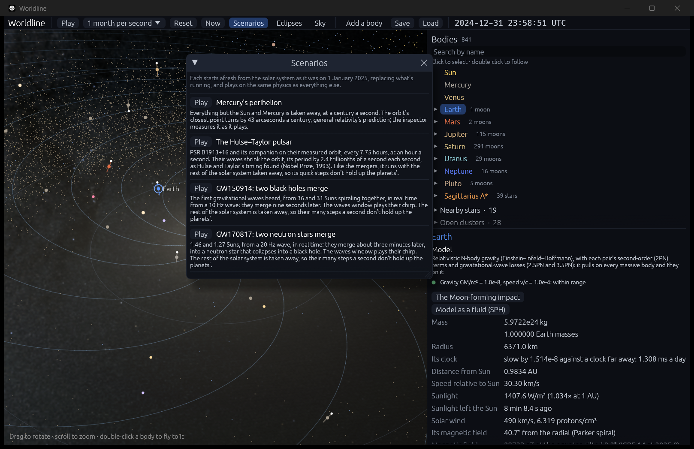
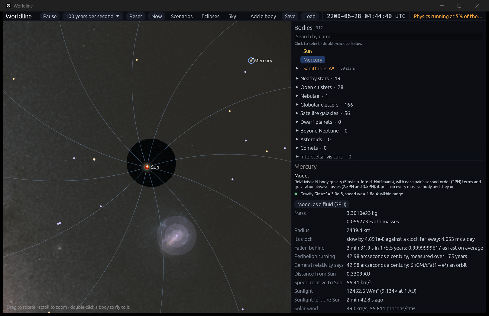

# Scenarios

**Code:**
- `crates/worldline-app/src/app/scenarios.rs`: the library, its window and the perihelion watch;
- `crates/worldline-core/src/orbit.rs`: `periapsis_vector` (the Laplace–Runge–Lenz vector) and `relativistic_advance` (general relativity's turn of an orbit).

**Tests** (in `scenarios.rs`):
- `every_scenario_loads_and_plays`;
- `each_scenario_is_set_up_as_it_says`;
- slow: `mercurys_perihelion_turns_as_general_relativity_says` and `the_scenarios_play_out_as_they_say`.

Step 8.1 gathers the events and experiments Worldline can show into a library. Each one sets up in a single click, from the solar system as it was on 1 January 2025.



## Playing one

**Scenarios** in the top bar opens the window. **Play** starts one afresh, replacing whatever is running. From the command line:

```bash
cargo run --release -- --scenario mercury
```

`--scenarios` opens the window at the start.

## The library

Each scenario is built from what the app already does: the catalogue's bodies, its windows and its views. It runs on the same physics as everything else.

| Scenario | Key | Set up as | Checked |
|---|---|---|---|
| Mercury's perihelion | `mercury` | The Sun and Mercury alone, everything else in the solar system taken away. 100 years a second. The inspector fits the rate the perihelion turns at, from the Laplace–Runge–Lenz vector sampled every frame. | Over a century: 42.9806″ a century, against general relativity's 42.9807″ for the orbit, 6πGM/c²a(1 − e²) an orbit (limit 10⁻³ of it). The planets' pulls, which would add 531″, are gone. |
| The Hulse–Taylor pulsar | `hulse-taylor` | PSR B1913+16 and its companion on their measured orbit, 30 AU above the Sun. An hour a second, with the gravitational-wave window. | Their orbit's period shrinks at −2.40210 × 10⁻¹² s each second, against −2.40263 × 10⁻¹² that general relativity predicts from the measured masses (Weisberg & Huang 2016). The limit is 8.5 × 10⁻⁴, what rounding the catalog's masses allows, as in step 2.2. |
| GW150914 | `gw150914` | The two black holes, 35.6 and 30.6 Suns, from a 10 Hz wave, in real time, with the waves window. | They merge after 8.7 s. The waves window's recording runs the same pair ahead on its own and ends its inspiral at 8.69 s. The two must agree to within how finely the play is checked, 0.03 s. |
| GW170817 | `gw170817` | The two neutron stars from a 20 Hz wave, in real time. | They merge after 173 s; the recording ends at 172.5 s, within 0.75 s. The app reports a hot neutron star of 2.73 Suns that collapses into a black hole. |
| A planet meets a black hole | `planet-black-hole` | A copy of Gaia BH1 40 AU from the Sun. A Jupiter 2 AU from it, at 0.071 of the circular speed, with the tides overlay. A week a second. | Its closest approach is 0.501 of its tidal radius, R(M/m)^(1/3). Becoming a fluid there needs the GPU, so the tests don't play it. |
| TON 618 swallows Sagittarius A* | `ton-618` | TON 618 dropped 6,600 AU from Sagittarius A* at half the circular speed. A month a second. | Sagittarius A* is swallowed after 0.48 years. |
| A white dwarf past its limit | `white-dwarf` | Two copies of Sirius B, 1.02 Suns each, 0.05 AU apart, at rest relative to each other. An hour a second. | They meet and explode as a type Ia supernova after 12.2 hours, past Chandrasekhar's limit of 1.456 Suns. |
| An evaporating black hole | `mini-black-hole` | The catalogue's hypothetical 10⁸ kg black hole, circling the Sun 1.02 AU out. A month a second. | It evaporates after 2.67 years. |
| The next total solar eclipse | `eclipse` | The eclipse finder, going to the first total solar eclipse it finds. | It goes to 12 August 2026, 17:46 UTC, as NASA's Five Millennium Canon dates it. |
| The Moon-forming impact | `moon-impact` | The impact window, with 8,000 particles. | It opens and runs; the impact's own checks are step 6.4's ([giant-impacts.md](physics/giant-impacts.md)). |
| A black hole through the Sun's neighborhood | `black-hole-flyby` | A copy of Sagittarius A*, 4.3 million Suns, 3 pc behind and 3 pc beside the Sun, moving past at 1,000 km/s. The solar system taken away but the Sun. 100 years a second. | Its path passes 3.000 pc from the Sun. Gaia's nearby stars near it scatter. |

**Every scenario** loads, then plays three frames as the app plays them: time moves on in each, except the Moon-forming impact's main view, which waits paused.



## Why some are set up as they are

**Things taken away.** The whole solar system runs at about 26,000 simulated seconds in each frame's time budget, a few weeks a second. A scenario that needs centuries a second, or a pair whose steps are a millisecond, would crawl with every planet stepping alongside. So:
- **Mercury's perihelion and the flyby** leave out what they don't need.
- **The three tight pairs** (Hulse–Taylor, GW150914, GW170817) run beside the Sun alone. Their steps would otherwise set the planets'.
- **The mini black hole** circles the Sun beside Earth's orbit, not Earth. Its short orbit around Earth would have set the planets' steps.

**Where the pairs are.** 30 AU above the Sun, at rest relative to it.
- **The Sun's tide** there is under 10⁻¹⁰ of the pair's pull on each other.
- **Precision:** a place there is good to a millimetre. Near the galactic center, 8 kpc from the frame's origin, double precision only places a body to 30 km, too coarse for a pair 1,300 km apart.

**GW150914 from 10 Hz,** not the catalogue's 20 Hz, so its inspiral lasts nine seconds rather than one.

**The flyby's Sun** moves in the hole's spacetime once the planets are gone, as anything does that a black hole 35 times heavier pulls on hardest. 3 pc off, that's Newton's to 10⁻⁷.

## Found on the way

Building the library turned up three faults, now fixed:
- **Removing Proxima Centauri stopped the app.** Proxima is the first body of the nearby stars' region, and removing the first body of any region was refused as if it were the solar system's Sun. A region with no followers or particles measured from it can now lose it (`any_nearby_star_can_be_removed`).
- **What pulls hardest on a body in the galactic center was measured from the wrong frame.** It took the body's place in the solar system's frame and the region's bodies in their own, 8 kpc apart, so Sagittarius A* always won. A pair dropped there wasn't seen as a pair: no waves window, and the wrong model check. It now measures in the region's frame.
- **The waves window ran its copy of a pair at its place in the simulation's frame.** It now runs it about the pair's center of mass, where the quadrupole is taken anyway, so the copy keeps its own precision wherever the pair is.

## Where it's valid

- **The placements are sandbox choices.** GW150914 merged 440 Mpc away, and the Hulse–Taylor pulsar is thousands of parsecs away, in Aquila. Here they run near the Sun, with the planets gone. The physics of a pair doesn't depend on where it is, but its waves' strength at Earth does.
- **The planet meeting a black hole** becomes a fluid only with a GPU.
- **The Moon-forming impact** runs in its own window, apart from the solar system, as in step 6.4.
