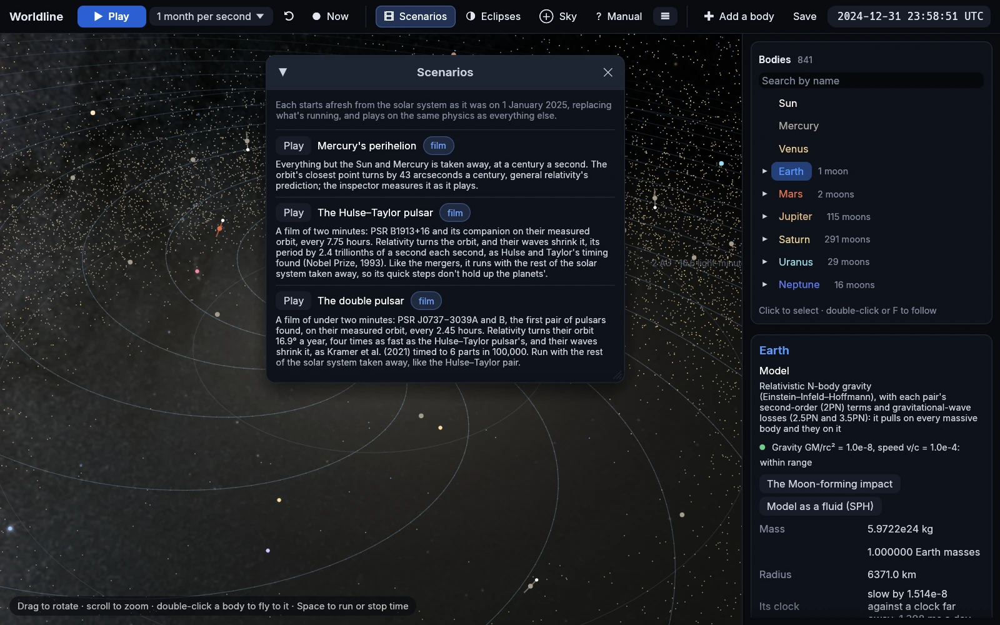

# Scenarios

**Code:**
- `crates/worldline-app/src/app/scenarios.rs`: the library, its window and the perihelion watch;
- `crates/worldline-app/src/app/film.rs`: the films' frame (step 8.5a): the reel, the camera it directs, the cards, captions and bar;
- `crates/worldline-app/src/app/scripts.rs`: the Hulse–Taylor film's script, and the checks of its figures against the data;
- `crates/worldline-app/src/app/films.rs`: every other film's script, the double pulsar's among them (step 8.5c), and the checks of theirs;
- `crates/worldline-core/src/orbit.rs`: `periapsis_vector` (the Laplace–Runge–Lenz vector) and `relativistic_advance` (general relativity's turn of an orbit).

**Tests** (in `scenarios.rs`):
- `every_scenario_loads_and_plays`;
- `each_scenario_is_set_up_as_it_says`;
- slow: `mercurys_perihelion_turns_as_general_relativity_says` and `the_scenarios_play_out_as_they_say`;
- the films' (in `film.rs`, `scripts.rs` and `films.rs`): see [Films](#films-step-85a) and [Every film](#every-film-step-85c).

Step 8.1 gathers the events and experiments Worldline can show into a library. Each one sets up in a single click, from the solar system as it was on 1 January 2025.



## Playing one

**Scenarios** in the top bar opens the window. **Play** starts one afresh, replacing whatever is running. From the command line:

```bash
cargo run --release -- --scenario mercury
```

`--scenarios` opens the window at the start.

## The library

Each scenario is built from what the app already does: the catalogue's bodies, its windows and its views. It runs on the same physics as everything else.

| Scenario | Key | Set up as | Checked |
|---|---|---|---|
| Mercury's perihelion | `mercury` | The Sun and Mercury alone, everything else in the solar system taken away. 100 years a second. The inspector fits the rate the perihelion turns at, from the Laplace–Runge–Lenz vector sampled every frame. | Over a century: 42.9806″ a century, against general relativity's 42.9807″ for the orbit, 6πGM/c²a(1 − e²) an orbit (limit 10⁻³ of it). The planets' pulls, which would add 531″, are gone. |
| The Hulse–Taylor pulsar | `hulse-taylor` | PSR B1913+16 and its companion on their measured orbit, 30 AU above the Sun, played as a [film](#films-step-85a) that ends by opening the gravitational-wave window. | Their orbit's period shrinks at −2.40210 × 10⁻¹² s each second, against −2.40263 × 10⁻¹² that general relativity predicts from the measured masses (Weisberg & Huang 2016). The limit is 8.5 × 10⁻⁴, what rounding the catalog's masses allows, as in step 2.2. |
| The double pulsar | `double-pulsar` | PSR J0737−3039A and B on their measured orbit, 30 AU above the Sun, as the Hulse–Taylor pair is, played as a [film](#every-film-step-85c) that ends by opening the gravitational-wave window (step 8.5c). | Its orbit turns 16.899719° a year simulated, against the timed 16.899323° (limit 2.8 × 10⁻⁵, the post-Newtonian order left out); Peters & Mathews's formula gives Kramer et al.'s prediction of its shrinking to 3 × 10⁻⁷. |
| GW150914 | `gw150914` | The two black holes, 35.6 and 30.6 Suns, from a 10 Hz wave, in real time, with the waves window. | They merge after 8.7 s. The waves window's recording runs the same pair ahead on its own and ends its inspiral at 8.69 s. The two must agree to within how finely the play is checked, 0.03 s. |
| GW170817 | `gw170817` | The two neutron stars from a 20 Hz wave, in real time. | They merge after 173 s; the recording ends at 172.5 s, within 0.75 s. The app reports a hot neutron star of 2.73 Suns that collapses into a black hole. |
| A planet meets a black hole | `planet-black-hole` | A copy of Gaia BH1 40 AU from the Sun. A Jupiter 2 AU from it, at 0.071 of the circular speed, with the tides overlay. A week a second. | Its closest approach is 0.501 of its tidal radius, R(M/m)^(1/3). Becoming a fluid there needs the GPU, so the tests don't play it. |
| TON 618 swallows Sagittarius A* | `ton-618` | TON 618 dropped 6,600 AU from Sagittarius A* at half the circular speed. A month a second. | Sagittarius A* is swallowed after 0.48 years. |
| A white dwarf past its limit | `white-dwarf` | Two copies of Sirius B, 1.02 Suns each, 0.05 AU apart, at rest relative to each other. An hour a second. | They meet and explode as a type Ia supernova after 12.2 hours, past Chandrasekhar's limit of 1.456 Suns. |
| An evaporating black hole | `mini-black-hole` | The catalogue's hypothetical 10⁸ kg black hole, circling the Sun 1.02 AU out. A month a second. | It evaporates after 2.67 years. |
| The next total solar eclipse | `eclipse` | The eclipse finder, going to the first total solar eclipse it finds. | It goes to 12 August 2026, 17:46 UTC, as NASA's Five Millennium Canon dates it. |
| The Moon-forming impact | `moon-impact` | The impact window, with 8,000 particles. | It opens and runs; the impact's own checks are step 6.4's ([giant-impacts.md](physics/giant-impacts.md)). |
| A black hole through the Sun's neighborhood | `black-hole-flyby` | A copy of Sagittarius A*, 4.3 million Suns, 3 pc behind and 3 pc beside the Sun, moving past at 1,000 km/s. The solar system taken away but the Sun. 100 years a second. | Its path passes 3.000 pc from the Sun. Gaia's nearby stars near it scatter. |

**Every scenario** loads, then plays three frames as the app plays them: time moves on in each.

## Films (step 8.5a)

A scenario can play as a film: a script of shots, each saying where the camera looks from and how it moves, how fast time runs, what's said over it, and which cards of information sit beside the bodies. The Hulse–Taylor pulsar was the first; since step 8.5c [every scenario is one](#every-film-step-85c).


**The physics is the scenario's own.** The pair runs on the same relativistic gravity as everything else. The film only directs the camera, sets the speed for each shot and explains what's happening. Nothing is sped up, exaggerated or drawn that the simulation isn't doing.

**Every number on a card is published or measured.** A card's line is one of three kinds:
- written in the script (history, with its source under the card);
- read from the data's CSV files as it plays, with the paper it was copied from (`binary-orbits.csv` gained the pulsar's spin frequency for it, 16.940537785677 turns a second, from Weisberg & Huang 2016's Table 1);
- measured from the simulation as it plays: how far apart the stars are, how fast they pass, how far the orbit has turned.

The captions round some of these figures for reading ("every 7.75 hours", "35,000 times as fast as Mercury's", "38.5 seconds early after 30 years"). A test works each one out from the data and checks the caption says it.

### Watching one

`cargo run --release -- --scenario hulse-taylor`, or **Play** beside it in **Scenarios** (marked *film*).

- **The bar** at the bottom: back, pause, next, the shots (one segment each, as long as the shot; click one to go to it), the time, and **Leave**.
- **Space** pauses the film and time together: the film's pause is time's, so the top bar's **Pause** pauses it too.
- **→** is the next shot; **←** goes back to this shot's start, or to the one before within its first two seconds, as a player's back button does.
- **Dragging and scrolling** still turn and zoom the camera: what you do is kept as an offset to the shot's own move until the next cut.
- **Flying to a body** (a double-click, F) or **standing on Earth** leaves the film, as **Leave** does: the camera is yours and the scenario plays on.
- **At the end**, the film runs its last line (the Hulse–Taylor film opens the gravitational-waves window), says so at the top of the view, and offers to play again.

While a film plays it hides the view's grid. Its rings, AU across around the Sun, would seem to measure a pair a thousand times smaller. It sets the trails shot by shot, and puts both back when it ends or is left.

### The Hulse–Taylor film

Seven shots, 1 minute 56 seconds:

| Shot | Time runs | What it shows | Its cards |
|---|---|---|---|
| 1. Found | an hour a second | The pair from afar: 1974, Arecibo, a pulsar whose pulses come faster, then slower, every 7.75 hours | The pulsar's name and discovery (Hulse & Taylor 1975) |
| 2. Two neutron stars | an hour a second | Closer: what a pulsar is, and that every pulse is a clock's tick | Beside each star: its mass (1.438 and 1.390 ± 0.001 Suns), the pulsar's spin (16.94 turns a second, a pulse every 59.03 ms), and its radius, labeled assumed (GW170817's 11.9 km: none has been measured for it) |
| 3. The orbit | an hour a second | The two orbits around their center of mass, the pulsar's closest approach marked | The timed period and eccentricity; how far apart the stars are now and how fast they pass, measured as it plays |
| 4. Relativity turns it | a month a second | The pulsar's long axis turning: its line now, and dashed, where it pointed when the shot began | Degrees turned; the rate measured here, general relativity's for these masses and the timed orbit, and the timed 4.226585° a year; and why the turning alone can't test relativity: the masses were found from it |
| 5. Waves shrink it | a month a second | The camera rising as the caption tells of the waves | The period's shrinking, as general relativity gives it for the orbit here and as measured (−2.398 ± 0.004 × 10⁻¹²), their ratio 0.998 ± 0.002, and the collision in 300 million years |
| 6. Timed, not seen | a month a second | How the shrinking was measured | A plot of how much earlier each closest approach comes than in an orbit that kept its size, ½ (dP/dt) t² / P from the measured values: 38.5 s after 30 years. First seen in 1979 (Taylor, Fowler & McCulloch) |
| 7. 1993 | an hour a second | The camera pulling away | The Nobel Prize, and LIGO hearing two black holes merge in 2015 (the GW150914 scenario) |

**Why a month a second for the turning.** At an hour a second the long axis turns 0.0005° a second, too slowly to see. At a month a second it turns 0.35° a second: 8° over the shot. The pair then goes round 93 times a second, more often than frames come, so the film draws each star's orbit as it is at each moment (its osculating ellipse) rather than a trail. The physics keeps up: 7.3 ms a frame on the development laptop, inside the 12 ms budget.

**Why the orbits, not trails.** At a month a second a trail, sampled once a frame, would cut across the orbit. Shots 1 and 2, at an hour a second, show the stars' trails: since step 8.5b a pair far from the barycenter keeps its trail around its own center of mass (see [app.md](app.md#the-3d-view)); before, 30 AU out, it added a point only every 0.26 AU, ten times its whole orbit.

**How much earlier each closest approach comes.** An orbit whose period is P + Ṗt reaches its N-th closest approach at N P + ½ Ṗ P N². Against an orbit that keeps its size, which gets there at N P = t, that's ½ (Ṗ/P) t² earlier. For the measured Ṗ = −2.398 × 10⁻¹² and P = 0.322997448918 days, that's 38.5 s after 30 years.

### What's checked

| Test | Checks | Limit, and why | Result |
|---|---|---|---|
| `the_film_plays_from_start_to_end_with_its_cards` | Played a quarter second a frame, as the app plays it: each shot at its speed, the camera on the pair's center of mass from between the shot's two distances, every card line saying something, and at the end the waves window open and the notice saying so | exact | passes, 464 frames |
| `the_captions_figures_follow_from_the_data` | Each rounded figure in the captions, worked out from the data: 7.7519 h, 16.94 turns a second, 746,000 to 3,152,000 km apart, 902 km/s, 4.2266° a year and 35,402 times Mercury's, 75.68 µs a year, 38.51 s after 30 years | the caption's rounding | passes |
| `the_pair_collides_when_the_caption_says` | Peters' time to merge for the orbit as set up | to one figure, as the caption says it | 300.7 million years |
| `the_formula_for_the_catalogs_masses_gives_the_timed_turning` | 3 (GM/c³)^(2/3) (P/2π)^(−5/3) / (1 − e²) for the catalog's masses and the timed orbit, against 4.226585° a year | 4.7 × 10⁻⁴: the masses rounded to 0.001 Suns, (2/3)(0.002/2.828), as in step 2.2 | passes |
| `the_measured_shrinking_is_general_relativitys_to_its_uncertainty` | Weisberg & Huang's measured Ṗ over general relativity's | twice the measurement's uncertainty | 0.998 ± 0.002 |
| `pausing_time_pauses_the_film_and_skipping_sets_up_the_shot` | Paused, the film stays put; skipping to the turning sets its speed and starts watching; flying to a body leaves the film | exact | passes |
| Slow: `the_turning_the_film_measures_is_the_timed_one` | The turning shot's two years, as the film plays them at 60 frames a second, the long axis sampled every frame and its rate fitted | 7.2 × 10⁻⁴: the masses' rounding (4.7 × 10⁻⁴) and the catalogue sizing the orbit by Kepler's law, whose period relativity makes 1.5 × 10⁻⁴ longer than the timed one (step 2.2), so the rate, going as P^(−5/3), 2.5 × 10⁻⁴ slower | 4.225515° a year against 4.226585°, 2.5 × 10⁻⁴ under: the second difference, as expected |

In `film.rs`, unit tests check the reel itself: it plays through its cuts to its end, stays put paused, skips and goes back as a player does, turns the camera the shorter way round at a cut, and fades captions and cards in and out.

**Found on the way.** For this pair, the orbit read off a single moment is a poor guide to general relativity's rate. Its Newtonian semi-major axis swings by 1 × 10⁻⁴ around each orbit, from the relativistic terms in the pair's motion. The rate worked out from one moment ranges from 4.2255° to 4.2262° a year, measured at 200 moments of one orbit. The card therefore uses the formula with the timed period, and the inspector's row shows three decimals for a pair. The rate fitted to the long axis over many orbits averages the swing out.

## Every film (step 8.5c)

Every scenario now plays as a film, and the library has a twelfth: **the double pulsar**, PSR J0737−3039A and B, from Kramer et al.'s (2021) timing. Each film's cards follow the Hulse–Taylor film's rules: a number on a card is published (read from the data, with its source) or measured from the simulation as it plays; history is cited to the paper that made it; what never happened says *imagined* in its first caption.

| Film | Shots | Length | What it shows | Its sources |
|---|---|---|---|---|
| Mercury's perihelion | 3 | 46 s | The turning Le Verrier couldn't explain, 38″ a century (1859); Einstein's 43″ (1915); the turning measured as it plays, against relativity's | Le Verrier 1859; Einstein 1915 |
| The Hulse–Taylor pulsar | 7 | 1 min 56 s | See [above](#the-hulse-taylor-film) | Hulse & Taylor 1975; Weisberg & Huang 2016 |
| **The double pulsar** | 5 | 1 min 23 s | Found in 2003 and 2004; two pulsars, 44 turns a second and one every 2.8 s, on an edge-on orbit; turning 16.9° a year (four times Hulse–Taylor's), measured as it plays; shrinking 7 mm a day, colliding in 86 million years; the most precise test of gravitational waves | Burgay et al. 2003; Lyne et al. 2004; Kramer et al. 2021 |
| GW150914 | 4 | 27 s | Two black holes of 36 and 31 Suns, 440 Mpc away, in their last nine seconds, in real time; one of 63 Suns, three Suns' worth radiated; heard on 14 September 2015 | GWTC-1 (Abbott et al. 2019); Abbott et al. 2016 |
| GW170817 | 4 | 3 min 11 s | Two neutron stars in NGC 4993, 40 Mpc away, in their last three minutes, in real time; the gamma rays 1.7 s after; the kilonova | GWTC-1; Abbott et al. 2017 |
| A planet meets a black hole | 3 | 38 s | Imagined: a Jupiter falling past a copy of Gaia BH1; its tidal radius, live; torn apart as a fluid | El-Badry et al. 2023; Rees 1988 |
| TON 618 swallows Sagittarius A* | 3 | 35 s | Imagined: 66 billion Suns and 4.3 million; the fall, live, against TON 618's horizon; 0.0065% heavier | Shemmer et al. 2004; GRAVITY Collaboration 2022 |
| A white dwarf past its limit | 3 | 23 s | Imagined: two copies of Sirius B, 2.04 Suns together, past Chandrasekhar's limit worked out live; a type Ia supernova, and what such supernovae found in 1998 | Bond et al. 2017; Chandrasekhar 1931; Riess et al. 1998; Perlmutter et al. 1999 |
| An evaporating black hole | 3 | 36 s | Imagined: 100,000 tonnes, its temperature, power and life left, live, to the end | Hawking 1974 |
| The next total solar eclipse | 3 | 30 s | The finder searching ahead, how far it has got shown as it goes (the first shot waits until it has found it, about half a minute); the shadow on 12 August 2026, from the Sun's side | Espenak & Meeus 2006 |
| The Moon-forming impact | 3 | 38 s | The young Earth while the impact plays in its own window; the giant-impact idea | Canup 2004; Hartmann & Davis 1975; Cameron & Ward 1976 |
| A black hole through the Sun's neighborhood | 3 | 42 s | Imagined: a copy of Sagittarius A* passing 3 pc from the Sun at 1,000 km/s; its distance and speed, live | GRAVITY Collaboration 2022 |

**For the films to work** the frame gained three things:
- **A shot can wait.** The eclipse's first shot holds at its end until the eclipse finder has found the eclipse and gone to it, however long that takes.
- **A shot can face the Sun.** Its angle around is measured from the direction to the Sun, so the eclipse is seen from the sunlit side whatever the date.
- **A shot can follow whatever the camera follows.** For a copy whose name is only known once it's added (the planet, the white dwarfs), a shot names no bodies and looks at the one followed.

Two more changes come with them:
- **Watch again** now starts the scenario afresh. Time doesn't run backward, and an event, once it has happened (a merger), can't be shown again by going back to its shot. Going back to an earlier shot shows its framing and words with time still running on.
- **The Moon-forming impact's** main view now runs in real time during its film. It used to wait paused, but a paused film doesn't play.

### The double pulsar

**The data** (`notable-objects.csv` and `binary-orbits.csv`, from Kramer et al. 2021, *Phys. Rev. X* 11, 041050, read from the paper itself):
- **The masses:** pulsar A 1.338185 (+12/−14) Suns and pulsar B 1.248868 (+13/−11) Suns (Table IV, eqs. 36 and 37).
- **The orbit:** period 0.1022515592973 days, eccentricity 0.087777023, turning 16.899323° a year.
- **Pulsar A:** spin 44.05406864196281 Hz.
- **The distance:** 735 pc.
- **The shrinking from gravitational waves:** −1.247782(79) × 10⁻¹² s/s (eq. 44). That's the observed −1.247920 × 10⁻¹², less the Shklovskii and galactic terms and A's loss of mass.
- **General relativity's prediction** at the same, quadrupole order: −1.247810 × 10⁻¹² (eq. 45). With the next order of radiation, Kramer et al. find measured ÷ predicted 0.999963 ± 0.000063 (eq. 48).
- **The radii** aren't measured: GW170817's 11.9 km, labeled assumed, as for the Hulse–Taylor pair.

**Checked** (in `crates/worldline-data/tests/`):
- **The orbit turns as measured** (`the_double_pulsars_orbit_turns_as_measured`). Resized until its simulated period is the measured one, as for the Hulse–Taylor pair in step 2.2, it turns 16.899719° a year against the timed 16.899323°: 2.3 × 10⁻⁵. The simulation keeps the first post-Newtonian order. The next, which Kramer et al. measured at 35 times the turning's uncertainty (35 × 0.000013/16.899323 = 2.7 × 10⁻⁵), it leaves out. With the masses' rounding, 5 × 10⁻⁷, the limit is 2.8 × 10⁻⁵.
- **The orbit shrinks as measured** (`the_double_pulsars_orbit_shrinks_as_measured`):
  - Peters & Mathews's formula, for the catalog's masses and the timed orbit, gives Kramer et al.'s prediction to 3 × 10⁻⁷. The limit, 6.5 × 10⁻⁶, is the masses' rounding plus the prediction's own uncertainty.
  - Their measurement is 0.35σ from it, within the 2σ allowed.
  - The engine's radiation reaction itself is checked over a thousand simulated orbits of the Hulse–Taylor pair (step 2.2).

**The films' checks** (in `films.rs`):
- `every_scenario_is_a_film_and_each_shot_sets_itself_up`: every scenario has a film. Gone to, each shot sets its speed and trails and hides the grid, and every line of its cards says something.
- `the_captions_figures_follow_from_the_data`: every figure a caption rounds, worked out from the data. For example, the double pulsar's 2 hours 27 minutes, 44 turns a second, four times Hulse–Taylor's turning, 7 mm a day (7.15), 39 µs a year (39.38) and 86 million years (86.0).
- `a_shot_waiting_for_the_eclipse_holds_until_it_is_found`: the eclipse's first shot holds just short of its end while the finder searches, and moves on once the eclipse is found.
- Slow: `every_film_plays_to_its_end`: each film, half a second a frame, the eclipse finder polled as its window polls it, ends, and every shot's cards speak.

## Why some are set up as they are

**Things taken away.** The whole solar system runs at about 26,000 simulated seconds in each frame's time budget, a few weeks a second. A scenario that needs centuries a second, or a pair whose steps are a millisecond, would crawl with every planet stepping alongside. So:
- **Mercury's perihelion and the flyby** leave out what they don't need.
- **The three tight pairs** (Hulse–Taylor, GW150914, GW170817) run beside the Sun alone. Their steps would otherwise set the planets'.
- **The mini black hole** circles the Sun beside Earth's orbit, not Earth. Its short orbit around Earth would have set the planets' steps.

**Where the pairs are.** 30 AU above the Sun, at rest relative to it.
- **The Sun's tide** there is under 10⁻¹⁰ of the pair's pull on each other.
- **Precision:** a place there is good to a millimetre. Near the galactic center, 8 kpc from the frame's origin, double precision only places a body to 30 km, too coarse for a pair 1,300 km apart.

**GW150914 from 10 Hz,** not the catalogue's 20 Hz, so its inspiral lasts nine seconds rather than one.

**The flyby's Sun** moves in the hole's spacetime once the planets are gone, as anything does that a black hole 35 times heavier pulls on hardest. 3 pc off, that's Newton's to 10⁻⁷.

## Found on the way

Building the library turned up three faults, now fixed:
- **Removing Proxima Centauri stopped the app.** Proxima is the first body of the nearby stars' region, and removing the first body of any region was refused as if it were the solar system's Sun. A region with no followers or particles measured from it can now lose it (`any_nearby_star_can_be_removed`).
- **What pulls hardest on a body in the galactic center was measured from the wrong frame.** It took the body's place in the solar system's frame and the region's bodies in their own, 8 kpc apart, so Sagittarius A* always won. A pair dropped there wasn't seen as a pair: no waves window, and the wrong model check. It now measures in the region's frame.
- **The waves window ran its copy of a pair at its place in the simulation's frame.** It now runs it about the pair's center of mass, where the quadrupole is taken anyway, so the copy keeps its own precision wherever the pair is.

## Where it's valid

- **The placements are sandbox choices.** GW150914 merged 440 Mpc away, and the Hulse–Taylor pulsar is thousands of parsecs away, in Aquila. Here they run near the Sun, with the planets gone. The physics of a pair doesn't depend on where it is, but its waves' strength at Earth does.
- **The planet meeting a black hole** becomes a fluid only with a GPU.
- **The Moon-forming impact** runs in its own window, apart from the solar system, as in step 6.4.
