# Screenshots and recordings

Step 8.8b. Each is the app itself, capturing its own frames, made by `python tools/capture.py`.
Running the command under one makes it again (`--capture` saves a PNG, which the tool turns into WebP;
`--record` saves a folder of frames, which it turns into an animated WebP and an MP4).

## interface

Saturn up close: along the top, time, the scenarios, eclipses, the sky, the manual and the tools to add bodies; on the right, every body, and the one selected with the physics that moves it.

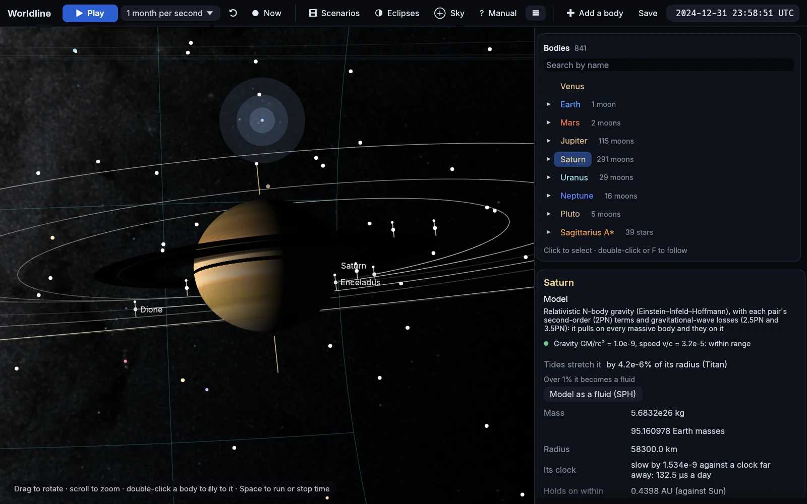

```
cargo run --release -- --focus Saturn --zoom 8 --pitch 20 --paused --capture interface.png --at 2
```

## solar-system

The real solar system five months after 1 January 2025, with relativistic gravity: the planets' orbits, the asteroid belt and the comets.

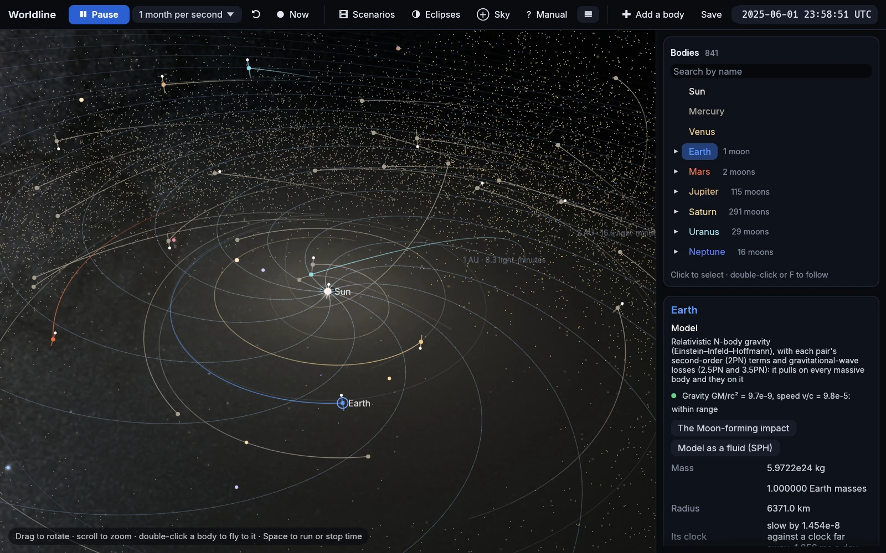

```
cargo run --release -- --capture solar-system.png --at 5
```

## earth

Earth on 1 January 2025: clouds, blue Rayleigh haze, the Pacific in daylight and night falling over Asia.

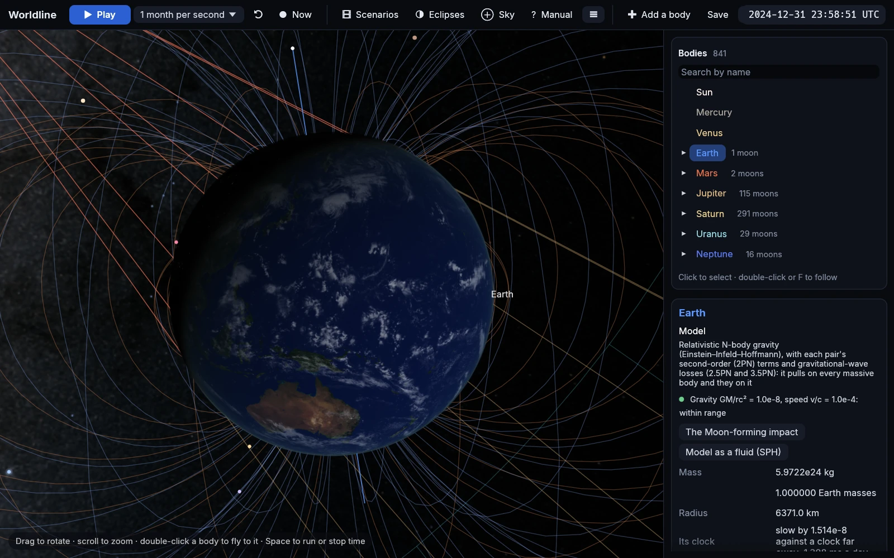

```
cargo run --release -- --focus Earth --paused --capture earth.png --at 2
```

## saturn-2032

Saturn in April 2032 from below its rings: Cassini's measured ring structure, and Saturn's shadow across the rings.

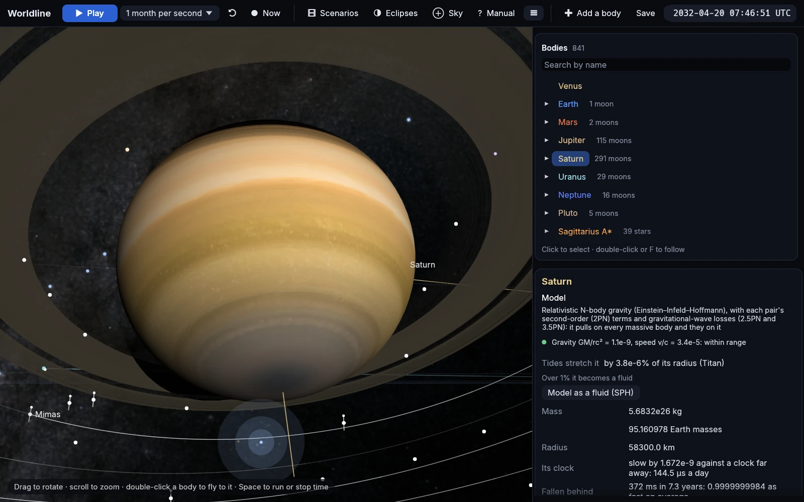

```
cargo run --release -- --focus Saturn --advance 7.3 --pitch -12 --paused --capture saturn-2032.png --at 2
```

## belts

The asteroid belt and Jupiter's two Trojan clouds, 60° ahead of and behind it, from 28,331 real orbits, in the glow of the zodiacal dust.

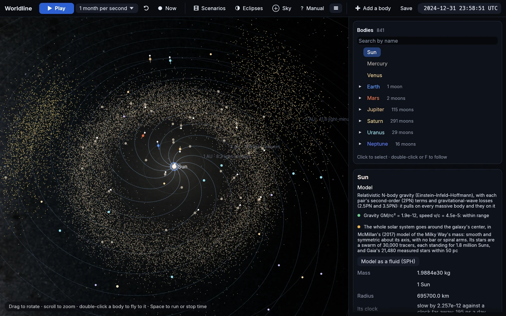

```
cargo run --release -- --focus Sun --zoom 2500 --pitch 60 --paused --capture belts.png --at 2
```

## black-hole

Gaia BH1 from 570 km, nearly edge on to a disk drawn around it: its shadow, with the disk's far side bent over the top and under the bottom by its gravity, rays traced one by one. The disk is an illustration, a thin disk as Novikov and Thorne model one: Gaia BH1 has none that's been seen.


```
cargo run --release -- --add "Gaia BH1:1" --focus "Gaia BH1" --zoom 20 --pitch 3 --paused --capture black-hole.png --at 7
```

## spinning-black-hole

Cygnus X-1, spinning at 0.9985, from 9° above the disk drawn around it: the shadow flattened where light circles with the spin, and the disk's far side lensed over the top.

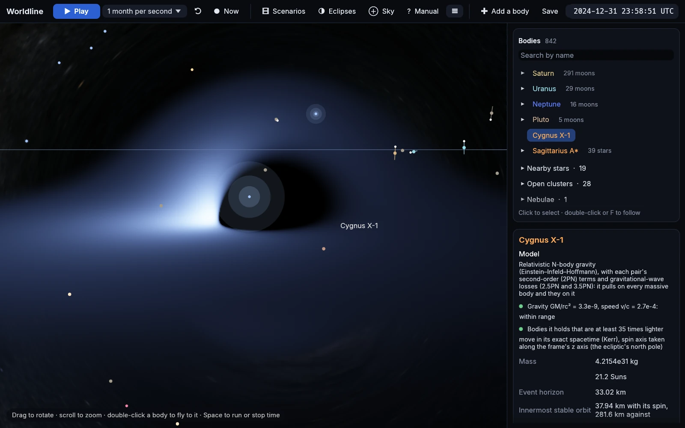

```
cargo run --release -- --add "Cygnus X-1:3" --focus "Cygnus X-1" --zoom 28 --pitch 9 --paused --capture spinning-black-hole.png --at 7
```

## neutron-star

The Hulse–Taylor pulsar from close by: its gravity bends its light, so it looks 1.25 times its size with more than half its surface in view, and its two radio beams.

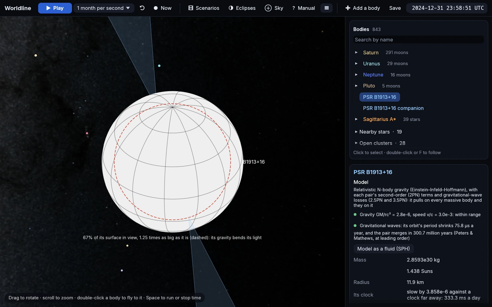

```
cargo run --release -- --add "PSR B1913+16 pair:30" --focus "PSR B1913+16" --zoom 6 --paused --capture neutron-star.png --at 7
```

## gravitational-waves

GW150914's two black holes at 20 Hz: their gravitational waves' crests spiral out at the speed of light, and the clock-rate map glows where clocks run slowest.

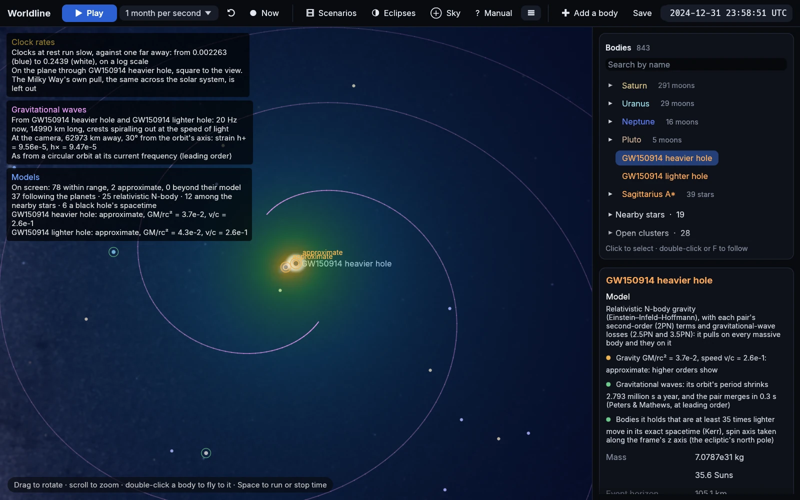

```
cargo run --release -- --add "GW150914 pair:30" --focus "GW150914 heavier hole" --zoom 600 --pitch 60 --paused --overlays waves,clocks,models --capture gravitational-waves.png --at 7
```

## tides

Earth's tides and the shape of space around it: arrows stretched toward and away from the Moon and the Sun, and space dipping toward Earth's center.

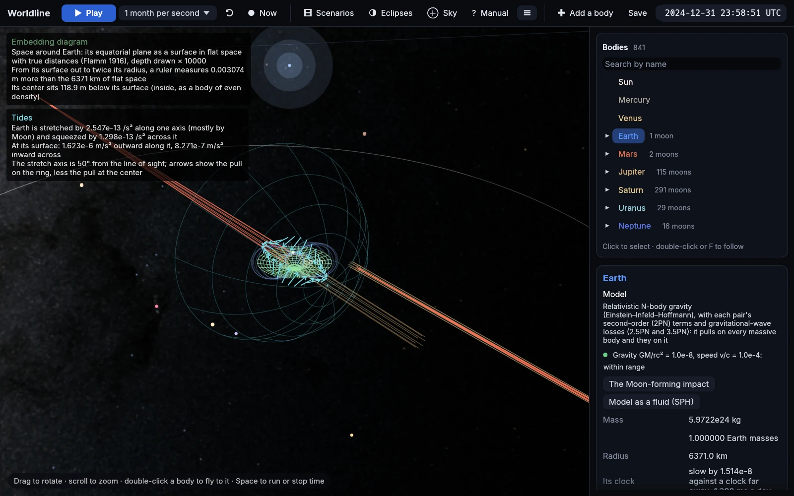

```
cargo run --release -- --focus Earth --zoom 90 --pitch 25 --paused --overlays tides,embedding --capture tides.png --at 2
```

## eclipse-path

The total solar eclipse of 12 August 2026 at its greatest, found by the eclipse finder in the app's own simulation: the Moon's shadow on Earth and its path of totality.

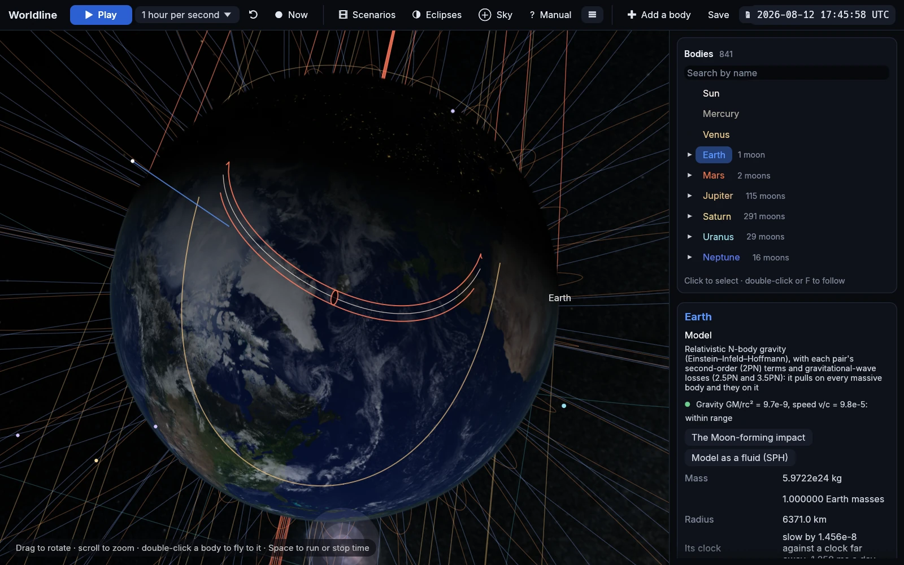

```
cargo run --release -- --eclipse 7 --capture eclipse-path.png --at 150
```

## totality

The same eclipse from Reykjavík at totality: the Moon's black disk over the Sun, with the corona around it.

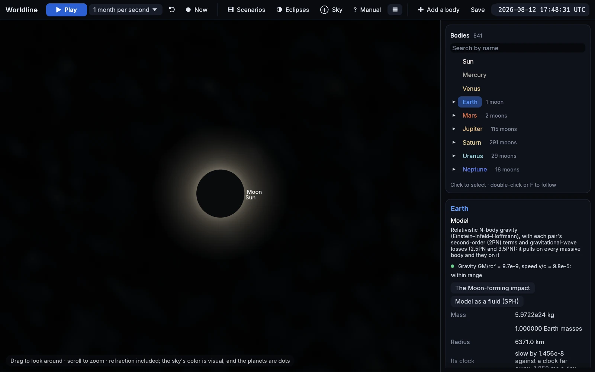

```
cargo run --release -- --stand 64.1466,-21.9426 --advance 1.611890 --paused --fov 4 --capture totality.png --at 2
```

## crater

Chicxulub's estimated impactor, sent at Earth: the crater it digs, 25 hours later in the noon Sun.

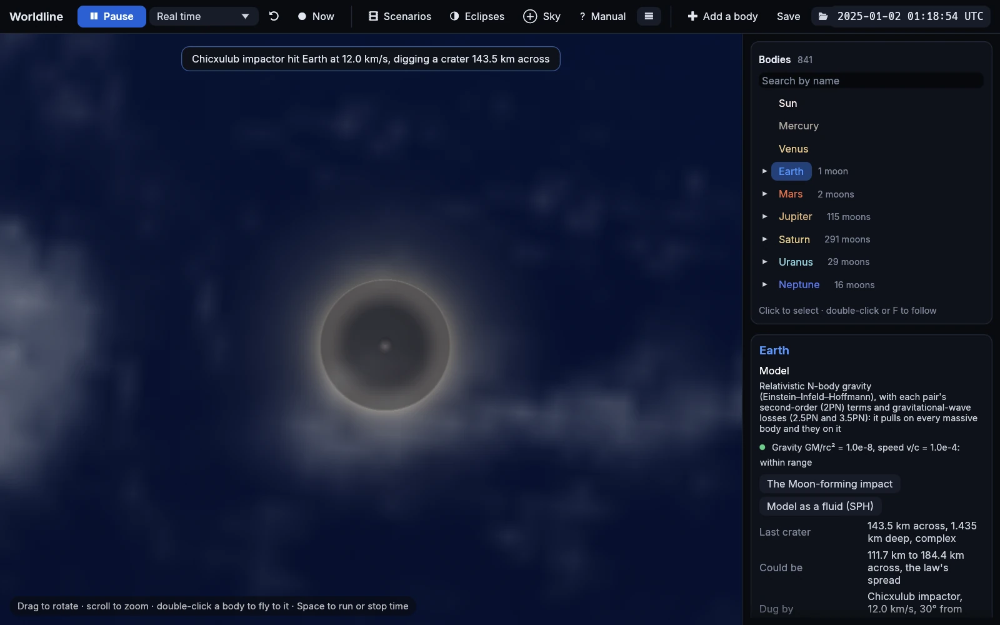

```
cargo run --release -- --add "Chicxulub impactor:0.002@Earth" --aim 12,0.5 --advance 0.00289 --focus Earth --zoom 1.12 --yaw -75 --pitch 39 --speed real --capture crater.png --at 2
```

## collision

A second Earth strikes Earth at 30 km/s, a little off center: the fragments it throws off, and what's left.

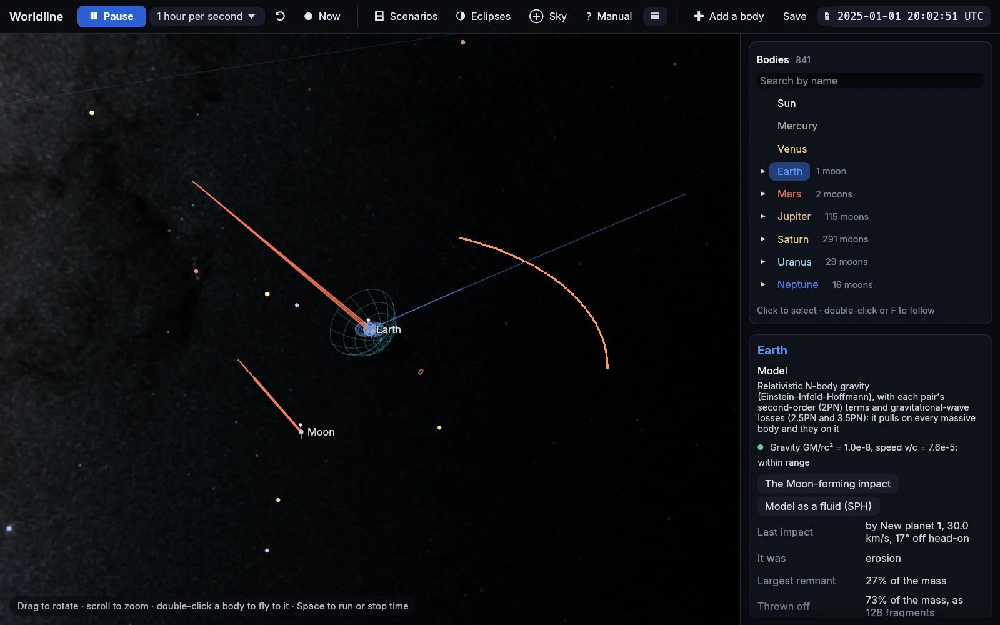

```
cargo run --release -- --add earth:0.0003@Earth --aim 30,0.3 --focus Earth --zoom 330 --speed hour --capture collision.png --at 20
```

## alpha-centauri

α Centauri A and B, 4.4 light-years away, on their 80-year orbit.

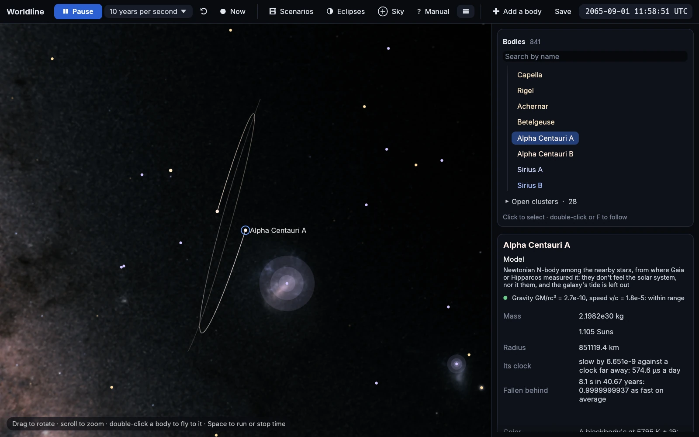

```
cargo run --release -- --focus "Alpha Centauri A" --zoom 4000 --pitch 85 --speed decade --capture alpha-centauri.png --at 4
```

## clusters

The Milky Way's globular clusters, and Omega Centauri, the largest.

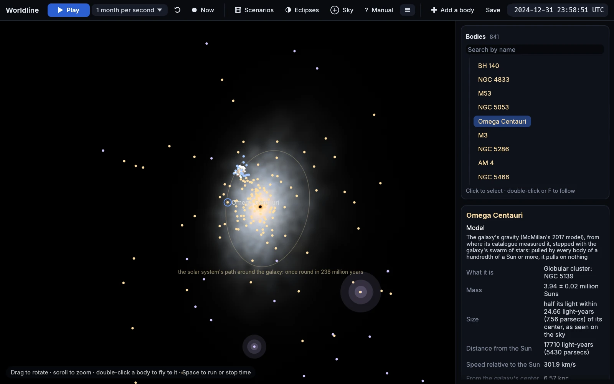

```
cargo run --release -- --focus "Omega Centauri" --zoom 9000 --pitch 40 --paused --capture clusters.png --at 2
```

## milky-way

The Milky Way from 35 kiloparsecs, drawn as light: its disk and bulge, with the Sun on its path round the center.

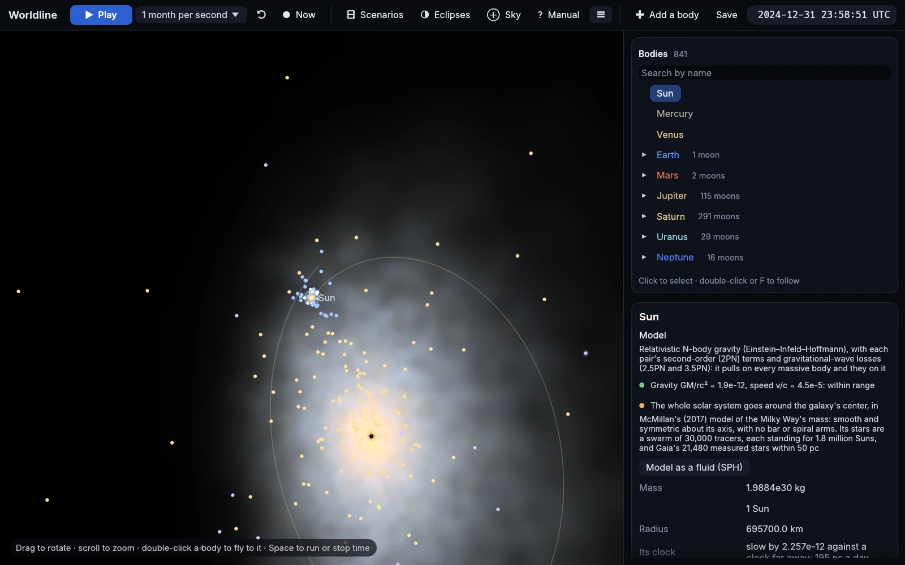

```
cargo run --release -- --focus Sun --zoom 1.5e12 --pitch 50 --paused --capture milky-way.png --at 2
```

## scenarios

The Scenarios window: twelve famous events, each played as a film.

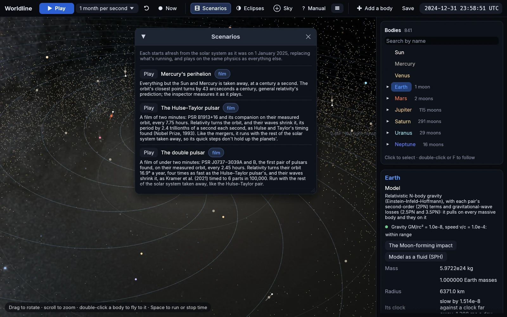

```
cargo run --release -- --scenarios --paused --capture scenarios.png --at 2
```

## manual

The manual inside the app, at its beginning.

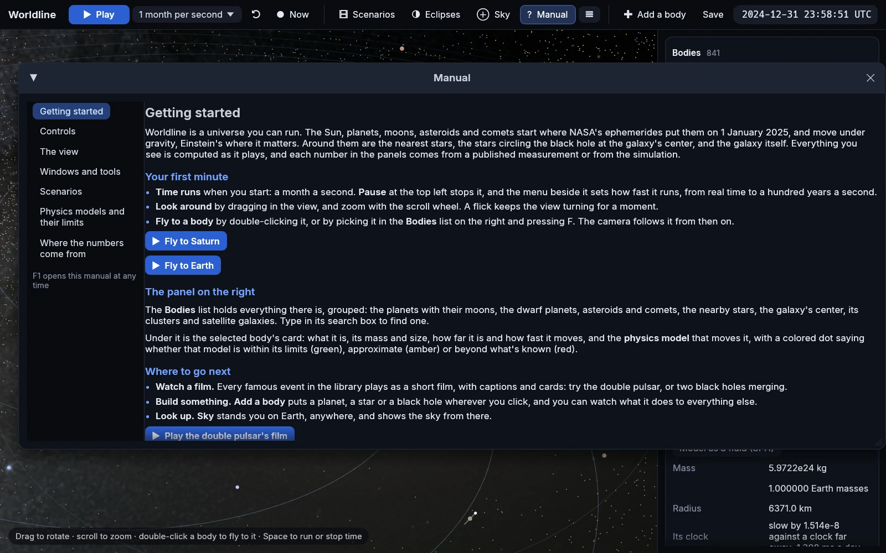

```
cargo run --release -- --manual --paused --capture manual.png --at 2
```

## film

The Hulse–Taylor pulsar's film: the orbit turning as general relativity says, with a card measuring it against the pulsar's timing.

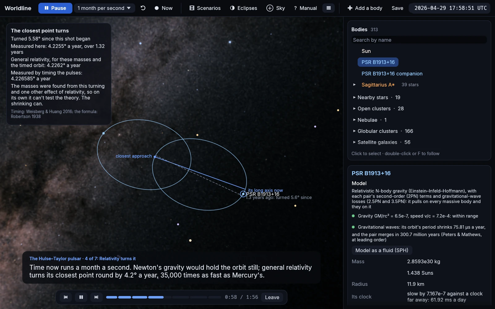

```
cargo run --release -- --scenario hulse-taylor --capture film.png --at 58
```

## hulse-taylor

The Hulse–Taylor pulsar's film, its fourth shot: at a month a second, the orbit's closest point turns 4.2° a year, as general relativity says.

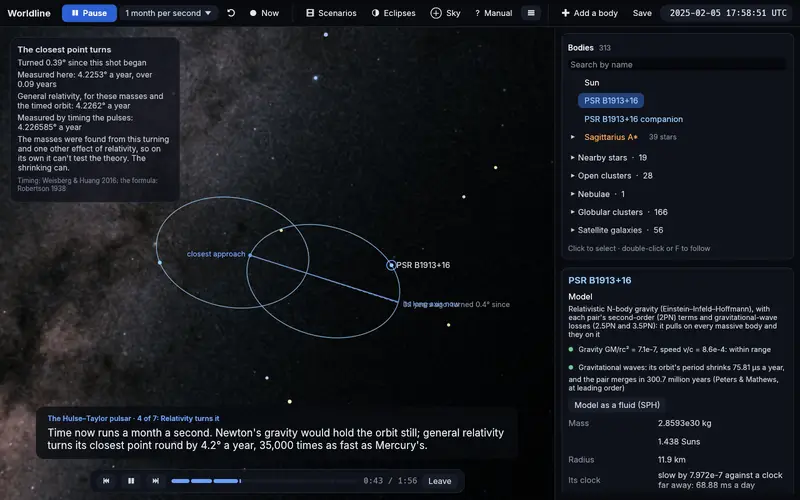

As video: [hulse-taylor.mp4](hulse-taylor.mp4).

```
cargo run --release -- --scenario hulse-taylor --record hulse-taylor --at 43 --for 8 --fps 15
```

## saturn-moons

Saturn's moons at a day a second, each on its own orbit in the plane of the rings.

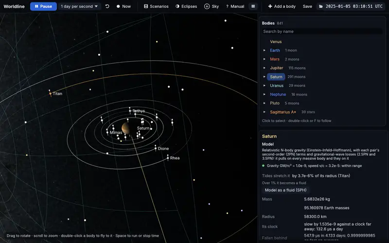

As video: [saturn-moons.mp4](saturn-moons.mp4).

```
cargo run --release -- --focus Saturn --zoom 40 --pitch 60 --speed day --record saturn-moons --at 4 --for 8 --fps 15
```
