# Validation plots

Step 8.2. Every claim in the [README](../../README.md#validated-against-reality) links to the test that checks it and to a plot here, drawn from what that test measured the last time it ran. This page is written by `tools/validation_report.py`; don't edit it by hand.

## Reading them

- **Margin plots**: one bar for each check a test makes, its result's distance from what's expected as a share of the limit it must stay within, on a logarithmic scale. Under 1, left of the red line, passes. Under each bar, the result itself. A bar past the line, in orange, is a check the test allows to miss and says so: the small moons' listed residuals, and the one disruption threshold Leinhardt & Stewart's "usually" allows.
- **Curves**: what was simulated or measured, solid or as dots, against what's expected, dashed, with the limits as dashed lines where they're a curve's.

Every limit is the test's own, from theory, rounding or the roadmap; the line under each curve says which.

## How they're made

1. Each validation test describes what it checked as a figure, with the small `worldline-report` crate, and saves it. When the `WORLDLINE_REPORT` environment variable is set, saving writes the figure's numbers to `data/<id>.json`, with the test's name and file; otherwise it does nothing, so ordinary test runs change no files.
2. `python tools/validation_report.py` draws each as `<id>.svg` and writes this page. It uses Python's standard library only.
3. `cargo test -p worldline-report` checks the README: every row links at least one test and one plot, every plot exists with its data, and the data names a test function in a file the row links.

To draw them all again: `python tools/validation_report.py --run` runs every test with `WORLDLINE_REPORT` set, the slow ones too (about two hours, and a GPU), then draws. Without `--run` it only draws.

## The plots

In the README's order.

### Kepler's third law: simulated orbital periods against T = 2π √(a³/GM)

`kepler-periods`, from [`orbital_periods_obey_keplers_third_law`](../../crates/worldline-core/tests/validation_kepler.rs).

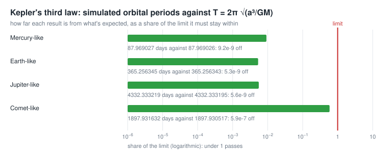

### Energy over 10,000 orbits (IAS15, e = 0.5): the error random-walks at rounding level

`ias15-energy`, from [`energy_error_random_walks_at_rounding_level`](../../crates/worldline-core/tests/validation_ias15.rs).

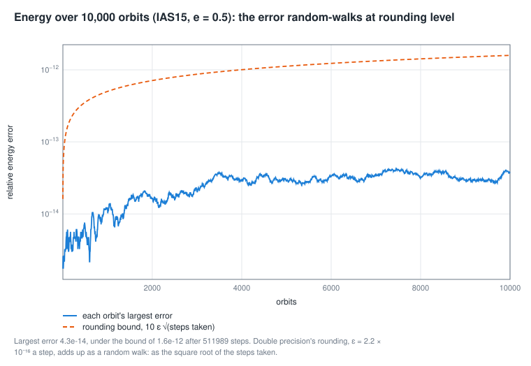

### One year of the real solar system against NASA JPL, with relativistic gravity

`one-year-vs-jpl`, from [`one_year_matches_jpl`](../../crates/worldline-data/tests/validation_solar_system.rs).

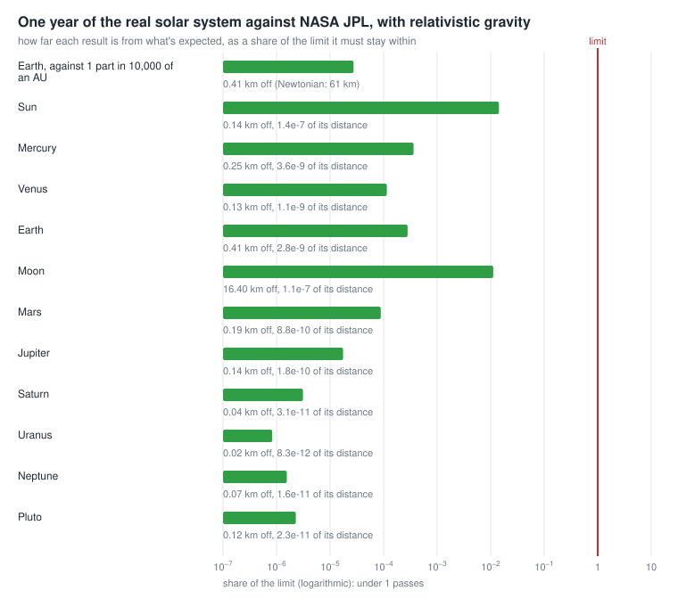

### Mercury's perihelion over a century, the Sun and Mercury alone

`mercury-perihelion`, from [`mercury_perihelion_precesses_43_arcseconds_per_century`](../../crates/worldline-core/tests/validation_mercury.rs).

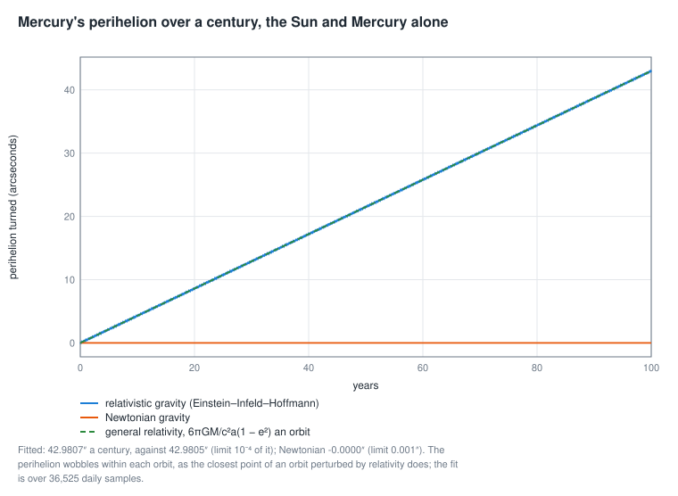

### Planets' axial tilts: IAU rotation models and the simulated orbits, against NASA's fact sheet

`axial-tilts`, from [`axial_tilts_match_nasa`](../../crates/worldline-data/tests/validation_rotation.rs).

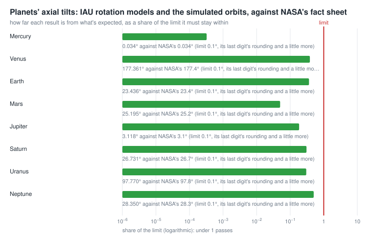

### Mercury's 3:2 spin–orbit resonance

`mercury-spin-orbit`, from [`mercury_spins_three_times_every_two_orbits`](../../crates/worldline-data/tests/validation_rotation.rs).

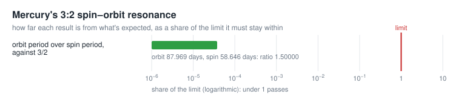

### Earth in the Moon's sky over a month: the Moon keeps one face toward it, rocking (libration)

`moon-libration`, from [`moon_keeps_one_face_toward_earth`](../../crates/worldline-data/tests/validation_rotation.rs).

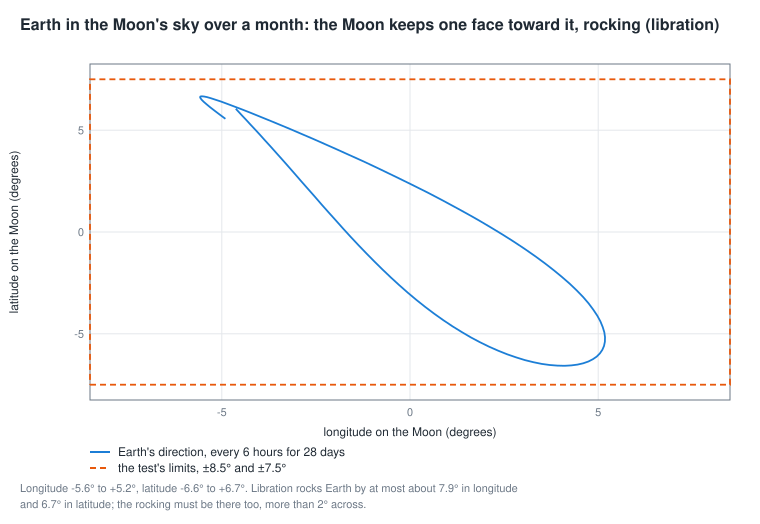

### Where the Sun is overhead on 1 January 2025, 00:00 TDB

`sun-overhead`, from [`sun_is_overhead_in_the_right_place_on_new_years_day`](../../crates/worldline-data/tests/validation_rotation.rs).

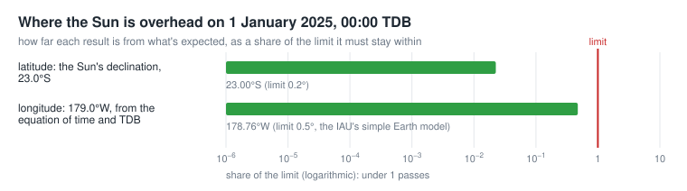

### Saturn's rings turn edge-on in 2025: to Earth on 23 March, to the Sun (equinox) on 6 May

`saturn-ring-crossings`, from [`rings_turn_edge_on_on_the_published_dates_in_2025`](../../crates/worldline-data/tests/validation_rings.rs).

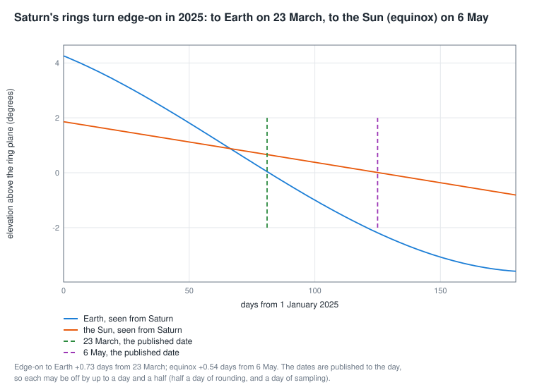

### Cassini's measured ring profile against the PDS ring boundaries

`ring-structure`, from [`measured_profile_matches_the_published_ring_boundaries`](../../crates/worldline-data/tests/validation_rings.rs).

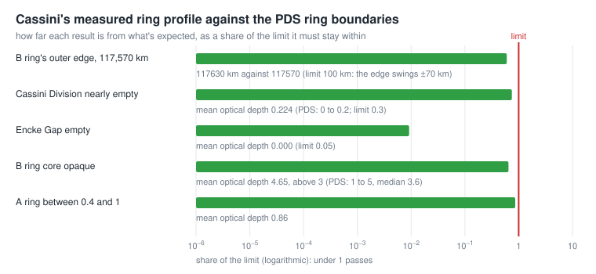

### 21 major moons after 30 days against NASA JPL: each within its own radius

`major-moons-vs-jpl`, from [`moons_match_jpl_after_30_days`](../../crates/worldline-data/tests/validation_moons.rs).

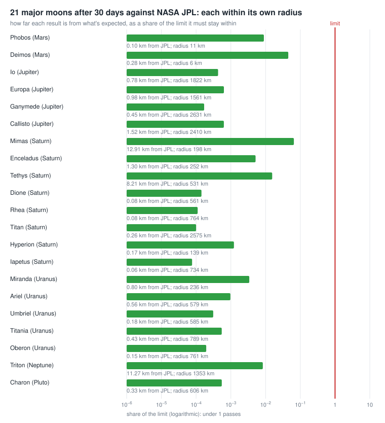

### Every moon in JPL's list of planetary satellites loads

`every-moon-loads`, from [`every_moon_in_jpls_list_loads`](../../crates/worldline-data/tests/validation_small_moons.rs).

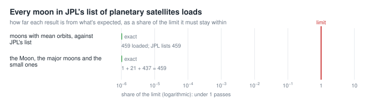

### Small moons with measured sizes after 30 days against JPL: 7 listed residuals, not yet explained

`small-moons-vs-jpl`, from [`small_moons_match_jpl_after_30_days`](../../crates/worldline-data/tests/validation_small_moons.rs).

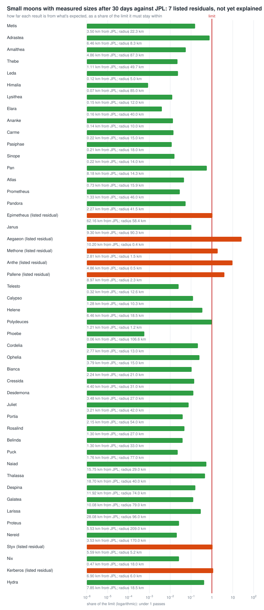

### Janus and Epimetheus trade orbits: due in January 2026

`janus-epimetheus`, from [`janus_and_epimetheus_trade_orbits`](../../crates/worldline-data/tests/validation_small_moons.rs).

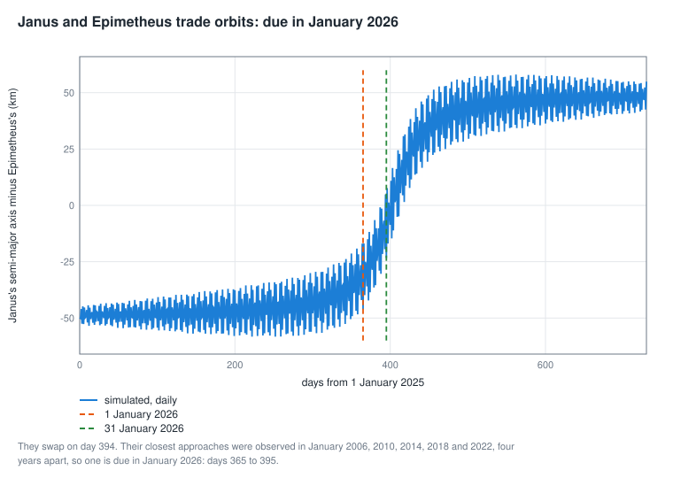

### Phobos and Deimos after 30 days against JPL, with and without Mars's lumpy (Tharsis) gravity

`mars-lumpy-gravity`, from [`mars_lumpy_gravity_keeps_phobos_and_deimos_on_track`](../../crates/worldline-data/tests/validation_moons.rs).

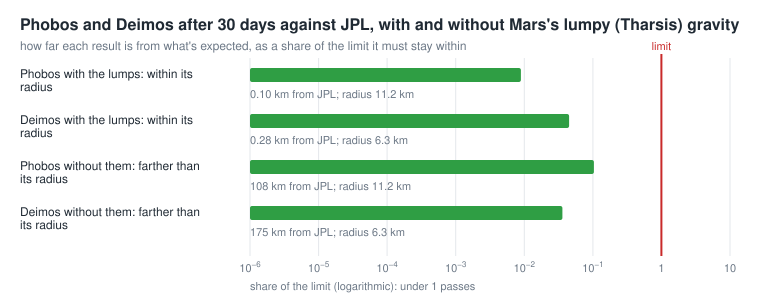

### Io, Europa and Ganymede's Laplace resonance: φ = λ_Io − 3λ_Europa + 2λ_Ganymede

`laplace-resonance`, from [`galilean_moons_hold_the_laplace_resonance`](../../crates/worldline-data/tests/validation_moons.rs).

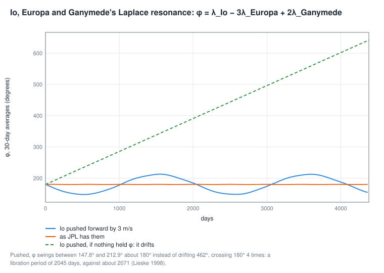

### The heaviest asteroids' pull brings Mars closer to JPL after a year

`asteroids-pull-on-mars`, from [`the_asteroids_mass_shrinks_mars_error`](../../crates/worldline-data/tests/validation_small_bodies.rs).

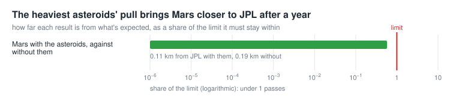

### 62 dwarf planets, asteroids and comets after a year against NASA JPL

`small-bodies-vs-jpl`, from [`small_bodies_match_jpl_after_one_year`](../../crates/worldline-data/tests/validation_small_bodies.rs).

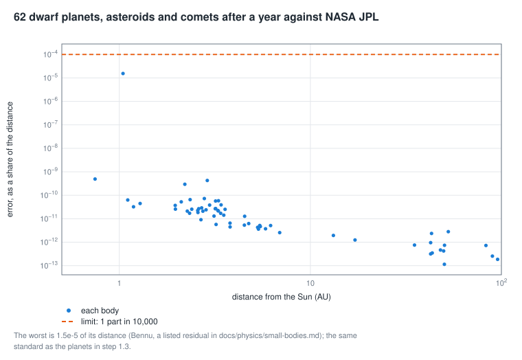

### Halley's Comet returns in July 2061

`halley-2061`, from [`halleys_comet_returns_in_july_2061`](../../crates/worldline-data/tests/validation_small_bodies.rs).

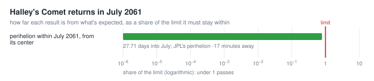

### Kirkwood gaps in 19,971 real main-belt asteroids, at Jupiter's resonances

`kirkwood-gaps`, from [`kirkwood_gaps_open_at_jupiters_resonances`](../../crates/worldline-data/tests/validation_belts.rs).

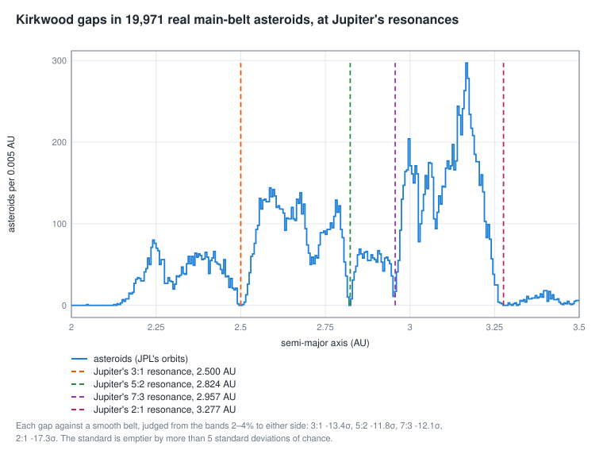

### Jupiter's Trojans (4,509) cluster 60° ahead of and behind Jupiter

`trojans`, from [`trojans_cluster_60_degrees_ahead_of_and_behind_jupiter`](../../crates/worldline-data/tests/validation_belts.rs).

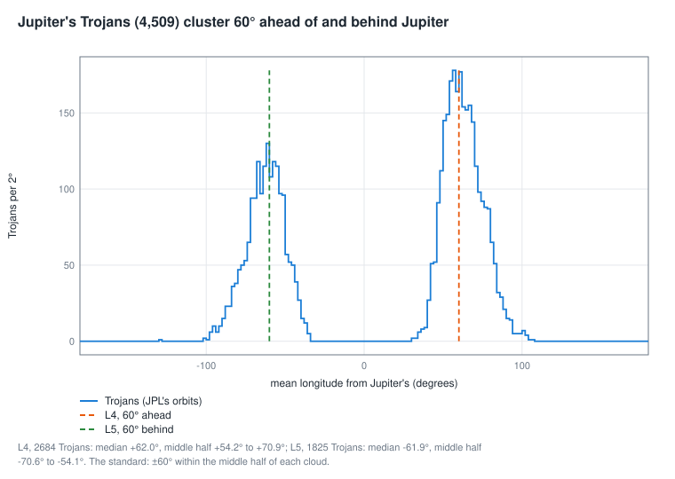

### The Hildas crowd into Jupiter's 3:2 resonance

`hildas`, from [`hildas_crowd_into_jupiters_3_2_resonance`](../../crates/worldline-data/tests/validation_belts.rs).

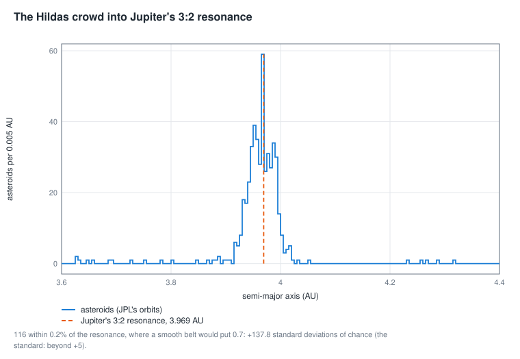

### The Plutinos crowd into Neptune's 3:2 resonance

`plutinos`, from [`plutinos_crowd_into_neptunes_3_2_resonance`](../../crates/worldline-data/tests/validation_belts.rs).

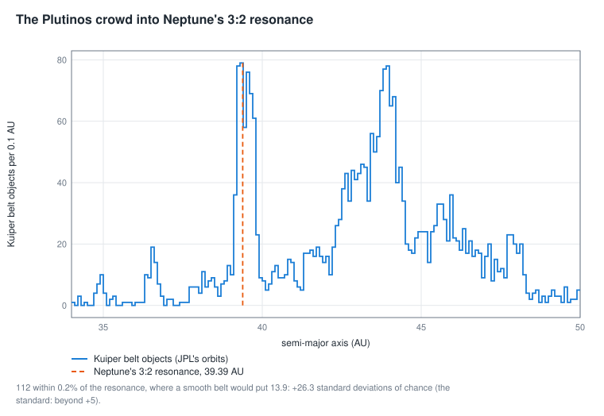

### The zodiacal dust model (COBE) brightens toward the Sun as Helios measured

`zodiacal-helios`, from [`the_dust_model_brightens_toward_the_sun_as_helios_measured`](../../crates/worldline-core/tests/validation_zodiacal.rs).

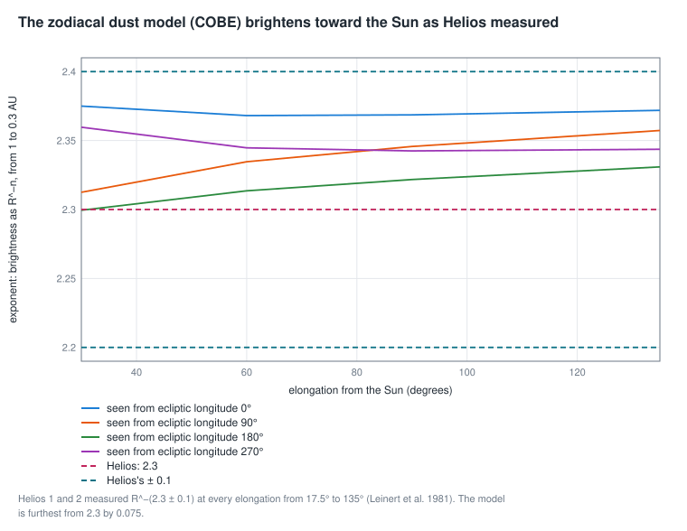

### Sunlight at 1 AU against NASA SORCE's measurement

`sunlight`, from [`sunlight_at_earth_is_1361_watts_per_square_meter`](../../crates/worldline-data/tests/validation_sun_reach.rs).

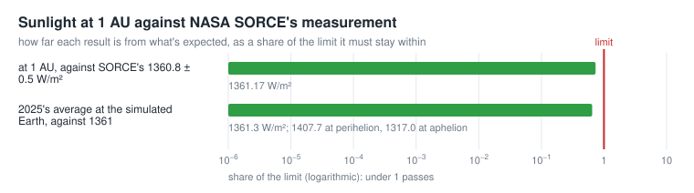

### Light travel time, Sun to Earth

`light-travel-time`, from [`light_takes_8_3_minutes_to_reach_earth`](../../crates/worldline-data/tests/validation_sun_reach.rs).

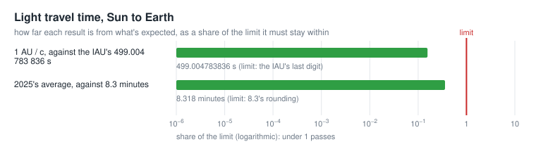

### The Parker spiral against a year of solar wind measured at Earth (NASA OMNI)

`parker-spiral`, from [`the_parker_spiral_matches_the_magnetic_field_measured_at_earth`](../../crates/worldline-data/tests/validation_sun_reach.rs).

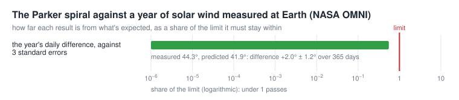

### The Voyagers' heliosphere crossings: JPL's positions against the published distances

`voyager-crossings`, from [`voyager_positions_match_the_published_crossings`](../../crates/worldline-data/tests/validation_sun_reach.rs).

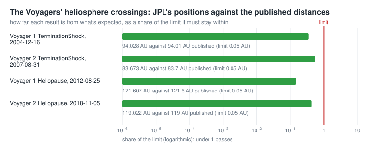

### Earth's magnetopause from pressure balance with the solar wind

`earth-magnetopause`, from [`earths_magnetopause_sits_about_10_earth_radii_sunward`](../../crates/worldline-data/tests/validation_magnetospheres.rs).

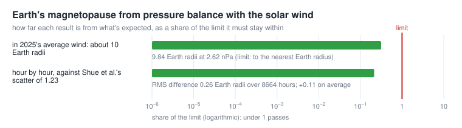

### Earth's magnetopause through 2025: pressure balance against Shue et al.'s fit to spacecraft crossings

`magnetopause-2025`, from [`earths_magnetopause_sits_about_10_earth_radii_sunward`](../../crates/worldline-data/tests/validation_magnetospheres.rs).

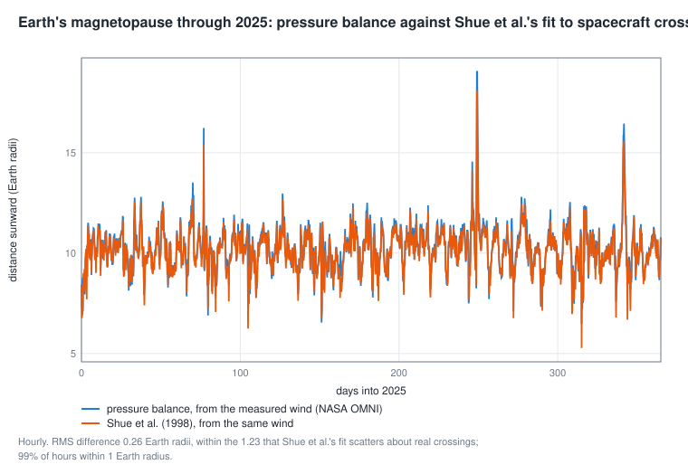

### A Jupiter-mass planet dropped at 1.5 AU: the solar system over 10 years

`jupiter-intruder`, from [`a_jupiter_mass_planet_disturbs_the_inner_orbits`](../../crates/worldline-data/tests/validation_sandbox.rs).

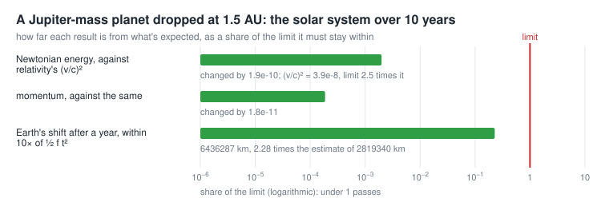

### Save and load: lossless

`save-and-load`, from [`a_save_loads_back_exactly_and_runs_the_same_every_time`](../../crates/worldline-app/src/simulation.rs).

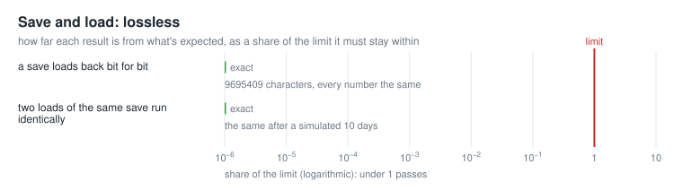

### Two planets collide and merge (Newtonian gravity)

`two-planets-merge`, from [`two_planets_collide_merge_and_keep_their_momentum`](../../crates/worldline-core/tests/validation_collisions.rs).

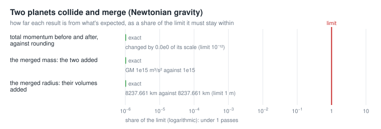

### A comet falling into the Sun from 1 AU at 50 km/s is caught at the surface

`comet-into-the-sun`, from [`a_comet_falling_into_the_sun_is_absorbed_at_the_surface`](../../crates/worldline-core/tests/validation_collisions.rs).

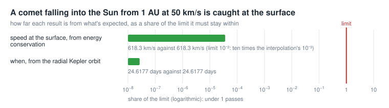

### A Jupiter-mass body hits Mars in the real solar system, with relativistic gravity

`intruder-hits-mars`, from [`an_intruder_that_hits_mars_merges_and_keeps_the_momentum`](../../crates/worldline-data/tests/validation_sandbox.rs).

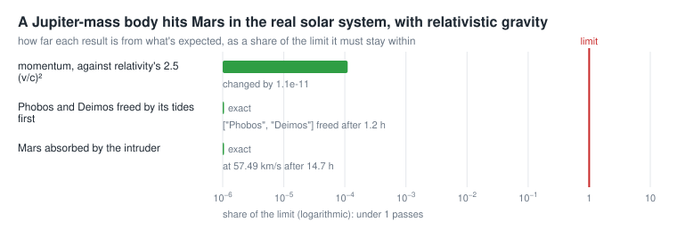

### The roadmap's notable objects load with exactly their published masses

`notable-masses`, from [`the_roadmap_objects_load_with_their_published_masses`](../../crates/worldline-data/tests/validation_notable_objects.rs).

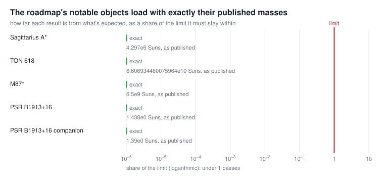

### Sirius B's gravitational redshift from its mass and radius, against Hubble's measurement

`sirius-b-redshift`, from [`sirius_b_reddens_its_light_as_hubble_measured`](../../crates/worldline-data/tests/validation_notable_objects.rs).

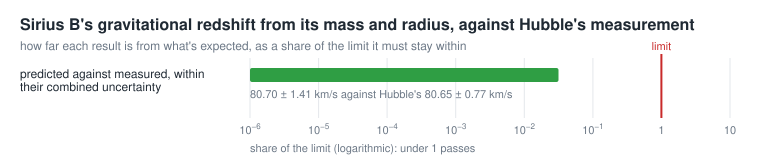

### Black holes' sizes on the sky, θg = GM/Dc², against the Event Horizon Telescope's images

`black-hole-sizes`, from [`the_black_holes_look_as_big_as_the_event_horizon_telescope_saw`](../../crates/worldline-data/tests/validation_notable_objects.rs).

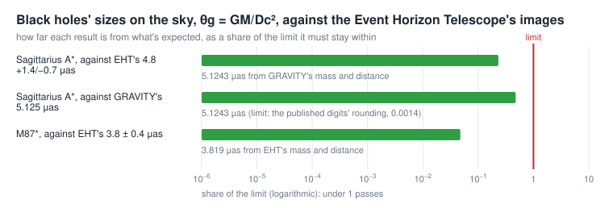

### The Hulse–Taylor pulsar's orbit turning, simulated with relativistic gravity

`hulse-taylor-turning`, from [`the_hulse_taylor_orbit_turns_as_measured`](../../crates/worldline-data/tests/validation_notable_objects.rs).

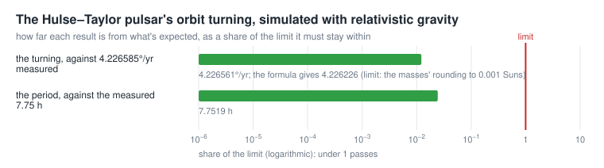

### The Hulse–Taylor pulsar's orbit shrinking from gravitational waves, simulated over 1000 orbits

`hulse-taylor-shrinking`, from [`the_hulse_taylor_orbit_shrinks_as_measured`](../../crates/worldline-data/tests/validation_gravitational_waves.rs).

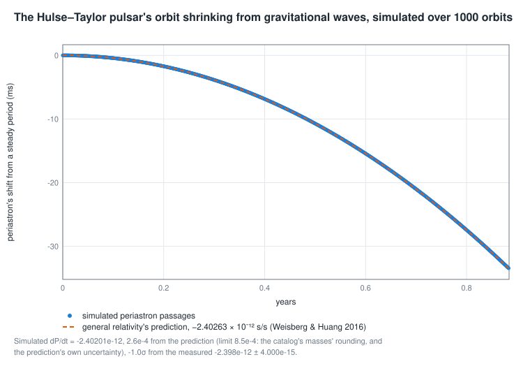

### A pair's energy loss against Einstein's quadrupole formula and its first correction

`quadrupole-energy-loss`, from [`radiation_carries_off_the_waves_power`](../../crates/worldline-core/src/gravity/post_newtonian.rs).

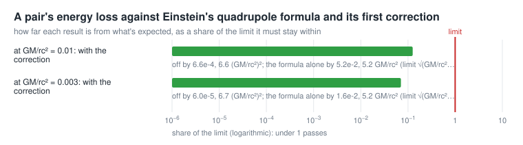

### GW150914 replayed: the final black hole against LIGO and Virgo's measurements (90% credible)

`gw150914`, from [`a_gw150914_replay_leaves_the_hole_ligo_measured`](../../crates/worldline-data/tests/validation_gw150914.rs).

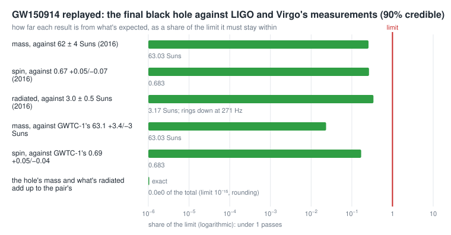

### Two neutron stars' chirp: how fast the wave's frequency sweeps up, 20 to 40 Hz

`chirp-sweep`, from [`the_chirp_sweeps_up_as_theory_says`](../../crates/worldline-core/tests/validation_chirp.rs).

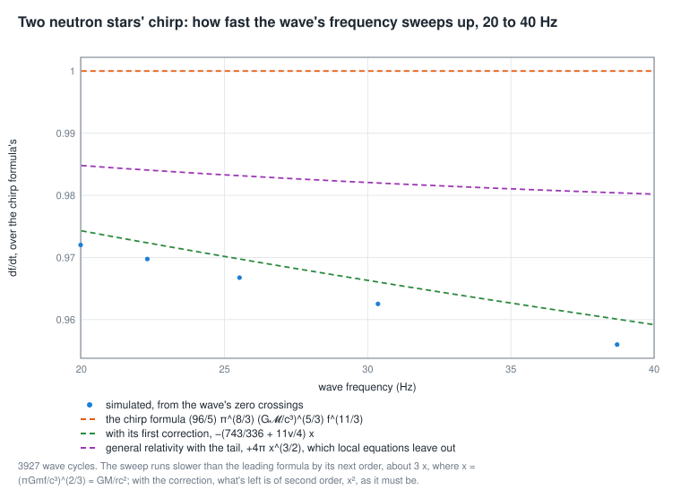

### Spacecraft maps placed right: IAU Gazetteer landmarks on the right terrain

`map-landmarks`, from [`landmarks_land_on_the_right_terrain`](../../crates/worldline-app/tests/validation_maps.rs).

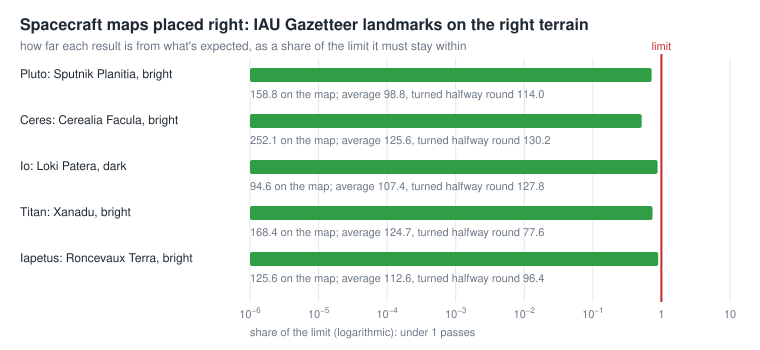

### Pluto and Charon face each other at longitude 0°: rotation models and JPL's positions

`pluto-charon`, from [`pluto_and_charon_face_each_other_at_longitude_zero`](../../crates/worldline-app/tests/validation_maps.rs).

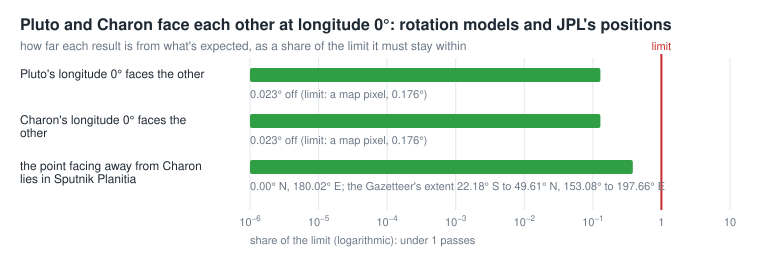

### A black hole of 10 Suns falls into the Sun and takes its place

`black-hole-into-the-sun`, from [`a_black_hole_that_hits_the_sun_takes_its_place`](../../crates/worldline-core/tests/validation_collisions.rs).

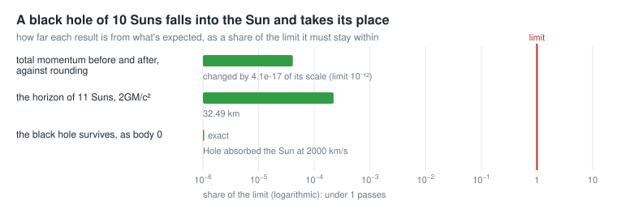

### The belts as live particles against NASA JPL after a year (24 sample bodies)

`live-belts-vs-jpl`, from [`the_live_belts_follow_jpl_where_fixed_ellipses_drift`](../../crates/worldline-data/tests/validation_belts.rs).

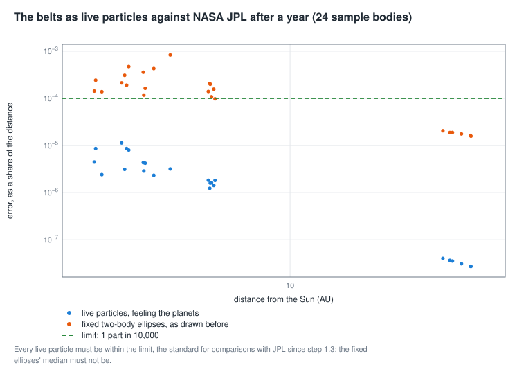

### A black hole of 10 Suns streaks past the asteroid belt at 0.1c: each asteroid's kick

`black-hole-flyby`, from [`a_black_hole_flyby_kicks_the_asteroids_as_the_impulse_approximation_says`](../../crates/worldline-core/tests/validation_swarm.rs).

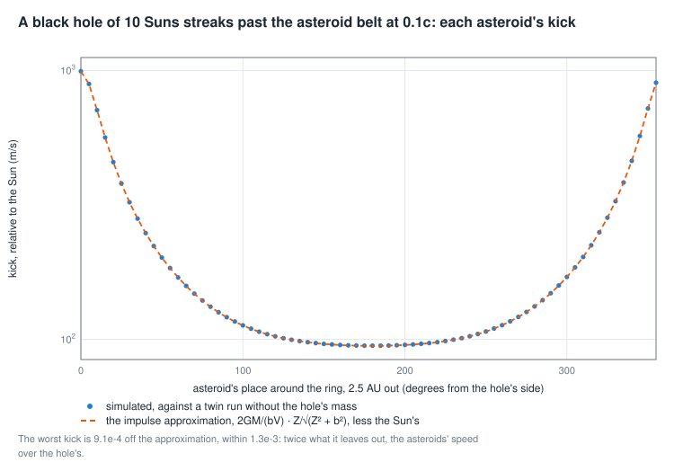

### The star S2 around Sagittarius A*: its orbit's relativistic turning, over ten orbits

`s2-turning`, from [`s2_circles_sagittarius_a_star_and_turns_as_gravity_measured`](../../crates/worldline-data/tests/validation_galactic_center.rs).

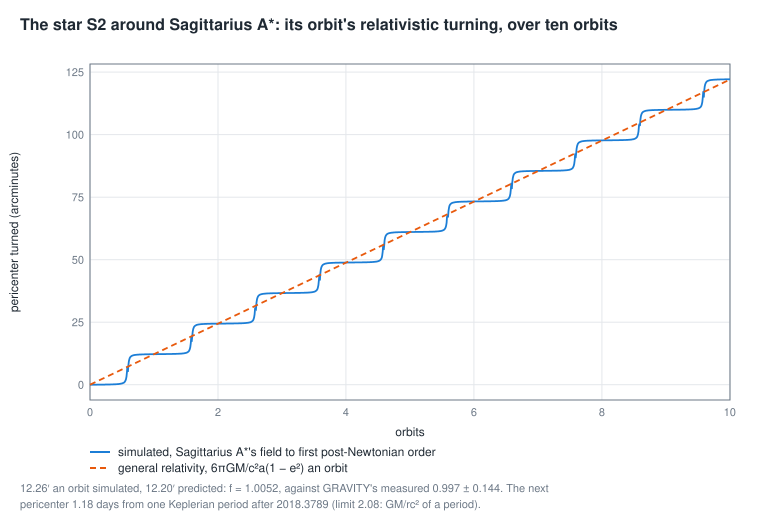

### Sagittarius A*'s direction in galactic coordinates, against SIMBAD's

`sagittarius-a-star-direction`, from [`sagittarius_a_star_is_where_it_is_on_the_sky`](../../crates/worldline-data/tests/validation_galactic_center.rs).

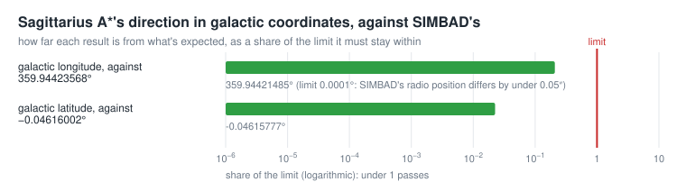

### The Milky Way's mass model (McMillan 2017), solved as his code solves it

`milky-way-model`, from [`the_model_is_mcmillans`](../../crates/worldline-core/tests/validation_milky_way.rs).

### The Milky Way's rotation curve, from McMillan's (2017) mass model

`milky-way-rotation-curve`, from [`the_model_is_mcmillans`](../../crates/worldline-core/tests/validation_milky_way.rs).

### Light grazing the Sun is bent by 1.75″

`sun-light-bending`, from [`light_grazing_the_sun_is_bent_by_1_75_arcseconds`](../../crates/worldline-core/tests/validation_lensing.rs).

### The innermost stable orbit of a black hole, from orbits in its exact (Kerr) spacetime

`kerr-isco`, from [`the_innermost_stable_orbit_is_where_theory_puts_it`](../../crates/worldline-core/tests/validation_kerr.rs).

### Sagittarius A* spirals into TON 618 (1 : 15,000), in TON 618's exact spacetime

`emri`, from [`sagittarius_a_star_spirals_into_ton_618`](../../crates/worldline-data/tests/validation_emri.rs).

### The shadow of a non-spinning black hole, by tracing rays: its edge against Synge's angle

`black-hole-shadow`, from [`the_shadow_is_root_27_and_its_edge_where_synge_puts_it`](../../crates/worldline-core/tests/validation_lensing.rs).

### Light bent by a black hole: rays traced through its spacetime against Darwin's exact angle

`light-bending`, from [`rays_bend_as_darwins_integral_says`](../../crates/worldline-core/tests/validation_lensing.rs).

### The table of bending the GPU reads: how far it moves the sky, against a tenth of a pixel

`bending-table`, from [`the_table_the_gpu_reads_places_the_sky_within_a_tenth_of_a_pixel`](../../crates/worldline-core/tests/validation_lensing.rs).

### Jupiter as a fluid of about 1,000 SPH particles (an n = 1 polytrope), left alone

`sph-equilibrium`, from [`a_planet_left_alone_stays_in_equilibrium`](../../crates/worldline-core/tests/validation_sph.rs).

### SPH converges on Lane–Emden's structure: four times the particles

`sph-convergence`, from [`with_more_particles_it_comes_closer_to_lane_and_emdens_structure`](../../crates/worldline-core/tests/validation_sph.rs).

### The fluid on the GPU, in single precision: densities and forces against the CPU's

`gpu-fluid-forces`, from [`the_gpus_densities_and_forces_are_the_cores`](../../crates/worldline-render/tests/validation_fluid_gpu.rs).

### Jupiter as a fluid on the GPU, left alone for ten dynamical times

`gpu-fluid-equilibrium`, from [`left_alone_on_the_gpu_a_planet_stays_in_equilibrium`](../../crates/worldline-render/tests/validation_fluid_gpu.rs).

### Now: caught up to the computer's clock, the simulation's time read back in UTC

`now`, from [`caught_up_its_clock_reads_the_computers`](../../crates/worldline-app/src/simulation.rs).

### Today's planets: the app's simulation from 1 January 2025 to 28 October 2026, against JPL

`planets-today`, from [`the_planets_today_are_where_jpl_puts_them`](../../crates/worldline-app/src/simulation.rs).

### Earth turned by the IERS's UT1: where the Sun is overhead, against JPL Horizons

`sun-overhead-ut1`, from [`the_sun_is_overhead_where_jpl_puts_it`](../../crates/worldline-data/tests/validation_time.rs).

### Every solar and lunar eclipse of 2026–2030, found in the app's own simulation

`eclipses-2026-2030`, from [`every_eclipse_of_2026_to_2030_at_nasas_time`](../../crates/worldline-app/src/simulation.rs).

### The total solar eclipse of 12 August 2026: the central line against NASA's path, every 2 minutes

`eclipse-path-2026`, from [`the_august_2026_eclipse_path_is_nasas`](../../crates/worldline-app/src/simulation.rs).

### Every rise and set of the Sun and Moon in 2026, against the U.S. Naval Observatory's tables

`rise-and-set`, from [`the_sun_and_moon_rise_when_the_naval_observatory_says`](../../crates/worldline-app/src/simulation.rs).

### The Sun, Moon and planets' altitude and azimuth from two cities in 2026, against JPL Horizons

`sky-from-a-city`, from [`the_sky_from_a_city_is_jpls`](../../crates/worldline-app/src/simulation.rs).

### Leinhardt & Stewart's (2012) worked example, from their scaling laws

`leinhardt-stewart-example`, from [`the_papers_worked_example`](../../crates/worldline-data/tests/validation_collision_outcomes.rs).

### Leinhardt & Stewart's Table 1: everything they work out from each simulation, to its printed digits

`leinhardt-stewart-table-1`, from [`table_1s_derived_columns`](../../crates/worldline-data/tests/validation_collision_outcomes.rs).

### The catastrophic disruption threshold, from nothing but the bodies, against Leinhardt & Stewart's fits

`disruption-threshold`, from [`the_catastrophic_disruption_threshold`](../../crates/worldline-data/tests/validation_collision_outcomes.rs).

### The largest remnant of each of Leinhardt & Stewart's 189 simulations, from their scaling laws alone

`largest-remnants`, from [`the_largest_remnants_of_every_simulation`](../../crates/worldline-data/tests/validation_collision_outcomes.rs).

### What a collision throws off: mass, momentum and energy before and after, in five regimes

`debris-accounts`, from [`a_collision_keeps_its_mass_momentum_and_energy`](../../crates/worldline-core/tests/validation_collisions.rs).

### The Moon-forming impact, planets of rock and iron in SPH: the disk it leaves

`giant-impact`, from [`the_canonical_impact_leaves_the_disk_canup_found`](../../crates/worldline-core/tests/validation_giant_impact.rs).

### Meteor Crater, dug by Holsapple's scaling laws from its estimated impactor

`meteor-crater`, from [`meteor_crater_from_its_estimated_impactor`](../../crates/worldline-core/tests/validation_craters.rs).

### Chicxulub, dug by Holsapple's scaling laws from its estimated impactor

`chicxulub`, from [`chicxulub_from_its_estimated_impactor`](../../crates/worldline-core/tests/validation_craters.rs).

### α Centauri A and B circle each other with their measured period, as full bodies

`alpha-centauri-period`, from [`alpha_centauri_a_and_b_go_round_in_their_measured_period`](../../crates/worldline-data/tests/validation_neighbors.rs).

### Barnard's Star crosses the sky at its measured rate, speeding up as it approaches

`barnards-star`, from [`barnards_star_crosses_the_sky_at_its_measured_rate`](../../crates/worldline-data/tests/validation_neighbors.rs).

### The galaxy's 30,000 stars, left alone, keep McMillan's (2017) density

`galaxy-swarm-density`, from [`left_alone_the_swarm_keeps_the_models_density`](../../crates/worldline-data/tests/validation_galaxy_stars.rs).

### A million-Sun black hole falls through the galaxy's swarm at 1,000 km/s: each star's kick

`galaxy-swarm-flyby`, from [`a_black_hole_passing_through_scatters_it_as_the_impulse_approximation_predicts`](../../crates/worldline-core/tests/validation_galaxy_stars.rs).

### Gaia's stars within 50 pc, placed in the galaxy and measured back as Gaia measured them

`gaia-placed`, from [`each_is_where_gaia_measured_it`](../../crates/worldline-data/tests/validation_gaia_nearby_stars.rs).

### Gaia's neighbors move on average as the Sun's motion against them says (Schönrich et al. 2010)

`gaia-motions`, from [`they_move_as_the_suns_motion_against_its_neighbors_says`](../../crates/worldline-data/tests/validation_gaia_nearby_stars.rs).

### Clusters, nebulae and satellite galaxies placed in the galaxy and measured back as published

`deep-sky-placed`, from [`each_is_at_its_published_distance_and_place`](../../crates/worldline-data/tests/validation_clusters_and_galaxies.rs).

### Clusters, nebulae and satellite galaxies: galactic coordinates as their catalogues print them

`deep-sky-galactic`, from [`their_galactic_coordinates_are_the_catalogues`](../../crates/worldline-data/tests/validation_clusters_and_galaxies.rs).

### The galaxy's swarm drawn on the GPU, seen from 200 kpc above: the disk thins out with the model's scale length

`galaxy-glow`, from [`from_above_the_drawn_disk_thins_out_with_the_models_scale_length`](../../crates/worldline-render/tests/validation_glow_gpu.rs).

### The scenario library: every scenario loads and plays from the menu

`scenarios-load`, from [`every_scenario_loads_and_plays`](../../crates/worldline-app/src/app/scenarios.rs).

### The Mercury scenario: the inspector's perihelion rate over a century, against general relativity's

`scenario-mercury`, from [`mercurys_perihelion_turns_as_general_relativity_says`](../../crates/worldline-app/src/app/scenarios.rs).

### The scenarios that end in an event, played until it happens

`scenarios-play-out`, from [`the_scenarios_play_out_as_they_say`](../../crates/worldline-app/src/app/scenarios.rs).

### A Jupiter passing a star 1,000 times its mass: the mass it loses, against Faber, Rasio & Willems (2005)

`faber-rasio-willems`, from [`a_planet_passing_a_star_loses_what_faber_rasio_and_willems_found`](../../crates/worldline-render/tests/validation_fluid_gpu.rs).

### Torn right through (β = 2), the planet's debris falls back as t^(−5/3)

`fallback-rate`, from [`torn_right_through_its_debris_falls_back_as_t_to_the_minus_five_thirds`](../../crates/worldline-render/tests/validation_fluid_gpu.rs).

### A planet stays a point until tides would stretch it by 1%, at 5.34 tidal radii

`point-to-fluid`, from [`a_giant_planet_stays_a_point_until_its_tides_reach_one_percent`](../../crates/worldline-app/src/simulation.rs).

### A fluid planet on the GPU stretches by the n = 1 polytrope's Love number, 15/π² − 1

`love-number`, from [`a_fluid_planet_stretches_by_its_love_number`](../../crates/worldline-render/tests/validation_fluid_gpu.rs).

### A clock carried round a circular orbit at 10 GM/c² of a black hole runs slow by √(1 − 3GM/rc²)

`proper-time-orbit`, from [`carried_round_its_orbit_the_clock_keeps_that_rate`](../../crates/worldline-core/tests/validation_proper_time.rs).

### A GPS satellite's clock against one on the equator, as worked out by hand

`gps-clocks`, from [`gps_clocks_run_fast_as_worked_out_by_hand`](../../crates/worldline-core/tests/validation_proper_time.rs).

### Earth's clock against the solar system barycenter's, over ten years

`earths-clock`, from [`earths_clock_runs_slow_against_the_barycenters_by_the_iau_rate`](../../crates/worldline-app/src/simulation.rs).

### The clock overlay's rates, against hand calculations

`overlay-clocks`, from [`clocks_run_slow_as_worked_out_by_hand`](../../crates/worldline-core/tests/validation_overlays.rs).

### The tide overlay's stretch, against hand calculations, 2GM R/d³

`overlay-tides`, from [`tides_stretch_as_worked_out_by_hand`](../../crates/worldline-core/tests/validation_overlays.rs).

### The shape of space around a body, against hand calculations

`overlay-space`, from [`space_around_a_body_is_shaped_as_worked_out_by_hand`](../../crates/worldline-core/tests/validation_overlays.rs).

### The gravitational-wave overlay's numbers, against hand calculations

`overlay-waves`, from [`gravitational_waves_are_as_worked_out_by_hand`](../../crates/worldline-core/tests/validation_overlays.rs).

### The shadow of a spinning black hole: rays traced along its edge, against Bardeen's outline

`kerr-shadow`, from [`a_spinning_holes_shadow_is_bardeens`](../../crates/worldline-core/tests/validation_kerr_light.rs).

### A disk around a spinning black hole, seen nearly edge on: the side coming toward you is brighter

`kerr-disk-doppler`, from [`the_side_coming_toward_you_is_brighter`](../../crates/worldline-core/tests/validation_kerr_light.rs).

### White dwarfs of carbon and oxygen, ever denser: their mass approaches Chandrasekhar's limit from below

`chandrasekhar-limit`, from [`no_white_dwarf_passes_chandrasekhars_limit`](../../crates/worldline-data/tests/validation_white_dwarfs.rs).

### Black holes' lifetimes from Hawking's temperature and a black body, against 5120πG²M³/(ħc⁴)

`hawking-lifetimes`, from [`the_lifetime_follows_from_the_temperature_and_a_black_body`](../../crates/worldline-core/tests/validation_hawking.rs).

### A black hole of 10⁸ kg evaporates in the simulation (Hawking radiation, textbook model)

`hawking-evaporation`, from [`a_mini_black_hole_evaporates_on_schedule_in_the_simulation`](../../crates/worldline-core/tests/validation_hawking.rs).

### The heaviest neutron star the SLy equation of state holds up (general relativity's static stars)

`neutron-star-maximum`, from [`sly_holds_up_at_most_about_2_05_suns`](../../crates/worldline-data/tests/validation_neutron_stars.rs).

### Neutron stars of the SLy equation of state: mass against radius, up to the heaviest

`neutron-star-mass-radius`, from [`sly_holds_up_at_most_about_2_05_suns`](../../crates/worldline-data/tests/validation_neutron_stars.rs).

### Merging neutron stars collapse at once above Bauswein et al.'s (2013) threshold

`prompt-collapse`, from [`merging_neutron_stars_collapse_at_once_above_the_threshold`](../../crates/worldline-data/tests/validation_neutron_stars.rs).

### Sirius B's radius from its measured mass: an ideal cold carbon-oxygen white dwarf

`sirius-b-radius`, from [`sirius_b_is_the_size_theory_gives_its_mass`](../../crates/worldline-data/tests/validation_white_dwarfs.rs).

### Two neutron stars' chirp, 20 to 40 Hz: the checks at five points

`chirp-margins`, from [`the_chirp_sweeps_up_as_theory_says`](../../crates/worldline-core/tests/validation_chirp.rs).

### The Hulse–Taylor pulsar's orbit shrinking: the checks

`hulse-taylor-shrinking-margins`, from [`the_hulse_taylor_orbit_shrinks_as_measured`](../../crates/worldline-data/tests/validation_gravitational_waves.rs).

### Mercury's perihelion: the fitted rates against what's expected

`mercury-perihelion-margins`, from [`mercury_perihelion_precesses_43_arcseconds_per_century`](../../crates/worldline-core/tests/validation_mercury.rs).

